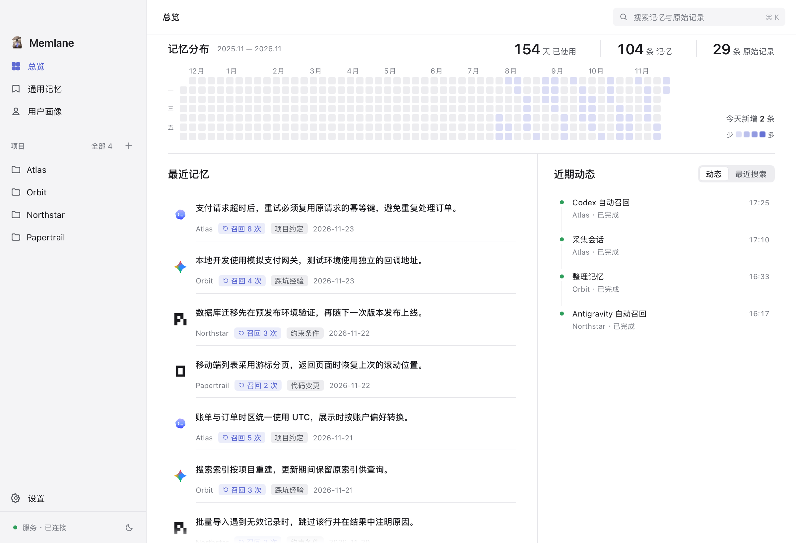
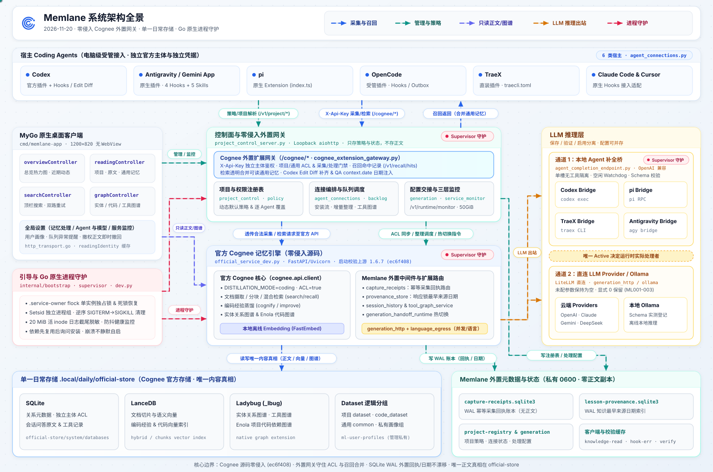

<div align="center">


# Memlane

**Switch agents. Keep going.**

A local-first memory client for macOS that lets your coding agents share project memory — with every memory traceable back to the original conversation.

[](https://github.com/zwhu/memlane/releases)
[](#installation)
[](LICENSE)

[简体中文](README.md) · English

</div>

<picture>
  <source media="(prefers-color-scheme: dark)" srcset="web/website/demo-overview-dark.png">
  
</picture>

> [!NOTE]
> The Memlane UI is currently available in Simplified Chinese only.

## Why Memlane

You debug an issue with Codex today and continue the change with Antigravity tomorrow. Each agent keeps its own context, so every switch means re-explaining project conventions, past pitfalls, and why things were done a certain way.

Memlane keeps that project knowledge on your own Mac, lets every connected agent recall it when needed, and gives you a native app to browse, search, and manage it.

## Features

- **Shared memory across agents** — a convention confirmed in one agent can be recalled by another.
- **Traceable provenance** — every memory keeps its key points and source date, and links back to the original Q&A and tool calls.
- **Distill with the agents you already pay for** — reuse the model of a locally signed-in agent (its coding plan or subscription) to distill memories, with no extra API key; direct LLM providers and local Ollama are also supported.
- **Local-first** — the memory store, vectors, and graph live on your machine; the embedding model (`bge-small-zh-v1.5`) runs fully offline.
- **Per-project authorization** — connecting an agent to your Mac does not grant project access; each project is authorized separately, and general memory and user profiles are stored independently.
- **Native macOS app** — overview, project memory, general memory, user profiles, raw records, knowledge graph, and global `⌘K` search, in both light and dark appearance.

## Supported agents

| Agent | Status |
| --- | --- |
| Codex | ✅ Supported |
| Antigravity (Gemini App) | ✅ Supported (task / CodeMode sessions) |
| pi | ✅ Supported |
| TraeX | ✅ Supported |
| Claude Code, Cursor, OpenCode | 🚧 Planned |

## Installation

**Requirements:** Apple Silicon (M1 or later), macOS 26 or later, and about 4–6 GiB of free disk space for first-time setup.

1. Download the latest `.dmg` from [GitHub Releases](https://github.com/zwhu/memlane/releases) and drag Memlane into Applications.
2. Beta builds are ad-hoc signed and not yet notarized, so macOS blocks the first launch. Open **System Settings → Privacy & Security** and click **Open Anyway**.
3. Follow the first-run setup to prepare the runtime (China mirrors or official sources; every download is verified against a pinned SHA-256), then connect your agents in Settings.

See the [beta installation guide](docs/product/beta-install-guide.md) (Chinese) for full steps, known limitations, and uninstallation.

## How it works



- **Native desktop app** — a macOS client built with [MyGo](https://github.com/egoist/mygo); it reads data only through local loopback APIs and keeps no copy of memory content.
- **Access gateway** — manages project registration, agent connections, and capture/distillation queues, and enforces project ACLs and recall merging in an external gateway.
- **Memory engine** — a pinned, unmodified release of [Cognee](https://github.com/topoteretes/cognee) (`1.6.7`). All Memlane extensions live in the external gateway, external stores, and plugin layer, so upstream can be upgraded as-is.

See the [architecture overview](docs/architecture/overview.md) (Chinese) for details.

## Privacy

- Memory content, vectors, and graphs are stored locally. Memlane has no cloud service and uploads nothing to its own servers.
- When distilling memories, relevant conversation content is sent to **the model you choose**: a local agent's model bridge, an LLM provider you configure, or local Ollama.
- First-time setup downloads dependencies from mirrors or official sources; **Check for Updates** only contacts GitHub Releases.

## Building from source

Development requires the managed Python 3.12 (prepared by `scripts/dev.py prepare`) and the Go toolchain wrapper shipped in this repo:

```sh
# Start background services and the desktop window (runtime.json is your private local config)
.local/cognee-python/bin/python scripts/dev.py start --config /path/to/runtime.json

# Tests and static checks
sh scripts/go.sh test ./...
python3 scripts/task.py -- python3 scripts/lint.py
```

See the [development guide](docs/architecture/development.md) (Chinese) for setup, runtime configuration, operations, and testing. Run `sh scripts/install-hooks.sh` before your first commit to enable the repository hooks; collaboration rules are in the [engineering workflow](docs/engineering/workflow.md).

## Project status

Memlane is in **public beta** (`v0.1.0-beta`); features and data formats may still change. See the [roadmap](docs/product/roadmap.md) for what's next, and report problems via [Issues](https://github.com/zwhu/memlane/issues).

## Documentation

Most documentation is currently written in Chinese. Start from the [documentation index](docs/README.md); domain terms are defined in [CONTEXT.md](CONTEXT.md).

## License

Memlane is licensed under the [Apache License 2.0](LICENSE); see [NOTICE](NOTICE) for attribution. Licenses for third-party components and models, including Cognee (Apache-2.0), are listed in [THIRD_PARTY_LICENSES.md](THIRD_PARTY_LICENSES.md).
