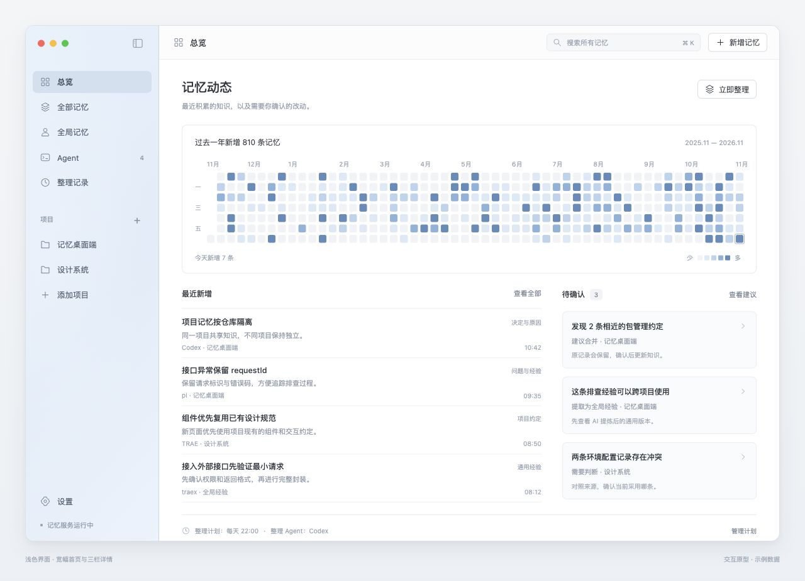

# Memlane

一个面向程序员的 macOS 记忆客户端，让多个编码 Agent 共用项目知识，减少重复交代背景。

名字取自 **memory lane**。使用 Cognee 作为记忆引擎，把好看、简单使用和方便管理作为产品重点。这是一个个人 side project，当前处于产品与设计确认后的工程初始化阶段。

## 产品方向

- 项目记忆与全局经验：多个 Agent 在同一仓库下共享知识，按范围检索。
- 手动新增与编辑：保留来源、修改记录和单条版本恢复。
- 手动与定期整理：自动提炼和归类，合并、覆盖、删除等建议经用户确认后生效。
- 全局总览：每日新增记忆热力图、最近新增、待确认建议。
- 项目代码图谱：手动启用，后续自动更新。
- 本地运行：管理记忆服务及其后台生命周期。

首批目标 Agent 为 **Codex、pi、TRAE、traex**，尚未完成接入验证。记忆数据保存在本地；使用云端模型的 Agent 处理内容时，相关输入仍会交给该模型服务。

## 当前材料

- [产品定义与信息架构](docs/product.md)
- [设计决策与界面](docs/design.md)
- [选定的可交互原型](https://github.com/zwhu/memlane/tree/prototype/selected-ui/prototypes/selected-ui) — 保存在 `prototype/selected-ui` 分支，使用内存中的示例数据。



首页采用侧边栏加宽幅总览，记忆等详情页面采用三栏。新增、编辑、历史与建议确认在栏内完成。

## 开发起点

`main` 目前只保存产品与设计材料，没有可运行的桌面应用。桌面框架、Cognee 的打包方式和 Agent 适配接口将在技术方案阶段确定，原型的 HTML/CSS 不代表最终技术选型。

首个实现目标：一个 Agent 在项目内写入经验，另一个 Agent 能在同一项目检索到，并可在客户端查看来源。随后接入编辑历史与受控整理。

查看交互原型：

```sh
git switch prototype/selected-ui
python3 -I prototypes/selected-ui/serve.py
```

打开终端打印的本机地址。原型不连接真实 Agent 或 Cognee，刷新后恢复示例数据。查看完成后可用 `git switch main` 回到主分支。
