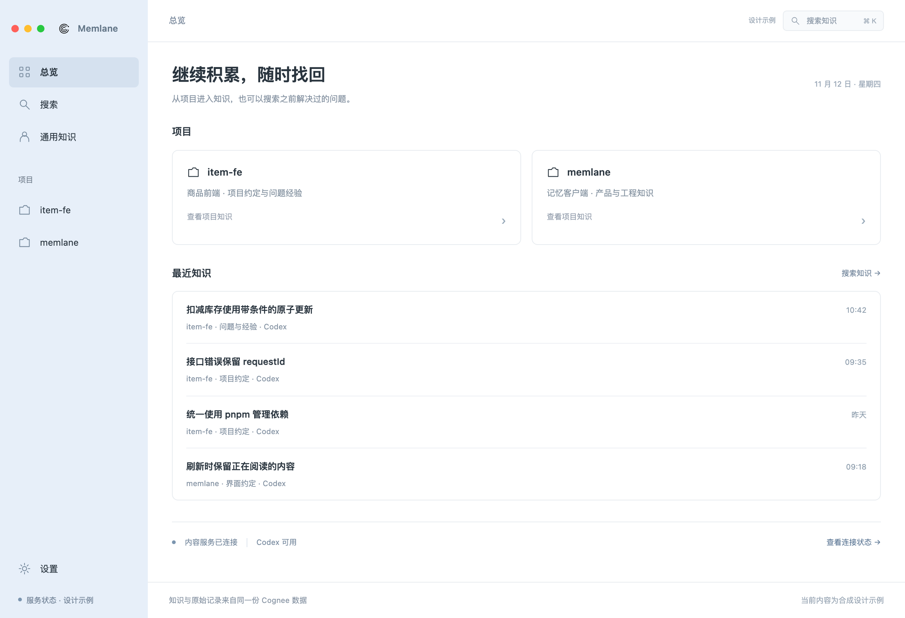

# Memlane

面向程序员的 macOS 记忆客户端，让编码 Agent 共用项目知识，减少重复交代背景。

Memlane 使用 Cognee 作为唯一记忆引擎，提供独立、美观的桌面阅读界面。当前方案保留 Codex 订阅推理和开发启动器，首版专注知识、原始记录、搜索、出处与官方图谱。

## 当前方案与设计

- [详细规格](docs/client-simplification-spec-20261112.md)
- [最小技术方案](docs/client-simplification-technical-plan-20261112.md)
- [设计目录](docs/ui-redesign/design-catalog.md)
- [界面交接](docs/ui-redesign/full-design-handoff.md)
- [产品定义](docs/product.md)
- [视觉与交互规则](docs/design.md)

首页保持宽幅，知识和原始记录采用三栏。当前原型已经删除退出范围的操作、页面和状态，全部使用合成设计示例，不连接实际服务。

本机交互入口：`build/p3-prototype/prototypes/client-simplification-20261112/index.html`。直接用浏览器打开即可，不必切换分支或安装依赖。

## 实施边界

当前完成的是规格、技术方案和界面范围清理；尚未据此改造生产实现、接管日常服务或删除运行数据。实现以本轮精简方案为准，不从旧功能数量或历史通过记录扩大范围。

开发期不打完整运行包。日常后台由开发启动器管理，关窗保持服务，重启电脑后手动启动；正式安装及系统服务进入 release 阶段。

开发入口与命令见[开发说明](docs/development.md)，工程与失败规则见[工程规范](docs/engineering/workflow.md)。历史实施和验收记录保留原有事实，不作为本轮功能清单；当前设计清理范围见[清理记录](docs/ui-redesign/design-cleanup-20261112.md)。
