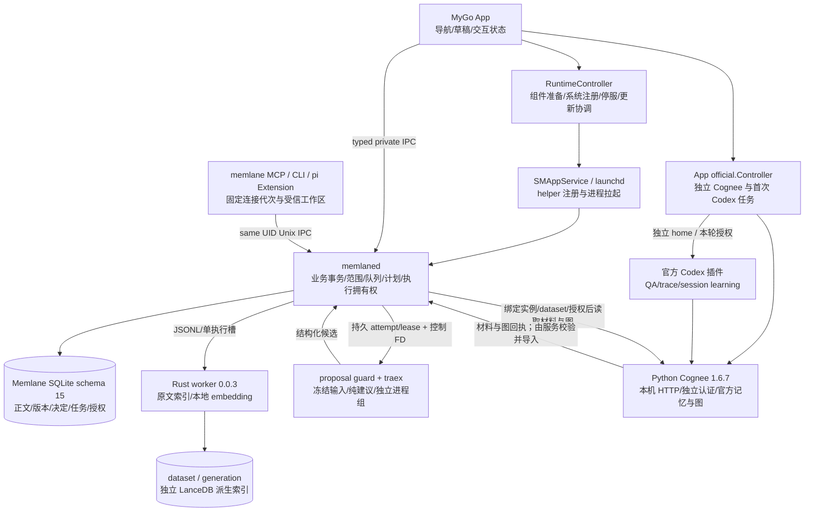

# Memlane 独立架构验收

本快照的业务数据与审核边界有清晰实现基础，但**不能通过完整本机架构验收**：主动停服依赖回执送达、Rust worker 长驻请求预算耗尽是本轮已复现的阻塞；helper 本体无限重拉是源码确认的恢复风险，尚待本轮 launchd 故障实证，不与两项已复现阻塞混同。正式分发另有独立门槛，不能用本机包、历史完整链路或签名完整性检查代替。

## 验收对象与证据规则

- 角色：按 `docs/agent-prompts/architect.md` 检查系统契约、状态所有权、跨进程生命周期及失败恢复，并非仅审查当前 diff。
- 固定源码：`/Users/bytedance/work/AI/memlane/build/acceptance/2026-11-09-001/source`。下文源码路径和行号均相对于此目录。
- 基线：HEAD `99246f43e1ae7ab7c1adf3ac9e5a859dd80cfcb1` 加工作区快照，捕获于 `2026-11-08T17:06:28.047855+00:00`；内容清单为 [baseline.json](../../../build/acceptance/2026-11-09-001/baseline.json)。不能将 HEAD 单独当成完整被验代码。
- 已阅读快照 `AGENTS.md`、产品/设计/技术方案、组织审核/计划/恢复/Agent/首次使用/备份等关键契约。代码图谱已明确首版隐藏；本报告不追加其可见流程或完整代码图谱要求。
- 本角色只启动三个自己拥有的独立 daemon 进程验证停服断线；未启动 UI、未注册 LaunchAgent、未改个人配置、未操作共享服务。Rust 请求上限、真实 daemon+Rust 超限与停服断线实验由管理者独立执行，本角色读取其原始 JSON 技术证据。没有阅读其他角色的验收报告。
- 证据分三层：**源码事实**说明实现支持什么；**本轮实证**只说明实际执行过的边界；**历史证据**只说明其固定包/根曾经通过或失败。未运行的完整快照链路全部保留“未验证”。

## 当前所有权与调用链



这里有两套记忆引擎路径。Memlane 正文、用户编辑与 Rust 检索由 `memlaned` 管理；官方新会话 recall 读取独立 Python Cognee，官方材料经批准导入 Memlane。App 编辑不自动写回 Cognee。这是 `docs/onboarding-memory-contract.md` 明确的当前边界，不应画成所有 Agent 都直接读取同一份当前版本，也不在本次强行补双向同步。

| 状态 | 权威所有者 | 关键实现与边界 |
| --- | --- | --- |
| 正文、当前版本、不可变历史、建议决定、活动 | `store`，运行期由唯一 `memlaned` 持有 | `daemon/server.go:77` 服务根锁；`store/store.go:48` 数据库 owner 锁；`store/store.go:179`/`:203` 事务入口。数据库不直接交给日常 Agent |
| 当前可检索映射 | SQLite `index_bindings` 与当前 revision/generation | Rust 只产生候选；最终有效性由 `store/store.go:426` Resolve 决定 |
| 组件是否完整 | 已验证签名清单、不可变版本目录 | `components/manager.go:237` 签名、`:278` 协议/平台、`:344` 文件验证、`:524` 跨进程锁、`:550` staging 发布 |
| 服务主动停止意图 | `service-state.json`；daemon 或取得停止边界后的 RuntimeController 写入 | `serviceipc/types.go:145`；停止意图与实际进程状态必须同时成立，ARCH-01 暴露二者分离 |
| worker 可用性 | daemon 的运行 worker 引用与实际响应 | 当前 `health` 仍依赖缓存状态，ARCH-03 表明“进程活着”不足以代表可用 |
| 整理执行与收费恢复 | daemon 执行槽、SQLite task/attempt/lease/plan generation | `daemon/organization.go:176` 生命周期归服务；`daemon/organization_leases.go:17` 续租；`store/organization_recovery.go:136` 事务消费恢复 |
| Agent 授权 | SQLite connection ID/generation/批准范围 + 受信工作区 | `store/connections.go:149`；MCP 参数不能自报任意工作区，`agentbridge/bridge.go:19` 固定启动配置 |
| 官方 Cognee 数据与后台处理 | 独立 Python Cognee 服务 | `official/runtime.go:276` 由 App 启动 Setsid 进程，独立根/数据库与凭据；不是 `memlaned` 的 Rust worker |
| 官方首次 Codex 执行与临时登录文件 | 当前 App 内 `official.Controller.tasks` | `official/agent.go:298` 内存任务表与 `:311` 临时 auth；生命周期不具备整理 runner 相同的持久拥有权证明，见 ARCH-05 |
| 全库恢复 | 离线 RestoreManager + 两层 owner 锁 | `desktop/backup_restore.go:19` 先停服；`store/restore.go:23` 只变换私有内存副本；正常 App 不直接开生产 SQL |

## 关键不变量抽查结果

“源码支持”不是整套系统已在本轮运行通过。

| 不变量 | 抽查结论 | 源码锚点 |
| --- | --- | --- |
| 同一业务库只有一个活跃拥有者；启动恢复早于监听 | 源码支持。根锁与 DB 锁独立；未来 schema 拒绝；未完成恢复在开 SQL 前处理 | `daemon/server.go:70–168`、`store/store.go:41–153` |
| 版本/活动/待索引任务原子提交；编辑和恢复产生新版本 | 源码支持。`expected_revision` 防覆盖，恢复读旧正文后递增 revision，清除当前索引绑定 | `store/store.go:203–327` |
| 索引结果与正文不做跨库事务；旧候选不能冒充当前知识 | 源码支持。索引完成再次核对当前 revision；搜索校验完整 chunk/revision/generation/dataset，失败不补旧文 | `memory/service.go:23–101`、`store/store.go:354–449` |
| 项目隔离在引擎和业务出口都成立 | 源码支持显式 UUID dataset 目录，不能传空范围查询全部；当前项目与全局由服务授权计算 | `engine/rust/backend.rs:88–102`、`memory/service.go:56`、`store/connections.go:149` |
| AI 覆盖/合并/删除/移动先审核，确认时重验来源与目标 | 源码支持。自动循环跳过 RequiresReview；审核短事务重验、应用、决定/回执一次提交；来源过期只使未确认项失效 | `daemon/organization.go:28`、`store/organization_review.go:35–126`、`daemon/server.go:475` |
| 自动摘要不是独立证据；全局条目不泄漏未授权项目原文 | 源码有冻结来源、derived stale 与出口过滤；Agent get 拒绝 stale，status 保留诊断 | `store/organization_sources.go`、`store/experience.go:14`、`daemon/agents.go:193–220` |
| 开始 IPC 断线不终止持久整理；取消先持久栅栏再杀进程 | 源码支持主整理链路。服务生命周期 context 与短 IPC context 分离；取消持久化后通知 owner | `daemon/organization.go:12–58`、`:176–217` |
| 旧 owner/旧 attempt/过期租约/旧 plan generation 不发布新事实 | 生产编排支持，续租失败取消真实 runner，执行槽在清理后释放；Store 缺租约行的兼容旁路仍需收紧 | `daemon/organization_leases.go:17–50`、`store/organization_leases.go:21–119`；ARCH-07 |
| 主动停服即使回执丢失仍完成；无限故障不会无限重拉 | **未满足** | ARCH-01、ARCH-02 |
| 长驻运行不会因诊断轮询耗尽协议能力；错误不能显示 ready | **未满足** | ARCH-03 |
| Agent 保存幂等且只能新建；重放返回当前版本/原保存事实 | 源码支持连接命名空间的 operation ID、异内容冲突与移出范围拒绝；服务错误不伪装空结果 | `daemon/agents.go:174–199`、`agentbridge/bridge.go:51–84` |
| 备份含已提交 WAL；恢复不复活旧授权或收费任务 | 源码支持。开库迁移前 `VACUUM INTO`；手动 backup/离线恢复分离；恢复退休连接、停计划、失效建议、排重建，并要求重开 App | `store/store.go:89`、`store/backup.go`、`store/restore.go:101`、`desktop/backup_restore.go:122` |
| 主客户端与组件独立版本化，正式更新可恢复 | 组件验证/缓存/受控更新源码具备；同身份 helper 替换与正式分发尚无可接受完成证据 | ARCH-04 |

## 阻塞项

### ARCH-01 — P1：停止操作依赖 IPC 回执送达，断线后服务继续工作

**状态：本角色真实 daemon 已复现 3/3；管理者补充真实 daemon+Rust 组合复现；本机工程阻塞。**

源码 `internal/daemon/server.go:762–786` 已写入 `stopped=true`/stop generation；但实际 `s.stop()` 位于 `:370–372`。其前面的 `:366–368` 若编码/写回执失败直接返回，跳过取消整个服务。`quiesce` 也使用同一顺序。App 的 `internal/desktop/runtime.go:356–357` 在 stop IPC 报错后直接返回，未进入注销系统服务的兜底步骤。

违反的不变量：停止一旦持久接受，其完成不得依赖调用者仍在线；后台计划、worker、服务锁必须在有界时间内收口。持久停止与仍可接收请求同时存在，还会使新 UI 根据 stop 标记显示已停止，而旧 daemon 仍可工作。

复现：向自己新建 daemon 的 Unix socket 发送完整 `stop` JSONL，立即 `shutdown(SHUT_RDWR)` 并关闭，不读回执。三个独立根均得到 `service-state.json.stopped=true`、daemon 仍存活、服务锁仍被持有、随后 `health` 返回 `ok=true`。为只验证控制面，worker 路径故意不存在；本角色此层实验不证明真实 Rust 或收费任务仍在运行。管理者另用相同冻结 helper 加真实 Rust 复现：stop 断线后持久 stopped=true，daemon 和 worker 仍存活，health 仍为 ready；见 [manager-daemon-limit/report.json](../../../build/acceptance/2026-11-09-001/manager-daemon-limit/report.json)。该组合的 worker 已先触发请求上限，因此证明的是实际进程与服务未收口，不宣称仍能成功索引或仍有收费任务执行。

证据：[stop-disconnect-report.json](../../../build/acceptance/2026-11-09-001/architecture/stop-disconnect-report.json)、[有界复现脚本](../../../build/acceptance/2026-11-09-001/architecture/verify-stop-disconnect.py)。使用本轮冻结包 helper，SHA256 `790351e9fa323c0b52204928be817a46b3df152eea4e6c5afa872fb60dcde670`。PID 74258/74262/74274 全部退出 0，IPC 消失、锁释放，`cleanup_ok=true`。

关闭标准：持久停止成功后，无论回执正常、EPIPE、客户端取消或超时，都执行相同的服务取消/等待；回执失败不得撤销停止事实。回归覆盖断线 stop/quiesce、真实活动 worker/runner 回收、停服后重开不自动恢复；失败写 stop 时仍明确返回失败。

### ARCH-03 — P1：Rust worker 第 10,001 个请求后永久拒绝新请求，健康检查仍可能显示 ready

**状态：本轮真实 Rust 0.0.3 与真实 daemon+Rust 组合均已实证；App 呈现为源码推导；本机工程阻塞。**

`engine/rust/worker.rs:80–101` 用进程寿命内 `used_ids` 去重；达到 10,000 后，无论新 ID 与操作类型，统一返回 `duplicate_id`，甚至 `shutdown` 也被拒绝。它没有退出或清空，提示的 reconnect 没有协议实现。`internal/engine/client.go:231–286` 仅把远端错误返回调用者，没有预算协调或此类错误重建 worker；`internal/daemon/server.go:616–626` 忽略 worker health 错误，仍返回启动时缓存的 `status=ready`。`internal/desktop/runtime_availability.go:60–67` 因此仍能判断为 ready。

真实组件实验前 10,000 个唯一 ID health 成功，第 10,001 health、第 10,002 search、第 10,003 shutdown 均返回 duplicate_id，进程仍在；stdin EOF 后正常退出。归档 SHA256 `3c31733c56dde7d8f290154c09e2f5580904eac38a0a7ee694a9c6f87d2e3fa0`。证据为管理者独立执行的 [manager-worker-limit/report.json](../../../build/acceptance/2026-11-09-001/manager-worker-limit/report.json)。0.844 秒是快速协议实验时长，不是五小时连续运行实测。

`cmd/memlane-app/main.go:339–350` 每两秒调用 ObserveAvailability，每次 daemon health 会给 worker 新 ID。持续成功轮询且不重建 worker 时，仅这一入口约 5.56 小时即可耗尽；握手、保存、检索会使其更早到达。管理者进一步用冻结 helper 加真实 Rust 快速执行 10,010 次 health，之后 search 返回 `search unavailable: duplicate_id...`，daemon health 仍返回 `ok=true,state=ready`。组合证据为 [manager-daemon-limit/report.json](../../../build/acceptance/2026-11-09-001/manager-daemon-limit/report.json)。因此 daemon 假 ready 已实证；App 长时间后的实际窗口仍未运行，5.56 小时只是调用频率推算。管理者的 daemon 正常退出 0、IPC 消失、worker 的 ps 结果为空。

关闭标准：实现可持续的请求去重/连接寿命契约，不能将有界集合变为必然服务中断。若选择换代，需要由 owner 在空闲边界重建并保留持久队列，正常轮换不消费故障预算；health 必须传播实际不可用原因。真实 worker 跨越原上限后验证 health、保存索引、当前检索、取消、shutdown，另验 daemon 与 App 不产生假 ready。

### ARCH-04 — P1（正式分发）：同身份 helper 替换和发布链路未闭合

**状态：历史包有明确失败，当前快照未重验；只阻塞升级/正式分发声明，不否定独立身份本机工程实验。**

当前构建 `scripts/build-client.py:36` 固定 ad-hoc，`:69` 显式跳过公证，`:79` 再以 `-` 封装；`mygo.json:11` 同样是 ad-hoc。`:53–58` 仅在显式提供 runtime config 时嵌入组件源/固定本机根和 helper 配置路径。此构建器产物定位为本机验证包，尚不能把无配置的默认构建命令视为干净设备完整安装体验。

历史 [helper-replacement-producer-signature.json](../../../build/p4-delivery/helper-replacement-producer-signature.json) 的 LaunchAgent 在 helper 替换后 `EX_CONFIG 78`，`actual_helper=false`；快照 `docs/p4-helper-replacement-validation.md:7` 记录 `Launch Constraint Violation`，严格 codesign 检查和直接执行通过都没有解除该失败。另起包身份不能证明同身份升级成立。

关闭标准：在真实发布身份下完成旧包→新版 App/helper 同身份替换、旧进程退出、新 helper 注册与 ready、失败回退和保持用户数据/停止意图；补 Developer ID、公证、Gatekeeper、真实更新清单/下载来源、干净 macOS 15+ arm64 安装。需分别报告主包、首次额外下载、最终磁盘用量；受控 localhost 签名源只证明本机机制。

## 未验证的结构边界

### ARCH-02 — P1 待故障实证：helper 本体缺少有限恢复预算

**状态：源码确认风险；实际 launchd 持续失败尚未在本轮复现。未证明有限恢复完整成立，不作为与 ARCH-01/03 同等级的已实证故障。**

`scripts/build-client.py:73–75` 生成 `KeepAlive={SuccessfulExit:false}` 和 `ThrottleInterval=10`；`cmd/memlaned/main.go:29–49` 在配置读取、数据库迁移/恢复、启动等错误时直接退出非零。daemon 的三次/十分钟计数只在 `internal/daemon/server.go:213–307` 的 Rust worker 监督循环内，启动失败尚未进入这一循环。

可复现条件：隔离 LaunchAgent 的配置持续无效、业务库无法打开、未来 schema 或恢复前置检查持续失败。系统会持续尝试拉起 helper，ThrottleInterval 只限频，不是总次数。不能将“worker 有限重试”表述为“整个后台服务有限恢复”。

关闭标准：在数据库打开之前仍可持久、诊断并限制 helper 故障重拉；明确重试可以开启新预算，主动停止不消费/重置为自动运行。用真实打包 LaunchAgent 注入持续启动失败，证明到达上限后不再产生 PID、错误可见、修复后的明确重试恢复。不要把配置错误无限循环或每次迁移失败无限产出备份作为恢复机制。

### ARCH-05 — P2：官方 Cognee/首次 Codex 任务未纳入与整理相同的持久生命周期拥有权

**状态：源码支持此差异；App 强制退出/正常退出中的活动任务残留尚未在本轮实测，不认定已发生数据损坏。**

`internal/official/runtime.go:276–293` 从 App 启动脱离会话的 Cognee 进程；成功后没有 daemon 重试监督。`internal/official/agent.go:298–310` 的活动任务只在 App 内存登记，`:319–323` 临时 auth 清理由 defer 承担，`:345–370` 取消升级也由 App goroutine 承担。对比整理路径 `internal/agents/proposal_guard.go:19–44` 的服务失联 EOF 杀组，两条路径提供的故障保证不同。正常保留服务退出时 `cmd/memlane-app/main.go:91–92` 取消 UI context 后立即退出，没有等待官方任务回收的相同边界。

风险条件：官方任务/准备正在运行时 App 意外退出，或保留服务退出与异步取消竞争。独立 Cognee、Codex 工具子进程、临时登录文件与任务结果可能留下未协调状态；它们不能通过 `memlaned` 的 ready、D2 租约或 SMAppService 许可状态推断。当前重开把官方历史 ready 改为 requires_verification（`desktop/cognee_prepare.go:36`）是正确保守行为，但不等于故障自动恢复。

关闭标准：先明确官方任务在“关闭窗口/退出 App/停止服务/后台许可撤销”四种动作下是继续还是取消，指定唯一存活 owner；再做真实 App/官方 Cognee/Codex 活动故障，证明有界清理或持久接管、临时 auth 收口、部分材料保留、迟到导入授权拒绝及重开可追踪。现有正常任务与按钮取消证据不能代替 App 死亡证据。该能力若继续限定为需要窗口存活的一次性首任务，应直接记录这一工程边界。

尚未验证的其他必需组合：当前 schema15 的完整旧库迁移/备份/恢复矩阵；当前快照完整 UI→正式 Agent→helper→真实 Rust 回归；真实后台许可撤销时在途计划与官方进程的状态；四款 Agent 当前安装版本与能力的完整运行矩阵。此报告对这些不作通过声明。TRAE IDE、pi 日常 Extension、pi 后台 RPC、traex、官方 Codex、Memlane Codex MCP 必须分别验收，不能互相替代。

## 可延后项

### ARCH-06 — P2：关键停止状态的 rename 缺少父目录同步

源码事实：`internal/serviceipc/types.go:91–112` 同步临时文件后 rename，未同步父目录；`MarkStopped`/`Resume`/daemon 重试记录共用该函数。进程级崩溃与普通重开可看到原子文件，不证明电源中断后的目录项持久性。完整恢复模块另有父目录同步合同，两个子系统的“持久”标准不一致。

可延后条件：本机当前验收仅声称进程故障恢复，不宣称突然掉电后停止意图绝不丢失。关闭标准：为关键运行授权/停止状态定义一致的文件发布语义，rename 后同步父目录并传递错误；通过受控文件故障验证“未可靠保存就不返回成功”。实际电源故障未测，不报告已发生自动重启。

### ARCH-07 — P2：Store 缺失租约行时允许写入，正确性依赖调用者记住顺序

源码事实：`internal/store/organization_leases.go:55–67` 在 `sql.ErrNoRows` 时返回 nil，注释说明兼容 Store-only 夹具和旧受信操作。生产 `daemon/organization.go:189–205` 确实先取得槽位、创建 lease、再 claim，因此本次没有发现可由日常 Agent 利用的直接入口。

架构代价：核心“不带 owner 不发布”只能由跨文件编排保持，新调用者或以后 runner 容易绕过；存储层不是完整的错误状态屏障。可在不修改当前已验证执行语义时延后，但不得把该 Store API 宣称为自身强制完整租约。

关闭标准：生产 Store/attempt 类型显式要求租约，实验与旧迁移入口使用明确模式；增加无租约、错误 owner、过期 owner、旧 attempt 拒绝发布的行为测试，不以测试便利开放生产旁路。

## 历史证据的适用范围

已抽查原始技术文件，而非仅引用“已通过”文字：

| 证据 | 能支持的事实 | 不能外推 |
| --- | --- | --- |
| `build/onboarding-memory-validation/selected-final/source-commit.json`、`delivery-matrix.json` | 历史首启/官方任务/三视图/新会话 recall 交付对应源提交 `64a8243...`，交付提交为 `99246f4...` | 本次叠加工作区的后台可用性轮询和其余全部功能已运行通过 |
| `build/onboarding-memory-validation/selected-final/sizes-final.json` | 历史受控环境 DMG 18,166,963 B、首次准备归档 708,140,713 B、App+准备后逻辑文件 1,583,373,218 B；含独立官方组件 | 新快照体积、公共下载可达、正式签名或干净设备体验 |
| `build/p3-recovery/guard-crash.json` | 历史真实 guard 在 owner SIGKILL 后组回收；未调用模型、未开数据库 | 全新官方 Codex runner 也继承 guard 或当前全包崩溃恢复已通过 |
| `build/p4-delivery/helper-replacement-producer-signature.json` | 历史同身份 helper 替换明确失败且保存原因 | 当前换独立 App 身份成功已经解决同身份更新 |

## 修复方向与取舍

保留已清晰的 SQLite 单拥有者、typed IPC、纯建议输出和派生索引边界；无需为此次验收重写全部架构。当前优先修复停止完成责任和长驻协议预算。

| 决策 | 候选 A | 候选 B | 建议 |
| --- | --- | --- | --- |
| stop 完成责任 | 在服务拥有者中提交停止意图后登记必达取消，回执仅观察结果 | 仍由 UI 重试/注销补偿断线 | A。停止正确性不能要求 UI 存活或了解多个清理步骤；B 可保留为运维补偿，不能当主保证 |
| worker 请求寿命 | 协议使用有界活跃请求/可定义的完成窗口，不永久记全部 ID；业务去重仍在 SQLite | owner 在上限前排空、重建 worker，协议显式声明换代能力 | 原文业务已有持久幂等，A 接口与运行成本较低；B 改动较集中但需承担模型重载、队列迁移、正常轮换和故障预算区分 |
| 官方长任务拥有者 | 与服务统一管理的独立运行 owner，持久任务/可取消/状态查询 | 明确为 App 存活期任务，所有正常退出等待清理，强制退出由独立 guard 收尾 | 若目标是后台继续任务选 A；若仅首任务引导可先选 B。保留独立 Cognee 数据域，避免为统一生命周期引入双向知识同步 |

建议接口表达完整操作，而非把“写状态→发回执→关监听→杀进程→释放锁”拆给调用者：

```go
receipt, err := lifecycle.RequestStop(ctx, StopRequest{OperationID: id})
// receipt 表示停止意图已接受；服务 owner 无论连接状态都会完成收口。
state, err := lifecycle.Status(ctx)
// state 分别列服务、Rust、官方 Cognee、执行任务；不复用一个 ready 布尔量。
```

迁移顺序：先修 ARCH-01/03 并复跑本轮最小证据，再验证活动真实 worker/runner 与 App 状态；随后补 helper 进程预算和官方生命周期契约；最后在固定新包做完整关键路径与同身份更新。只有新源码、新 worker 归档及实际包均绑定清单后，才能关闭相应项。修改报告时保留本轮失败证据，不覆盖成成功。

本角色交付仅为架构报告和有界复现材料，未修改业务实现、冻结源码、个人配置或 Git 提交。
