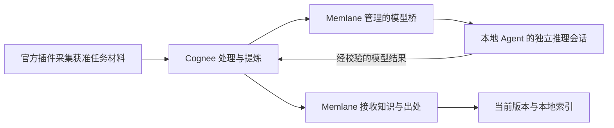

# 本地 Agent 模型桥接需求

2026-11-09。**用户已确认需求方向与桥接方案，并要求先用 pi 实现与真实闭环验收。** 当前已实现统一服务准备与受管 pi 模型桥；本轮结果和未覆盖项见 [pi 模型桥验证记录](pi-model-bridge-validation.md)。验收不修改用户日常 Agent 配置。

用户原话：“那我认为确实需要一起初始化”；“最好的方式是可以直接通过本地Agent来完成桥接，按这个方式来提供需求”。在核对官方 Claude observer 案例后，用户确认：“方案可以”。

## 目标与范围

Memlane 统一初始化记忆服务、Cognee 及其本地依赖。Cognee 需要大模型处理材料时，通过 Memlane 管理的桥接调用用户选择的本机 Agent，复用 Agent 自己的登录与模型配置。首版主流程使用本地 Agent 提供模型能力，用户无需为 Cognee 另填模型供应商、API 地址或模型 API Key。

继续使用官方 Cognee Integrations 采集、同步和提炼材料，桥接承担其中的模型调用。来源、项目归属、当前版本、审核和持久接收仍由既有契约管理。不能用 Agent 手工写几条记忆替代官方提炼流程。

采集材料的编码 Agent 与提炼 Agent 可以相同，也可以不同。接入能力按 Agent 和版本分别验证；用户进一步要求先拿 pi 试验，因此本轮首个实现为 pi 0.84.1 RPC，采集端仍采用已验证版本的官方 Codex 插件。Codex app-server 模型桥继续待实现，其他 Agent 不继承 pi 的通过结果。后台统一执行者选择与后续新设计的入口整合单独交付。

## 本轮试验对应的流程

以下流程记录本轮 pi 实现与验收所沿用的版本。后续用户纠正的初始化仅包含「准备环境／连接 Agent／配置记忆处理」三步，完成后进入日常首页；首项任务与记忆结果在日常使用中承接。新界面及三种处理方式以 [最新页面复用契约](ui-redesign/reusable-setup.md) 为准，不能把本轮旧版首任务入口作为新初始化的要求。

1. **准备环境**：App 一次准备基础服务、Rust 索引组件、本地向量模型、官方 Cognee 服务及所需依赖和模型桥。确认、下载、校验与进度保留在已认可的同一准备页面。
2. **连接 Agent**：选择电脑上的编码 Agent，完成电脑级 Memlane 配置、必要重载与连通验证。此步不要求项目、仓库目录、提炼模型或真实任务，遵守 [电脑级连接规则](ui-redesign/agent-connection-contract.md)。
3. **选择提炼 Agent**：在首次任务准备或设置中的后台执行者入口明确选择并验证提炼 Agent。复用已有选择时检查本次状态；不自动把发现的第一款工具设为执行者，不因“已连接”推断它能完成提炼。
4. **首项真实任务**：App 在首任务页面明确工作目录、可选项目和本轮材料范围，完成官方采集所需授权。正常任务结束后，官方材料经 Cognee 提炼；模型请求由桥接交给所选 Agent，用户无需逐条复制提炼提示词。
5. **查看与继续使用**：展示实际材料、提炼知识、完整出处和当前版本。未收到材料、仍在处理或索引未就绪时准确显示对应阶段。

选择提炼 Agent 与安装环境分开取证：初始化完成意味着服务和本地依赖已实际准备，不意味着已经授权采集、调用云模型或产生记忆。没有提炼 Agent 时仍允许使用已经可用的手动记忆与本地检索。

## 功能要求

| 编号 | 要求 | 完成标准 |
| --- | --- | --- |
| R01 | 一次初始化所需本地环境 | 基础服务、Rust/E5、Python Cognee/BGE 和桥接依赖统一检查与准备。兼容组件复用，缺失组件才下载；取消、重试和中断保留已校验内容。各模型的配方、维度和索引继续分开。 |
| R02 | 服务启动与提炼能力解耦 | 缺少模型供应商 API Key 或尚未选择提炼 Agent 时，服务仍能完成本地初始化与健康验证。服务健康和实际推理验证独立，不能用假 Key、假响应或未发起的探测宣称推理可用。 |
| R03 | Agent 自己管理认证和模型 | 用户选择已安装 Agent，桥接让 Agent 自己使用现有登录与模型配置；不读取或复制模型密钥到 Cognee，不修改用户日常模型选择。登录失效在 App 提供明确恢复入口。 |
| R04 | 验证所选执行者 | 安装发现、电脑级连接、后台执行能力和实际结构化推理分别核对。最小真实推理探测在用户明确验证时执行，提示使用 Agent 的模型额度；不能以版本帮助、协议握手或模型列表代替。 |
| R05 | Cognee 模型请求透明衔接 | 输入材料、提炼指令和返回格式进入受管模型桥，结果经格式与 Schema 校验后返回 Cognee。官方采集、同步和提炼的真实产物继续进入既有接收链路。 |
| R06 | 每次推理使用独立上下文 | 提炼会话与日常编码会话分开，只处理该请求的获准材料。不会扫描其他仓库或历史聊天，不继承已有会话结论；明确隔离 MCP、技能、插件、hooks 和工具执行能力。 |
| R07 | 阻断递归采集与直接改知识 | 桥接发起的推理不再次触发日常记忆采集，也不能调用知识保存、覆盖、删除或审核工具。不能只靠提示词实现隔离；需验证运行配置和实际事件。 |
| R08 | 生命周期和取消有明确拥有者 | App/后台服务管理桥接任务、并发与进程。使用真实请求 ID、任务/attempt 和终态；用户取消后确认实际停止，拒绝迟到结果。不把取消 ACK 当完成，不让 Cognee 并发请求无限创建 Agent 进程。 |
| R09 | 故障准确反馈 | 区分未选择 Agent、登录失效、版本不支持、额度耗尽、暂时不可用、超时、取消与结果格式失败。保留已持久化材料；只有明确可重试且符合预算的故障才重试，不自动切换模型或执行者。 |
| R10 | 重放与恢复不改变已有有效知识 | 重试、服务恢复和重复回执使用稳定材料/操作身份去重。Agent 返回的模型结果不直接改变已有知识；AI 合并、覆盖、删除和跨项目移动继续等待用户确认，编辑/恢复继续产生新版本。 |
| R11 | 包与进度均来自真实组件 | 主包保持轻量，重型引擎与本地模型独立准备。页面下载量、卡片进度及占用来自真实 manifest/任务和测量；分别报告主包大小、首次下载量、最终磁盘占用。 |

选择或更换提炼 Agent 后重新验证能力；运行中任务绑定其启动时的执行者与配置代次，变更不能使旧任务的迟到结果重新有效。真实任务状态与失败原因应可追踪，诊断不暴露模型凭据或未授权材料。

## 技术边界与首个适配

Cognee 1.6.7 已提供 MCP Sampling，但所连接的客户端必须支持 `sampling/createMessage`，且后台任务须持有可用的客户端连接。本次核对的本机 Codex 0.147.0 未声明 Sampling 能力，其请求处理器也未实现模型回调。因此本版 Codex 优先采用 app-server 桥接，而不把“支持 MCP 工具”作为 Sampling 已接通的证据。

用户认可的桥接结构沿用官方 Claude observer：Cognee → Memlane 管理的本机兼容模型接口 → 本地 Agent → 返回经 Schema 校验的结果。官方案例内部使用 `claude -p`；本轮按用户后续要求先将 Agent 调用适配为 pi RPC。原先研究的 Codex app-server 方案保留为后续适配，不将官方 Claude 案例描述为现成的 Codex 实现。接口与认证由 Memlane 管理；本机访问 token 由 App 生成并限制访问，不要求用户提供云模型 API Key。具体 provider 映射属于实现细节，不进入产品用户流程。

本轮 pi runner 复用原有 RPC 的 ACK、终态、空闲确认、取消与进程组回收。每个模型请求创建独立目录，关闭日常会话持久化、上下文文件、技能、插件和工具；只加载 Memlane 自带的无工具 Schema 扩展。Ollama 使用原生结构化输出，返回仍须通过 Go 的完整 JSON Schema 校验。桥在私有 loopback 地址提供兼容接口，仅允许一个活动推理槽位；取消暂停后续推理，明确重试时重新准备服务与桥。具体实现和实际范围以验证记录为准。

Codex 的 `thread/start`、临时会话、`turn/start.outputSchema`、`turn/completed` 与 `turn/interrupt` 提供必要的协议基础。实现仍须验证提示词角色映射、全部工具隔离、后台终态及可靠取消。`ephemeral`、空 `dynamicTools`、只读 sandbox 或禁止审批都不能单独证明纯推理隔离。

已有正式后台任务槽位、进程保护、有限重试与主动停止语义应复用或按同一规则衔接；具体实现归属在技术方案中明确，不能在 App 和 Cognee 两边产生互不协调的重试/取消拥有者。受管服务停止后不自动通过另一条路径继续模型调用；窗口关闭与明确停止服务按现有后台运行设置处理。

本地 Agent 表示调用由本机已安装程序执行；如果 Agent 选择云端模型，获准材料仍会发送给该模型服务并消耗其额度。用户能够查看实际执行者、模型与失败状态，模型不明时准确标记未报告。

依据与版本证据见 [桥接研究](research-cognee-agent-appserver.md)。其他协议或 Agent 只有在同样的请求、结构化输出、隔离与生命周期契约通过后才标为支持。

## 验收条件

| 场景 | 必须取得的证据 |
| --- | --- |
| 新用户空环境，无模型 API Key | 在隔离空根和无组件缓存下完成统一准备。服务健康通过，无项目、无历史聊天、无业务记忆；主流程不出现 Cognee 模型供应商/API Key 输入要求。 |
| 初始化复用、失败和恢复 | 实测兼容复用、下载失败、取消及重开恢复。已完成组件保留，错误和未知不显示为就绪；按钮与进度符合实际任务。 |
| 电脑级连接，无项目 | Agent 配置与重载后完成本机连通验证，无需仓库或提炼执行者，不产生空项目或验证用知识。 |
| 提炼执行者真实验证 | 不向 Cognee提供云模型 Key，使用所选真实 Agent 完成结构化探测；记录实际版本、模型、请求与终态。登录失败、额度耗尽不伪装为无结果。 |
| 官方采集与提炼闭环 | 正常编码任务经官方插件采集，Cognee 的实际模型请求进入桥接，Agent 的真实输出被 Cognee 使用，最终知识与出处持久接收并可检索。不能手工注入或预置知识代验。 |
| 防递归和范围隔离 | 任务产生的模型推理会话未形成新的采集/提炼循环；无法读取其他项目、历史会话或调用知识变更工具。核对配置与实际事件，不仅检查 prompt。 |
| 取消、崩溃和结果迟到 | 活动推理可取消；进程/任务实际终止，迟到结果拒绝，已保存材料保留；服务重启和明确停止无重复任务或隐式续跑。 |
| 格式失败、并发和重试 | 无效 JSON/Schema 不能作为成功结果；同时请求受槽位约束；有限重试和重放不重复产生知识，不自动改换执行者。 |
| 当前版本与审核 | App 编辑后新 Agent 会话读到当前版本；不把官方历史图谱冒称当前正文。需要确认的知识变更在确认前不生效。 |
| 完整包与实际窗口 | 从含真实 UI/helper/LaunchAgent/组件管理的本机包运行以上主线，截图核对环境准备与任务状态；分别测量三类体积。编译、源码或协议 schema 通过不能代替完整包验收。 |

验收使用明确授权的合成任务和独立配置根；真实模型、官方插件和真实服务参与。保留原始失败回执，不能用 mock、手工保存、SQLite 注入或旧版本报告补造通过。

本轮已进入实现与本机完整包验收，不能再按“仅需求”理解。以上表格是完整要求；仅实际取得证据的场景标为通过。已认可 A01–A04 重设计、全部故障/恢复矩阵、正式分发和其他 Agent 模型桥不由本轮 pi 试验代替；这项工作不恢复暂停的全量工程 Goal 或其他主机管理。

## 后续调研待办

- [ ] 研究 [yetone/magpie](https://github.com/yetone/magpie) 如何驱动调用各个 Agent。核对反向代理、进程启动、app-server／ACP／RPC 适配、认证复用、结构化输出、取消与会话隔离的实际实现；区分模型 HTTP 反代与 Agent 协议桥接，记录可用于 Memlane 的源码依据。用户于 2026-11-09 明确要求记录。已快速核对官方 README：主线是本地模型网关，Claude 订阅 provider 另会驱动真实本机 `claude` 并经 MCP 桥接工具；具体实现仍待研究。
