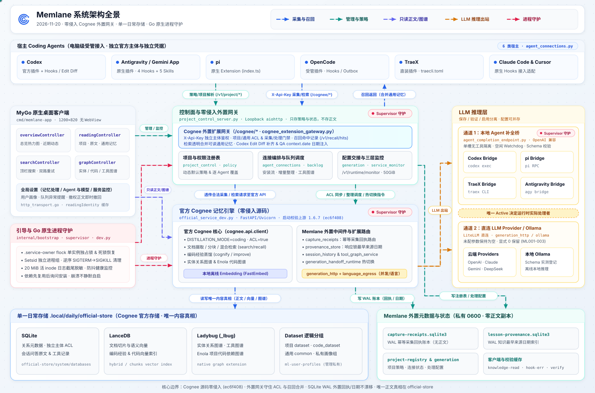

# Memlane 系统架构总览

Memlane 是面向程序员的 macOS 记忆客户端，坚持 **Cognee 上游源码零侵入**与**单一日常存储为唯一内容真相**。外置网关、WAL 账本、Agent 适配器与守护进程均位于上游引擎之外。

## 分层与源码入口

| 层级 | 核心职责 | 关键源码入口 |
| --- | --- | --- |
| **宿主 Coding Agents** | 电脑级受管接入（Codex、Antigravity/Gemini App、pi、OpenCode、TraeX、Claude Code & Cursor），各自持有独立官方主体与 `X-Api-Key` | [agent_connections.py](../../engine/python/agent_connections.py)、[engine/agents/](../../engine/agents/)、[engine/patches/project_access.py](../../engine/patches/project_access.py) |
| **MyGo 原生桌面端** | `1200×820` 无 WebView 自绘客户端，分为总览、阅读、搜索、图谱四大控制器，通过统一 HTTP 客户端直连本地服务（不缓存正文副本） | [main.go](../../cmd/memlane-app/main.go)、[app_controllers.go](../../internal/simpledesktop/app_controllers.go)、[http_transport.go](../../internal/simpledesktop/http_transport.go) |
| **引导与进程守护** | `.service-owner` flock 单实例独占锁、`Setsid` 独立进程组、20 MiB 活 inode 日志截尾脱敏与防抖健康检查 | [first_runtime.go](../../internal/bootstrap/first_runtime.go)、[supervisor.go](../../internal/supervisor/supervisor.go)、[dev.py](../../scripts/dev.py) |
| **控制面与外置网关** | Loopback 控制面负责项目注册表、连接编排、整理与工具图谱调度、三层监控；挂载 `/cognee/*` 外置网关执行 ACL 门禁、召回合并通用记忆、Diff/日期注入与召回打点 | [project_control_server.py](../../engine/python/project_control_server.py)、[cognee_extension_gateway.py](../../engine/python/cognee_extension_gateway.py)、[service_monitor.py](../../engine/python/service_monitor.py) |
| **官方 Cognee 引擎与中间件** | 启动前校验固定上游源码（`1.6.7` / `ec6f408`）；外置路由与中间件承担采集回执、最早来源日期锁、并发闸门、语言注入与运行期热切换 | [official_service_dev.py](../../engine/python/official_service_dev.py)、[external_capture_store.py](../../engine/python/external_capture_store.py)、[provenance_store.py](../../engine/python/provenance_store.py)、[language_egress.py](../../engine/python/language_egress.py) |
| **双通道 LLM 推理** | 支持「本地 Agent 补全桥（Codex / pi / TraeX / Antigravity）」与「直连 LLM Provider / Ollama」并存配置，运行期由唯一 `active` 决定执行者 | [agent_completion_endpoint.py](../../engine/python/agent_completion_endpoint.py)、[generation_config.py](../../engine/python/generation_config.py)、[generation_handoff_runtime.py](../../engine/python/generation_handoff_runtime.py) |
| **存储层** | `.local/daily/official-store`（SQLite + LanceDB + Ladybug）保存全部正文、向量与图谱；私有 `0600` 外置 SQLite WAL 与 JSON 保存回执、日期索引及策略状态 | `capture-receipts.sqlite3`、`lesson-provenance.sqlite3`、`project-registry.json` |

## 核心数据流

1. **采集与召回流**：宿主 Agent 携带独立 `X-Api-Key` 请求 `/cognee/*` → 外置网关校验主体与 ACL 后透传官方 Cognee → 读写 `official-store`；召回时网关透明合并可读通用记忆并记录命中打点。
2. **管理与策略流**：桌面端与宿主（`/v1/project/*`）请求控制面 `project_control_server.py` → 更新项目策略、连接状态、增量整理队列或触发运行期热切换，并将策略与回执写入私有 WAL/JSON 元数据。
3. **只读正文与图谱流**：桌面端直接从官方 Cognee 服务读取正文、会话原文与图谱数据；撤权或失效时即时撤下界面正文与复制入口。
4. **LLM 推理出站流**：Cognee 蒸馏/提取请求经过 `generation_http.py` 并发控制与 `language_egress.py` 语言注入后，路由至当前 `active` 指定的 Agent 补全桥或直连 Provider/Ollama。
5. **进程守护流**：`internal/supervisor`（及开发入口 `scripts/dev.py`）统一拉起与清理控制面、官方 Cognee 服务及本地补全桥进程组，崩溃不静默自启。

## 延伸阅读

- [本地开发与配置说明](development.md)
- [架构四阶段改造记录（2026-11-20）](architecture-refactor-20261120.md)
- [电脑级配置与 Agent 接入契约](agent-connection-contract.md)
- [Agent 有效模型读取与调用契约](agent-effective-model-contract-20261118.md)
- [保存队列异常范围与隔离契约](queue-isolation-20261119.md)
