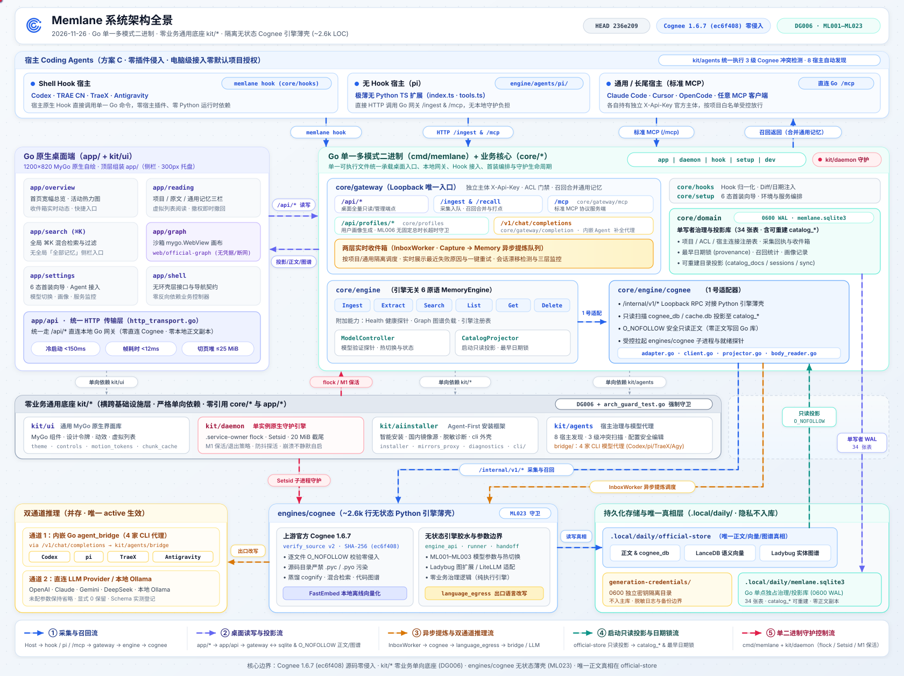

# Memlane 系统架构总览

Memlane 是面向程序员的 macOS 记忆客户端，坚持 **Go 单二进制收口**、**Cognee 上游源码零侵入**、**极简两层模型（`Capture → Memory`）**与**单一日常存储为唯一内容真相**。系统核心三组件统一命名为 **记忆引擎（Cognee）**、**接入网关** 与 **Agent 模型代理**（唯一术语表见 [CONTEXT.md](../../CONTEXT.md)，硬性依赖与语言边界见 [架构边界契约](boundaries.md)）。

## 分层与源码包映射

系统自底向上分为三段（依赖方向由 [arch_guard_test.go](../../arch_guard_test.go)、[diff_guard.py](../../scripts/diff_guard.py) `DG005`/`DG006` 与 [lint.py](../../scripts/lint.py) `ML023` 机械强制守护）：

| 分层 / 包 | 核心职责 | 关键源码入口 |
| --- | --- | --- |
| **宿主接入（方案 C）** | 支持 Shell Hook 的核心宿主（Codex、Antigravity、TraeX、TRAE CN 等）统一调用 `memlane hook` 无状态转发并配套 `memlane mcp` stdio 桥接主动工具；`pi` 保留极薄无状态 TypeScript 转发扩展（129 LOC）；长尾宿主接入网关原生 `/mcp`（详见 [mcp.md](mcp.md)）；三级 Cognee 插件冲突检测防止静默覆写 | [cmd/memlane/hook.go](../../cmd/memlane/hook.go)、[cmd/memlane/mcp.go](../../cmd/memlane/mcp.go)、[core/hooks/](../../core/hooks/)、[engine/agents/pi/](../../engine/agents/pi/)、[core/gateway/mcp/](../../core/gateway/mcp/)、[kit/agents/conflicts.go](../../kit/agents/conflicts.go) |
| **单一 Go 二进制入口** (`cmd/memlane`) | 收口 `app`（MyGo 桌面端）、`daemon`（本地网关 + 模型代理 + 进程守护）、`hook`（宿主事件转发）、`mcp`（stdio MCP 桥接）、`setup`（零 Skill Setup CLI：`doctor`/`install`/`connect`/`verify`/`repair`/`stop`）、`dev`（开发启停 `start`/`status`/`open`/`stop`/`recover`） | [main.go](../../cmd/memlane/main.go)、[app.go](../../cmd/memlane/app.go)、[daemon.go](../../cmd/memlane/daemon.go)、[hook.go](../../cmd/memlane/hook.go)、[mcp.go](../../cmd/memlane/mcp.go)、[dev.go](../../cmd/memlane/dev.go)、[setup.go](../../cmd/memlane/setup.go)、[quit_policy.go](../../cmd/memlane/quit_policy.go) |
| **MyGo 原生桌面端** (`app/*`) | `1200×820` 客户端，主界面与托盘弹层为纯 MyGo 原生自绘，仅图谱画布经沙箱 `mygo.WebView` 加载内嵌静态资产；拆分为组合根 `app/` + 6 个无环 UI 子包（`shell`/`overview`/`reading`/`search`/`graph`/`settings`）与传输包 `api`，直连本地网关，不落盘缓存正文副本 | [app/app.go](../../app/app.go)、[app/tray_flyout.go](../../app/tray_flyout.go)、[app/graph_host.go](../../app/graph_host.go)、[app/shell/](../../app/shell/)、[app/overview/](../../app/overview/)、[app/reading/](../../app/reading/)、[app/search/](../../app/search/)、[app/graph/](../../app/graph/)、[app/settings/](../../app/settings/)、[app/api/](../../app/api/) |
| **零业务通用底座** (`kit/*`) | 零 Memlane 业务依赖的可复用基础设施：MyGo UI 组件/主题/动效原语、本机 Agent 发现/配置读写/CLI 模型代理、Agent-First 依赖安装与诊断、单实例 flock 锁/进程组守护/活 inode 日志截尾与退出策略 | [kit/ui/](../../kit/ui/)、[kit/agents/](../../kit/agents/)、[kit/agents/bridge/](../../kit/agents/bridge/)、[kit/aiinstaller/](../../kit/aiinstaller/)、[kit/daemon/](../../kit/daemon/) |
| **领域模型与单点存储** (`core/domain`) | 极简两层 `Capture → Memory` 状态模型、项目注册与独立主体 ACL、最早来源日期锁（`provenance`）、召回打点（`recall`）、已读状态、收件箱、提炼配置账本、目录投影与旧库一次性迁移；单点独占读写 `0600` 私有 SQLite WAL（`memlane.sqlite3`，强制 `journal_size_limit`） | [store.go](../../core/domain/store.go)、[registry.go](../../core/domain/registry.go)、[capture.go](../../core/domain/capture.go)、[provenance.go](../../core/domain/provenance.go)、[recall.go](../../core/domain/recall.go)、[catalog.go](../../core/domain/catalog.go)、[generation.go](../../core/domain/generation.go)、[sqlite_open.go](../../core/domain/sqlite_open.go) |
| **接入网关与模型代理** (`core/gateway`、`core/profiles`、`core/setup`) | 本地唯一 Loopback HTTP 入口：管理与只读查询 `/api/*`（兼容 `/v1/*`）、宿主写入与召回 `/ingest` & `/recall`、标准 `/mcp`（含 `remember` 快路径与收件箱回退）、统一主体鉴权 `agentauth`、故障隔离配额召回 `recall`、独立用户画像 `/api/profiles/*`、OpenAI 兼容 Agent 模型代理 `/v1/chat/completions` 与异步收件箱提炼协程 `InboxWorker` | [server.go](../../core/gateway/server.go)、[hooks.go](../../core/gateway/hooks.go)、[mcp_remember.go](../../core/gateway/mcp_remember.go)、[inbox_worker.go](../../core/gateway/inbox_worker.go)、[overview.go](../../core/gateway/overview.go)、[generation.go](../../core/gateway/generation.go)、[agentauth/](../../core/gateway/agentauth/)、[recall/](../../core/gateway/recall/)、[completion/](../../core/gateway/completion/)、[mcp/](../../core/gateway/mcp/)、[core/profiles/](../../core/profiles/)、[core/setup/](../../core/setup/) |
| **引擎无关接口与适配器** (`core/engine`) | 向上层领域暴露且仅暴露 6 原语 `MemoryEngine` 接口（`Health` / `Ingest` / `Extract` / `Search` / `List/Get/Delete` / `Graph`）及可选能力（`ModelController`、`CatalogProjector`）；1 号适配器 `core/engine/cognee` 通过内部 Loopback HTTP 驱动 Python 引擎薄壳 | [engine.go](../../core/engine/engine.go)、[capabilities.go](../../core/engine/capabilities.go)、[registry.go](../../core/engine/registry.go)、[core/engine/cognee/](../../core/engine/cognee/) |
| **无状态引擎薄壳与沙箱画布** (`engines/cognee`、`web/official-graph`) | `engines/cognee`（13 个非测文件，~3.2k LOC，`ML023` 硬上限 ≤3,500）零业务状态、禁导 `sqlite3`/`aiosqlite`，启动前经 `verify_source` v2 缓存 + `_SourceOnlyFileLoader` 逐文件 SHA-256 校验固定上游 Cognee `1.6.7` (`ec6f408`)，承接 Cognee / LiteLLM / Ladybug 适配与 `language_egress`；`web/official-graph` 承载无凭据无网络的官方图谱前端资产 | [runner.py](../../engines/cognee/runner.py)、[engine_api.py](../../engines/cognee/engine_api.py)、[llm_config.py](../../engines/cognee/llm_config.py)、[handoff.py](../../engines/cognee/handoff.py)、[language_egress.py](../../engines/cognee/language_egress.py)、[probe.py](../../engines/cognee/probe.py)、[tool_graph.py](../../engines/cognee/tool_graph.py)、[web/official-graph/](../../web/official-graph/) |

> **存储真相双分界**：正文、向量（LanceDB）与属性图（Ladybug）唯一内容真相始终保留在日常官方目录 `.local/daily/official-store`；Memlane 全部自有治理元数据（注册表、ACL、收件箱、来源日期、召回打点、已读状态、提炼配置与目录投影）统一收敛到由 Go 网关单点独占读写的私有 `0600` SQLite WAL（`memlane.sqlite3`）。

## 五条核心数据流

1. **实时采集与两层提炼流（`Capture → Memory`）**：宿主 Agent 触发 Hook → `memlane hook`（或 `pi` 极薄扩展 / `/mcp`）携独立 Agent 令牌请求 Go 网关 `POST /ingest` → 网关在单一裁决点校验主体身份、项目 ACL 与 `auto_capture` 开关（关闭即拒、不落盘）后写入 `memlane.sqlite3` 轻量收件箱并立即返回 → `InboxWorker` 异步经 `MemoryEngine.Ingest` + `Extract` 调用 `engines/cognee` 写入 `.local/daily/official-store` 并产出结构化记忆与图谱关系，失败记录原因并支持一键重试。
2. **授权召回与打点流**：宿主请求 `POST /recall`（或标准 `/mcp` 检索工具）→ Go 网关校验项目与通用记忆读权限，经 `MemoryEngine.Search` 跨授权范围检索并透明合并可读通用记忆（项目约定优先）→ 网关在 `memlane.sqlite3` 记录会话漂移与召回命中打点（人工桌面搜索不计入 Agent 召回），返回带出处与来源日期的结构化上下文。
3. **首页聚合、只读浏览与沙箱图谱流**：MyGo 桌面端经 `app/api` 访问 Go 网关 `/api/overview/bootstrap`（`ML012` 强制单次聚合冷启动，延迟宿主探测）、`/api/projects/{id}/knowledge`、`/api/raw-records`、`/api/search` 与 `/api/profiles/*`；目录与未读/日期元数据由网关结合 `memlane.sqlite3` 游标返回，正文与图谱经 `MemoryEngine.GetItem` / `Graph` 受权读取；图谱画布在无凭据、无直连网络的沙箱 `mygo.WebView` 中仅消费标准 `{nodes, edges}` 载荷（单调 `epoch` 注入），撤权或身份失效时即时清空界面内存正文、缓存与复制入口。
4. **双通道 LLM 提炼与热切换流**：`engines/cognee` 的提炼请求经 `engines/cognee/llm_config.py`（`native_llm_configuration`，`ML001–ML003` 保 `0` 禁补默认值）、`capacity.py` 并发控制与 `language_egress.py` 语言注入后，路由至运行期唯一 `active` 配置——要么走 Go 网关内嵌的 OpenAI 兼容 Agent 模型代理（`/v1/chat/completions` → `core/gateway/completion` → `kit/agents/bridge` 调用本机隔离 CLI 子进程），要么直连 LLM Provider / 本机 Ollama；验证与热切换通过 `handoff.py` 原子协调，保存/验证与激活严格分离。
5. **Gateway-First 单二进制守护与首装自举流**：`cmd/memlane daemon` 与 `cmd/memlane dev` 依托 `kit/daemon`（及安装态 `internal/bootstrap` / `internal/setupcli` / `internal/supervisor` 统一导出的 `OwnerCodec`，保留日常 `.daemon-owner.json` 与首装 `.memlane-dev-owner.json` 双文件名兼容）同步获取 `.service-owner` flock 单实例独占锁并清扫过期 `cache/daemon-run` 残留目录，**先监听 Loopback HTTP 网关**（立即服务鉴权、目录只读、`/api/health` 双态探针 `gateway_ok` / `engine_ok`、非阻塞 `/v1/capabilities` 与收件入队），再以 `Setsid` 后台异步拉起并监控 `engines/cognee`（20 MiB 活 inode 日志截尾与 `.previous` 脱敏、防抖健康检查）；引擎启动失败或崩溃不静默自启且不中断网关服务。桌面端 `cmd/memlane app` 实施生产态 `RequestSingleInstanceLock` / `OnSecondInstance` 唤回与开发态按 canonical `StoreRoot` 隔离的 `.app-instance.lock` 单实例保护，遵循 M1 保活/退出策略（非持有实例绝不误停后台）；`cmd/memlane setup`（含顶层 `doctor`/`install`/`connect`/`verify`/`repair`/`stop` 快捷入口）提供零 Skill JSON-first 诊断与受控自举。

## 延伸阅读

- [现行架构边界契约（含方案 C 与三级冲突策略）](boundaries.md)
- [MCP 架构与工具契约（stdio 桥接、4 项工具与安全边界）](mcp.md)
- [本地开发与运维说明](development.md)
- [Agent 有效模型读取与调用契约](agent-effective-model-contract-20261118.md)
- [Memlane × Cognee 3D / 2D 记忆流转交互图解](memory-flow-3d/README.md)
- [架构守护、Python 冻结与定时巡检规划](../engineering/architecture-governance-and-py-freeze.md)
