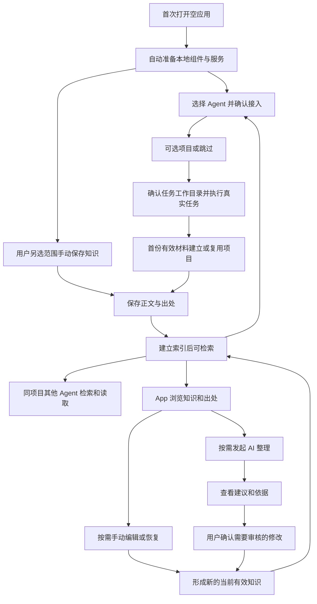

# Memlane 核心业务主流程

2026-11-08 整理，2026-11-09 按 Agent 优先与项目可跳过更新首次流程。本文描述用户如何建立、积累、复用和维护共享记忆，作为后续 E2E 用例的业务依据。功能规则以 [产品定义](product.md) 和 [设计决策](design.md) 为准；首次接入的实现契约见 [Agent 首任务流程](agent-first-task-flow.md)，其他阶段的实现边界依据既有验证与 [交付矩阵](p3-delivery-plan.md)。

下文的“已有验收记录”引用仓库已有结果，不表示本次重新执行验收。流程中的示意内容用于说明业务，不是用户真实记忆。

2026-11-09 最新初始化边界以 [A 实施交接](ui-redesign/a-setup-handoff.md) 为准：仅「准备环境／连接 Agent／配置记忆处理」三步，完成后进入日常首页。下文首次任务与记忆复用是日常业务旅程，不能再作为初始配置的完成门禁；电脑级连接与项目/材料授权分开。

## 1. 产品主线

**用户首次打开空应用，由 App 准备本地能力，为代码仓库建立共享记忆空间，由自己或编码 Agent 积累第一条知识；同项目的其他 Agent 在后续任务中检索复用；用户可以编辑、恢复和确认整理结果，让下一次检索使用当前有效知识。**

用户手动保存不要求先连接 Agent。已有记忆可以直接检索复用；编辑、恢复和整理按需发生，不是每次检索的必经步骤。

## 2. 参与者与业务对象

| 对象 | 业务职责或含义 |
| --- | --- |
| 用户 | 登记项目、连接 Agent、手动维护知识、决定需要确认的 AI 修改 |
| 日常编码 Agent | 提交知识或原始记录，在当前项目检索和读取共享知识；当前 Codex/pi 有实际接入记录 |
| 整理 Agent | 根据选定材料返回有出处的整理建议；当前手动合并由 traex 执行，不等同于 traex 日常记忆接入已完成 |
| Memlane App | 展示项目、知识、出处、历史、活动及整理建议，承载用户操作 |
| 后台记忆服务 | 持续接收、保存和提供当前有效知识，记录版本和整理决定 |
| 项目 | 一个代码仓库对应的共享范围，多个 Agent 共用；同仓库 worktree 归属同项目，独立 clone 不自动合并 |
| 知识条目 | 可维护的正文、所属范围、出处和历史版本；当前有效且索引完成后可被检索 |
| 原始记录与出处 | Agent 实际提交的材料和引用，保留以供追溯；不把任意聊天或原始记录自动当作新增知识 |
| 整理任务与建议 | 任务记录执行过程，建议等待审核；生成建议不等于修改已经生效 |
| 全局记忆 | 个人偏好与通用经验；检索受连接授权约束，项目明确约定优先于全局建议 |

## 3. 核心流程一览

| 编号 | 用户目标 | 起点 | 完成结果 | 当前边界 |
| --- | --- | --- | --- | --- |
| F00 从空应用开始 | 从没有业务数据到首次真实 Agent 记忆与后续读取 | 首次启动，无项目、知识、连接；严格冷启动也无组件缓存 | 先选 Agent，项目可跳过；真实材料进入后建立或复用项目，查看知识/完整出处并新会话读取 | 本轮首先验 Codex 官方采集＋Memlane 当前知识读取；不把它扩大为四 Agent 新流程全部通过 |
| F01 建立共享项目 | 让多个 Agent 使用同一仓库的记忆 | 本地仓库已存在，用户打开 App | 项目已登记，选定 Agent 在确认范围内通过实际读写验证 | 项目与 Codex/pi 连接有 P1/P2 验收记录；其他日常 Agent 分别待接入 |
| F02 积累并复用记忆 | 一次保存，在后续任务或另一个 Agent 中获取 | 用户有一条知识，或 Agent 提交知识/原始记录 | 保存知识后可检索，读取者获得当前正文、版本和出处 | 手动保存和 Codex 保存 → pi 读取有验收记录 |
| F03 维护与版本恢复 | 修正知识，并能追溯或恢复历史 | 用户打开已有知识详情 | 编辑或确认恢复形成新当前版本，历史与出处保留，后续读取一致 | P1/P2 有验收记录 |
| F04 受控整理 | 把已有材料整理成更易复用的知识 | 用户明确选择项目与材料并发起整理 | 允许自动执行的结果生效，需审核的建议经用户决定后生效，完整记录结果 | C2/C3/C4 与持久计划已有分层验收；本轮不重跑全部模型与故障组合 |
| F05 提升为全局经验 | 将项目经验用于其他项目 | 用户打开项目知识并选择全局经验操作 | 新全局条目可在允许范围复用，原项目知识与来源关系保留 | P3-E 原文复制、提炼与条件有历史真实验收；本轮不重新执行 |

## 4. F00：首次打开空应用到第一次共享复用

这是一条独立核心主流程。不能把“已有项目、已准备组件、已连接 Agent、已有知识”当成它的起点。以下顺序用于表达从零到共享复用的完整旅程，不增加强制新手向导。

**参与者**：首次使用的用户、App、后台记忆服务、选定的真实编码 Agent。第二个 Agent 的跨 Agent 扩展接 F01/F02，按其实际适配另验。

**初始状态**：

- Memlane 没有登记项目，没有知识或原始记录，没有已配置连接，没有整理任务和建议。
- 严格冷启动时，本地引擎、模型与下载缓存也不存在；后台服务尚未就绪。
- App 本身已安装；用户可以选择一个实际存在的本地仓库。Agent 可以已安装，但尚未配置 Memlane 接入；Agent 自身安装和登录是外部使用条件。
- 允许应用自带默认设置与空的全局范围，不把这些结构当作已有业务知识。

完整主流程：

| 步骤 | 用户操作 / App 行为 | 到达的业务状态 |
| --- | --- | --- |
| 1 首次打开 | 用户打开 App，直接进入宽幅总览，不注册客户端账户 | 主窗口可操作；项目与内容为空，未连接 Agent；自动发现的 Agent 只能显示已发现 |
| 2 准备本地能力 | App 检查缺失组件，用户确认后实际下载、校验和准备，引擎与服务给出当前回执 | 服务实际就绪，仍无项目或知识；准备完成主操作为选择 Agent |
| 3 选择 Agent | 用户选择 Codex 等已支持安装，查看实际版本与接入状态 | 发现与可用分开；项目登记不作为这一选择的前提 |
| 4 可选项目并连接 | 用户可以选择已有项目，也可以跳过；确认接入身份与显式允许范围 | 接入身份已持久化；跳过项目时没有空项目、没有预置知识 |
| 5 确认首任务范围 | 用户确认实际任务工作目录，准备必要官方环境和插件 | 工作区与 Git common directory 已核对；无有效材料时仍不自动登记项目 |
| 6 执行首次真实任务 | App 引导用户输入正常任务并确认本轮采集；任务结束自动接续官方同步和材料接收 | 实际 Agent 执行、官方持久回执和 Memlane 接收分别可见；任务退出码不等于记忆保存 |
| 7 项目与记忆形成 | 首份通过内容和来源校验的记录进入业务事务 | 受信项目建立或复用、授权提升、原文/版本/索引任务共同提交；失败不留下空项目 |
| 8 获得并复用记忆 | 用户查看本次知识和完整出处，在新 Agent 会话查询相关约定 | 真实原文、知识和 Rust 当前版本可对应；后续读取使用明确的当前知识通道 |
| 9 维护后继续使用 | 用户编辑或恢复知识，再让新 Agent 会话查询 | 获得新当前正文、版本及范围；官方历史材料保留，不能冒称已自动回写 |

组件准备期间可以浏览界面，登记和保存以相应服务实际可用为前提，不假定准备完成前能够成功保存。

**完成里程碑**：步骤 7 是“从零到第一份有效记忆与项目”；步骤 8 是“查看出处并在新会话复用”；步骤 9 接 F03 的维护后当前版本一致性。重开持久性、第二个 Agent 和整理分别按对应阶段继续验，不由单款 Agent 的首任务结果代替。

**独立的手动新增入口**：用户仍可另选项目或全局范围，在右栏输入并保存知识，不要求先连接 Agent；这条入口不替代最新确认的 Agent 优先首次旅程。

首次使用的主要分支：

- **没有安装 Agent**：用户仍可完成手动新增、搜索和维护；连接页显示未发现，安装或指定实际 Agent 路径后再继续共享流程，不展示假连接。
- **首次离线且无组件缓存**：主窗口可以打开，说明需要联网准备，恢复网络后重试；当前未被服务保存的输入只能称草稿。
- **下载失败或取消**：保留真实进度和原因，用户重试后继续准备，不提前显示服务或检索可用。
- **Agent 认证、重载或验证失败**：本地已保存知识保留，连接显示对应状态；解决实际原因后继续，不把配置写入成功当成可用。
- **没有可选仓库**：用户可先手动保存到全局范围；项目共享路径需选择实际仓库后继续，不自动创建或登记用户项目。
- **初始化既有记忆**：属于另一条可选入口，已有分层验收；复制 prompt 不等于导入完成，不作为从空应用完成首次保存的必经条件。

**从零 E2E 的业务边界**：必须在空业务根开始，严格冷启动还必须没有组件缓存；项目登记、连接、知识创建全部经过实际产品入口。测试可以提供隔离路径、真实组件的公开下载配置、可选仓库和实际 Agent 运行条件；不能提前创建项目/知识/连接或复制旧组件运行目录，随后宣称从零流程通过。连接验证只用于验证连接，首次业务知识仍来自用户或 Agent 的实际保存。

**当前验收边界**：App 自动准备依赖有效运行配置和组件源；已有受控源验证不等于无配置的正式分发包已完成从零旅程。空态与各段已有证据不替代一次从首次启动到跨 Agent 复用的连续验收。

## 5. F01：建立共享项目与连接 Agent

**参与者**：用户、App、日常编码 Agent、后台记忆服务。

**触发与前提**：用户希望一个已有本地仓库的多个 Agent 共用记忆。App 可以打开；需要实际读写验证时，本地组件和服务须可用。

主流程：

1. 用户在 App 添加本地项目，选择仓库路径。
2. Memlane 登记该仓库的项目范围；同一仓库的 worktree 使用同一项目记忆。
3. 用户进入 Agent 页，查看自动发现结果或指定可执行路径。
4. 用户选择连接项目和允许使用的全局或额外项目范围，明确点击连接。
5. Memlane 安装自己的接入配置；需要重载时显示待重载。
6. Agent 按实际要求重载，用户执行读写验证。
7. 实际工具往返成功且相关服务可用后，连接显示可用。

**完成结果**：Agent 的项目身份与可访问范围明确，能够实际保存、检索和读取该项目的知识。发现可执行文件或写入配置尚不能表示连接可用。

主要分支：组件未准备好时继续准备；认证、重载或验证失败时保留真实原因与重试入口。用户修改范围后，旧连接访问不能继续沿用已撤销授权；断开只移除 Memlane 自己的配置。

## 6. F02：积累并跨 Agent 复用记忆

**参与者**：用户或写入 Agent、App、后台记忆服务、后续读取 Agent。

**触发与前提**：产生了一条需要保留的项目知识。用户手动保存需要选定范围；Agent 保存需要已经连接并确认工作区与授权范围。

记忆进入有两条入口：

- **用户入口**：进入项目或全局范围 → 在右栏新增记忆 → 输入标题与正文 → 点击保存。用户保存动作就是对这条知识的确认，不等待 AI 整理。
- **Agent 入口**：Agent 提交知识或原始记录 → Memlane 按实际提交接收正文、范围和来源，不先筛选“是否重要”，也不额外读取聊天记录。

保存知识后的主流程：

1. Memlane 保存正文、所属范围、来源和初始版本，返回已保存结果。
2. 在保存之后建立索引，展示与保存独立的索引状态。
3. 索引就绪且服务可用时，该知识可被检索。
4. 同项目的另一个 Agent 在后续任务中查询相关知识。
5. 默认查询当前项目及已授权的全局个人偏好、全局经验；其他已授权项目仍需明确指定。
6. Agent 获取命中知识的当前正文、版本、适用范围及来源，可以继续读取条目详情。
7. 用户也能在 App 找到同一条知识，核对正文和原始出处。

**完成结果**：写入端保存的知识，可由后续读取端获取同一条目的当前有效内容。检索返回或读取成功不能直接证明 Agent 已在代码中采用该知识。

主要分支：原始记录单独保留，不直接计作知识新增，后续转换遵守整理规则。索引未就绪时只能显示已保存；索引失败保留正文并允许重试。服务不可用返回明确错误，正常零命中才表示无结果。重试同一次保存不得重复创建知识。

## 7. F03：用户维护知识与恢复版本

**参与者**：用户、App、后台记忆服务、后续读取 Agent。

**触发与前提**：用户需要纠正已有知识，或恢复曾经有效的内容。用户已经选中一条知识。

编辑主流程：

1. 用户在右栏查看当前正文、所属范围和出处。
2. 点击编辑，在右栏修改正文并保存。
3. Memlane 以用户打开编辑时的版本为基础，保存一个新版本，保留旧正文与操作历史。
4. 新版本重新建立索引；App 展示新的当前正文，后续 Agent 读取新版本。

恢复主流程：

1. 用户打开历史，查看各版本及差异。
2. 选择某一旧版本，进入右栏恢复确认。
3. 确认前当前知识保持原样。
4. 用户确认后，以旧正文创建一个新的当前版本。
5. 新版本索引就绪后，后续 Agent 检索和读取恢复后的内容。

**完成结果**：正文、历史与后续检索一致。例如 v1 编辑成 v2，再恢复 v1 内容，会得到 v3，v1/v2 本身不被改写。重开 App 或服务后，已保存正文与历史仍可读取。

主要分支：其他写入方已更新时，旧编辑不能静默覆盖，保留草稿，由用户明确选择按最新版本继续编辑。保存失败保留窗口内草稿；当前草稿不承诺退出 App 后持久保留。索引失败不回滚已保存正文。

## 8. F04：受控整理与用户审核

**参与者**：用户、App、整理 Agent、后台记忆服务、后续读取 Agent。

**触发与前提**：用户希望提炼、归类或清理已有材料，明确选择项目和待整理内容，并授权使用整理执行者。

已确认的完整业务主流程：

1. 用户点击立即整理；后续计划能力可在用户启用频率和范围后触发同一套规则。
2. Memlane 选取并固定本次材料、版本与出处，展示任务运行状态。
3. 整理 Agent 根据材料生成有依据的摘要、标签及修改建议。
4. 新增摘要、添加标签可以自动完成；合并、覆盖、删除、跨项目移动等修改必须等待用户确认。
5. 用户在整理记录右栏查看建议、原始依据、差异与将发生的变化。
6. 用户确认或拒绝需要审核的建议；应用前再次检查材料版本和范围。
7. 已确认结果与历史一起保存；需要检索的新正文建立索引。
8. 用户在记录中查看每项实际结果，后续 Agent 复用新的当前有效知识。

**当前已经有 App 验收记录的路径是“两条知识合并”**：

同项目选择两条有效知识 → 开始整理 → traex 返回纯建议 → 右栏展示建议、冻结出处与差异 → 用户确认合并 → 新建合并知识并归档两条来源 → 合并知识可检索 → 可以回看整理记录、来源和历史。

**完成结果**：用户能够解释“为什么改、改了什么、谁确认、哪些结果已生效”。任务执行结束、建议已生成、用户已确认、知识可检索分别表达。

主要分支：

- 拒绝建议：保留决定，原知识不变。
- 材料在审核前被编辑：建议过期，整项不应用，重新选择当前版本再次整理。
- 取消运行：阻止尚未提交的结果，已提交结果保留；离开页面或关闭窗口不自动取消持久任务。
- 服务中断：当前合并任务记录中断，旧结果不能迟到生效；重新整理由用户再次发起。
- 应用后索引失败：保存正文、来源、历史和确认事实，恢复索引后再显示可检索。
- 恢复某条归档来源：创建该来源的新版本，已产生的合并知识继续保留，不等同于撤销整次整理。

摘要、标签、覆盖、删除、跨项目移动、逐项部分结果、完整计划与重试能力按交付矩阵继续；上述完整流程不表示这些能力已经全部实现。

## 9. F05：项目经验提升为全局经验

**参与者**：用户、App、整理 Agent（仅 AI 提炼路径）、后台记忆服务、其他项目的读取 Agent。

**触发与前提**：用户认为某条项目经验可用于其他项目，打开该知识详情。

两条主路径：

- **原文复制**：用户选择原文复制到全局 → 新建独立全局经验 → 保留原项目条目与来源关联 → 建立索引。
- **AI 提炼**：用户选择 AI 提炼为全局经验 → 查看通用表述与适用条件 → 确认后新建全局经验 → 保留原项目条目与来源关联 → 建立索引。整理发现的全局候选也需要预览确认。

索引完成后，其他项目的 Agent 在允许的全局范围检索和读取这条经验。同一事项仍以当前项目的明确约定优先，全局建议保留适用条件与出处。

**完成结果**：形成一条可跨项目复用、可追溯来源的独立全局知识，原项目知识继续保留。取消或拒绝 AI 预览不创建全局条目。

**当前边界**：这是已确认的产品流程；全局记忆保存和授权检索已有基础，以上项目提升操作仍待交付。

## 10. 日常浏览与持续使用

以下流程支撑上述知识闭环，不要求用户每次按顺序执行。

| 流程 | 用户路径 | 完成结果与边界 |
| --- | --- | --- |
| 首页回顾 | 打开宽幅总览 → 看每日活动和最近知识 → 点日期或条目 → 进入列表与右栏详情 | 可以回到实际知识及出处；只在知识首次可用时计新增，编辑/恢复/重放不重复计数，删除保留活动事实 |
| 待确认回访 | 首页查看待确认 → 进入整理记录 → 查看同一任务 → 确认或拒绝 | 建议可再次找到；未确认前知识保持原样。当前待确认入口只展示最近记录中的建议，不宣称完整全库待办统计 |
| 首次准备 | 安装并打开 App → 自动准备组件与模型 → 看进度/失败重试 → 服务可用 | 主界面在准备期间仍能打开；准备完成前不把依赖组件的能力显示为可用。本机受控准备有记录，正式分发仍有待交付项 |
| 后台持续使用 | 关闭窗口或默认退出 App → 后台继续运行 → Agent 继续访问 → 重开 App | 已有生命周期记录；用户明确停止服务时不自动拉起，读取失败与零结果区分 |
| 意外故障恢复 | 服务或索引异常 → 展示原因并有限恢复/重试 → 再次读取已保存知识 | 已保存内容不丢失；尚未被服务接收的 App 输入仍是草稿，不能承诺已持久保存；不把所有恢复分支视为已验收 |
| 客户端更新 | 用户进入更新 → 更新客户端 → 重开并继续使用知识 | 保留知识、设置和兼容组件；已有受控更新记录，正式发布源、签名与干净环境验收仍待交付 |

## 11. 贯穿各流程的业务规则

1. **保存与可检索分开**：正文持久保存后可以显示已保存，索引及相关服务可用后才显示可检索。
2. **范围明确**：默认当前项目加允许的全局；其他项目需明确选择且已授权。
3. **当前知识一致**：详情、列表、Agent 读取和检索围绕当前有效版本；历史保留但不作为旧命中返回。
4. **出处可追溯**：保留实际提交和所依据的来源，不伪造聊天、引用或独立证据。
5. **用户决定修改**：手动保存代表用户确认；AI 的合并、覆盖、删除、跨项目移动等修改需另行确认。
6. **历史不被改写**：编辑和恢复产生新版本，整理保留来源、决定及实际结果。
7. **重复不产生新事实**：保存或确认的重试不重复新增条目、版本或活动。
8. **失败如实表达**：无结果、服务失败、索引等待、索引失败和审核待确认分别呈现。

词云与 Top-K 记忆展示继续保留在 [Roadmap](roadmap.md)，不加入当前核心业务流程；初始化导入、代码图谱和远程管理依各自规划展开。

## 12. 一条贯穿业务的示意旅程

用户首次打开空应用 → App 准备引擎、模型和服务 → 用户登记项目 A → 在 App 保存第一条知识并搜索 → 连接 Codex，读取第一条知识并保存一条接口错误处理经验 → 用户在 App 查看 Codex 正文与出处 → 连接 pi，在下一次任务检索并读取 Codex 知识 → 用户补充正文，后续读取获得新版本 → 用户选择两条已实际保存的相关知识发起整理 → traex 给出合并建议 → 用户查看依据并确认 → 新合并知识成为当前可检索结果，原来源归档并保留历史 → 重开 App 后继续查看和复用。

手动新增可以替代上述 Agent 保存入口。用户维护、版本恢复、拒绝整理和全局提炼分别是这条旅程的业务分支，不要求合并成一个必须依次完成的长流程。

后续 E2E 先以 F00 验证从空应用到首次价值与共享复用的完整旅程，再按 F01–F05 及其已交付分支建立对应关系。本次只整理业务主流程。
