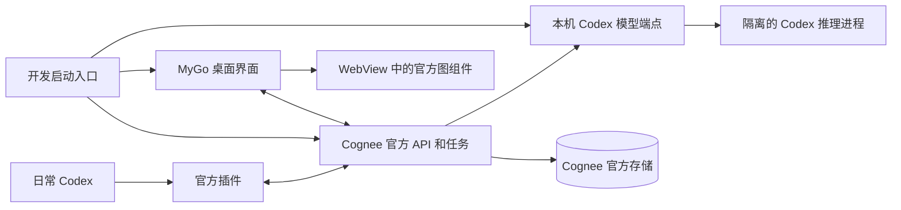

# Memlane 最小实现技术方案

日期：2026-11-12。状态：2026-11-13 已按用户新指令进入 dev 实施；进度见 [执行记录](../../../engineering/client-simplification-execution-20261113.md)。

最新补充：窄窗口设计、实现、修复与验收全部取消；后续实施同步清除此前遗留的问题代码，清理前先保存完整源码快照并打注释 tag。当前已完成开发前提交与本地 tag；只执行本次精简版，不恢复旧全量 Goal。

对应[首个可用版本规格](client-simplification-spec-20261112.md)。本方案按“Codex 订阅推理”和“首版独立美观桌面”两个硬约束设计，其他组件按必要性决定，不以现有代码量或已完成测试数量作为保留理由。

## 架构结论

采用 **MyGo 桌面客户端、Cognee 官方服务、一个本机 Codex 模型端点、一个开发启动入口**。内容存储、索引、提炼、召回与图谱全部属于 Cognee。

不设置 Memlane 业务 daemon，不建设自有内容数据库、任务数据库、通用事件总线或第二套索引。MyGo 是原生呈现与桌面承载方式，不承担记忆业务；Codex 适配器是模型接口，不成为任务平台。



唯一接入方式是 Cognee 官方自定义 Provider 配置指向本机 OpenAI 兼容模型端点。端点只实现实际使用的 completion 和结构化输出语义，不承担项目业务、任务数据库或整理接口；不同时维护进程内适配和 HTTP 两条路线。这个选择复用官方配置入口，无需修改 improve 或替换内部函数。[Cognee 模型配置](https://docs.cognee.ai/setup-configuration/llm-providers)

## 对复杂度的取舍

| 候选设计 | 结论 | 工程理由 |
| --- | --- | --- |
| 自有 Go 业务服务 | 不进入目标架构 | 官方 API 已承担内容与处理；再加一层会产生另一套状态和生命周期 |
| 自有 SQLite 知识或任务库 | 不进入目标架构 | 只有本机配置和 UI 偏好，使用小型配置文件即可；官方数据仍由其原存储管理 |
| 独立正文、版本、索引和同步 | 删除 | 两套内容真相会制造一致性与失效问题，且用户已允许直接清理旧内容 |
| Codex 模型适配 | 保留最小实现 | 用户选择使用订阅推理，这是额外成本的明确来源 |
| 多供应商、多 Agent 模型调度 | 删除首版要求 | 一个执行通道足以满足当前选择，无需动态路由和配置版本账本 |
| 独立桌面 UI | 保留 | 用户明确要求，是产品差异所在 |
| 官方 Web 页面整体替代桌面 | 不作为首版交付 | 不满足独立且美观的界面要求；可参考信息结构和复用图组件 |
| 图谱组件拆包和承载 | 保留必要工作 | 官方已经提供绘制和交互，只补桌面承载与数据连接 |
| 系统 helper 和更新体系 | release 再做 | 开发期手动启动可满足日常使用，避免发布工程阻断产品 |
| 可行性探测与重复评测 | 不安排 | 直接采用已走通的路线，实际实现出错时修复具体问题 |
| 窄窗口与响应式布局 | 从首版删除 | 用户明确不需要；仅维护默认及最小 1200×820，允许放大 |
| 昨天遗留的问题实现与补丁 | 实施中替换并清除 | 旧功能退出时删除实现与专属代码；保留功能修正实现后删除旧问题路径 |
| 清理前源码 tag | 必须先完成 | 固定包含相关未提交文件的可恢复源码，不用工作区脏状态承担回退职责 |

“只做薄适配”必须由职责证明。调用内部仍是 Cognee，并不能证明外面的项目授权、调度、正文副本和状态账本都必要。

## 模块边界

### 桌面客户端

MyGo 负责窗口、布局、Markdown、列表、焦点、滚动、图组件宿主和普通配置。客户端通过官方 HTTP API 读取和操作，不经过旧内容服务。

客户端内部只需要按用途组织的 API 调用与呈现代码，不建立通用 MemoryRepository 或多引擎插件平台。网络结果在内存中归一化，保留官方身份和类型；不持久化完整正文来实现缓存或离线搜索。

允许保存的配置限于：官方服务地址、本机运行位置、必要项目关联、当前 Codex 处理选择及界面偏好。项目关联包含稳定标识、显示名、仓库路径、知识 dataset ID 和可选代码 dataset ID；它是配置映射，不是项目数据库。官方对象与数量每次从官方读取，不在本地长期维护副本。系统、临时和历史测试 dataset 不自动出现在项目侧栏。凭据放系统凭据存储或官方支持的私有配置中。

读取失败与空结果分开。切换项目或选择项时取消旧请求，迟到结果只能被仍匹配的视图采用。这是内存 UI 状态，不要求任务表或权限代次数据库。

### 官方服务

使用固定版本的 Cognee 原始业务实现。保留官方 API、数据集、会话、提炼、索引、检索、图谱与原生任务状态。

不重新编排 improve，不替换其公开函数，不把每次官方处理转交自有任务中心后再调回官方。桌面需要的状态优先读取官方接口；官方没有的状态不编造。

服务实例与官方数据目录一一对应。更新前保护已有官方数据与凭据，普通启动不自动拉取新版本，不静默创建另一个空库来掩盖启动失败。

### 模型适配器

适配器只完成四件事：转换模型请求、调用 Codex、校验返回结构、结束所属推理进程。它不读写知识、不判断项目访问权限、不生成提炼计划、不拥有官方处理任务。

首版一个当前配置，一个有界执行通道。配置在服务启动时加载，变更通过重启生效；不实现活任务切模型、配置历史、动态模型目录和多供应商回退。

端点使用 Python，复用 Cognee 已有 Python 运行环境及 HTTP、JSON Schema 依赖，作为独立模块和进程运行，不修改官方包源码。桌面继续使用 Go/MyGo，官方图组件保留其 TypeScript 源码。开发启动入口沿现成脚本完善，不再引入一个 Node 常驻业务服务。

### 开发启动入口

启动入口只处理环境配置、单实例占用、本机模型端点、官方服务及桌面进程的启动、错误显示和停止。它不接受记忆业务请求，不注册系统服务，不保存业务队列。

可以复用符合这些职责的现成脚本，也可以写一个小入口；不能为了复用旧入口把原业务 daemon 和状态库重新带回来。

## 官方组件与版本

固定一组已走通的官方服务、插件和图组件输入。记录服务及插件提交、包版本、前端锁文件和必要工具链版本；不使用浮动 main 或 latest 作为日常启动输入。

当前 coding-memory 已选官方输入可继续作为实施输入：服务端 `ec6f40859e5f2df9e7862dde27d580ac3268ed43`，插件 `a176248914fdb32a78354854b300174203b15a5c`。这些值来自[组件输入清单](../../../../engine/coding-memory-components.json)，是固定上游输入，不是对旧 Memlane 服务封装的保留要求。实施以届时冻结的清单为准，不为本轮重新比较一套版本组合。

coding-memory 服务端来源仍是官方开发分支，不能标为稳定发行版；本阶段接受已选择的固定输入，不追逐分支更新，不自研替代算法。[官方 PR](https://github.com/topoteretes/cognee/pull/6568)

官方已发布版本 v1.6.7 及其 UI 启动器说明了官方服务可以独立运行；这不是本轮切换到另一版本或重做验证的要求。[官方 release](https://github.com/topoteretes/cognee/releases/tag/v1.6.7)

MyGo 作为桌面实现使用项目固定版本。选择依据是原生桌面呈现和可嵌入 WebView；不依赖旧页面背后的业务代码。图组件使用官方固定源码及其锁定依赖，保留必要许可证信息。

## 内容接口

| 用途 | 使用官方能力 | 客户端职责 |
| --- | --- | --- |
| 项目列表 | 明确关联的 dataset 目录和元数据 | 按小型配置映射展示项目，不把全部 dataset 当项目 |
| 知识列表 | 官方文档列表与可靠类型字段 | 分类、分页、选中状态 |
| 正文 | 官方文档原文接口 | Markdown 和复制，不复制到本地库 |
| 原始记录 | 官方 sessions、QA、trace 与原始文档 | 按实际来源类型呈现，不冒充完整聊天 |
| 来源 | 官方文档、会话和片段关联 | 真实目标跳转；缺失时显示缺失 |
| 搜索 | 官方 scoped search 或 recall | 传入 dataset 分组、展示结果身份及来源 |
| 处理 | 官方 improve 及任务结果 | 展示实际状态和错误，不另建任务状态机 |
| 图谱 | 官方 visualize payload 和代码索引查询 | 传入当前数据组、承载官方画布 |

具体路由和 DTO 以锁定版本为准。已有路由接线可直接实施，不新增接口探索阶段。若实际调用返回不兼容，围绕该错误修正适配，不将其扩大为引擎选型重做。

### 内容身份

每个可点击结果至少能够定位官方服务、dataset、对象类型和官方对象 ID。来源关联还需携带目标类型与官方 ID。标题、列表位置、显示时间不能作为身份。

知识与原始材料分开展示。官方任务成功但没有学习文档时，不增加知识条数。未知类型按原始内容或未知类型显示，不凭字数或标题猜测。

### 搜索

搜索请求直接进入官方服务。项目内默认当前项目，跨项目搜索直接选择官方数据组；所有有效已连接 Agent 可以使用这些数据组，不增加授权步骤。

首版优先使用官方直接返回上下文的检索形式，避免每次 UI 搜索再生成一段答案。结果必须能定位到真实内容，不能把模型生成文字伪装成原文。

分页与搜索分开处理；“搜索已加载列表”可以作为局部过滤，但不能替代产品搜索。无可用官方类型过滤时先返回真实混合结果并标明类型，不额外建立分类索引。

### 刷新

首次加载、刷新和失败是不同视图状态。刷新不卸载已显示内容；只有身份变化或内容确实失效时替换正文。优先使用官方提供的状态变化机制；没有时只为当前可见页做简单有界刷新，不建立事件中心。

## Codex 模型适配设计

### 接入点

使用一个仅监听本机回环地址的 HTTP 模型端点，通过官方自定义 Provider 的模型、地址和认证配置接入。实现 Cognee 实际调用的 completion 路径与结构化输出契约，返回其实际需要的响应和错误字段。调用凭据由本机管理，不要求用户另买模型 API Key，也不将端点暴露到局域网。

端点实现放在一个独立适配模块中，只接收模型请求。首版不提供项目、文档、任务查询、向量、文件或模型市场接口，不宣称兼容完整 OpenAI API。Cognee 继续决定何时调用模型、如何提炼及如何保存，端点不改写 improve 的业务流程。

### 执行方式

本方案固定采用 **Codex app-server 的 stdio JSON-RPC**，不并行维护 `codex exec` 或 WebSocket 路线。首版单次模型请求启动一个受控 app-server，创建一次临时会话和一次 turn，完成后退出；不增加会话池或预热平台。保留所需认证，隔离项目上下文、采集插件、历史会话和写入工具。

| 模型请求阶段 | 协议动作与端点职责 |
| --- | --- |
| 接收 | 校验本机凭据、请求体和所需 Schema，取得执行槽位 |
| 建立上下文 | 完成 app-server 初始化，使用 `thread/start` 创建临时会话；只传当前模型请求需要的指令和配置 |
| 执行 | 使用 `turn/start` 传递输入及 `outputSchema`，跟踪真实 thread/turn ID |
| 成功返回 | 等待 turn 最终完成，取最终输出并重新做 Schema 校验，再转换为 completion 响应 |
| 取消或超时 | 发出 `turn/interrupt`，等待最终状态；必要时终止所属进程组，不把中断 ACK 当成已经停止 |
| 收尾 | 关闭 app-server，清除本次私有临时输入，释放槽位；失败不给成功内容 |

以上协议沿用[既有 app-server 研究中的固定接口](../../../research-cognee-agent-appserver.md#app-server-适配的边界)，直接作为实施输入，不安排新一轮协议探测。临时会话本身不等于关闭工具：必须显式隔离配置，不加载项目指令、MCP、技能和采集 hooks；不依靠提示词阻止工具调用。

请求包含提示、输出 Schema、模型选择和超时。输入只来自本次官方模型请求，不让处理进程另行读取仓库补上下文。采用标准输入或私有临时文件传递长输入，避免命令行拼接、shell 展开和普通日志暴露正文。

结构化输出转换只处理已需要的 Schema 差异。不能悄悄删掉业务约束，也不能遇到不支持结构就退化成自由文本。返回结果通过原请求结构校验后交还 Cognee，写入知识由官方执行。

### 并发与取消

首版默认一个模型请求执行槽位，最多一个请求在内存中等待；超出容量返回明确的忙错误，由官方处理其任务结果，不悄悄丢弃或落入自有持久队列。官方 LLM 并发同样设为 1，避免主动制造拥塞；embedding 使用官方原配置。服务重启后不重放内存中的等待请求。

模型端点拥有每次请求的 Codex 进程句柄，负责正常完成、超时和上游取消时的收尾；启动器拥有端点及其完整子进程树，在端点或服务异常退出时负责最终回收。不能留下脱离所有者的后台推理进程。只有观察到退出才记录结束；结果未知不生成成功返回，也不自动重试模型调用。

模型错误、认证失效、Schema 错误和超时如实返回给官方。适配器不再新增第二套失败重试策略；已有官方重试行为按固定配置使用，避免双层重试。

### 设置

首版只有 Codex 这一种处理方式。界面显示连接、当前模型和处理状态；不要求另填 LLM API Key，不展示无实现的 Provider 或 Magpie 页签。

本机配置只保存当前设置，不保存配置版本历史。需要改变模型时停止正在运行的处理后重启服务，界面明确下次启动生效。Codex 推理与 embedding 分开配置；后者复用已有官方兼容模型，不重复下载。

## 2026-11-13 总览增补

总览恢复三项统计、知识热力图和近期动态，按[总览技术方案](overview-technical-plan-20261113.md)实施、[总览规格](overview-spec-20261113.md)验收。首日是首次初始化完成日，存为必要客户端状态；内容仍直接读取 Cognee，统计与活动只作内存聚合，不新建内容库或永久统计账本。知识及原始记录必须完整分页、可靠去重，知识创建时间与操作时间分开使用。该增补已实施，分层结果见[实施记录](engineering/overview-execution-20261113.md)，不改写此前交付。

## 桌面和图组件

MyGo 直接调用官方 API，保持紧凑侧栏、宽幅首页与三栏阅读。首版实现内容阅读和基本设置，不复制官方全部控制台，也不追求与旧设计每个入口功能对齐。

窗口默认及最小尺寸统一为 1200×820，允许放大。实施时直接设置窗口尺寸下限；删除窄窗口断点、专用栏宽、压缩布局、溢出修补分支，以及只为这些行为存在的夹具和测试。不实现 800×620 或其他窄窗方案，不保留相关待办与完成门槛。正常尺寸下的正文滚动、代码横滚、焦点和键盘操作仍属于基本阅读能力。

当前界面入口是[精简设计目录](ui-redesign/design-catalog.md)。已砍掉的按钮、页面、状态、旧图册与默认跳转已从当前设计移除；后续实施以这里的实际保留页面为准。历史窄窗问题记为范围取消，失败记录保留，不重新测试或将其改成通过。

图区域采用官方画布及必要面板。只适配节点数据、项目切换、选中和来源跳转，不重新实现布局、绘制或源码解析。开发时可以使用前端开发资源，release 再决定静态资源封装。

WebView 不获得后端凭据，也不暴露任意文件或任意命令执行。宿主只转交所需图数据与导航事件。项目切换时撤下前一个图的对象和事件引用，避免显示错项目。

代码图谱按当前项目显式开启，首次开启由客户端调用官方索引；后续通过“更新代码图谱”再次调用官方索引或更新入口。当前 coding-memory 插件模式不承担普通模式的自动代码索引，因此首版不承诺源码变化后自动刷新，不增加文件监听器或新调度服务。客户端是这条手动索引入口的唯一发起方，避免插件和客户端重复扫描。[官方 Codex 插件说明](https://github.com/topoteretes/cognee-integrations/blob/main/integrations/codex/README.md)

开关是任务设置，不是读取权限。关闭后不发起新扫描，已有任务依官方取消接口处理；没有接口时保留运行事实，不报告已经取消。读取已有图不需要项目授权页面，来源版本按真实结果展示。

代码图谱与实体图使用各自官方内容类型，不用节点数代替知识数，不将静态调用关系称为完整运行时影响。

## 运行目录与配置

运行位置独立于可随时清理的构建产物。逻辑上只需要以下内容，具体目录名由实施者沿本机现有可用位置确定，不开展额外目录迁移项目：

```text
运行根
  runtime.json          当前服务地址和非敏感启动参数
  credentials          私有凭据引用或官方配置
  components           固定官方组件与必要依赖
  official-data        官方数据位置或其明确引用
  run                  本次进程与单实例信息
  logs                 有界运行日志
```

上述是目录职责，不是要求再复制一份引擎、模型或数据。已有稳定数据位置优先原地使用。客户端可用系统偏好保存窗口状态，不引入 SQLite。

配置不包含知识正文、历史版本、图谱副本、审核建议或自有任务队列。凭据不进入 Git、知识库、截图和普通日志。

## 进程生命周期

### 启动

1. 读取固定配置，检查明确的数据位置与必要组件；错误直接报告，不静默创建空环境。
2. 按规范化的官方数据位置取得单实例锁，同时核对目标端口和现有写者。锁不能只放在启动器自己的运行根：不同入口或符号链接指向同一库时也只能有一个写者。发现已有实例时复用入口或报告占用，不再启动。
3. 启动本机 Codex 模型端点，再将官方 API 的模型配置指向它并启动 API。端点可连接不代表订阅调用永远可用，实际模型错误仍按请求返回。
4. 官方服务可连接后启动桌面；模型不可用与内容服务不可用分开展示。
5. 插件使用同一服务地址，不自行启动另一套 Cognee。

这里的健康检查属于每次启动的正常控制，不是另立可行性验证项目。

### 停止

关闭桌面窗口不停止启动器、模型端点或官方服务。开发期通过启动器的明确停止动作收尾：停止官方服务接受新任务，让模型端点结束所属推理子进程，退出官方服务和模型端点，确认所属进程树退出后释放数据位置的运行所有权。异常退出也由启动器负责最后收尾，不能仅删除 PID 文件就宣称已经停止。

不实现通用本机控制 daemon。若桌面需要“停止后台”按钮，它只调用这一有限生命周期入口；首个可用版本允许从启动器停止，不以新增桌面管理协议阻塞交付。

进程退出未知时保留运行记录，不宣称已停止，不启动另一个写者。意外退出先显示错误，由用户重新启动；不自动恢复业务任务或无限重启。

### 官方插件连接

官方插件按固定版本配置同一个本地 API、官方凭据和数据集。使用该版本支持的受管端点模式，避免地址不可达时启动本地 fallback；明确清除会覆盖目标地址的旧 local 配置。

所有接入使用同一官方身份，关闭每个插件独立身份的配置（`COGNEE_PLUGIN_IDENTITY=false`）；受管端点模式使用 `COGNEE_MANAGED_ENDPOINT=true`。仅移除客户端 ACL 不足以实现共享，官方身份也必须一致。已有其他身份持有的数据通过官方所有权或共享能力处理，不引入自有权限表，也不关闭官方认证。[官方插件配置](https://github.com/topoteretes/cognee-integrations/blob/main/integrations/codex/plugins/cognee/scripts/config.py)

自动采集和 improve 只作用于此次正常工作对应的项目材料，不因为复用官方库就批量提炼所有保留的历史、测试或系统 dataset。这里限制的是任务目标，不是 Agent 访问权限。

普通模式与 coding-memory 模式的服务端、插件配置必须成对，不在用户工作中静默切换。安装、信任和重载沿官方机制；不开发新的宿主插件平台。[官方 Codex 集成说明](https://github.com/topoteretes/cognee-integrations/blob/main/integrations/codex/README.md)

## 清理前源码快照与 tag

用户要求“清除之前打个 tag”。这是后续生产代码清理的先决步骤 G0，放在任何相关删除、替换旧实现或清理专属测试之前，不等所有新功能完成再补。

### 快照必须覆盖的内容

- 当时的已跟踪源码、项目配置、文档与相关未跟踪源码，包括本次后续执行会依赖的文件。记录当前分支、HEAD、未提交修改清单和其他会话的文件所有权。
- 当前工作区有大量未提交修改，tag 必须指向包含这些相关修改的快照提交，保证能够恢复清理前实际代码。
- 当前项目相关源码和文档在当前分支提交并打本地 tag；原型工作树保留原状，不增加额外快照流程。
- 不纳入密钥、账号凭据、真实知识库、聊天记录、模型、组件下载副本、完整运行包及临时构建缓存。它们的保留由各自数据与运行依赖规则管理。

### 执行步骤

1. 记录工作区状态和需保留源码的明确路径清单，处理并行编辑的所有权；不重置、不清空他人的修改，也不直接暂存整个目录。
2. 按用户最新指令直接在当前分支提交相关源码与文档，不采用独立 Git index、快照分支或额外 worktree 流程；排除凭据、实际数据与构建产物，保护无关工作。
3. 为快照创建唯一的注释 tag，建议名称 `pre-simplification-cleanup-<YYYYMMDD-HHmmss>-main`；需要时另建 `-prototype`。时间按实际执行时的 Asia/Shanghai 记录，已有 tag 不强制覆盖。
4. 在本次清理记录写入 tag 名、commit ID、包含的相关未提交路径及明确排除项；用 Git 对象检查确认源码已进入快照。这是检查点完整性确认，不启动产品、模型或路线验证。
5. 检查点可恢复后才开始生产代码清理。未能保存快照时，不进行依赖该快照的破坏性清理；可继续不改旧源码的独立准备工作。

tag 默认只在本地创建，不自动推送远端。未来需要恢复某个文件时，从相应快照提取，不恢复整条旧产品路线或覆盖后续无关修改。

源码 tag 不替代官方数据的一致快照，也不保护仍被引用的运行包；这三类对象分别管理。用户明确不要的旧内容仍直接删除，不借源码 tag 恢复内容迁移或历史归档工程。

## 昨天遗留的问题代码如何清除

用户所指的“昨天所有有问题的代码”包括此前开发已暴露问题的实现、临时补丁和其残留调用路径。范围沿已有缺陷记录、当前调用关系和本次实现中发现的同类旧代码识别，不按文件修改日期批量删除，也不先展开全仓重验。

### 处理规则

1. **功能已退出**：直接删除该实现、接口、入口、状态字段、专属测试与夹具，不为使旧测试继续通过保留功能。
2. **功能仍需要**：在新职责边界内修正或替换实现，删除引起问题的旧分支和临时绕路，不保留可被启动参数重新启用的旧路径。
3. **仍有运行消费者**：源码替换可以推进；实际旧进程、包或资源在消费者切换完成后再退役。不能再次因 GUI 已更新就删除后台仍依赖的完整包。
4. **只有历史证据**：保留故障记录、已证原因、未知与失败次数。代码删除记为已退役；因范围取消的问题不写成已修复或验收通过。

### 随模块一起处理的范围

| 问题或旧路径 | 本次处理 |
| --- | --- |
| 旧正文、版本、独立索引、搜索、双库同步和 outbox | 随官方内容直连接入移除，删除对应写者、读者和兜底入口 |
| 编辑、历史恢复、审核、复杂整理、计划、权限、多模型配置账本 | 功能和专属实现一同退出，不留下隐藏页面、废接口或状态表依赖 |
| 窄窗布局、尺寸分支与反复修补 | 删除相关设计、实现、夹具与专属检查；保留标准窗口的基本阅读行为 |
| 刷新时清空正文、选择与计数等旧 UI 问题 | 在官方直读视图内统一处理首次加载、刷新和失效；删除导致闪空、重复刷新或迟到结果覆盖的旧路径 |
| 自有采集、重复上下文注入、重复提炼编排 | 使用官方插件与官方处理，移除自有并行流程及递归采集来源 |
| 为旧任务中心、旧 daemon 和多模型适配形成的临时桥接 | 仅保留本机 completion 到 Codex 的必要协议转换，删除反向调度、替换官方业务函数和旧回退路径 |
| 旧自绘图、图任务驱动的错误处理及旧质量试验入口 | 图谱使用官方组件与接口；退出旧专属绘制／驱动，保留历史失败事实，不恢复旧试验 |
| helper 更新与运行包清理中的问题路径 | 开发启动器接管日常运行，旧 helper 不再承担开发门槛；仍被实际引用的完整包先保护，消费者切换后再清理 |
| 临时调试开关、一次性补丁、废弃验收驱动和夹具 | 随所属旧功能删除；真实缺陷证据保留。仍服务当前功能的工具只做必要调整，不继续旧全量矩阵 |

这些是清理对象和处理原则，不是认定每个文件都已查明根因。实施到对应模块时，将具体问题映射到实际文件与调用方，直接处理；不把“继续排查旧系统”变成新的前置项目。

清理记录至少列出：问题／旧路径、文件与调用方、关联 tag、删除或替换结果、仍需保留的运行消费者和剩余原因。每个工作包完成时同时结清其旧代码，不把已经替换但尚未删除的实现长期留作兼容层。

已有[达到停止阈值的问题](../../../engineering/repeated-failures-20261111.md)和[运行依赖误清理记录](../../../engineering/runtime-package-cleanup-incident-20261111.md)继续保留；本次允许按新方案退役相关路径，不授权重做已停止的同一问题试验。

## 日常切换与旧链删除

这是一次接管和退役工作，不是内容迁移项目。旧实现只在确定删除对象、运行依赖和保留资料时查看；不决定新架构。

以下源码删除与替换均在 G0 源码快照和 tag 完成后执行。运行数据的删除另遵守停写与保留范围，不因已有 tag 就提前删除活动依赖。

### 接管顺序

1. 明确当前官方数据位置、账号、组件与旧运行拥有者，准备好新启动入口和 Codex 模型端点；不先停掉日常服务再开发其替代依赖。
2. 停止旧自有采集、写入和后台托管，确认同一官方数据不再被旧写者占用。只退役托管，不继续修复旧 helper。
3. 在旧写者停止、新链首次写入之前，保留一份官方存储和必要配置的一致快照，即使存储版本不变也保留本次交接点。快照只保护明确要保留的官方数据，不挂载为第二个日常环境；旧 Memlane 正文与历史不进入备份或迁移必做清单。
4. 新启动入口管理同一官方数据，桌面与插件连接同一地址。
5. 按明确清单删除旧内容、专属索引、队列、旧接口和不再需要的运行引用。

不因为旧 helper 无法重启而恢复其更新实验。接管后的恢复目标是新开发入口能重新运行官方服务。

### 删除对象

删除旧内容表、全文版本、旧索引数据、同步任务、旧内容 outbox、全文缓存和旧搜索入口。删除旧审核、复杂整理、计划、权限管理及其专属接口和状态。取消正文迁移、历史转换、归档 dataset、双源读写与兼容恢复路径。

不使用目录名或表名通配删除。若一个容器同时存放旧内容与仍需的配置，先抽取少量配置再退出旧容器；不迁正文，不保留整个旧状态系统。

旧业务 daemon、内容 worker 和自有状态库退出活动启动链。旧源码可通过 Git 历史追溯，不必保留可运行的兼容模式。历史缺陷报告继续保留，不把过去失败改成通过。

### 明确保留

Cognee 官方存储、Agent 自身聊天、第三方配置、账号登录、共享模型和正在被使用的组件不属于本次删除授权。处理临时产物前核对实际消费者，不为节省磁盘清掉运行依赖。

### 中途失败

| 位置 | 处理方式 |
| --- | --- |
| 旧写者未停 | 不打开第二个写者，修复具体停止问题，保留已有数据 |
| 新服务启动错误 | 根据真实错误修复配置或依赖，不换空库冒充成功 |
| 官方数据发生版本变更 | 按相匹配的官方数据与组件恢复，不能仅降级二进制 |
| 旧内容删除未完成 | 保留未完成清单继续处理，新链不恢复旧写入路径 |
| 服务或模型终态未知 | 先处理原运行，不重发同一收费任务，不清理仍可能使用的资源 |

## 工作拆分

| 工作包 | 输出 | 并行边界 |
| --- | --- | --- |
| G0 清理前检查点 | 含相关未提交源码的快照提交、注释 tag 与路径清单 | 首次生产代码清理前完成；不改变他人工作树或暂存区 |
| T1 官方运行与接管 | 准备固定启动配置与单实例管理，模型端点就绪后完成日常接管 | 一个执行者拥有实际运行环境 |
| T2 Codex 模型适配 | 官方 LLM 调用到 Codex 的唯一通道 | 不接触 UI，不新增业务任务系统 |
| T3 桌面内容 | 标准窗口下的官方列表、正文、来源、搜索和设置；移除窄窗分支 | 与 T2 按模型及官方 API 状态接线，不新增窄窗口工作 |
| T4 旧链与问题代码清除 | 旧内容、索引、搜索、权限、昨天的问题实现及运行引用退出 | 源码清理先有 tag；运行数据清理先停旧写者，保留官方数据 |
| T5 官方图谱 | 画布承载、项目开关、代码查询与来源 | 不扩展自绘、解析器或图存储 |

先完成 G0，再开展涉及旧源码删除／替换的工作。T1 的配置和启动入口准备与 T2、T3 并行推进；T1 与 T2 接线完成后，由 T1 的执行者一次性切换日常运行。T4 的源码清理随各模块替换同步执行，运行数据与资源清理等待旧写者及真实消费者退出，不等待所有美化结束；T5 接在记忆主线之后。文档、源码和配置的所有权明确后再并行，避免多个执行者启停同一服务。

每个工作包完成后交付具体可用结果，不用文件数量或粗略百分比代替进度。接口确定后直接实施，不安排“先做一个验证器”的额外阶段。

## 完成检查与错误处理

完成条件沿用[规格中的 D01 至 D09](client-simplification-spec-20261112.md#完成条件)，包含清理前 tag 和问题代码退出结果。不重跑已走通的 SDK、模型、插件、框架、版本选型或打包实验。

开发中保留直接必要的编译、类型和受影响行为检查；不机械要求完整旧测试矩阵继续成立。已删除功能的测试随功能退出，仍需的官方内容、进程生命周期和 UI 行为按本次实际修改检查。

窄窗口相关问题和检查全部移出本版；只检查标准窗口下发生变化的行为。旧问题路径从活动代码退出、无残留调用方且保留能力按新路径工作，才算对应清理完成。源码 tag、清理清单与实际启动入口一同交接。

实际日常使用中出现错误就定位、修复并记录必要回执。不上新验收平台，不把技术路线重新判为待验证，不为了增加证明材料重复调用模型。独立桌面效果在实际窗口中交付，不以浏览器原型代替。

同一具体问题达到仓库停止阈值仍按原规则处理；“遇到错误就解决”不被解释为无限重试。原 helper、旧图谱样本和旧 hook 的历史计数保留，不因新架构自动恢复。

开发命令继续遵守项目磁盘门禁；不构建或验收完整运行包。任务结束清理本次临时资源，保护仍在使用的官方数据与组件。

## 设计边界

本方案取消的是不必要的自有记忆平台，不取消用户明确选择的模型来源与桌面体验。若模型适配开始承担项目任务、正文存储或处理计划，应立即收回到 LLM 请求边界；若 UI 为缺少字段建立数据库，应先收缩对应展示承诺。

后续出现新需求时，依次检查官方现成能力、简单呈现或配置能否满足、是否值得本项目长期维护。没有明确用户收益，不为未来可能的扩展提前建立框架。
