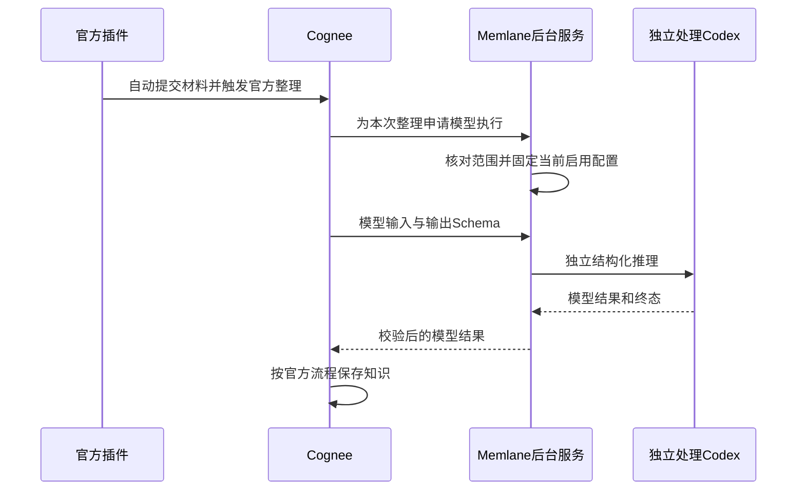

# Codex coding-memory 与代码图谱接入规格

状态：开发已按用户要求暂停；恢复须用户明确指示，当前见[暂停交接](../../../engineering/coding-memory-handoff-20261112.md)。第 5.2 节的试用范围自动替换／只读规则已于 2026-11-12 获用户明确确认。正式 Codex 通道已补充 Schema 兼容及源码／协议检查，尚未启用本规格的日常自动采集或执行数据迁移；实际完成边界见[正式接入进度](../../../engineering/coding-memory-production-20261112.md)。

2026-11-12 环境决策更新：用户明确“直接日常环境，没必要独立，现在就我自己在用”。因此直接更新日常 Cognee 服务和配套官方 Codex 插件，不另搭试用运行环境。升级前保留可恢复的数据和配置备份、旧组件版本；升级操作与主 session 协调执行。该决定不取消模型推理与编码上下文的防循环分离，也不扩大已有人工知识及历史的自动删除范围。

2026-11-12 范围追加：用户要求 Cognee 图谱能力上马，并明确纠正为“代码图谱”。本期增加第 10 节的代码索引、符号／调用／依赖查询及 Codex 使用；不是新增通用知识实体图范围。这条最新决定覆盖此前首版隐藏代码图谱入口的范围决定，不表示历史停止问题已通过或失败计数清零。

2026-11-12 最新范围变更：本阶段移除 Memlane 项目／Agent 权限管理，默认所有 Agent 均可读写。项目／dataset 仅表示数据归属与检索分组；不保留读写白名单、角色、授权确认和撤权页面。连接认证、任务取消／去重／来源版本校验继续保留。全局清理与未完成项见[移除权限管理实施记录](../../../engineering/remove-agent-permissions-20261112.md)。

## 1. 目标与本期范围

用户已确认按“Cognee coding-memory 值得跟进、预期能够解决编码记忆问题”的方向推进。Memlane 复用官方采集、提炼、存储和召回，负责安装配置、模型通道、阅读和运行控制。

本期完成一条 Codex 连续使用链路：

> 用户正常编码 → 官方插件自动采集 → 官方 Cognee 自动整理 → 调用用户在 App 选定的 Codex 完成推理 → 官方存储实际知识 → App 查看知识和出处 → 新编码会话自动收到相关知识。

首个交付范围为当前日常环境、一个明确选择的日常项目和 Codex。沿用官方项目／dataset 归属映射，明确自动生成知识范围；不要求另建 HOME、数据库、服务端口或第二套运行环境。保留电脑级连接入口；连接本身不要求项目或模型，采集和整理按任务开关与当前处理配置执行。

本期不扩展其他 Agent、不导入历史聊天、不迁移旧知识、不研究新的提炼算法、不进行 Token 测试或优化、不进入完整包／正式发布阶段。已有质量失败记录保留；采用上游方向不等于把旧失败改为通过。

## 2. 用户流程

### 2.1 开启试用

1. 用户在现有“设置 → Agent 连接”中安装官方 Codex 插件。App 分别反馈已安装、需信任／重载、已验证及失败，不将安装完成显示成采集可用。
2. 复用“设置 → 记忆处理”，选择已连接的 Codex，完成真实结构化推理验证，再明确设为当前使用。保存配置不自动启用。
3. 用户选择日常项目及采集范围。App 使用该项目已确认的官方 dataset 映射，显示 coding-memory 的实际可用状态。
4. 用户正常进入 Codex 开发，无须逐条复制提示词、手动保存记忆或另外输入模型供应商 Key。

### 2.2 日常编码和后台整理

1. 官方插件按固定版本行为采集请求、最终回答和工具轨迹；由官方决定会话结束／冷却等整理时机。
2. 整理触发后，Cognee 执行官方 improve 流程；其中的模型请求通过受管通道交给选定 Codex。
3. Codex 在独立处理上下文中返回结构化结果，由 Cognee 使用并生成知识；编码会话保持独立。
4. 用户可在 App 看到实际整理状态和失败原因；没有产出时显示“本次未生成知识”，不造知识行。
5. 用户在知识页打开正文、查看对应来源会话／工具，返回后保留选择、展开和滚动状态。
6. 下次 Codex 编码会话由官方插件自动注入相关知识。App 不再额外注入第二份内容。

### 2.3 模型暂不可用

未选择模型、未启用、认证失效或执行失败时，采集与整理状态分开。已被官方接受的材料保留，不显示为知识已生成；实际本地待发、官方缓存和长期材料分别据真实回执展示，不承诺超出官方生命周期的保存。恢复后按明确重试动作或官方已验证机制处理，不创建另一个无限重试循环。

## 3. 职责划分

| 参与方 | 职责 |
| --- | --- |
| 日常 Codex | 完成用户开发任务；通过已配置官方插件接受相关知识 |
| 官方插件 | 采集实际材料、项目标记、发送、触发官方整理、召回注入 |
| 官方 Cognee | 会话材料、improve、提炼筛选、知识存储、向量／图谱和官方替换行为 |
| Memlane 后台服务 | 安装与版本管理、数据归属映射、启用配置、模型请求生命周期、取消和真实状态关联 |
| 独立处理 Codex | 只执行获准的模型推理，返回符合 Schema 的结果；不读项目、改代码或直接保存知识 |
| Memlane App | 沿用已认可设置和项目页面，展示实际知识、出处与状态，并提供运行控制 |

Memlane 不另写采集器、提炼器、召回器或全文知识镜像库。允许保存必要的配置、范围绑定和执行回执；不因需要进度显示而另存全部提示、会话和知识正文。

## 4. 官方后台整理的模型通道

### 4.1 必须接通的关系

安装插件只接通 P→C，不自动接通 C→M→X。这是本期需要完成的核心集成。

### 4.2 配置与执行归属

- 模型执行使用 App 已明确启用且验证有效的配置。没有配置时返回明确不可用，不使用假 Key，不自动改用其他模型或 Agent。
- 项目／dataset／服务身份来自真实服务请求和客户端数据绑定，仅用于归属和来源定位，不作为 Agent 读写权限。
- 每次官方整理运行固定处理配置及其代次；该运行内部的模型请求使用同一选择。用户切换配置作用于后续运行；停用或明确取消必须影响当前执行。
- 通道限制在本机受管服务间，连接认证核实服务身份，不把开放端口或只有模型名当作可靠连接。凭据不进入报告、普通日志或知识正文。

### 4.3 执行、停止与错误

- 复用现有 Codex runner、Schema 校验、配置账本、取消和进程回收能力，不能把本次验收临时脚本作为正式运行依赖。
- 通过服务薄适配将官方自动 improve 关联到受管模型生命周期，保持官方采集和整理触发。具体 SDK 接入点在实现前核对并固定，不能仅令“App 手动整理”通过就称自动整理完成。
- 处理上下文不加载日常采集 hooks／插件、项目上下文、历史会话或知识写入工具；验证实际运行配置与事件，不能仅靠提示词。
- 复用已有执行槽位，明确排队、活动、取消中及终态。关闭窗口按既有后台规则处理；明确停止服务后不能继续发起新模型调用。
- 请求出错区分认证、执行者不可用、超时、取消、Schema 失败与结果未知。结果未知先检查原运行，不默认当失败重新执行。
- 取消时同时处理当前推理、待处理模型请求及官方后台运行；只有观察到终止才显示已取消，不能把取消 ACK 当成完成。
- 官方流程可能已写入部分材料或知识。失败和取消保留这些事实，不声称整次事务回滚。
- 官方运行身份可可靠取得时关联执行回执；重复触发继续复用官方锁／水位等机制。没有幂等证据时不承诺恰好一次。

## 5. 知识、出处与自动更新

### 5.1 直接读取官方产物

- 支持旧知识正文及 coding-memory 新正文，识别 Lesson-Type／State-Key 等固定官方封装，正文与类型分别呈现。
- 只有实际生成并持久化的学习文档计作知识；QA／trace 文档和图谱节点不能冒充知识条数。
- 保留 dataset、项目范围、官方文档 ID、会话关联及可用 Git 信息。类型和元数据只用于解释和定位，不证明内容已获人工确认。
- 出处只跳转实际匹配且获准的会话；有精确 QA／trace 关联才定位到条目，否则说明关联整个会话。时间或 commit 未提供时显示未知，不补造。
- Git commit 不一定包含未提交修改，不能把它冒称知识对应代码的完整快照。
- 后台刷新保留仍有效的阅读状态；旧 ID 被官方替换后显示已变化并刷新，不展示空白或继续当成当前知识。来源身份或版本已失效时撤下错误正文。

### 5.2 自动替换：用户已确认的试用边界

用户于 2026-11-12 对上一轮明确提出的“新试用项目中的官方生成知识允许自动替换并暂时只读”回复“允许”。据此确认：**新试用 dataset 只承载官方自动生成知识，允许官方在该范围内执行同键替换（包括 state／pitfall）；App 对这些输出先提供阅读和出处，不提供未经实现的编辑／历史恢复承诺。**

已有手写、编辑、确认过的知识及历史不迁入这个 dataset，不进入本期自动替换范围；旧功能与数据保留。既有日常自写采集如仍启用，切换前需要明确核对和防双采集，不能直接叠加新插件。

随后用户明确直接使用日常环境，因此上述规则在日常环境中接入的官方自动生成知识范围内实施，不再要求独立试用运行环境。已有手写、编辑、确认过的知识和历史仍不纳入自动替换；按可靠内容来源及本轮任务范围核对，不能仅因使用同一个服务就混入。用户接受本范围内官方生成知识暂时只读；旧知识的编辑／历史能力继续保留。不为该例外默认新建知识全文或历史镜像库。此决策解除该规则的产品待定项，不表示安装、模型通道、日常配置切换或数据迁移已完成。

## 6. 版本、代码与并行边界

使用固定插件／服务端组合、提交 SHA 和能力检查。发现不匹配时显示具体组件问题；开关不能代表能力已经存在。组件更新直接在日常环境执行：先记录实际运行版本、依赖路径和配置，停止写入后制作一致数据备份，再更新和核对。保留旧组件及恢复方法，不另搭环境作为前置门槛；保留原验证版本与失败记录。

首轮参考输入为实测插件 1.8.0 对应 `a176248914fdb32a78354854b300174203b15a5c`、服务端 `ec6f40859e5f2df9e7862dde27d580ac3268ed43`；这只是已知基线，不把“Draft 可运行”写成已发布。正式选取输入时核对最新差异和兼容性。

| 工作 | 现有接点／预期改动 |
| --- | --- |
| 新知识格式 | `internal/official/documents.go`、`knowledge.go`：来源与正文兼容、元数据核对 |
| 正式模型通道 | `internal/processing`、`internal/agents/codex_completion.go`、`engine/python/cognee_processing_adapter.py`：复用执行与校验 |
| 自动 improve 生命周期 | `engine/python/cognee_session_processing.py`、官方服务适配与 daemon：接通后台触发，明确活动拥有者 |
| 组件与插件 | `internal/official`、`internal/agents/official_codex_plugin*`、组件配方：固定版本、配置与实际能力反馈 |
| App 接入 | 沿用现有官方知识／会话及设置页，由 UI 主 session 按确认接口集成；本 session 不直接改其 UI 文件 |

源树含并行修改时，使用包含必要未提交文件的可追溯隔离快照，记录来源散列，继续避免覆盖主 session 的 UI 修改。运行环境直接使用日常环境；只修改本次升级／官方接入所需配置，保留第三方配置。启停／替换共享 App、daemon 和 Cognee 组件前与主 session 协调，由同一运行拥有者串行执行，避免两个 session 同时操作。开发执行继续遵守 task.py、100 GiB 磁盘门禁和开发阶段不打完整包规则。

## 7. 执行顺序与阶段产物

| 阶段 | 产物 | 本阶段不代表什么 |
| --- | --- | --- |
| A 读取兼容 | 现有真实知识样本可读取，正文／类型／出处正确；向 UI session 交付接口和样本 | 不代表自动采集／处理通过 |
| B 正式模型通道 | App 选定 Codex，通过受管通道完成官方整理、取消与错误反馈 | 单独手动整理不代表后台自动触发通过 |
| C 官方自动运行 | 正常官方插件退出触发整理，实际使用 B 的通道，无人工补调用、无递归采集 | 不代表全部 Agent 或旧数据迁移完成 |
| D 新项目连续使用 | 两项真实开发任务，新会话实际使用前项知识；App 阅读和出处自验 | 不代表发布包／用户历史导入完成 |

沿用“先主流程、集中实现、最后整体验收”的执行方式。阶段 A 可使用已封存产物，不为每个字段修改重复启动模型。B／C 是正式集成重点，先解决生命周期与来源一致性，不临时绕过后留到交付补齐。

## 8. 验收规格

| 编号 | 场景／操作 | 通过标准与证据 |
| --- | --- | --- |
| CM01 | App 安装配套官方插件／组件 | 真实安装版本和能力匹配；信任／重载单独反馈；保留第三方配置 |
| CM02 | App 选定并启用 Codex 处理 | 真实结构化验证；保存／启用分开；不另填 Cognee 模型 Key；不改日常模型 |
| CM03 | 正常开发后退出会话 | 官方自动采集并触发整理，官方材料包含实际 QA 和工具轨迹；无人工 memory_save／entry 灌入 |
| CM04 | 后台整理调用模型 | 官方请求实际进入受管 Codex 通道；输入、Schema、终态与官方产物可关联；不依赖临时脚本 |
| CM05 | App 查看新知识及出处 | 正文／类型／真实状态一致；来源匹配；返回保留阅读状态；无产物如实显示 |
| CM06 | 第二项开发任务开新会话 | 官方知识实际进入新会话且与任务相关；核对真实注入和开发行为，不能只让模型声称记住了 |
| CM07 | 当前状态变化 | 在日常环境获确认的官方生成知识范围内更新成功，App 无旧 ID 残留或正文错配；保护范围外内容 |
| CM08 | 模型未选／失效／格式错误 | 材料状态与知识状态区分；有明确错误；不偷偷切模型、伪造成功或清空已有材料 |
| CM09 | 取消、停用及重开 | 观察实际停止、拒绝迟到结果，记录部分产物；不自动恢复已停任务或启动第二重试链 |
| CM10 | 防循环与范围隔离 | 处理会话不被采集，没有递归整理；无项目文件／历史访问和直接知识变更工具；核对配置与实际事件 |
| CM11 | 并发／重复触发 | 所有执行有归属并受现有槽位约束；依据官方锁／水位核对实际处理，不用请求数猜幂等 |
| CM12 | 日常升级与回退 | 升级前备份一致、旧组件版本可恢复；直接日常环境启用和验证，停用后不再发起新整理；已有官方／旧数据保留，必要时数据库与组件按配套备份恢复 |

真实链路验收后由 Agent 先自验，再交用户。模型、官方服务、Native 和发布分别记账；不以单测／页面打开替代完整链路。继续保留已知知识质量问题累计 2 轮、临时 Schema 适配问题失败 1 轮及仓库其他停止项，不换 ID／版本重置；同一问题第 4 次未通过时执行停止规则。无关停止项不恢复，不用每个阶段触发全仓重跑。

## 9. 规格确认后的交付物

- 固定组件输入与升级／停用方式。
- 正式模型通道及官方自动触发的实际运行证据。
- 新知识读取与出处接口，以及主 UI session 的集成结果。
- 日常项目两项连续开发任务记录和新会话知识复用证据。
- 失败／部分产物／取消／保护数据清单与当前未通过项。

相关依据：[模型桥接要求](../../../agent-model-bridge-requirements.md)、[当前内容契约](ui-redesign/content-model.md)、[隔离实测](../../../engineering/coding-memory-codex-validation-20261112.md)、[上游来源分析](../../../research-coding-memory-origins-20261112.md)。这些材料中的旧工程状态不替代新交付证据。

## 10. 代码图谱接入

### 10.1 用户能做什么

2026-11-12 用户明确确认：代码图谱必须由用户在项目内主动开启。**新项目默认关闭，开启入口放在该项目的设置／代码图谱区域，操作只作用于当前明确的项目和工作区。** 连接 Agent、安装插件、打开仓库、开启 coding-memory、正常聊天或 Agent 自行请求索引均不能代替这次用户操作，也不能批量开启其他项目。

用户在日常项目中明确开启代码图谱后，可以：

- 查找函数、类、文件和模块，查看对应路径及位置。
- 查询谁调用某个符号、该符号调用什么，以及文件／模块依赖。
- 查看修改一个符号可能涉及的静态调用／依赖范围；结果作为排查候选，不承诺完整运行时影响。
- 代码变化后更新索引，明确当前索引对应的实际工作区和来源，不能把旧图冒充当前代码。
- 让已连接的 Codex 使用同一官方图谱回答上述问题，减少反复搜索源码。

2026-11-12 用户进一步明确不喜欢 Memlane 自绘图，要求直接使用官方现成图、先有功能，性能或外观后续由用户再提出。**本期放弃 Memlane 自绘图路线，采用 Cognee 官方原有图视图，由 MyGo 嵌入承载。** 项目内的控制入口、项目归属、数据连接和必要导航由 Memlane 接入，不重新实现图布局／绘制算法，不先做样式重写或性能专项。

MyGo v0.7.4 已有 `Window.NewWebView`／`ui.WebView`，可在现有原生项目页面中承载官方 Web 图区域；技术可行不等于实际集成已通过。具体直接加载官方页面还是本地打包官方画布，按真实项目范围和依赖核对选择最小适配，不把整套网页登录／导航强加给日常使用。用户此处的“原生的”按上下文记录为 Cognee 官方现成功能；会话正文和其余页面继续沿用现有 Native 契约。本 session 不直接修改主 UI session 的文件。

源码调研后采用的接入方式：**本地打包官方图谱组件，在 MyGo 原生项目页内嵌 WebView，仅适配项目数据、启动／停止与选中／来源导航。** 保留官方画布及所需面板的布局、样式和交互；不搬入整套 Next 登录、租户切换或跨项目治理页面，不新增一套 Memlane 绘图器。MyGo 当前锁版本已具备承载能力，本项不要求升级 MyGo。当前 App 还需增加前端静态资源构建／加载和页面事件桥，不能把“有 WebView API”当成零接入工作。

官方前端参考固定 main `8853378eae5366addb064e758e560a456146ae1a`：`BusinessGraphCanvas`／`BusinessCanvas` 使用 React + Canvas 2D；`codeGraph.ts` 已处理函数、模块、文件、端点等代码节点。该 Web 版本与服务端草案是两个独立输入，实施必须核对组合，而不是把本地旧 Web checkout 或最新页面能力外推到当前运行包。主要 Enola 类别有映射依据，其余类别按实测说明覆盖范围；不因不支持某类而静默声称全量展示。

数据优先沿用官方可视化 payload（`nodes`、`links`、`color_maps`，含节点 stage、来源和关系类型），经 Go/daemon 按当前项目允许的 dataset 获取。已核对 Web 的图读取使用 `/v1/visualize/json`，本地请求适配到 `/api/v1`；是否支持 SSE／JSON 回退以所选服务版本能力为准。不把代码搜索结果或原始 nodes/edges 列表不经核对就当成官方画布输入，也不向网页复制后端凭据。

### 10.2 与 coding-memory 的关系

coding-memory 记录经验、约定和任务状态；代码图谱表示静态代码结构。两者共用日常 Cognee 运行环境，但分别管理数据范围、开启状态和就绪状态。代码索引更新不能触发用户知识迁移或冒充新增知识。

固定插件的 coding-memory 路径会关闭原本的自动 code-graph indexing，因此不能认为打开 coding-memory 就顺带开启代码索引。实现先核对固定官方版本中显式索引／查询入口，复用这些入口；自动更新如需要补接，由 Memlane 调度官方能力，不另写解析器或并行索引器。两条链路同时启用必须取得实际证据。[官方插件 PR #581](https://github.com/topoteretes/cognee-integrations/pull/581)

### 10.3 实现与数据边界

- 优先使用同版本 Cognee 官方代码抽取、存储和查询能力。旧 G0／G1／G2 的现有实现和证据用于复核已有能力、任务正确性及回归要求，不自动认定旧 Rust worker 管线就是本期官方服务的同一条链路，也不同时重复建两份代码图。
- 每个项目／worktree 明确开启；代码数据与会话知识分开标识，未开启项目不扫描，关闭后停止新扫描并排除迟到结果。
- 主动开启必须落到正确工作区与服务端任务状态检查，不能只隐藏按钮。官方插件自身的会话启动索引、变更刷新和显式索引入口均须服从项目开启状态；仅设置 `COGNEE_CODE_AUTOINDEX=off` 不能作为完整关闭证明，因为官方说明已索引仓库仍会自动刷新。用户开启后才允许首次建图及后续变更更新；重开 App／Codex 不得把关闭项目自动打开。
- 尊重忽略规则，不扫描凭据、依赖／构建目录或通过链接越出工作区；索引不执行项目脚本或安装项目依赖。覆盖语言据固定抽取器核对，优先复用已有 TypeScript／TSX、Python 的验证依据，不把支持承诺推广到所有语言。
- 官方索引文档说明会写仓库内 `.enola/` 生成物；接入需明确输出位置、忽略与清理归属，不能宣称官方默认索引对工作区零写入。复核旧只读原仓契约与这一行为的差异，优先使用官方支持的输出／快照方式，不自动修改用户全局 Git 配置。
- 结果返回可靠的项目、工作区、文件和位置以及可用版本信息。对未提交改动需能判别来源是否仍一致；若官方缺少所需字段，先明确兼容方案，不伪造来源或默默新建图数据库。
- 重命名／删除后旧符号不能继续作为当前结果；失败保留可识别的旧索引状态，不伪装成空结果或最新结果。启停、更新、去重和取消沿用既有所有权规则及官方支持，不让插件与 App 同时扫描同一范围。
- Codex 可以读取各项目已有代码图谱，查询返回来源与索引版本状态，不按项目／Agent 读写白名单拦截。未建图或来源已变化时如实反馈；模型处理会话继续隔离采集与项目工具。图查询使用官方有限接口。

### 10.4 交付顺序与验收

先复核现有 G2 能力和固定官方组件 → 接通一个日常项目的显式索引与查询 → 供 Codex 使用 → 接入必要 App 控制与来源 → 验证变化更新及与 coding-memory 共存。主线仍完成第 7 节的记忆闭环，不因追加图谱而放弃原目标。

| 编号 | 场景 | 通过标准 |
| --- | --- | --- |
| CG01 | 开启／关闭 | 新项目默认关闭；连接 Agent／开仓库／开启 coding-memory 均不扫描；用户在项目内点击开启后才首次建图；关闭后停止新扫描及自动刷新，迟到任务不能发布当前图；其他项目不受影响 |
| CG02 | 结构查询 | 官方实际结果覆盖已知符号、调用者／被调用者、依赖，能回到正确文件与位置 |
| CG03 | 代码变化 | 修改／重命名／删除后查询更新；未完成或过期时明确显示，不使用陈旧结果冒充当前 |
| CG04 | Codex 使用 | 日常 Codex 实际调用官方查询并据真实结果回答，不用提示词或预置答案代验 |
| CG05 | 共存 | 同一日常环境 coding-memory 与代码图谱分别可用，无重复扫描、无记忆处理递归 |
| CG06 | 范围与故障 | 未建图／错误来源／忽略文件不冒充当前结果；失败、取消及重开保留准确状态和已有材料 |
| CG07 | App 连续流程 | 开启→进度→查询→源码位置→返回的状态正确；与主 UI session 集成并完成实际窗口自验 |

CG07 使用官方现成图进行验证；官方图中的节点、边、缩放、选中及跳转以实际支持为准。未获用户后续指示前不再优化旧 Memlane 自绘图，也不以审美／性能目标另造图组件。详细复用判断见 [Cognee Web 与 MyGo 图谱调研](../../../research-cognee-web-mygo-graph-20261112.md)。

CG07 还需实际验证本地资源加载、窗口尺寸变化、图内与原生控件的焦点／菜单、节点及来源点击、项目切换和关闭后的状态。WebView 隐藏会保留页面，必须同步清除不再有效的项目数据。MyGo 原生 `Window.CapturePage` 不含 WebView 像素，图谱验收使用网页自身截图并配合真实系统整窗证据。本期不增加图谱性能或美化验收门槛。

历史依据：[正式代码契约](p4-code-contract.md)、[G1](../../../p4-code-app-validation.md)、[G2](../../../p4-code-update-validation.md)。已停止的具体图谱／helper 问题先核对原触发条件和失败账本，本期恢复方向不删除原计数；遇到同一问题已累计第 4 次失败时，按原规则记录并向用户说明，不能借官方新路径或新版本自动重置次数。

## 11. 实体与知识／记忆的关系图

2026-11-12 用户进一步询问实体与记忆之间是否有现成关系图。已核对官方 Web：除实体间关系外，`computeBrainState` 有 document／chunk 与 entity 的 `docLinks`，以及包含文档、片段、摘要等内容的 Records 层输入。底层和官方视图均已有这类关联基础，不需要 Memlane 重新发明关联或绘图。

采用同一官方图组件展示既有内容关系：从知识查看涉及的实体，从实体查看相关知识及实际出处。这里的知识对应真实官方学习文档；官方原始材料、文本片段、摘要仍保持各自类型，不能把所有 Records 一律称为已生成知识。关系可能经过“知识文档 → 文本片段 → 实体”，不伪造直接边或将共同出现当成支持／因果关系。

按官方现成 Records／来源视图和面板接入，保留官方交互，不要求把所有知识卡片重做成全新的专用节点样式。显示与跳转使用真实文档、片段和实体 ID，按当前项目筛选数据集，并支持切换项目。实体知识关联的浏览不会开启代码扫描；代码图谱仍独立遵守第 10 节的项目主动开启规则。

验收核对一条实际知识对应实体、同一实体关联多条材料、从实体回到正确知识／出处、知识与原始记录分类、项目切换、来源版本与迟到结果。若官方当前图只返回部分节点，明确已加载范围；不补造节点、边和完整性。此节记录已核对能力及复用边界，未宣称本机已完成官方图的运行接入。[官方关系与 Records 层代码](https://github.com/topoteretes/cognee/blob/8853378eae5366addb064e758e560a456146ae1a/cognee-frontend/src/modules/business/computeBrainState.ts#L278-L313)
