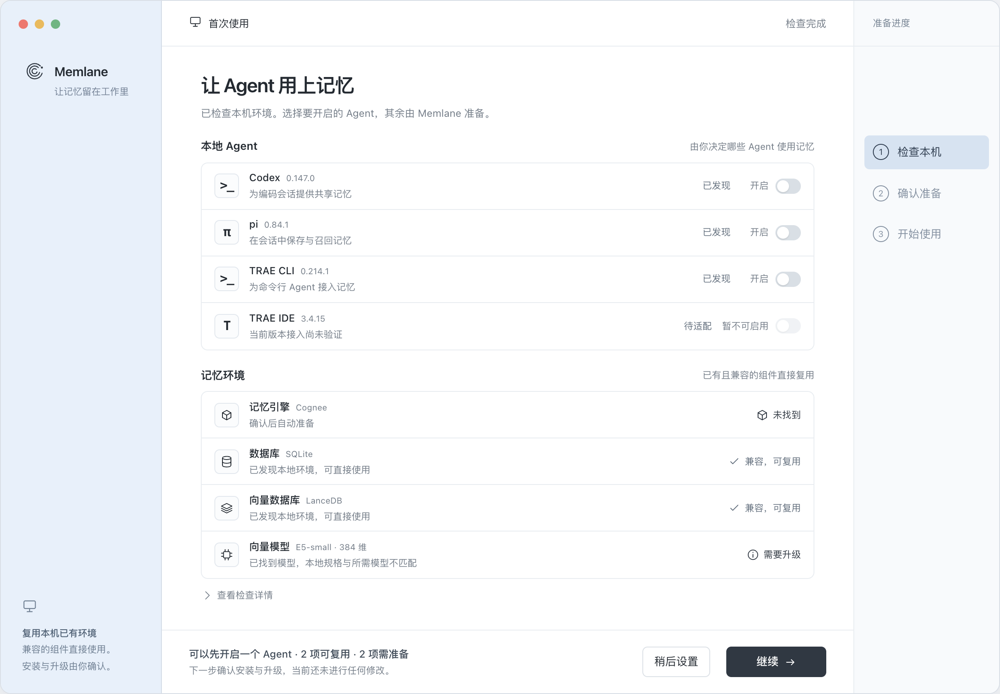
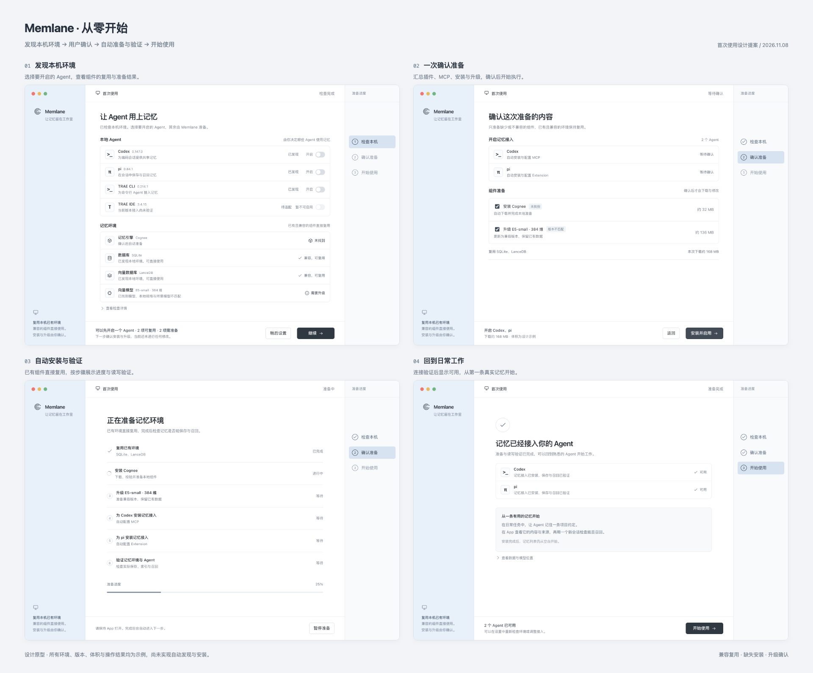
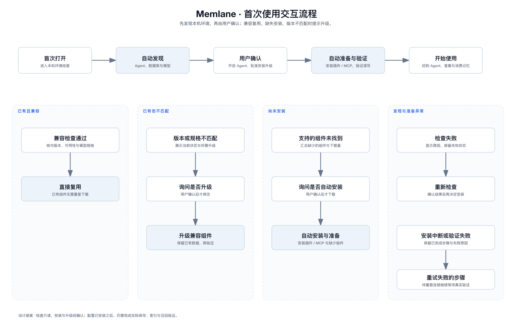

# 首次使用：本机环境发现与准备选定设计

2026-11-09，A 初始配置与设置复用 revision 13 已认可，实施以 [A 实施交接](ui-redesign/a-setup-handoff.md) 和固定提交 `e27a49e35020972d6aea4ab070ec898fb6c9c22e` 为准。当前初始化仅「准备环境／连接 Agent／配置记忆处理」，首任务和记忆结果在日常使用中承接。环境正文的原认可稿见 [环境契约](ui-redesign/a-environment.md)，冻结提交 `5f4c504bfbc6ee07a571b015f7ccc809d0943848`。本页下文图稿与流程保留为历史记录，设计认可不代表新版生产 UI 已实现。

2026-11-08。用户已确认本轮流程，并最新选定方块散落、归整后形成灯泡的启动效果。设计原型保留归档。正式 App 已实现本机发现、明确确认、真实 Rust/E5 组件准备与验证、持久首启状态和方块灯泡；空根实际本机包已通过。官方 Cognee/Agent 真实准备、正常任务、来源/实体/Rust与全新召回连续路径已通过；首启按原型结构续改，新包结果见 [本轮验收记录](../../../onboarding-memory-validation.md)。

流程：自动发现本地环境 → 展示可复用、缺失与不匹配结果 → 用户确认启用 Agent、安装和升级 → 自动准备与验证 → 开始使用。

2026-11-09 Q1–Q3 产品确认：本机环境准备完成后，“开始使用”的首个业务选择为 Agent；提示用户选择项目并允许跳过，完成必要接入与真实可用验证后，由 App 引导完成第一项真实 Agent 任务，再查看实际记忆与出处。未选择项目时，在连接后首次有效数据到达再按受信仓库身份自动建立或复用项目。当前正式包仍依赖先登记项目，新顺序及项目尚未建立时的授权衔接待整合验证；细节见 [产品问题记录](product-questions.md)，不以跳过项目自动授权采集。

2026-11-09 Q4 产品确认：首版隐藏代码图谱入口，首次任务引导不引入代码图谱操作；记忆、实体和关系图三个浏览视图继续保留。

兼容的数据库、向量数据库与模型直接复用；发现失败保持未知。用户启用 Agent 后，自动安装对应插件、Extension 或 MCP。实际读写验证通过前不能显示可用。

## 界面设计

首次启动先呈现全白检测画面，中央蓝色小方块随真实环境发现、准备与验证由散落归整为灯泡，下方显示实际阶段。发现结束即进入紧凑结果页，不添加固定成功计时；准备/ready 页使用小型阶段标记，保留任务与下一步的内容空间。此前点阵球截图与动图仅作探索归档。完成首启后再次打开直接进入正常界面。

[查看此前点阵球探索动图](images/first-launch/startup-breathing.gif)

环境结果与准备页面的步骤放在右侧进度栏；左侧保留品牌和环境说明，中间承载内容与操作。步骤随流程更新，窄窗口下底部按钮保持完整。

## 交互流程

## 原型与验证

可点击原型位于 `prototype/selected-ui` 分支的 `prototypes/first-launch/index.html`。本机现有原型 worktree 入口为 `build/p3-prototype/prototypes/first-launch/index.html`，直接打开即可离线体验。

包含部分已安装、全部兼容、全新环境、版本不匹配、未发现 Agent、发现异常、安装失败、验证失败和待重载场景。示例数据和评审工具栏仅用于设计讨论，不作为本机真实状态或接入结果。

浏览器核验覆盖授权、复用、升级、失败重试、待重载、跳过恢复和窄窗口，记录保存在原型 `artifacts/verification.json`。已实际打开原首页／三栏设计图，以及本轮渲染图进行对照。

## 探索归档

薄雾视觉及提高可见度后的版本保留在 `prototype/selected-ui` 分支的 `prototypes/first-launch/`，不作为选定启动方案。`index.html` 的原型旧默认仍是点阵；本轮明确使用 `blocks.html`，不将旧默认误写为当前选择。

另有 `blocks.html` 方块归整探索：许多蓝色小方块从散落逐行排列，再汇聚成灯泡亮起，表达知识带来灵感。该版本已由用户选定，表达本机环境准备的进展，不执行或暗示真实记忆提炼。正式实现与验收状态见 [共同契约](onboarding-memory-contract.md)。

2026-11-09 交互续改：正式 MyGo 首启已按 `index.html` 的页面信息层级实现紧凑分组、默认折叠详情、准备确认、真实任务进度、固定顶部/底部操作与右侧编号/当前步骤高亮。首启只确认本机环境；官方 Cognee 模型与 Codex 插件、项目采集范围仍在实际项目内独立确认。官方准备、正常任务、来源/Rust/全新召回的真实结果见 [共同验收记录](../../../onboarding-memory-validation.md)，不把原型开关或已发现状态当可用。
