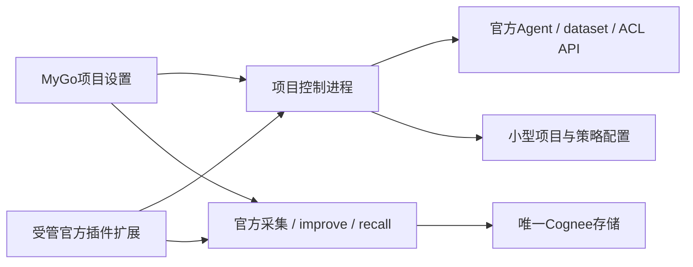

# 项目权限管理技术方案

日期：2026-11-13。状态：可评审实施方案，未编码／运行验证。配套：[产品](project-access-product-plan-20261113.md)、[规格](project-access-spec-20261113.md)。采用本方案列出的确定选择，不将接口与行为问题推迟为笼统待研究项；源码事实和需要运行验证的断言分别注明。

## 1. 基线与已经查清的行为

官方固定输入见[组件清单](../../../../engine/coding-memory-components.json)。源码核查记录及精确行号见[能力核查](../../../research-project-knowledge-official-capabilities-20261113.md)第8节。

| 事实 | 设计后果 |
| --- | --- |
| 插件 get_dataset 取配置／launch record，不按 cwd 自动选项目 | 在 SessionStart 首次 ensure_launch_record 前补解析，不改全局env替代路由 |
| coding capture 先 parse_transcript，再写官方插件 durable buffer／spool，最后 drain | 只等服务端403不能实现不采集；策略门禁必须在解析正文和排队前 |
| warmup drain 对HTTP错误停止并保留未发尾部，后续prompt／Stop／final可能再drain | 授权拒绝需要 blocked 状态及停止重试，不能只显示错误 |
| typed remember entry 对目标dataset检查write后才入服务cache；权限拒绝通常403 | 官方仍是最终写权限边界；区分401、403和网络失败 |
| 显式remember的HTTP拒绝不降级，断网可走CLI fallback | 受管模式禁用离线CLI fallback，避免另一身份／另一库 |
| coding distill需要write及delete；同State-Key旧知识会被替换删除 | 最小方案明确可写维护 = read/write/delete，share仅管理侧 |
| owner直接调Agent session improve，不会自动读到Agent身份的会话缓存 | 不采用owner代调的假设，improve沿原Agent身份执行 |
| 官方授权是user／role／tenant允许权限的并集，没有deny覆盖 | 不保留共享广泛角色；撤销具体ACL后必须核对有效权限 |

上述为固定源码结论，不等于本机新组合已经运行验证。普通remember拒绝、improve阶段失败并不统一同一HTTP状态：按该接口结构与阶段分类，improve还可能返回409等，不把所有非200都归为无权限。

## 2. 架构选择

保留官方服务与原内容流水线；新增一个**仅管理项目关联与策略的本机控制进程**，随 `scripts/dev.py` 启停，独立于GUI窗口。选择Python以复用现有aiohttp和运行环境；本版使用明确配置的 `http://127.0.0.1:<project_control_port>`，不自动选端口、不对外监听。

这一进程是本需求新增的必要职责，明确改变原先只需启动器与官方服务的目标结构，不伪装成现有功能。它只保存配置及同步回执，不接收知识正文、不代理任意官方HTTP、不执行处理任务、不建立业务任务库。旧daemon和outbox不恢复，completion端点仍只承担模型协议。

推荐文件边界：`engine/python/project_control.py`、`project_policy.py`、`internal/simpledesktop/project_access*.go`；仅在现有启动器、官方Client与App的项目入口作小范围接线。本次不创建这些源码。

## 3. 配置、身份与继承算法

控制进程是 `project-registry.json` 的唯一写者，存放私有运行配置目录，文件0600；单实例文件锁、同目录随机临时文件、fsync及原子rename提交。配置包含 schema_version、稳定service_namespace、revision、模板、Agent主体引用、项目路径别名／dataset关联、字段覆盖和applied_revision；不存正文与明文key。密钥放独立0600私有文件，仅保存引用，未来release可换系统凭据存储。

新项目ID由 service_namespace 与规范仓库根生成稳定UUID；官方组命名 `ml-project-<project_id>`，名称不含用户目录。同名不同路径不合并。symlink规范化后复用；子目录取Git根；worktree／clone首版各自登记，用户可主动关联别名；目录移动后通过关联选择原项目，不能按remote自动合并。非Git目录只接受宿主明确工作区或用户选定目录，不把临时shell cwd当项目。

默认值提案：受管Agent访问=maintain（read/write/delete）、capture=true、auto_process=true；通用知识访问=read。字段继承公式为 `effective(field)=project.override[field] ?? current.defaults[field]`；显式false不视为缺省。模板改变增加revision，重算所有继承字段，覆盖字段不变；恢复默认删除该覆盖值。新Agent注册即加入模板计算，具体项目覆盖按安装实例ID识别。

访问级别不允许互相矛盾的独立read/write组合：none={}、read={read}、maintain={read,write,delete}。维护含数据集级delete的真实能力，产品必须显示含删除，不承诺只删自动生成知识。自动处理=false只约束受管插件自动触发，仍允许有权手动操作，不新增服务端禁止所有手动处理的承诺。

## 4. 控制接口与官方集成

控制接口区分管理token与每个安装实例的控制token，固定方法／路由白名单。管理token不分发给Agent；Agent请求身份由token解析，不能在body指定另一个principal。请求均有长度、超时限制，响应不含原始错误、凭据或聊天。

| 自有窄接口 | 契约 |
| --- | --- |
| `POST /v1/project/resolve` | Agent提交真实工作区与host session key；按预设模板登记／复用，返回project_id、官方dataset UUID／名称、effective policy、revision、applied状态；不能提交自选ACL／owner |
| `GET /v1/project/policy?project_id=...` | 当前Agent获取最新规则与就绪状态，无权内容不返回正文；首次未知项目只经resolve建立身份 |
| `GET /v1/projects` | 管理身份取完整目录，返回revision；供桌面刷新与关联选择，不返回key |
| `PUT /v1/defaults`、`PUT /v1/projects/{id}/overrides` | 管理身份带expected_revision提交；版本冲突409，不能覆盖其他session修改；返回实际同步状态 |
| `POST /v1/projects`、`POST /v1/projects/{id}/aliases` | 管理身份主动新建／关联；验证官方owner、类型、重复关系，使用同一登记函数 |
| `POST /v1/projects/{id}/reconcile` | 管理身份明确核对未确认操作，不自动重放内容／处理任务 |

官方请求继续 `X-Api-Key`，不把completion Bearer或JWT混入。官方精确API：

| 用途 | 固定接口 |
| --- | --- |
| 创建Agent子用户 | `POST /api/v1/agents/create?name=<unique_name>`，无JSON body；响应含 `agentId`、`agentEmail`、`agentApiKey` |
| 数据组目录／创建 | `GET /api/v1/datasets`；`POST /api/v1/datasets` JSON `{"name":"..."}`，校验返回UUID／owner／名称 |
| 授权／撤权 | `POST`／`DELETE /api/v1/permissions/datasets/{principal_id}?permission_name=<read|write|delete|share>`，body为UUID数组 |
| 直接授权查询 | `GET /api/v1/permissions/principals/{principal_id}/datasets?permission_name=...`；同时核对角色／tenant有效权限，不能仅此查询就推断全部撤权 |

管理侧统一拥有项目数据组；Agent自建数据组即使同名也不会被登记为项目。禁用shared-agent-memory自动补全广泛角色和identity自动回退。旧owner key从受管Agent配置退出，并确认旧消费者不可继续使用；需要换key时先保留服务与数据关联，不重建日常库。

安装／配置实例各用单独 `COGNEE_ENV_FILE`，写入该实例官方Agent key和受管控制连接引用，不修改全局env为另一个项目。只覆盖宿主实际支持的实例配置边界；同一客户端无法隔离的多个session共享实例权限，不宣称session级隔离。CLI和Desktop分别验证hook、cwd及加载回执。

## 5. 原子登记和授权变更

同项目的resolve串行化，官方dataset按管理owner和确定性名称创建／复用，原子写映射；官方创建也有确定性ID与冲突回读。配置持有operation_id、目标revision和已确认dataset ID，仅用于同次配置同步，不是内容队列。

创建超时先GET核对，不换owner重建。授权阶段先进入transition：插件暂停新内容操作；收窄时先撤销，再核对，放宽时逐项grant再核对；全部确认后发布applied_revision。部分成功持久为unconfirmed、保持阻塞，用户可明确reconcile。重启只读取／核对未确认配置，不自动新建或重跑improve。

本地配置不与官方ACL宣称跨系统事务；任何网络／权属未知返回not_ready。对配置变更过程中已在途请求显示真实结果，不承诺撤销已经发送的数据。后台GUI关闭仍处理登记；桌面每15秒／激活时读目录，不清除阅读状态。

## 6. 官方插件扩展与禁写处理

选择维护**固定官方插件的小补丁**，而非等待未存在的扩展点。官方服务源码不改；补丁只接入配置路由、操作门禁、官方buffer阻塞标记及统一召回。上游归档保持原样，在组件清单增加patch SHA256和patched文件摘要，安装到独立受管插件产物目录；升级重放补丁失败即停止，不在日常已安装插件缓存上手改。开发启动器校验最终输入，不用“官方原版未变”掩盖补丁。

| 插件接点 | 确定行为 |
| --- | --- |
| SessionStart，在host key确定后、ensure_launch_record前 | resolve项目和策略；成功后固定官方session；恢复时核对原绑定，不重复建组；未就绪不落默认dataset |
| capture读取transcript之前 | 获取最新策略；禁采集／禁写立即skipped，不读新增正文、不新buffer；正常编码不抛致命异常 |
| buffer／spool drain每批发送前 | 查最新规则与revision；禁写或403改blocked，不consume未发材料、不自动再drain |
| idle、cooldown、exit与其他自动improve入口 | 查auto_process与维护权限；暂停只阻止新触发，不假取消当前任务 |
| 显式remember／手动improve | 先查操作权限；拒绝给出明确结果，无owner切换或CLI fallback；手动不受自动开关替代授权 |
| recall及本地lesson cache使用前 | 查read与revision，撤权清理对应内存／插件缓存引用，不使用旧内容；不追溯清除已注入上下文 |

官方已有buffer按session保存；不创建Memlane内容outbox。blocked标记保存在该session的受管状态中，仅记录阻塞原因与时间，不复制正文。后台不会在权限恢复后自动重放；桌面提供“补交此前待发材料／丢弃待发材料”，动作只处理官方插件已有buffer，展示数量和项目。暂停期间没有采集的内容不回扫补采。

为保证恢复时不补采禁用期，门禁跳过同时推进无正文的transcript水位：保存宿主事件时间、文件inode／大小及对应官方解析游标，使用stat而不是读取正文。恢复后在官方解析器增加起始游标参数，只读允许边界后的完整JSONL记录；跨边界的半条记录丢弃，不读回其前缀。工具／问答事件按恢复边界过滤，恢复前已开始的整轮不补交。文件被轮转、截短或无法核对游标时先暂停该会话自动采集并明确重新开始绑定，不回到offset0重扫；原合法buffer独立保留。该参数扩展仍在官方解析路径内，不新增并行解析器。

官方403是兜底，客户端预检不能消除预检后撤权竞态。401标连接认证失效；403标授权拒绝；HTTP409／其他处理失败按阶段与官方任务身份报告，不把它们全部视为禁写；超时标结果未知，先核对原请求，不自动重发。日志使用结构化安全码；同一session／revision的自动跳过通知只提示一次，状态可在设置查，不刷屏。

## 7. 新建关联与通用知识

新建／自动发现调用同一控制函数。已有dataset关联只接受管理身份可见且owner／类型匹配的明确选择；先导入既有ACL事实，再编辑模板，不因关联放宽其他主体权限。已有memlane映射保留。已运行item-fe不触发静默switch；用户明确切换才复用完整官方switch-dataset协议，并展示旧会话同步可能触发处理。

通用知识使用管理owner的固定专用dataset，Agent默认read，桌面管理身份写。普通官方 `POST /api/v1/remember` 正常文本摄入：multipart字段 `raw_data` 为单条Markdown、`datasetId` 为真实UUID；`node_set` 是可重复表单字段，单标签值直接为 `memlane_common`，不能编码成JSON数组字符串；`external_metadata` 是JSON数组字符串，例如 `[{"memlane_kind":"common_knowledge","category":"preference"}]`，与原文条目逐项配对。不传session_id/content_type，官方这两种模式不支持普通metadata配对。分类创建时确定，本版编辑正文和正文首行标题，分类改动不走不可用的metadata更新接口。

列表／raw／scoped search仍走官方；手动文档类型由明确metadata识别，不假装session_learnings。更新 `PATCH /api/v1/update?data_id=...&dataset_id=...` 上传正文并保留node_set／metadata，删除用dataset单文档DELETE。保存和处理分状态，failed后只读核对原ID和pipeline，禁止以保留ID当作原子回滚。

coding build_block在当前官方入口内扩展：分别取当前项目lesson和可读common候选，common由官方CHUNKS检索返回关联document ID后按raw核对；空项目不提前return。总候选最多30，raw缺正文最多8个、4并发、总构建预算8秒；单一最终块最多6000字符，项目最多4000、common最多2000，注明来源和“项目明确约定优先”。无query的首次预热取最多3条最近可读通用知识。只扩展这一个注入入口，不增加另一个hook注入器；角色／策略改变清缓存，超时只用当次已核对候选，不编造采用事实。

## 8. 验证、回退与协作

新增模块定向测试→固定官方HTTP契约夹具→两个独立主体的真实服务拒绝／允许→真实新仓库会话和通用知识采用→Native连续场景。默认继承、blocked不重试和并发首次登记必须有断言；真实捕获与模型采用不能以夹具替代。待运行验证的是这些已选方案是否按契约工作，不是把方案留空。

若权限切换失败，保持受管集成not_ready，保留库／配置和原任务身份；不得自动恢复owner Agent凭据。回退小补丁前先停受管采集入口并核对buffer，不通过恢复宽权限换取可用。阶段运行依赖及官方数据保护沿原规则，至少100GiB，同问题第4次验收仍失败停止；不启动旧已停止问题。

本轮只写文档。`app.go`、`client.go`、`scripts/dev.py` 当前与总览session共享，实施前必须交接；UI阅读部分优先独立文件。本方案增加控制进程和新权限集成，不将其算作原D01–D09已交付。

## 主要来源

- [完整源码事实及API表](../../../research-project-knowledge-official-capabilities-20261113.md)。
- [固定插件capture及buffer](https://github.com/topoteretes/cognee-integrations/blob/a176248914fdb32a78354854b300174203b15a5c/integrations/codex/plugins/cognee/scripts/_coding_memory.py#L1230)。
- [官方distill作用域与write/delete](https://github.com/topoteretes/cognee/blob/ec6f40859e5f2df9e7862dde27d580ac3268ed43/cognee/modules/session_distillation/distill.py#L189)。
- [官方普通文本摄入字段](https://github.com/topoteretes/cognee/blob/ec6f40859e5f2df9e7862dde27d580ac3268ed43/cognee/api/v1/remember/routers/get_remember_router.py#L120)。
