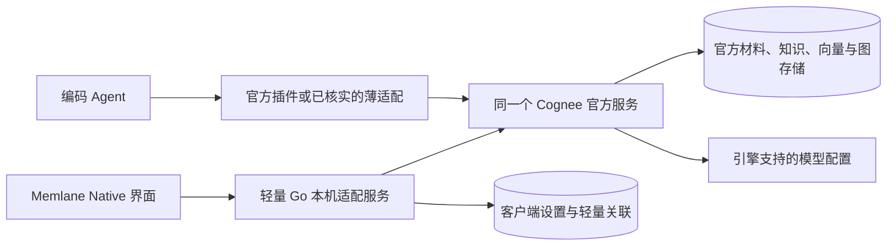

# Memlane 客户端职责重审：产品范围与技术方案

2026-11-12。根据用户“这个 side project 这次只管美观，剩下的事情都是底层记忆引擎来做”的要求重新规划。**本文是可评审方案；具体认可项见下文，其余取舍仍为建议，不代表批准删除旧功能或启动迁移实施。** 本轮只写方案，不恢复历史 Goal、不改源码和运行配置、不迁移或删除数据。

## 1. 产品目标与选型依据

Memlane 是面向程序员的漂亮、易用的本地记忆客户端。日常编码产生的材料由引擎及其集成接收和处理，不同 Agent 复用同一引擎中的知识；App 帮助用户连接、阅读、搜索和执行引擎已有的操作。

继续以 Cognee 官方服务作为本轮方案基线，理由是已有官方采集、会话处理和召回链路，也已有本项目官方直读的工程成果。尚未证明它在所有场景优于 Mem0；本轮不增加双引擎支持或抽象通用记忆平台。选型依据见[比较记录](../../../research-memory-engine-ui-boundary-20261112.md)。

关键约束：**产品能力以固定引擎版本的真实接口和语义为边界。没有的能力先记缺口或暂缓，不默认由 Memlane 补齐。** “只做客户端”仍包含安装、配置、桌面状态和必要安全适配；不等于完全没有本地代码或持久状态。

## 2. 旧设计是否还能用

结论：视觉与阅读壳层可复用，功能承诺必须逐项重审。旧稿的认可状态不被本方案自动改写，F–O 候选也不自动变成已认可设计。

本轮实际查看 `docs/images/home.jpg`、`docs/images/memory-detail.jpg` 及最新 `conversation-reading-20261112/03-knowledge-source.png`；前两张只作为旧视觉参考，不恢复其中已被撤销的“全部记忆”等导航。当前布局、命名及认可状态以[设计目录](ui-redesign/design-catalog.md)和[会话阅读交接](ui-redesign/conversation-reading-handoff-20261112.md)为准。本轮没有重画页面或进行 Native 验收。

| 设计内容 | 建议 | 实现边界与理由 |
| --- | --- | --- |
| 连续浅蓝侧栏、白色正文、单色按钮、紧凑字体 | 保留 | 美观是本项目的主要投入方向；复用 MyGo Native。 |
| 首页宽幅总览，项目列表／详情三栏 | 保留 | 不依赖自建记忆引擎；已认可的焦点、滚动、草稿和窄窗口体验继续有效。 |
| 项目“知识／原始记录”、Markdown、工具折叠、来源返回 | 保留并按字段降级 | 直接映射官方保留内容；不把会话缓存称为永久完整聊天，不猜逐轮工具关联。 |
| 三步初始化、设置复用、Agent 多选安装 | 保留结构 | 环境→连接→记忆处理；仅对实际存在并验证的集成展示可用。 |
| 首页最近知识、项目入口和连接状态 | 保留 | 来自官方当前数据和本机安装信息；不为填满版面制造指标。 |
| 知识总数、日期筛选、热力图、累计活动 | 按官方统计能力调整 | 当前集合的创建日期不能还原已删除／合并条目的历史活动；未核实完整事件和聚合接口前，不承诺原“历史事实永久保留”的热力图。不另建独立活动事实库补足；首期可省略相应卡片。 |
| 手动新增、编辑、删除 | 按官方写入语义接入 | 保留明确的用户操作和确认；需验证同 ID 更新、检索同步及删除范围。没有正式并发控制时不宣称强一致版本冲突保护。删除不伪装成可撤销。 |
| 逐版全文历史、差异、恢复旧版本 | 暂缓新内容的完整承诺 | 官方版本计数／事实溯源不等于全文版本恢复；不另建全文历史库。旧历史不因本提议被删除。 |
| “立即整理”、进度与结果 | 改为官方操作的界面 | 仅触发已验证的官方处理；状态按真实字段显示，可能成功但没有新知识。不要复刻独立提炼／合并流程。 |
| 待确认建议、合并／覆盖审批、跨项目移动 | 暂缓自有审核系统 | 官方冲突标记不等于现有逐项预览审批契约。无法证明副作用可控的处理先不开启；不能直接用 SDK 自动修改替代已有确认规则。 |
| 定期计划、租约、失败自动恢复 | 分开处理 | 保留服务崩溃后的有限重启；定时优先官方机制，可评估简单触发；暂缓自建复杂调度、断点续做和未知结果自动重跑，不能把插件 session sync 当任意定时任务。 |
| 仓库初始化、历史会话批量整理 | 单独核对官方导入能力 | 普通保存／连接不能隐式扫描仓库和历史；不能再以“补知识”为由自建仓库分析任务平台。 |
| 通用知识：个人偏好／通用经验 | 保留名称，范围语义待验证 | 官方 dataset／偏好功能必须支持对应隔离和检索范围后才启用；不自动全局共享或以固定 dataset 名推断权限。 |
| 实体与关系图 | 仅展示官方可返回部分 | 不建第二张图、不补独立图谱索引；已停止的图谱问题不因本方案恢复。 |
| Provider／Agent／Magpie 三种处理方式 | 收缩首期配置复杂度 | 优先引擎原生支持的配置；现有 pi 桥保留为已存在的可选适配，不继续把每个 Agent 或网关都发展为必做后端。哪些方式进入新版首期属于待评审取舍。 |
| 维护、备份和恢复 | 客户端配置与引擎数据分开 | 引擎数据优先官方导出／恢复机制，并验证覆盖范围；不能认为复制一个 SQLite 文件就是完整备份。完整包与分发留 release 阶段。 |

### 2.1 本轮已接受的功能边界

用户在逐项说明后回复“ok，我接受你的建议了”，接受范围按紧邻回复记录，不扩大为整个方案已认可：保留服务恢复；评估简单定时触发；审核优先映射官方能力，不补建额外审批系统；暂缓自行实现逐版全文历史恢复。简单定时尚未选择具体实现，不承诺复杂任务恢复。认可边界不等于已实施功能删除、迁移或运行切换。

首页指标和记忆处理方式仍分别评审；既有设计稿保留，后续对受影响入口出修订稿，不直接清空运行中页面。

### 2.2 首页三个指标的建议（待用户确认）

数据聚合本身属于客户端展示职责，可以做；不必为了“只做美观”而放弃图表。边界是统计官方实际提供且范围完整的数据，不另建永久事件账本。

- **热力图建议保留视觉**，首选统计“当前保留的知识按创建日期分布”。同一官方文档 ID 去重，编辑不重新计新增；删除后对应日期数量会变化，不保证保留已删除／合并知识的历史新增事实。导入日期与原知识产生日期不得混用；无法区分时单列或排除迁入材料并说明覆盖范围。官方创建时间、知识分类、全范围分页和时区须核实；只加载一页不能绘全年，未知日期不能补为 0。分批读取并在内存聚合，避免每次 UI 刷新扫描全文；大规模缺少聚合接口时先收缩统计范围，不另建索引。本建议改变旧热力图历史事件口径，尚未获准替换。
- **累计活动建议改为近期活动列表**，使用官方活动接口的实际可读范围；知识／材料数量采用当前集合的可靠计数，不称终身累计新增量或使用量。官方上游 `GET /api/v1/activity/pipeline-runs` 当前包含 pipeline 和 operation 两类记录，后台任务的 succeeded 还可能仅表示已接受启动，不能将返回行数、阶段转换或重试次数直接累加为用户活动。没有完整分页／保留期限／逻辑操作去重证据时不显示“累计 N 次”；历史未覆盖日期不补零。
- **待确认数量随官方待办能力提供**。如能枚举当前用户可处理的真实待确认事项，则按稳定 ID 和相同过滤范围计数并提供对应列表；官方冲突事实、未完成处理、失败任务都不能代替“待用户确认”。若固定版本没有相应队列，省略该数字及卡片，不显示 0，不为保留卡片重建建议表。已有旧建议在迁移盘点中核对，不自动混入新计数或删除。

官方活动接口依据：[当前上游路由源码](https://github.com/topoteretes/cognee/blob/main/cognee/api/v1/activity/routers/get_activity_router.py)。本轮只核对官方源码和当前适配代码，未探测日常部署的统计覆盖，也未实施这些指标。

### 2.3 待确认能力核验结果

2026-11-12 用户要求实际确认后，核对本机 SDK 元数据（Cognee 1.6.7）、对应固定版本官方源码，并只读查询当前既有服务 PID 76867、127.0.0.1:61255 的 `/openapi.json`。运行服务确实注册以下两个官方接口，未读取用户业务正文、未调用处理或解决冲突、未启动／重启服务：

- `GET /api/v1/conflicts?dataset_id=<UUID>&status=unresolved`：要求 dataset 读权限，返回未解决的 `FactConflict` 列表；包含稳定冲突 ID、候选事实、来源证据及先前决定信息。
- `POST /api/v1/conflicts/{conflict_id}/resolve`：要求 dataset 写权限，接受 dataset、选中的候选事实 ID 及可选原因，由官方保存决定并影响后续检索。被否决事实仍保留供查看。

因此可以保留数量卡片，建议命名为 **“待处理冲突”**；若仍用“待确认”，必须明确仅统计官方未解决事实冲突。当前接口没有专用 count／分页参数，可对同一获准范围的完整返回列表按 dataset＋冲突 ID 去重计数；接口失败或只取部分范围不能显示完整总数。只读项目可展示冲突但不能宣称用户有解决权限；全局数量按明确授权范围聚合。

这一能力不覆盖原设计全部“合并／删除／跨项目移动建议”，不需要自建建议持久表。当前自有 `cognee_session_processing.py` 手动处理路径显式设置 `review_conflicts=False`，所以“服务有接口”不等于当前整理会产生冲突；后续须单独验证官方检测配置、真实合成冲突生成、选择事实后的读取及数量变化。`write_pending` 只表示官方写入收尾状态，不能另算一项待用户确认。没有生成、读取或解决真实冲突的端到端证据，本轮不宣称 App 已交付该能力。

固定依据：[Cognee v1.6.7 官方路由](https://github.com/topoteretes/cognee/blob/v1.6.7/cognee/api/v1/conflicts/routers/get_conflicts_router.py)；本机 `cognee/modules/conflicts/models.py`、`methods.py` 与 `api/client.py` 的路由注册一致。只读 OpenAPI 核对经 task.py 执行，exit 0，未触发已停止问题。

## 3. 目标架构

图中 Go 适配服务不是新的任务或记忆业务中心。保留现有进程壳层可减少重写，但目标职责只包括本机生命周期、凭据保护、安装配置、范围校验、API 转换及 UI 状态转发。插件如需经本机代理做身份／范围校验，也不在代理中复制正文或自建知识处理。

- **唯一内容来源**：官方服务拥有知识、材料、索引和图；读写通过固定版本 API／SDK，不由 GUI 或 Go 直接打开官方内部数据库。
- **允许本地保存**：项目路径与官方 dataset ID 映射、安装版本／自有配置摘要、连接与授权状态、界面偏好、必要的操作 ID／官方回执引用。每个字段说明所有者和用途。
- **正文流转**：浏览与搜索结果在内存中归一化，必要 UI 草稿可暂存；草稿不是已保存知识。默认不新增持久全文缓存。凭据继续 Keychain，不写日志。
- **操作状态**：原生任务 ID 和状态优先；只有防止未知写入重复发送等确有必要时才保留轻量意图／回执。客户端发出取消不等于服务端已停止。没有官方恢复能力时显示中断／结果未知，不自创自动重跑。
- **官方集成**：App 管理发现、安装、配置和重载。有官方方案就复用；无对应采集能力时明确不支持／待适配，仅做宿主事件到官方字段的薄转换。pi 的社区工具包没有自动采集不代表它可直接替代现有采集路径，详见[pi 缺口](../../../engineering/pi-official-capture-gap-20261112.md)。
- **范围与未知项目**：电脑级连接不要求预先注册项目。已获准的新材料进入官方可隔离的待归属范围，再提示归属；该隔离、可靠 workspace 元数据及后续绑定／移动接口尚须核验。未核实前这是阻断项，不用“全部写进公共 dataset”或“先注册才能保存”替代用户要求。不要扩大其他 Agent 的读取范围。

引擎实现以**覆盖所需官方服务接口的固定 Cognee 版本**为基线。现有 Python 官方服务是优先复用候选，不再把仅有 raw index/search 的 Rust worker 当整套记忆平台的替代。Rust／Python 不继续做两套并行产品实现。最终版本需与插件联调后锁定，不因最新文档有某接口就直接升级日常服务。

对现有 `/api/v1/memlane/*` 和自定义 ProcessingAdapter 逐项审查：身份与最小协议缺口可暂保留且说明原因；重做官方业务、模型调度或永久状态的扩展列为收缩对象。不能把“官方处理调用在里面”就当没有自有服务扩展。优先向上游反馈必要缺口，避免维护长期 fork。

## 4. 已有成果、影响范围与关键未知

11 月 7 日入库方案从一开始就安排 Memlane 业务库保存正文和版本；当前要调整的是技术职责，不只是替换一个搜索接口。[旧方案](technical-plan.md)

本次按工作树最新记录核对，不能继续概括为“官方直读尚未实现”：

- `internal/official/documents.go`、`knowledge.go`、`sessions.go` 已有官方直读；`internal/desktop/official_*` 已有阅读接线，应优先复用。
- [处理记录 round 003 与 Native023](../../../engineering/official-session-processing-20261112.md)已记载真实 pi／DeepSeek 调用官方处理生成两篇学习文档及来源验证，客户端镜像表为空；但带有本项目模型网关与服务扩展，不等于纯官方原生部署已经满足全部需求。
- [迁移记录](../../../engineering/official-data-migration-20261112.md)已有隔离环境 31 条材料导入、正文／标题／出处及重启核对；不是日常数据源正式切换。
- [交付账本 Native037](../../../engineering/conversation-official-delivery-20261112.md)已有 pi 明确同意→普通对话→官方保存→阅读的切片记录；不同 Agent／客户端、故障和迁移仍需分别核验。

以上是工程记录与源码核对，本轮未重新运行其真实验收，不以此宣称当前日常环境已迁移完成。

| 关键未知 | 影响部分 | 下一步最小验证与所需证据 |
| --- | --- | --- |
| 官方新增／更新／删除与召回的实际语义 | H 编辑、Agent 跨会话复用 | 隔离 dataset 用合成知识做新增→读取→更新→新会话检索；核对同 ID、实际结果及副作用。 |
| 官方处理是否符合既有“破坏性变更先确认”约束 | J/K 整理与审核 | 核对固定版本 improve／remember 配置和副作用；无法关闭不受控变更时暂缓入口，提交范围决策，不另建审批引擎。 |
| 未注册项目的采集隔离、归属与授权 | E 项目、Agent 插件 | 电脑级授权→新仓库合成对话→官方保存→App 待归属→绑定→第二 Agent 仅检索获准项目。不能只用 mock 证明。 |
| 列表分页、来源保留期限与稳定身份 | F/G 阅读与全局搜索 | 用同一服务／用户／dataset 核对数据与 session 分页；来源过期只影响来源，不伪造永久副本。 |
| 原生任务、统计、全文历史接口覆盖 | 首页、历史、任务页 | 先列实际 OpenAPI／SDK 证据和字段语义，再定卡片和按钮；不为旧稿示例补数据库。 |
| 当前自有桥和扩展是否可缩减 | processing、official、Python 服务扩展 | 对照每个扩展与原生配置；优先选择最少维护的可用路线，保留旧证据，不重跑已停止问题。 |

## 5. 实施顺序与连续验收

1. **先冻结产品边界**：评审第 2 节能力变化，修订受影响设计入口；新方案认可前不静默删旧按钮、历史或后台能力。布局不依代码结构重画。
2. **固定一套官方服务和插件契约**：核对版本、真实 API、身份、处理副作用、数据目录及已有进程所有权。首先验证新增／纠错／跨 Agent 读取，以及未注册项目归属这两项最可能阻断目标的未知。
3. **统一内容访问**：桌面阅读、搜索、写入与 Agent 召回都指向同一官方数据源；复用已有直读模块。新增场景不得回流 `memories/versions/jobs` 形成第二套内容生命周期。
4. **迁移并切换**：复用已有隔离导入演练，重新核对目标库当前内容及编辑差异；逐项导入／核对官方 ID、内容摘要、范围与出处。先停止旧采集所有者再启用新所有者，不双采集。正式切换前保留可回退材料，不将“一次演练成功”当成全部库已迁移。
5. **集中完成界面**：按修订稿还原首页、阅读、搜索和设置；验证真实状态、缺失字段、临时故障、撤权、长文、焦点、滚动和两尺寸窗口。复杂功能暂缓后不保留假入口。
6. **收缩旧实现**：确认无消费者后再退出旧正文／版本／索引链路、自有审核／计划和重复采集路径；复用轻量 helper。清理运行依赖必须另行核对真实引用，不能通过删包迫使切换。

整体验收主线：安装与配置→正常 Agent 工作→官方真实接收→官方处理（允许无新知识）→App 阅读及来源→另一已授权 Agent 使用同一知识→用户明确纠错→新会话读到更新。并覆盖重开、断连恢复、未知写入不重复、待归属项目及撤权；保存、索引、生成知识和实际使用分别采证。

开发阶段只做必要测试、真实链路与 Native 验收，不构建完整交付包。所有执行遵守 task.py 与 100 GiB 门禁；当前没有启动这些步骤。依赖受影响检查按实际变更选取，不为规划文档运行测试。

## 6. 迁移、安全收尾与停止边界

本轮不创建临时运行环境、下载模型、启动服务或生成包；只有本方案文档。现有大量未提交修改不归本次所有，不覆盖或重置。

旧数据沿用[当前迁移授权](../../../engineering/official-data-migration-20261112.md)：用户允许低成本迁移、成本高可删除未上线旧业务数据；不是对 Agent 自身历史、第三方配置、其他项目和运行依赖的删除授权。不能因本方案收缩就认定全部旧内容可删除。旧编辑版本、来源或授权未知时先保留并记录。

已有具体失败和计数继续引用原账本：[旧 Codex hook 停止](../../../engineering/codex-hook-bridge-stop-20261112.md)、[UI 计数纠正](../../../engineering/conversation-ui-stop-20261112.md)、[运行包事故](../../../engineering/runtime-package-cleanup-incident-20261111.md)。旧 hook 桥、helper、已停止图谱问题不因重规划恢复；不重跑会命中停止问题的全仓测试。独立问题分别计数，同一具体问题累计第 4 次验收失败即停止。

## 官方资料与证据等级

- [官方采集、处理与召回链路](https://www.cognee.ai/coding-agent-memory-hooks)：证明官方提供相应流程，不证明本机各客户端已通过。
- [Improve](https://docs.cognee.ai/core-concepts/main-operations/improve)：官方会话桥接和学习提炼能力；任务完成不保证有新知识。
- [Sessions and Caching](https://docs.cognee.ai/core-concepts/sessions-and-caching)：会话层是短期记忆，不等于完整永久聊天档案。
- [Memory Versioning and History](https://docs.cognee.ai/core-concepts/further-concepts/memory-versioning)：当前文档明确不保留旧节点属性值和旧文档正文，快照导出也不等于逐条恢复功能；最新上游说明不能直接外推现有固定部署版本。

旧产品规则、设计稿、技术方案和验收记录继续保留其历史事实。本文将待决策范围集中到一处；获准实施时再同步 product、technical-plan、设计目录与工程账本，不让两套方案长期并列生效。
