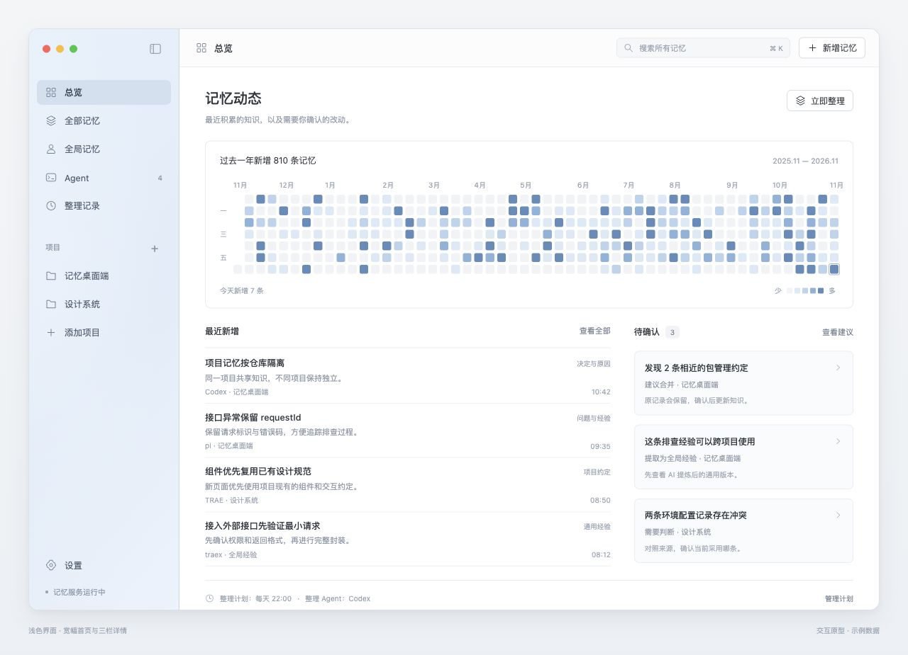
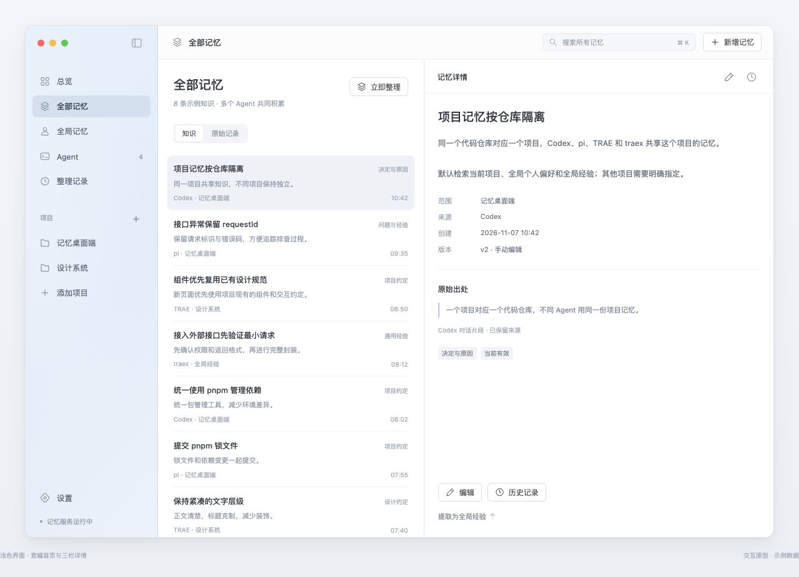

# 选定的界面与交互

> 2026-11-09：A 三步初始配置、Agent 批量连接、记忆处理和设置复用的 revision 13 已由用户确认归档。实施先读 [A 实施交接](ui-redesign/a-setup-handoff.md)，实际打开 [当前选定截图](images/ui-redesign/a-setup/README.md)。本范围内四步/首任务初始化、单选连接、方式状态小字和技术运行说明均被替代；通用浅色、侧栏及首页/三栏规则继续有效。当前是设计认可，新版 MyGo 窗口仍需真实验收。

2026-11-07 确认使用 V3 浅色方案。首页保留宽幅总览；列表详情页采用三栏。用户特别强调「不要随便用弹框」和「首页不需要 3 栏」。

## 首页

侧边栏加宽幅主内容区，上方是每日记忆热力图，下方是最近新增与待确认建议。首页没有固定的第三个详情栏。

## 列表与详情

记忆、Agent、整理记录等页面使用「导航—列表—详情与操作」三栏。右栏承载新增、编辑、历史、恢复确认和建议处理，保留中间列表与选中上下文。

从首页点击记忆，进入对应列表和详情；点击整理建议或「立即整理」，进入整理记录。普通操作不使用模态弹框，需要确认时在当前栏展示改动和确认按钮。

## 视觉规则

- 紧凑的 macOS 风格，系统字体采用 SF Pro Text / 苹方，小字号与清晰层级。
- 侧边栏使用克制的浅蓝材质，从窗口控制区延续到底部；收起图标放在侧边栏内部，与分栏边界保持距离。
- 工具栏和主内容为不透明白色；图标与按钮保持单色，蓝色主要用于侧栏和热力图数据。
- 统一栏宽、分隔线和对齐关系，不用无关装饰增加视觉负担。

## 原型归档

[选定的交互原型](https://github.com/zwhu/memlane/tree/prototype/selected-ui/prototypes/selected-ui) 保存在 `prototype/selected-ui` 分支。截图和原型均使用示例数据，连接、服务状态、整理结果不是实际运行状态。

这次原型确认了布局与主要交互方向，没有确认桌面框架。原型代码用于设计参考，真实应用按后续技术方案实现。完整功能与待验证事项见 [产品定义](product.md)。
