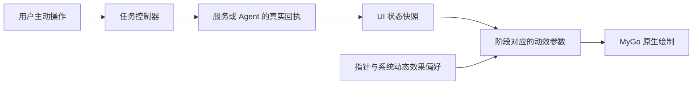

# MyGo 动效实施与复用契约

> 弹簧档位（`smooth` / `snappy` / `bouncy` / `fast`）、曲线参数与标志性动效以 [视觉规范 V4 第 6 节](visual-standards-v4-20261120.md#6-动效) 为准；本文规定 Memlane 在固定版本 **MyGo v0.7.4** 上的动效架构、SDK 能力边界、减少动态效果与能耗红线。

## 1. 所有动效共用的架构规则

生产界面统一使用 MyGo Native UI 编写动效组件；HTML/CSS/JS 仅作为原型对照（如 [visual-v4-prototype/](visual-v4-prototype/) 与 [onboarding-prototype/](onboarding-prototype/)），不作为正式任务进度的播放源。

全部按钮微交互、列表入场、页面切换、加载、新记忆落入与状态反馈统一遵循以下数据流：

- **动画只读取真实状态**：任务控制器拥有启动、取消、范围、尝试与结果。动画结束不宣布任务成功，绘制回调不安装组件、不运行 Agent、不读写记忆、不触发磁盘 I/O 或网络请求，也不提交取消。窗口关闭或离开视图即停止绘制，真实后台任务是否继续由服务生命周期决定。
- **动效交接必含 6 项事实**（不得仅交付一张 GIF）：

| 交接内容 | 必须明确的事实 |
| --- | --- |
| 触发与状态含义 | 哪个用户操作或真实事件触发；待开始、运行、完成、失败和取消分别表达什么 |
| 几何与层级 | 逻辑画布、锚点、形状、各阶段起点／终点、颜色、透明度、遮挡与阴影 |
| 时序与档位 | 对齐 V4 第 6 节弹簧档位（`smooth` / `snappy` / `bouncy` / `fast`）、错开间隔、循环条件与停止边界；时间仅用于插值而非判断业务完成 |
| 中断与重入 | 连续点击、阶段快速变化、收起／重开、旧回执和新尝试如何隔离处理 |
| 系统偏好 | 开启「减少动态效果」时的静态终态；纯视觉循环是否完全关闭 |
| Native 对照 | 原型基线、关键帧截图（浅色／深色）、实际帧预算与未通过项 |

## 2. 已核对的 MyGo v0.7.4 能力

依据仓库 `go.mod` 固定版本核对以下接口（接口存在不等于新场景已实测）：

| 设计需要 | MyGo 原生接口与用途 |
| --- | --- |
| 自绘图形、热力格、方块与完成勾 | `Draw`／`DrawOver`、`Painter.Fill`／`FillPath`／`StrokePath`、`Path.Trim` |
| 颜色层次、光晕和阴影 | `FillGradient`、`FillRadialGradient`、`FillPathGradient`、`Shadow` |
| 位移、缩放、倾斜与透视变换 | `Translate`、`Scale`、`Rotate`、`Skew`、`RotateX`／`RotateY`、`Perspective`、`TransformOrigin`、`BackfaceHidden` |
| 单值朝目标弹簧过渡 | `ui.Smooth` / `ui.Snappy` / `ui.Bouncy`、`AnimateTo`、`ui.Animation`、`ui.CubicBezier`；目标改变时保留连续运动 |
| 错开入场与组合时序 | `Keyframes`／`KeyframeOptions.Delay`；多对象协同使用 `Timeline`、`Tween`、`AtTime`／`AtLabel` |
| 按钮与列表行轻抬／按压微缩 | `AnimatePose`，仅重绘合成层而不重建整页视图 |
| 漂浮、脉冲等真实进行中循环 | `c.Now()`／`p.Now()` 与 `AnimationFrame()`；仅在确实运动时请求下一帧 |
| 指针视差 | `PointerPosition`／局部坐标转换，限制幅度并缓动回位 |
| 系统减少动态效果 | `c.Preferences().ReduceMotion`；内置动画遵循系统偏好，自绘循环必须显式停止 |

- **3D 变换平面约束**：MyGo 的 3D 变换将子元素投影到父元素平面（接近 CSS `transform-style: flat`），不能机械照搬 DOM `preserve-3d` 层级；需要 Z 深度差时应在绘制前计算投影坐标或在同一绘制面施加透视。
- **官方固定版本文档**：[绘制](https://github.com/egoist/mygo/blob/v0.7.4/docs/ui/drawing.md)、[动效](https://github.com/egoist/mygo/blob/v0.7.4/docs/ui/motion.md)、[变换](https://github.com/egoist/mygo/blob/v0.7.4/docs/ui/transforms.md)、[系统偏好](https://github.com/egoist/mygo/blob/v0.7.4/docs/ui/styling.md)。

## 3. 生产组件与复用边界

桌面端共享动效令牌、弹簧预设与自绘帧调度统一集中在 [motion_tokens.go](../../kit/ui/motion_tokens.go)，并受 `scripts/lint.py` 静态门禁强制守护（`ML008` 禁止在非动效模块直调 `AnimationFrame()` 且强制 `ReduceMotion` 守卫、`ML009` 禁止 `<500ms` 高频 `c.After` 轮询、`ML010`/`ML011` 禁止在 `Draw`/`DrawOver`/`App.View` 热路径做磁盘 I/O、休眠或网络调用）。

- **稳定 Key 与代次隔离**：组件与列表项必须使用稳定 `Key`，禁止用帧时间、随机值、Token 数或进度数字当 `Key`；同阶段收到文案/数据更新时只更新内容、不重播整段入场。`TimelineOptions.Run` 与 `KeyframeOptions.Run` 仅在阶段或尝试代次真实变化时递增。
- **阶段中断与重入**：阶段快速变化时从当前视觉位置平滑过渡到新目标，不额外等待旧动画结束；重开面板或切回页面只读取当前任务快照，不重发后台任务；任务取消、失败或新尝试出现时立即停掉旧循环并隔离过期回执。
- **无副作用 `Draw` 回调**：MyGo 可能在同一帧多次调用 `Draw`，绘制回调仅读取事先算好的标量或几何快照，不推进业务阶段、不持有上一帧的时间线对象。

## 4. 减少动态效果、离开与能耗红线

1. **严格遵循减少动态效果**：系统 `c.Preferences().ReduceMotion` 或应用内偏好任一开启时，全部动效直接跳至该阶段静态终态，关闭漂浮、视差、热力波浪与按压位移，同时保留状态文字、错误与操作可达。
2. **`DisableAnimations()` 不停止自绘循环**：`c.DisableAnimations()` 可让目标姿态立即就位，但不会自动停止独立关键帧、时间线或 `AnimationFrame()` 循环；自绘动画必须显式判断 `ReduceMotion` 后不再请求下一帧，独立时间线需采用静态终态或 `Seek`。
3. **静止零空转**：常规控件微交互优先用 `AnimatePose`，连续自绘循环集中在 `motion_tokens.go` 并仅在「可见 + 未减少动态效果 + 当前阶段真实需要运动」三条件同时成立时请求下一帧。完成、失败、取消、切离页面或窗口不可见后立即停帧，严禁常驻 60Hz 全局定时器。
4. **渲染与任务解耦**：停止绘制绝不取消后台服务任务；真实后台任务也不得依赖仅窗口可见时才运行的动画回调。静态几何与图标资产仅初始化一次，避免逐帧分配或无界对象增长。

## 5. 验收底线

- **性能预算守护**：回归须通过 `internal/simpledesktop/perf_budget_test.go`（冷启动首页 `<150ms`、帧耗时 `<12ms`/`<16ms`、切页堆内存 `<=25 MiB`）与 `scripts/lint.py`（`ML008–ML012`）。
- **Native 实窗对照**：每次新增或调整动效均须在 `1200×820` 实际 Native 窗口对照原型检验浅色、深色与「减少动态效果」三种状态，核实以下不变量：稳定阶段不反复重播；重复点击不重复启动任务；切离/重开不丢后台任务；过期回执不覆盖当前状态；静止或隐藏后零帧率空转；动画完成不写入业务数据或伪造任务成功。
