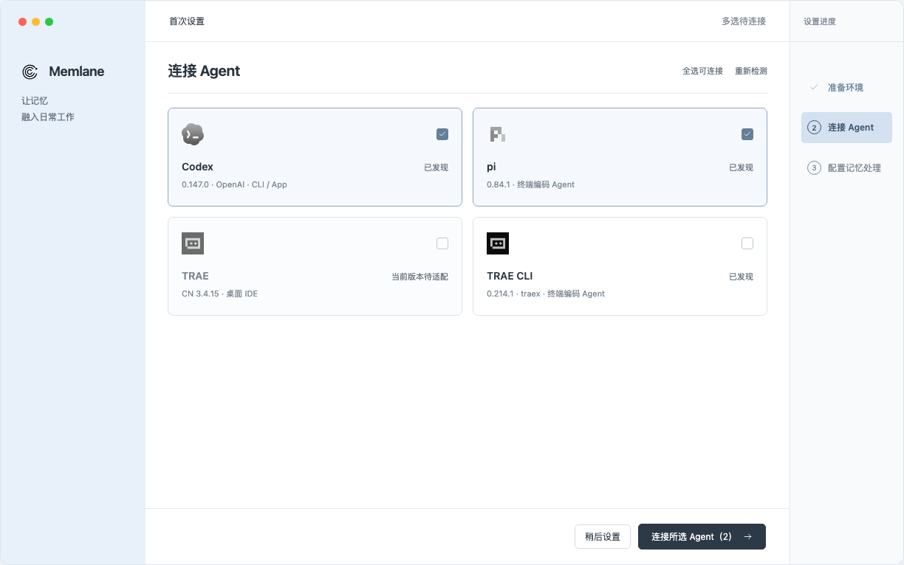
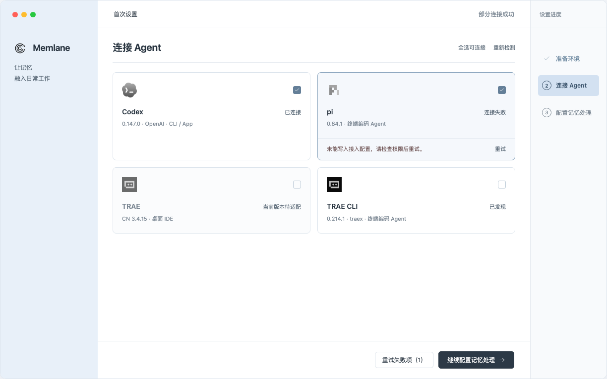
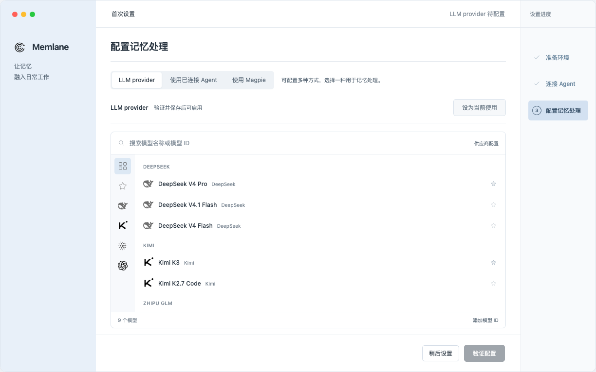
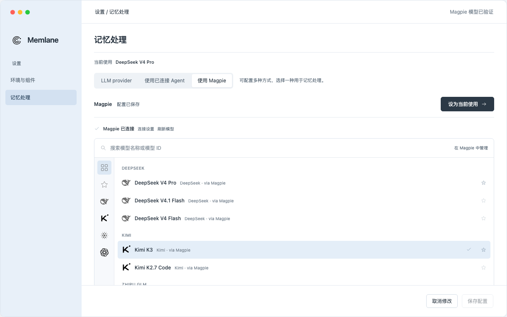
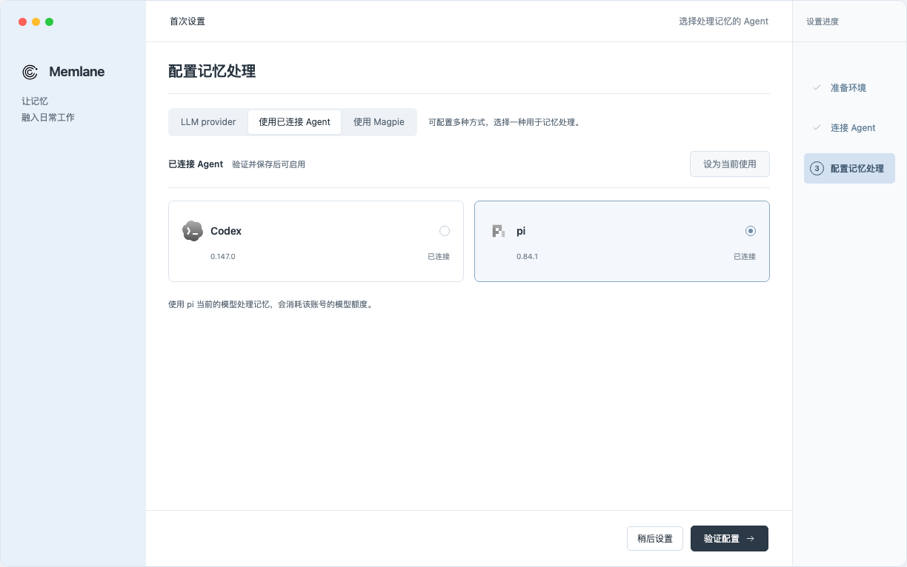
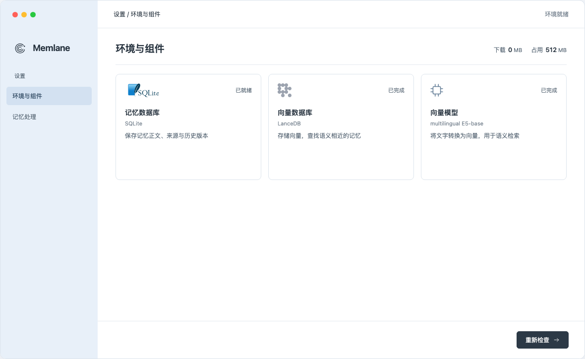

# A 已认可设计：截图与证据

2026-11-09，用户确认归档。选定交互 revision 13，来源为 `prototype/selected-ui` 冻结提交 `e27a49e35020972d6aea4ab070ec898fb6c9c22e`。

这些是实际浏览器截图和内存中的设计示例，不代表生产接口、安装或模型调用真实成功。开发先读 [实施交接](../../../ui-redesign/a-setup-handoff.md)，逐页打开图片；完成 MyGo 实现后，用实际窗口的相同内容区与缩放对照。

## 多选与批量连接

其他状态：[连接中](batch-progress.png)、[待重载](batch-reload.png)、[全部成功](batch-complete.png)、[已取消](batch-cancelled.png)、[取消保留成功](batch-cancel-preserves-connected.png)、[窄窗口](batch-narrow.png)。

## 配置与启用

其他状态：[模型目录](models.png)、[搜索](models-search.png)、[模型选中](models-selected.png)、[供应商编辑](supplier-settings.png)、[验证中](models-verifying.png)、[验证通过](models-ready.png)、[验证失败](models-failed.png)、[窄窗口](models-narrow.png)、[窄窗口已验证](models-ready-narrow.png)。

三份配置：[查看 Provider](all-configured-provider.png)、[查看 Agent](all-configured-agent.png)、[查看 Magpie](all-configured-magpie.png)、[启用 Magpie](all-configured-magpie-active.png)、[启用 Agent](all-configured-agent-active.png)、[当前启用状态栏](activation-entry-active.png)。

## 运行说明与 Magpie

Magpie：[未运行](magpie-connect.png)、[检测中](magpie-loading.png)、[模型目录](magpie-models.png)、[验证中](magpie-verifying.png)、[验证成功](magpie-ready.png)、[连接失败](magpie-failed.png)、[空目录](magpie-empty.png)、[窄窗口](magpie-models-narrow.png)。

## 设置复用与三步初始配置

其他状态：[设置准备缺失组件](environment-settings-missing.png)、[设置准备进度](environment-settings-progress.png)、[环境设置窄窗口](environment-settings-narrow.png)、[设置恢复已保存配置](processing-settings-saved.png)、[设置查看 Magpie](processing-settings-magpie.png)、[设置保存/启用 Magpie](processing-settings-saved-magpie.png)。

三步导航：[环境页面](initial-config-environment.png)、[记忆处理页面](initial-config-three-steps.png)。初始配置没有首任务与记忆结果。原安装正文另见 [原环境截图](../a-environment/)；其旧四步导航不作为当前流程要求。

## 证据边界

本目录保存44张当前浏览器截图。[verification.json](verification.json) 记录27个状态及关键交互通过、运行时错误0；[archive.json](archive.json) 记录归档确认、范围、冻结提交和源文件/截图 SHA256。

完整可交互原型保留在上述冻结提交中。设计已认可不意味着三种真实处理后端和批量连接已经实现；正式验收见实施交接中的 V01–V14。
