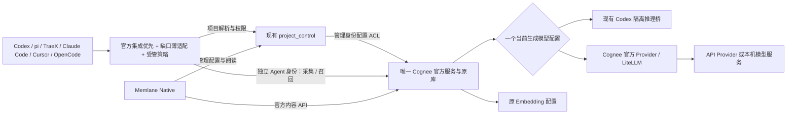

# 多 Agent 与 LLM Provider 扩展技术方案

2026-11-14，实施路线定稿（修订2）。需求：在现有 Codex 接入之外支持更多编码 Agent，同时支持更多 LLM Provider。pi、TraeX 为首批优先项。用户本轮要求将实施方案确定下来；本轮完成源码、实装宿主接口与协议核对、文档收敛，没有实施产品功能、安装插件、读取宿主聊天、调用模型或启停日常服务。定稿表示实现选择已确定，不表示功能验收通过，也不恢复历史全量 Goal 或进入 release。

## 1. 结论与范围

将“Agent 接入”和“知识处理模型”拆成两个独立配置维度：多个 Agent 同时连接同一 Cognee；Cognee 使用一个当前生效的生成模型配置。Agent 自己写代码时用什么模型，继续由 Agent 自身管理。

例如：Claude Code 与 Cursor 都能采集、召回同一项目知识；后台知识处理可选 Codex 订阅、Anthropic API 或 DeepSeek 兼容接口，和材料来自哪个 Agent 无关。选择 Claude Code 接入不等于授权使用其订阅进行后台推理。

本次实施范围：

| 批次 | Agent 接入 | 知识处理 | 完成边界 |
| --- | --- | --- | --- |
| 第一批（优先 pi、TraeX） | 保留 Codex；优先新增 pi、TraeX（TRAE CLI），再新增 Claude Code、Cursor | 保留 Codex 订阅；新增 OpenAI、Anthropic、Gemini、OpenAI 兼容接口 | 每种接入及协议各自有真实证据，完成跨 Agent 共享链路；pi、TraeX 不留到后续批次 |
| 第二批 | OpenCode | Ollama、本机 OpenAI 兼容服务 | 先解决电脑级配置、权限补丁及模型质量，单独验收 |
| 后续候选 | TRAE IDE、其他宿主 | Azure OpenAI、Bedrock；其他 Agent 订阅桥接 | 明确官方集成与缺口后单独定范围 |

pi、TraeX 提前支持是用户明确要求；其他新增 Agent 的顺序为方案建议。本文的 TraeX 指现有 `traex`／`traecli` 编码 CLI，不用 TRAE IDE 或开源 `trae-agent` 的能力代替。兼容接口第一批以 DeepSeek 为代表验收；通义、Moonshot、智谱、OpenRouter 等可以复用配置入口，但逐模型验证前只标“可配置／未验证”，不能批量宣布支持。

本次只补宿主事件薄适配，不新增并行采集链、内容库、索引、工作流引擎、通用插件市场、在线模型热切换、自动跨 Provider 故障转移、按项目选择模型或多模型并行处理。Embedding 保留现有配置；更换向量模型涉及向量空间和重建，另立迁移方案。

## 2. 当前基线与核对结果

以当前工作树为准，已有其他界面工作未提交，本提案不包含或改写这些改动。产品依据为 `docs/product.md`、`docs/design.md` 及 2026-11-14 项目权限卡片增补。旧连接契约中“共用身份／无 ACL”和旧多模型页面均不能覆盖最新规则，也不能直接恢复。

| 位置 | 当前事实 | 本次需要改变的部分 |
| --- | --- | --- |
| `engine/python/project_control.py` | `agents`、主体、项目策略、修订号、会话关联已存在；registry schema 为 1 | 复用身份和策略，补充宿主类型及连接元数据 |
| `engine/python/project_codex_connection.py` | 安装预览、准备、启用、核对均针对 Codex；身份关联 Codex home | 抽取必要的连接契约，原 Codex 行为保留 |
| `engine/python/project_installation.py` | 私有凭据及不可变代际产物已有；输出为 Codex marketplace | 按宿主生成不同安装产物与绑定 |
| `engine/patches/project_access.py`、`engine/python/project_plugin_policy.py` | 固定官方脚本补丁落实独立身份、项目归属、禁采水位、权限与无 fallback | 逐宿主核对补丁覆盖，不能直接复制 Codex manifest |
| `engine/python/project_control_server.py` | 有通用管理／策略 API，但连接路由及目录字段为 Codex 专用 | 新增通用连接 API，保留旧客户端兼容期 |
| `scripts/dev.py` | 必填 Codex executable/auth home；固定启动 completion，再启动官方服务及控制进程 | 按生成模型模式验证配置和选择子进程 |
| `engine/python/official_service_dev.py` | 清理外部模型环境，私有配置只允许 embedding 等字段；写死 OpenAI → 本机 Codex endpoint | 生成明确的 Provider 配置；按模式保留或撤下 Codex 专属能力注册 |
| `engine/python/codex_completion_endpoint.py` | 已有隔离 Codex 推理、Schema 检查、限流、取消及错误转换 | 原样复用为一种生成模型模式 |
| `internal/simpledesktop/settings_redesign.go` 等 | 设置仅本机 Codex，服务状态显示 Codex 模型；项目页已遍历 Agent 卡片 | 连接列表与模型设置解耦，扩展 DTO、状态和显示 |

当前固定组件：服务 `ec6f40859e5f2df9e7862dde27d580ac3268ed43`（manifest SDK 1.6.7）；官方集成 `a176248914fdb32a78354854b300174203b15a5c`。本轮不升级它们。

固定服务的 [LLMConfig 源码](https://github.com/topoteretes/cognee/blob/ec6f40859e5f2df9e7862dde27d580ac3268ed43/cognee/infrastructure/llm/config.py)已包含 OpenAI、Anthropic、Gemini、custom、Ollama 等配置。说明扩展可从配置适配入手；不证明当前 Python 环境依赖齐全、任意模型符合 Schema 或真实知识质量通过。

官方来源及证据边界：

| 来源 | 本轮可证事实 | 仍需实施时验证 |
| --- | --- | --- |
| [固定版 Claude Code 集成](https://github.com/topoteretes/cognee-integrations/blob/a176248914fdb32a78354854b300174203b15a5c/integrations/claude-code/README.md) | 提供采集、召回及会话整理 hook | 管理侧策略补丁、独立凭据、正常 CLI；Desktop 单列 |
| [固定版 Cursor 集成](https://github.com/topoteretes/cognee-integrations/blob/a176248914fdb32a78354854b300174203b15a5c/integrations/cursor/README.md) | 有官方 payload 适配和共享 hook 运行时；召回注入存在时机限制 | 无工具问答能否获得当前轮知识；第三方导入导致重复 hook；IDE／CLI 分别验证 |
| [固定版 OpenCode 集成](https://github.com/topoteretes/cognee-integrations/blob/a176248914fdb32a78354854b300174203b15a5c/integrations/opencode/README.md) | 有原生插件；文档安装为项目级，测试 API 范围有限 | 电脑级安装、动态项目解析、权限与待发材料语义适配 |
| [固定版集成目录](https://github.com/topoteretes/cognee-integrations/blob/a176248914fdb32a78354854b300174203b15a5c/integrations/inventory.yml) | 可发现候选及维护方 | 收录／迁移完成不等于 Memlane 已接入或宿主端 E2E 通过 |

实现时将共享脚本、宿主适配、PA 扩展逐文件比较，不按 README 的能力声明直接启用。

pi、TraeX 的已有依据与当前缺口：

- [旧 Agent 接入记录](agent-integrations.md)已覆盖 pi Extension 和 TraeX stdio MCP，但属于旧架构、部分项目级接入，不能直接算当前电脑级接入通过；旧版本号也不作为现时安装事实。
- pi 在[固定官方目录](https://github.com/topoteretes/cognee-integrations/blob/a176248914fdb32a78354854b300174203b15a5c/integrations/inventory.yml)中是社区维护的 `@kerryhatcher/pi-cognee`。[本地缺口记录](engineering/pi-official-capture-gap-20261112.md)核对过发布版0.1.0：有显式工具，缺少自动会话采集；本轮查阅[上游入口](https://github.com/kerryhatcher/pi-cognee/blob/main/index.ts)仍为工具与配置命令注册。实施时重新固定实际采用的提交与包摘要，不把社区目录收录称为官方完整采集方案。
- 固定 Cognee 集成目录未列 TraeX 专项。本轮确认实际 TraeX 0.214.1 支持用户级插件，导出的宿主协议枚举包含 `userPromptSubmit`、`postToolUse`、`stop`、`sessionStart`、`sessionEnd`；二进制内嵌命令 hook schema 还给出了 prompt、工具、回答及 `additionalContext` 的精确字段。采用官方 Codex 运行时加 TraeX 事件与身份适配，单独维护产物，不直接启用 Codex 的宿主配置。

本轮可复核的只读证据见[接口事实摘要](engineering/evidence/multi-agent-plan-20261114/facts.json)。pi实装0.84.1；TraeX可执行文件来自0.214.1发布目录，摘要已固定。执行了 CLI help、离线协议 schema 导出和隔离 `plugin validate`；后者接受当前固定插件根且报告10个skills，只证明产物根可识别，不证明hooks已安装、触发或真实模型采用。

pi社区包固定到发布版0.1.0对应提交 `5807e9e5e8231db8b04c0d1d7fb4c5dd3a28dd9b`。[MCP客户端源码](https://github.com/kerryhatcher/pi-cognee/blob/5807e9e5e8231db8b04c0d1d7fb4c5dd3a28dd9b/src/mcp/client.ts)只组装内容类型、Accept和MCP session头，未传递鉴权；因此本轮明确不直接安装该包完整入口，采用下文裁剪后的工具定义与受管传输。

## 3. 总体架构



职责不交叉：连接适配只管宿主安装、私有配置、回执与能力；策略扩展只管项目／权限／水位；Cognee 管内容、处理与检索；Provider 配置适配只生成官方参数。Native 不持有可读明文密钥，不实现供应商 SDK；不另建所有请求必经的多模型网关。

### 3.1 Agent 连接契约

在现有 Python 控制侧定义小型适配接口，由静态受支持列表选择实现，不做运行时第三方代码加载：

```text
detect(host_config) -> HostFacts
preview(instance, observed_config_revision) -> InstallPlan
prepare(plan) -> ImmutableArtifact
activate(plan_id, expected_revision) -> OperationReceipt
review(operation_id) -> ConnectionFacts
capabilities() -> CapabilitySet
```

`HostFacts` 含宿主类型、profile 路径指纹、宿主版本和实际入口（CLI／IDE／Desktop）；检测不得读取历史聊天。安装预览列出修改的自有配置键、保留项、需要的信任／重载及冲突。

状态分别保存：安装状态（未安装／已准备／待重载／已启用／配置冲突／结果未知）、连接健康、真实新会话回执。HTTP 健康或文件存在不升级为“采集已验证”。连接来源回执须匹配 installation ID、代际、宿主入口和官方 session。

身份规则：

- 一台电脑的一个 Agent 类型 + 一个独立 profile 为一个 `instance_id`、一个官方子主体及独立控制凭据。CLI 和 Desktop 确认共用 profile 时可共主体，但保留各自入口验证状态。
- 原 Codex instance ID、principal、ACL、会话关联不变。新 Agent 按现有默认策略建立自己的权限，不复制 Codex 个人覆盖；UI 如实显示当前有效权限。
- 同仓不同 Agent 通过现有管理侧规范路径解析到同一个项目／dataset；并发注册沿用当前去重锁。会话键加宿主与实例命名空间，避免碰撞，不为同一内容跨会话做激进合并。
- 安装产物保持不可变，以 instance + upstream commit + 补丁摘要命名。每类宿主独立 lock／manifest；固定 hash 不匹配直接停在需核对。

将 registry schema 升至 2（具体编号以实施时现存版本为准）：给 Agent 增加 `kind`、`host_profile_fingerprint`、`entrypoints`、`capabilities`；新增 `connections` 保存安装操作。原 `codex_connections` 在持锁下一次迁移成同 ID 记录，保留私有小型备份及旧读取兼容，不重新创建主体或重装插件。可选字段必须保守默认，缺失不推定能力可用。

管理 API 定为：`GET /v1/connections`、`POST /v1/connections/preview`、`POST /v1/connections/{id}/prepare|activate|review`。变更带 `expected_revision` 与 `operation_id`；复用现有鉴权和单写者，不给 Agent token 开放安装／Provider 管理。旧 `/v1/codex/*` 暂委托 Codex adapter，待 Native 及日常调用迁移后退役。

实施补充：增加仅管理身份可读的 `GET /v1/connections/operations/{operation_id}`，返回原操作是否登记、原状态与原回执，不重新执行适配器。Native 在 prepare/activate 请求前，将原编号、操作类别与实例标识写入已有私有 UI 回执目录；重开后核对原回执，缺失或 unknown 继续保留，不生成新编号重发。Agent 与 Provider 的待核对项按类别分开，不相互阻塞。

### 3.2 官方插件复用与权限接入

按能力登记 `explicit_memory`、`auto_capture`、`auto_recall`、`project_policy`、`code_graph`；每项附支持条件与验证状态。宿主有 MCP 不等于自动采集或自动召回；插件能采集也不等于允许借宿主模型推理。

先逐项审计以下入口：会话启动、prompt、工具轨迹、回答、结束、idle/final 整理、主动 remember/search/forget、代码索引。所有内容操作必须以该实例子主体调用官方 API；管理 owner 只留控制侧。

必须保持现有 PA 语义：禁采／无写权时先推进无正文水位；恢复不回扫；项目和通用知识在原召回注入入口合并；项目约定优先；代码图保持主动开启。服务不可达时不走本地 CLI、共享 owner 或另启服务。宿主可以继续编码，记忆侧应显示失败／不可用。

共享 Python hook 的 Claude Code／Cursor 优先复用 `project_plugin_policy.py`，仅补宿主 payload 和安装绑定差异；目前补丁绑定固定 Codex 文件树和锚点，必须单独产出、验证各宿主 patch manifest。不能把路径替换视为权限迁移完成。

OpenCode 为 TypeScript 路径，复用官方采集／召回／outbox，只增加访问现有控制协议的薄层，不另写采集链。需调整其认证拒绝后重试策略以遵守 Memlane 的 403 blocked、明确补交规则。若不能完整落实，保留未接入状态，不用共享 key 勉强开放。

Cursor 的第三方插件导入可能同时加载 Claude Code 插件。连接预览必须识别同一宿主中的重复入口，仅选择一种官方采集路径；只移除已确认自有且重复的项。若无法消歧则要求用户选择并保持原配置。无工具回答的当轮召回限制单列能力，不能用工具回执代替模型实际采用证据。

2026-11-14 代际切换补充：Cursor使用[官方workspaceOpen的pluginPaths](https://cursor.com/docs/hooks#workspaceopen)加载不可变官方派生产物。准备只生成候选hooks配置；启用仅替换用户hooks.json中该实例原先登记的准确入口，保留其他hooks及配置。重开工作区／窗口加载新目录，旧目录及依赖保留；读取原未知回执不重写配置。旧local插件、同名marketplace或Claude导入冲突仍需消歧，不原地覆盖或自动删除旧安装。此接入机制不增加采集器，真实IDE加载、窗口共存与多workspaceOpen hook组合仍须实际宿主验收。

### 3.3 pi、TraeX 首批接入路径

两者都要覆盖电脑级连接、显式读写、正常对话采集、新会话召回及现有项目权限。实现顺序提前，缺口提前消除；不能以“已安装工具”替代完整支持，也不能因缺少现成插件而自动推迟到第二批。

两者复用固定官方HTTP、采集过滤及回执核心，不采用社区包的SDK或MCP传输。旧pi投影与过滤代码仅作为可复用依据，不恢复旧daemon、数据库、授权账本或正文队列；每轮召回先核对有效权限。后台处理会话排除采集；本次接入不恢复pi订阅模型桥。最终接线如下。

| 环节 | pi 0.84.1 | TraeX 0.214.1 |
| --- | --- | --- |
| 电脑级安装 | 选定profile的`extensions/memlane-cognee/index.ts`，默认`~/.pi/agent/extensions/`；正常`/reload` | 原生`plugin install <固定本地产物>`，用户级`~/.trae/traecli.toml`由宿主管理；独立namespace与产物摘要 |
| 会话与归属 | `session_start`建立本次会话基线，当前cwd→现有resolve | `SessionStart`载荷的session_id/cwd→现有resolve |
| 每轮召回 | `before_agent_start`查询；`context`替换本扩展记忆块并在权限变化时移除 | `UserPromptSubmit`调用原官方召回；返回`hookSpecificOutput.hookEventName=UserPromptSubmit`和`additionalContext` |
| 问答采集 | `message_end`的user/assistant文字块；只收本次基线之后的新事件 | `UserPromptSubmit.prompt`配对`Stop.last_assistant_message`；以session_id+turn_id去重 |
| 工具采集 | `tool_execution_end`，按toolCallId关联参数、最终结果及isError；不同时监听另一路重复提交 | `PostToolUse`/失败事件的tool_name、tool_input、tool_response、tool_use_id |
| 整理触发 | `agent_end`只请求已有防抖处理，`session_shutdown`收尾；不将agent_end断言为永久终态 | `Stop`/`SessionEnd`进入原官方整理触发与策略门禁 |
| 主动工具 | 复用社区包MIT工具定义，裁剪为health/remember/recall/forget，替换backend | 复用官方skills/脚本和宿主原生工具入口；不另加重复MCP |

pi受管扩展不导入社区SDK、不暴露`/cognee-mode sdk`、全库forget、建dataset等越过管理侧的入口。保留上游许可与源摘要，通过构建期小型补丁选择工具定义；传输固定为下述Python helper。不会为兼容社区MCP额外运行服务器。

共享新增`engine/python/agent_memory_adapter.py`作为有边界的命令行适配，JSON stdin/stdout，操作限resolve/recall/remember/forget/capture/flush/status。由不可变安装绑定定位私有凭据，内容调用复用现有固定官方脚本的HTTP、过滤、buffer和未知回执逻辑；控制请求沿现有project_control。该helper无监听端口、无内容数据库、无LLM请求；不将正文发给project_control。pi启动自有helper，TraeX通过对应受管hook脚本调用相同核心。

客户端提交的session、turn、tool ID只作来源关联；实例身份来自安装绑定与凭据，dataset由resolve取得且按当前有效权限校验。forget必须给明确可访问目标，拒绝everything。helper故障不阻止编码，主动操作明确返回失败；自动采集保留官方buffer状态，不宣称已保存。

TraeX运行时复用固定Codex官方脚本，新增`traex_hook.py`规范化字段与host类型、独立插件状态目录及会话命名空间；原Codex产物不改写。不存在最终回答时保留缺失状态，不读`transcript_path`补扫历史。`Stop`保持中性输出，不请求后续对话；信任由宿主正常审阅，不写trusted hash、不使用bypass-hook-trust。升级后payload/schema不匹配停止该接入的写操作，保留原材料与安装代际。

本轮已确认的是实装声明的接口和产物格式。事件实际触发、真实注入与端到端采用仍按MA08/MA09验收；若实现中不符，记录为具体缺陷并保持首批未完成，不自动降级为仅MCP可用或改用终端抓取。

## 4. LLM Provider 设计

### 4.1 复用官方适配

两种运行模式：

| 模式 | 运行路径 | 配置 |
| --- | --- | --- |
| `agent_bridge` | Cognee → 原本机 completion → Codex app-server | `bridge_kind=codex`、独立 auth home、model；保留现有工具／采集隔离 |
| `provider` | Cognee 官方 LLM adapter → Provider | `provider`、`model`、`endpoint`、`credential_ref`、必要协议参数 |

OpenAI／Anthropic／Gemini使用固定Cognee的`NativeLiteLLMAdapter`和其原生供应商路由；OpenAI兼容服务使用`custom`并显式指定OpenAI协议模型前缀。首批参数映射固定为下表。Azure的API version／deployment和Bedrock的区域／身份链另设后续适配。

| 表单类型 | LLM_PROVIDER | LLM_MODEL | LLM_ENDPOINT |
| --- | --- | --- | --- |
| OpenAI API | openai | `openai/<实际模型ID>` | 明确API根地址 |
| Anthropic API | anthropic | `anthropic/<实际模型ID>` | 明确API根地址 |
| Gemini API | gemini | `gemini/<实际模型ID>` | 官方默认或明确自定义地址 |
| OpenAI兼容（含DeepSeek预设） | custom | `openai/<接口实际模型ID>` | 用户指定的兼容API根地址，是否含/v1按接口要求保存 |

不重复添加模型前缀，不从裸模型名猜供应商；保存`protocol`与用户原始model ID，统一编译官方环境。首批均设`STRUCTURED_OUTPUT_FRAMEWORK=litellm_native`，模型ID由用户配置并验证，不在方案中硬编码易失效的供应商模型名单。现有环境LiteLLM1.108.2、OpenAI3.46.0、Pydantic2.14.3已核对，不为首批先行重装环境。

参考官方 [Provider 配置](https://docs.cognee.ai/setup-configuration/llm-providers)与[结构化输出说明](https://docs.cognee.ai/setup-configuration/structured-output-backends)。运行以固定源码及现有环境为准，不因在线文档变化升级依赖。

首批启用通过官方结构化输出路径与固定质量样本的具体配置。普通对话、JSON mode、原生JSON Schema分开记录；不为未知远程模型硬注册`supports_response_schema=True`。固定`NativeLiteLLMAdapter`实际会尝试strict、non-strict和JSON fallback，本方案保留官方行为与Pydantic校验，不修改官方源码阻断该机制，也不宣称所有供应商提供严格原生Schema。验证回执记录观测到的模式，无法可靠识别则记unknown；原生Schema要求的具体用例不能用fallback回执冒充通过。结构验证或质量未过则不能选用。禁止的是跨模型／跨供应商自动回退，启动时显式清空其fallback配置。

模型输入框允许填写真实模型 ID，供应商可用的模型列表仅作建议；没有列表接口也可配置。验证记录绑定 provider、endpoint、model、非秘密参数、密钥版本、固定服务 commit 的摘要；修改后验证失效。兼容品牌预设只填默认参数，不宣称其中全部模型可用。

### 4.2 最小配置模型

```json
{
  "schema_version": 2,
  "generation": {
    "active_profile_id": "existing-codex",
    "next_profile_id": null,
    "profiles": [
      {"id": "existing-codex", "mode": "agent_bridge", "bridge_kind": "codex", "model": "<原模型>"},
      {"id": "api-candidate", "mode": "provider", "provider": "custom", "model": "<实际模型ID>", "endpoint": "<明确API地址>", "credential_ref": "<私有文件引用>"}
    ]
  }
}
```

这是形状示意，不直接替换现有daily runtime。runtime新增`generation_file`引用私有配置；profiles含immutable revision、validation digest，编辑产生新revision，active保留原revision，不会被就地修改。控制进程运行期间是唯一写者；停止后launcher持同一文件锁完成启动确认并将所有权交还新控制进程，不允许双写。只保存当前与候选的必要元数据，不恢复旧多模型账本或配置历史UI。

管理API固定为`GET /v1/generation`、`PUT /v1/generation/profiles/{id}`、`POST /v1/generation/validations`、`GET /v1/generation/validations/{operation_id}`、`PUT /v1/generation/next`。写入均要求管理token、expected_revision及operation_id；重复ID返回原结果。验证异步受管执行，普通GET不调用模型，后台最多一个验证操作；取消先确认所拥有的子进程退出，未知不记为已取消。验证回执独立于Agent回执。

凭据延续当前私有文件机制（目录0700、文件0600），配置仅存引用。写接口接收后端保存，GET 只返回是否已配置及版本；不把密钥回填 Native、命令行、回执或日志。Provider key、Agent Cognee key、管理 key、Codex 登录分别保存。远端 HTTPS、本机明确 loopback HTTP；拒绝未经配置的重定向携带凭据。自定义网关可配置，但错误后不隐式改目的地。

改造 `official_service_dev.py` 的环境白名单与生成过程：启动前清空外部 LLM／fallback 变量，显式写入所选 profile 的完整官方配置；embedding 原配置单独合并并校验。Codex 专属的本机 endpoint、token 和模型能力注册只在 bridge 模式执行。

`scripts/dev.py` 的 Codex executable/auth home 仅在 bridge 模式必需；API 模式即使没有 Codex 登录，也能启动知识处理服务。若 Codex 仍作为采集 Agent，相关插件配置单独校验。health 分别报告官方服务、当前处理模式与必要组件，不把“没有 completion 子进程”误报为 API 模式失败。

### 4.3 保存、验证、下次启动应用（定稿）

1. 保存候选配置，不改变当前使用项。基础校验不调用模型。
2. 用户点击“验证”，明确会调用该 Provider，使用合成材料；验证鉴权、普通 completion、嵌套 Schema／数组／空值／Unicode、拒绝／截断处理。需要真实抽取时使用隔离的小型临时官方数据根，不能打开日常库或创建第二个日常实例。
3. Schema验证和抽取质量分开记录。使用已有未处于停止状态的样本与断言，禁止重跑历史达到4次停止的固定328字节README图谱问题。此方案阶段不执行模型调用。
4. 用户点击“下次启动使用”写入`next_profile_id`，当前`active_profile_id`及在途任务完全不变；UI同时显示当前使用与待应用配置。首版不提供“立即切换”，不由控制API启停launcher。
5. 沿已有dev入口，由用户正常停止／重新启动后台。正常停机和在途任务限制沿现有机制，不新增“停稳快照可保证无损”的承诺。若当时有运行或未知任务，UI明确列出并提示稍后重启；不会自动关服务、强杀任务或补投。旧进程／库锁尚未释放时，新启动照常拒绝。
6. 启动器读取已验证候选的完整摘要，在取得原库独占锁后启动相应组件。健康与配置摘要匹配才确认active，清除next。启动前校验不符则继续旧配置并保留候选错误。
7. 新候选启动失败时，只在确认候选全部子进程退出并释放其资源后，在同一launcher所有权下尝试恢复旧配置一次。清理或锁状态未知则停止，不再启动；旧配置也失败则保留操作回执并停止。任何已经提交的官方任务、内容及原不确定写入都不重放。

首次Provider配置没有旧active时，dev入口`setup`只运行同一受认证配置API并复用知识处理页，持有原数据根所有权锁，尚不启动官方服务、创建项目主体或标记初始化完成。环境与官方数据根仍须事先准备。保存、验证、next沿上述契约执行；正常停止setup、重新start后，首个已验证next经健康及摘要确认才成为active。首个候选失败只清理并停止，不伪造旧配置或Codex回退；没有已验证next就拒绝启动。已有active的账本不进入setup，避免与普通设置／旧库迁移混淆。

首版确定采用“下次启动应用”，取消原草案的在线排空、切换窗口和新launcher命令通道。这样不存在运行中修改Cognee全局模型配置／缓存的路径，也不需要改造官方任务调度。计划性重启期间服务短时不可用，hook沿原buffer机制保存状态；不承诺宕机后自动补采或重放。后续若要不停服切换，另立任务准入与排空设计。

API 模式的超时、并发、输出上限及重试优先复用固定官方配置，仅暴露必要参数。429／额度／鉴权／Schema错误可区分；对已开始而结果未知的处理不由客户端自动补投，不自动切到另一个 Provider。无可靠 usage 时显示未知；不把 Codex 订阅估算成 API 费用。

## 5. 界面与兼容

设置新增清楚分开的“Agent 连接”和“知识处理”分组，沿现有 Native 视觉，不恢复旧大页或未实现按钮：

- Agent 连接：优先显示 Codex、pi、TraeX，再列 Claude Code、Cursor 及分批可用宿主。每项呈现准备、启用、重载和真实回执；电脑级配置与项目无关。可多选准备，逐项保留成功结果，仅重试失败；取消只停止尚未执行项，不回退其他成功接入。
- 知识处理：当前模式与模型；添加 Provider；按协议显示 endpoint／model／key 等必要字段；“保存”“验证”“下次启动使用”语义分离，待应用项不冒充当前使用。可继续用 Codex，无需新建 API key。
- 项目设置继续使用各 Agent 的两个 checkbox，即时保存 read 与 read/write/delete，关联采集和处理字段仍原子更新。供应商不出现在 Agent 权限列表；切换 Provider 不改变任何 Agent ACL。
- 连接回执、材料已保存、官方处理终态、实际知识产生继续分开。Provider 验证成功也不改变 Agent 采集验证状态。

实施 UI 时先实际查看当前认可图片并确定新增布局，再对照真实 Native；本轮只定义交互与数据契约，不宣称已有视觉稿或视觉通过。

原 runtime 自动识别为单一 Codex profile，保留既有 ID、地址、凭据文件和数据根。写新配置前做私有配置备份及版本校验，不提交主机配置。schema 升级后旧程序不应静默读写新状态；回退需匹配相应配置备份且确认没有新增连接操作，不只回退二进制。

### 5.1 本机检测与绑定（用户补充，2026-11-14）

复用既有设置布局及多选卡片，不另建连接向导。完整操作为：进入“设置 → 服务与连接”自动检测本机安装 → 勾选需要连接的Agent → 准备所选Agent → 逐项查看准备结果 → 启用已准备项 → 在对应宿主完成信任／重载并新建会话 → 卡片显示实际新会话回执。每步保留成功项；取消只停止剩余项，未确认的原操作继续核对原编号。

- 自动检测在应用启动、进入设置和点击“重新检测”时读取本机事实。后端每次读取连接列表重新发现，不要求重启后台才能发现新安装或移除的Agent。检测范围包含明确配置路径、PATH和限定常用安装目录；macOS GUI环境无shell PATH时也检查常用入口。明确配置路径优先，失效时不擅自改绑其他profile。检测不运行Agent、不读聊天、账号密钥或历史、不创建主体、不写宿主配置、不自动安装或启用插件。
- 卡片区分“未检测到安装／已检测到未连接／已准备／已配置待重载与新会话／已收到新会话回执／需核对”。检测到安装不等于已绑定或真实采集成功；连接完成也不表示已经产生知识。未安装项不可勾选；接入仍在开发的OpenCode显示实际检测事实与“接入开发中”，不可提前准备或启用。
- 连接是电脑级操作，不先要求选择项目或配置处理模型。绑定沿用独立官方主体、私有凭据及不可变安装代际，修改范围只含Memlane接入项。项目读写权限仍从项目菜单进入设置，不与Provider混在一起。
- “设置 → 知识处理”沿用当前配置、已保存配置及“添加Provider”入口。按协议呈现模型ID、API地址和所需密钥，保存／验证／下次启动使用分开。云Provider不以电脑安装Agent为前提，也不通过扫描Agent配置自动取得API Key。Ollama和本机兼容服务后续接入同一配置表单，其可达性、模型列表与质量须独立验证，不因检测到CLI就视为可用。

本轮影响：`agent_connections.py`只读发现、既有`GET /v1/connections`、Native导航与连接卡片；原连接操作回执、Provider草稿、active／next、项目ACL保持原契约。验收覆盖启动后安装／移除、缺失的明确路径不fallback、检测不写配置或registry、未完成适配不可绑定，以及设置卡片入口。真实宿主测试仍沿用户暂缓边界执行，界面夹具不替代实际Native视觉验收。

## 6. 关键未知与实施顺序

| 未知／风险 | 首先做的最小验证 | 失败时边界 |
| --- | --- | --- |
| pi接线已选，事件行为待验 | 全局Extension、四个社区工具定义、受管Python传输；按已核对事件完成真实宿主验收 | 不走SDK另建库、不复活旧daemon；仍计首批未完成 |
| TraeX接线已选，实际触发待验 | 用户级插件、固定官方核心与宿主字段转换；按本机导出契约验收信任／重载 | 声明接口不等于实际触发；缺口留作首批阻塞 |
| 共享 hook 是否能完整落实 PA 策略 | 固定版 Claude Code 安装产物 + 一个合成项目验证身份／禁采／主动工具／403 | 不启用日常身份，不复制 owner key |
| Cursor 当轮召回时机、重复插件 | 正常工具轮与无工具轮分别核对真实采用；审计启用入口 | 限制如实标注，不能以 CLI 通过外推 IDE |
| 固定服务和依赖是否覆盖三种原生 Provider | 检查已有环境 adapter import，随后每协议最小真实 Schema／抽取 | 缺失依赖单独记录并固定最小增量，不直接升级整个环境 |
| 自定义模型仅 JSON mode 或错误能力元数据 | 对选定endpoint/model记录官方实际模式，验证Schema及质量 | 不伪造原生Schema；未通过不选用，不跨供应商降级 |
| 下次启动应用的恢复边界 | 运行中只写next，重启检验摘要、锁、子进程退出与单次恢复 | 状态未知即停止；不引入在线切换门禁 |
| OpenCode 电脑级安装与403行为 | 固定插件源码 + 宿主全局安装演练 + 控制策略验证 | 不将逐仓配置称为电脑级支持 |

实施按以下顺序推进，具体工作包见第9节：

1. 固定当前代码与组件基线，盘点现存连接、有效 ACL、配置引用和失败计数；只读核对，不迁移聊天。为本次影响项写连续场景。
2. 优先按已定契约实现pi、TraeX并完成各自最小真实链；再完成一个API Provider，检查共用身份／配置抽象。Provider可独立推进，但不能绕过两者缺陷宣布首批完成。
3. 集中实现连接 adapters、私有配置、registry 兼容、Provider 参数及 launcher 分支；保持 Codex 回归通过。
4. 在 pi、TraeX 路径成立后加入 Claude Code、Cursor、其余原生 Provider 和 DeepSeek 代表兼容配置；完成批量接入及 Native 设置。控制侧、启动器和 UI 各自提交明确范围，避开当前其他 session 的共享改动。
5. 冻结第一批候选，执行下表连续验收；补齐日常接管和实际窗口证据后才交付。第二批按相同契约扩展，不把未完成项折算成已支持。

## 7. 连续验收与回归

2026-11-14 用户最新范围调整：“cursor 可以暂时不要测试，claude 都不需要测试”。本轮按Agent维度执行：Cursor暂缓后续测试，Claude Code不再要求追加测试；实现及既有证据保留，未验能力不改为通过。后续检查不主动触发这两个宿主的专项或原生安装器测试；本次免验不删除现有测试源码。Anthropic作为LLM Provider的独立协议／账号验证仍按LP01记录，不因Claude Code Agent免验而写成已验证；用户如进一步调整Provider范围再同步。其余首批及第二批范围不变。

用户随后补充“我本机没有的agent可以暂时不用验证”“其他继续突进／推进”：未安装Agent暂缓验证，保留实现与未验状态，不为验收自动安装新Agent。已安装的OpenCode继续推进第二批；首批Desktop／原生Provider外部前置等待期间可并行推进独立的第二批研发，仍分别留证与交付。

| 场景 | 必要证据 |
| --- | --- |
| MA01 原 Codex 回归 | 原主体、ACL、库不变；正常编码采集与新会话真实召回；CLI／Desktop 各自证据 |
| MA08 pi首批必需 | 用户级Extension→信任／重载→普通问答与真实工具结果采集→官方知识→新会话实际采用；会话／分支不回扫；无本地SDK第二库 |
| MA09 TraeX首批必需 | 实际CLI用户级安装→官方信任／重载→问答和工具采集→官方知识→新会话实际采用；证据与TRAE IDE分开；无终端抓取替代 |
| MA02 Claude Code 接入 | 电脑级安装→官方信任／重载→新会话回执→问答与工具落官方原始记录→处理知识→新会话实际采用 |
| MA03 Cursor 接入 | IDE 工具轮／无工具轮、回答采集、召回时机；CLI另验；重复导入只产生一次记录及注入 |
| MA04 跨 Agent 共享 | A在项目一产生知识，B新会话实际采用；同仓同dataset，不同项目隔离；通用知识项目优先 |
| MA05 逐主体权限 | A维护、B只读／禁止；读取／写入／删除及通用知识分别核对，无share；恢复不回扫；权限缓存撤下 |
| MA06 安装与故障 | 多选部分成功／取消；配置被改后冲突；服务断开无fallback；403明确补交；未知操作不重发 |
| LP01 各协议可用 | Codex、OpenAI、Anthropic、Gemini、DeepSeek代表接口分别验证普通请求、Schema及同组质量样本；provider/model/endpoint固定 |
| LP02 与 Agent 解耦 | pi／TraeX采集+API处理；Claude采集+API处理；Codex采集+另一API处理；无需对应Agent订阅；API模式无Codex登录仍可启动 |
| LP03 启动应用连续性 | 保存不切换，改参验证失效；运行中仅写next；重启成功才更新active；失败单次恢复；锁／清理未知则停止，材料和原操作保留 |
| LP04 错误与隔离 | 密钥错误、429、超时、截断、不支持Schema；官方模式如实记录，无自动换模型／Provider；日志无密钥；处理输出不被采集 |
| UI01 Native | 1200×820真实窗口，连接列表、Provider表单、错误、未知、项目checkbox及重开连续性；图片和操作回执 |
| MA07／LP05 第二批 | OpenCode电脑级接入全流程、Ollama／本机兼容模型Schema与质量，单独留证 |

定向检查复用 `engine/python/test_project_control.py`、`test_project_codex_connection.py`、`test_project_plugin_patch.py`、`scripts/test_dev.py` 及现有 simpledesktop 测试；新测试集中在跨协议、迁移、状态与权限边界。Go用 `sh scripts/go.sh test ./...`；其他执行走 `python3 scripts/task.py -- <命令>`。单测、真实官方链路、模型质量与 Native各自报告；不构建完整包。

沿用 E／PA 既有编号及计数，尤其 E09普通completion与业务Schema分离、E15并发容量、PA未知写入与403边界。同一具体问题累计第4次验收仍失败即停止该问题并记录，不换宿主／版本／路径重置；其余不依赖工作可继续。

## 8. 数据、资源与交付要求

只增加必要配置、连接元数据及操作回执；正文、知识和搜索仍来自官方。保留原库、owner、登录、第三方插件、旧会话、未保存材料及当前运行依赖，不自动迁移、补采或重放。

设计阶段不产生模型／引擎副本。实施时由 launcher拥有日常子进程；隔离验证资源由对应验收操作拥有，记录路径、PID／启动时间、消费者及清理条件。运行前确保100 GiB余量，受管任务低于105 GiB停动；临时环境用后清理，仅留小型脱敏证据，禁止清空build或清理仍被引用的插件代际／运行包。

交付更新当前产品、设计、Agent连接契约、开发配置示例及工程执行记录，明确本次新增范围覆盖“唯一Codex通道”的相应旧条目；不预先把提案写成现行已实现规则。验收报告逐项列出支持、有限支持、未验证与阻塞，不使用笼统“兼容全部Agent／Provider”。

## 9. 可直接执行的工作包

下列文件为实施位置，尚未创建的名称为确定的新增模块；局部提取可调整文件名但不改变职责、协议或范围。所有生产源码写入在用户启动实施后进行。

| 顺序／编号 | 具体改动 | 前置与完成门槛 |
| --- | --- | --- |
| I01 基线与连续用例 | 在现有工程账本登记MA/LP/UI场景、当前未提交文件所有者、E/PA停止项；新增本轮执行账本 | 与共享源码当前作者交接后才编辑；记录本地快照提交/tag，保留未提交工作，不提交私有配置 |
| I02 通用连接与迁移 | 新增`engine/python/agent_connections.py`与各宿主adapter；改`project_control.py`、`project_control_server.py`、`project_installation.py`；独立manifest | 原schema1合成副本迁移，Codex ID/ACL/材料关联不变；旧连接API兼容；未知操作不可重复启用 |
| I03 官方核心复用 | 新增`agent_memory_adapter.py`，扩展固定patch builder按host_kind生成产物；复用官方过滤、buffer和PA门禁 | JSON字段白名单、正文上限、身份不可伪造；403/未知/禁采水位回归；原Codex产物摘要不被改写 |
| I04 pi优先接入 | 新增`engine/agents/pi/index.ts`与上游工具定义补丁／license；接线第3.3节事件 | I02/I03；真实pi→官方原始记录／知识→新会话采用，MA08及对应MA05/06通过 |
| I05 TraeX优先接入 | 新增`engine/agents/traex/`manifest与`traex_hook.py`；安装器调用原生plugin命令，保留信任步骤 | I02/I03；当前0.214.1声明契约＋实际问答／工具／注入验证，MA09通过，不以IDE或exec代替交互式TraeX |
| I06 Provider配置与验证 | 新增`engine/python/generation_config.py`、`generation_validation.py`；扩展管理API；改官方服务环境编译 | I02；合成材料、独立验证进程和隔离数据根；API凭据不触及Agent配置；LP01/04。现有停止样本排除 |
| I07 启动应用与恢复 | 改`scripts/dev.py`条件启动completion；旧runtime适配profile；增加next/active摘要确认与单次恢复 | I06；不在线切换、不自动重放；候选失败清理与锁未知停止；LP02/03 |
| I08 Claude/Cursor | 在同一连接契约内加入固定官方产物与各自PA扩展 | I02/I03；MA02/03/04，Cursor限制单列，不挤掉pi/TraeX |
| I09 Native接入 | 改simpledesktop配置DTO、连接客户端与设置；新增Agent连接列表、知识处理表单与验证状态 | 后端契约固定后一次集中UI开发；保留当前项目checkbox和其他session改动；实际打开最新设计图片，补新增布局与真实Native对照 |
| I10 冻结与交付 | 全量必要检查后只修同类缺陷，集中跑第7节连续场景；同步开发文档／产品范围／最终证据 | pi、TraeX、原Codex、首批协议、权限及Native均有证据；模型缺凭据时明确阻塞，不用模拟冒充；继续dev、不打完整包 |

I04/I05为第一优先交付切片，必须先由Agent自验；不能先交一份只有新品牌列表的界面。I06/I07与Agent采集模型解耦，不要求将所有Agent×Provider组合穷举：每个宿主跑完整采集/召回链，每个协议跑同组结构/质量样本，再用pi+兼容API、TraeX+另一API做交叉组合，统一覆盖权限矩阵。

首批主动工具删除仅针对明确DataID／受管项目目标，官方支持什么语义就暴露什么，不自动删除整个项目dataset。Agent连接与授权不包含读取其历史聊天。需要用户参与的宿主信任和API凭据发生在对应实施步骤，方案阶段不要求提供。

最终选型已收敛：pi为全局Extension＋裁剪社区工具＋官方核心helper；TraeX为用户级原生插件＋固定官方运行时薄适配；Provider为固定Cognee/LiteLLM直接调用；模型配置在下次启动应用。余下工作是实现与验收这些契约，不再把它们留作无期限的方案选型。
