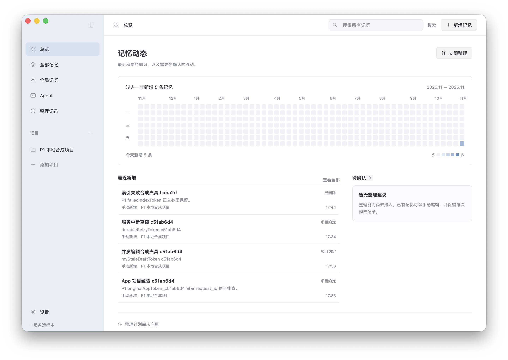
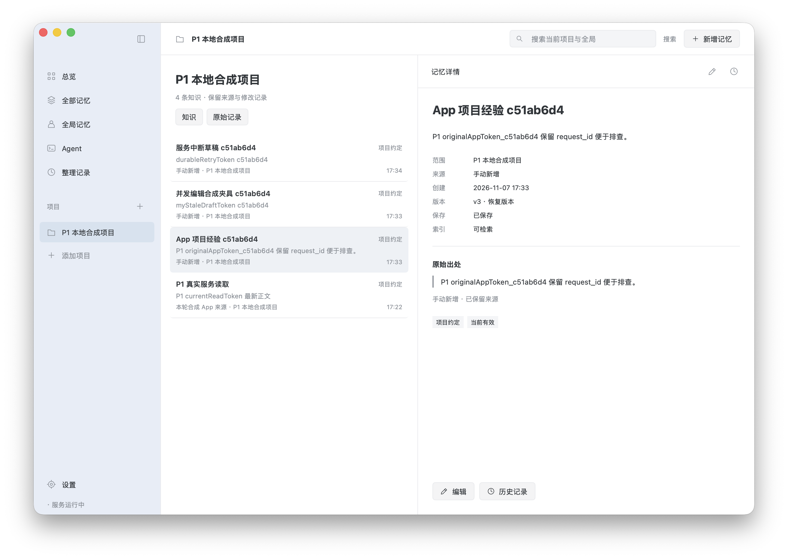

# P1 验证记录

## P1.1：设计还原与栏内状态（2026-11-07）

已实际打开 `docs/images/home.jpg` 与 `docs/images/memory-detail.jpg`，按 1200×820 内容窗口对照实际系统截图。导航 212 DIP、列表 428 DIP、右栏起点 640 DIP；文字 12/11 DIP、标题 20 DIP。首页宽幅，列表详情三栏；侧栏连续浅蓝，图标按钮单色，新增、编辑、历史与恢复确认在右栏。

验收构建仅通过 e2e 的显式 `--p1-visual-fixture` 参数加载合成视觉数据，不读或写真实记忆库；生产构建不含该夹具入口。此阶段不能声称真实保存/搜索接入。待确认整理区显示能力尚未接入的空态。

已完成实际窗口检查：首页与详情布局边界、右栏历史和恢复确认、新增与编辑草稿跨设置导航保留、未接服务时保存/确认恢复禁用。实际系统截图 `build/p1-screenshots/system-visual-home.png`、`system-visual-detail.png`；栏内截图 `visual-history.png`、`visual-restore.png`、`visual-new.png`。已用看图工具逐张检查首页、详情、新增和恢复；收紧最近新增间距后底部状态完整显示。

命令：

```sh
sh scripts/go.sh test ./internal/desktop ./cmd/memlane-app
sh scripts/go.sh vet ./internal/desktop ./cmd/memlane-app
python3 scripts/build-client.py --out build/p1-visual --name MemlaneP1Visual --identifier io.github.zwhu.memlane.p1visual --automation --skip-dmg
python3 scripts/verify-p1-visual.py
```

以上通过，实际窗口报告 `build/p1-screenshots/visual-verification.json` 为 passed。此构建包含 helper 与 LaunchAgent，未生成 DMG；完整客户端构建在 P1.4 验收。未改动的 P0 引擎、组件和系统输入法证据复用 [P0 验证记录](p0-validation.md)。

首次窗口脚本失败于对普通布局容器读取 `key`：MyGo 语义树省略普通容器，出现 StopIteration。实际截图已经取得；修正为导航按钮、列表滚动区与详情标题的已暴露边界后通过，没有降低列宽要求。系统窗口日志存在 IMKCFRunLoopWakeUpReliable 消息，但 App 流程和截图检查通过。

## P1.2：数据迁移、私有 IPC 与真实 App 读取（2026-11-07）

`PRAGMA user_version=0 → 1` 事务迁移保留 P0 正文、不可变版本、幂等操作、持久任务和绑定；新增范围、来源/原文、标题与活动表。已存在的记忆标为导入，不回填未核实的首次可用日期。项目 UUID 由服务登记并按规范绝对 Git 路径映射，全局偏好/经验各有持久 dataset。真实 Agent 工作区识别留在 P2。

UI 使用 `serviceipc.Library` 读取服务，不打开 SQLite。列表按创建时间与稳定 ID 分页，支持范围、来源、知识/原始记录和活动日期过滤；历史按 revision 分页；`get` 同时返回来源、原始正文、当前版本与索引状态。活动在首次当前版本索引完成事务中按 memory ID 去重。后台状态轮询在绘制以外运行，过期页面响应不会改写新页面；草稿和选中项保留对应范围。

服务接口验收 `build/p1/service-verification.json` 六组 passed：

- 合成旧库的两个历史版本、时间、操作 digest 和原绑定保留；旧幂等请求仍可重放；迁移后 integrity_check=ok。
- 项目规范路径与链接路径返回同一 UUID，全局范围在重启后保持。
- 13 条记录以 4 条/页读完，四页无重复遗漏；项目/来源过滤、非法分页参数验证通过。
- 实际 SIGKILL worker 后，新正文已保存但未索引；过期 revision 返回 conflict；恢复 worker 后检索仅返回当前版本与来源。恢复追加 v3，历史分页保留 v1/v2。
- 编辑、恢复、重复回执、索引重试不增加 13 条新增统计；删除后日期活动保留并标 deleted；原始记录不计数，导入另计 2 条。
- 服务重启后正文、历史、范围、活动保持，旧库版本/操作/绑定未改写。

受影响的原文事务与索引状态运行原 B1–B5 回归，结果单独写入 `build/p1/original-version-regression.json`，全部 passed；保留原 P0 报告。覆盖旧 chunk/伪造来源排除、编辑删除失效、真实失败和幂等重试、索引编辑竞争的迟到回执拒绝及重启检索。未重跑无改动的组件下载、自动更新、系统输入法或旁白。

实际 App `build/p1/library-ui-verification.json` passed：右栏登记合成项目，服务保存的条目出现在列表；最新正文、原始出处、来源和独立索引状态正确；历史两个版本可见；全局列表排除项目。系统截图 `build/p1-screenshots/system-real-library-detail.png` 已实际打开查看，历史截图 `real-library-history.png`。App 使用全新系统临时数据根，仅复用已验证的合成组件缓存；路径记录 `build/p1/fixture-path.txt`，不复制真实记忆、Agent 配置或密钥。

命令：

```sh
sh scripts/go.sh test ./...
sh scripts/go.sh vet ./internal/store ./internal/memory ./internal/serviceipc ./internal/daemon ./internal/desktop ./cmd/memlane-app ./cmd/memlaned
sh scripts/go.sh build -o build/p1/memlaned ./cmd/memlaned
python3 scripts/verify-p1-service.py
sh scripts/go.sh build -o build/p0-engine/memory-probe ./cmd/p0-memory-probe
python3 scripts/verify-memory-contract.py --report build/p1/original-version-regression.json
python3 scripts/create-p1-fixture.py
python3 scripts/verify-p1-library-ui.py
```

`create-p1-fixture.py` 生成公共配置与独立应用标识后，使用 `scripts/build-client.py --runtime-config <新根>/runtime-config.json --identifier <独立标识> --name MemlaneP1 --automation --skip-dmg --out build/p1-app` 构建。停止服务的验收根下次启动会保留停止状态，必须从设置明确启动。

## P1.3：实际 App 记忆管理闭环（2026-11-07）

保存、编辑、语义搜索、历史差异、恢复和索引重试均通过类型化私有 IPC；UI 不读数据库。保存使用稳定 operation ID 重试，编辑保存使用打开编辑器时的 revision，恢复使用进入栏内确认时的 revision。服务在单事务内保存正文/版本/任务并返回真实快照；索引稍后独立更新。服务不可用时草稿保留，过期编辑不会覆盖最新正文；选择以最新版本继续编辑是明确的栏内操作。

`build/p1/management-verification.json` 六组全部 passed，主流程由实际 MyGo 按钮与输入框完成：

- 在 App 新增合成项目记忆，v1 正文保存并在详情读取；所属 dataset 与当前登记项目一致。
- 在 App 编辑为 v2，搜索新内容并打开当前版本，原始出处保留。
- App 历史显示 v1/v2 和正文差异；进入恢复确认时仍为 v2，确认后生成 v3，v1/v2 内容不变。
- 真实退出/重开 App，读到恢复后的 v3 正文与三个历史版本；默认退出后服务继续运行。
- 用独立合成条目模拟外部编辑，旧编辑器保存被拒绝，最新正文仍为 v2；草稿保留。用户明确选择以最新版本继续编辑后，才保存新 v3。
- 从 App 主动停止服务，实际保存失败；草稿跨设置导航保留。启动服务后重试仅创建一个 v1 和一条新增活动。

主条目当前 v3 仍为恢复正文，历史顺序 [3,2,1]；实际活动总数 4（包括 P1.2 的一条合成知识及三个本阶段新增条目），连续编辑、恢复和重试没有重复计数。字段内容均为本轮合成夹具，保存在独立系统临时目录，未涉及真实 Agent。

实际系统截图 `build/p1-screenshots/system-management-restarted.png` 已打开检查；栏内确认截图 `management-confirm.png`、搜索、历史、冲突、服务中断、恢复等截图同目录。命令：

```sh
python3 scripts/verify-p1-management.py
sh scripts/go.sh test ./...
sh scripts/go.sh vet ./internal/desktop ./internal/store ./internal/daemon ./internal/serviceipc
```

首次主流程启动曾失败：组件已准备，App 65 秒等待后台服务超时，socket 不存在。保留 `build/p1/management-startup-failure.json`、`management-failed.png` 与 `startup-action.jsonl`。同包 helper 用同配置直接启动约 3 秒 ready；同 App 的独立 resume 入口返回 ready/enabled。重跑完整 App 主流程和其中的主动停止/启动均通过。没有据此宣称唯一根因，亦没有用直接 helper 代替 App 验收；正式后台注册的干净机器条件仍见 P0/P4。

## P1.4：真实活动、四类状态与完整构建（2026-11-07）

`build/p1/states-verification.json` 六组功能检查全部通过。新建空库 App 以真实 HTTP 请求执行准备，使用未改动签名的组件清单，准备期间 UI 可用；准备完成后真实列表和活动为 0，未填示例记忆或建议。已有数据 App 的首页读取首次可用事件；原始记录和导入的统计规则由 P1.2 真实 API 验收覆盖，导入单独展示。

在仅属于本轮合成根的 worker 副本上临时改名并终止实际 worker，服务进入异常。App 保存正文后，显式索引失败记为 failed；正文和 v1 保留，首页仍为 4 条。恢复 worker 并点击 App「重试索引」后可检索，只新增一次活动变为 5 条，重复重试不增加活动或版本。删除该合成条目后，5 条历史创建事实仍保留，日期列表显示「已删除 · 保留历史」和「不参与检索」。主流程条目仍为恢复后的 v3，v1/v2 未改写。

实际截图位于 `build/p1-screenshots/`：`system-state-preparing.png`、`system-state-empty-home.png`、`system-state-index-failed.png`、`state-date-deleted.png`、`system-final-real-home.png`。准备、空态、失败与有数据首页已实际打开对照。最终详情截图最初采到切换中的旧帧（列表/右栏为空，语义树已有真实数据），因此不能作为最终详情验收证据；补拍时 CGSession 确认 screen_locked=true，前台激活超时与 AXFocusedApplication -25204。解锁后重新执行 `python3 scripts/capture-p1-final.py`，在空白工具栏实际点击，核对本 App 的 NSWindow key/visible 状态后取得新的系统截图。最终首页与详情已实际打开对照，字体、间距、212/428/560 栏宽、选中态和连续浅蓝侧栏通过。截图已归档到 `docs/images/p1-home.png` 与 `p1-detail.png`，均为本轮隔离合成数据的真实 App 窗口；保留旧帧和失败诊断记录，不将其当作通过证据。

正常启动回归 `build/p1/startup-verification.json` passed：验收改用 Launch Services 启动真实 App 包，同标识、配置和数据根下连续两次通过，包含原地重建后立即启动。此前直接执行包内二进制在原地重建后触发 BTM `invalidateLaunchItem`、launchd spawn failed / EX_CONFIG 78。保留 `states-startup-failure.json`、`state-startup-launchd.txt`、`launchd-diagnostic.log` 和原 `management-startup-failure.json`；没有绕过 helper 或改动业务数据。

完整构建 `python3 scripts/build-client.py --out build/p0-final` 已通过，包含 helper/LaunchAgent 的重新签名 App 与 DMG。本机 codesign 完整性和 SHA256SUMS 通过；正式 Developer ID、公证、组件发布源与更新源仍按 P4 落实。生产包不含模型、worker 或验收检查器；验收 App 使用显式隔离公共配置。组件与模型未变，本轮复用 P0 已验证的首次下载和离线链路，没有重跑其无关旁支。

| 测量项 | bytes | 十进制 MB |
| --- | ---: | ---: |
| 主 DMG | 9,128,917 | 9.13 |
| App 普通文件 | 19,679,978 | 19.68 |
| 首次额外引擎＋模型下载 | 285,752,286 | 285.75 |
| 准备后 App＋运行目录逻辑占用 | 511,409,538 | 511.41 |
| 同目录 st_blocks 文件分配指标 | 511,770,624 | 511.77 |

体积报告 `build/p1/final-sizes.json`，其中 Rust worker 归档 66,253,324 bytes、模型归档 219,498,962 bytes；Python 对照首次额外下载 584,328,409 bytes，非 App 当前运行路线。磁盘口径含 5 条合成知识及实际组件、数据、设置和缓存，APFS 分配指标不等于删除可释放空间。

最终 `sh scripts/go.sh test ./...` 与 `sh scripts/go.sh vet ./...` 退出 0，日志与命令记录见 `build/p1/final-checks.json`。只读数据/包审计 `build/p1/data-package-audit.json` 通过：在持久 owner 锁空闲、WAL 为空时核对 integrity_check=ok，v3 为恢复正文、v1/v2 保留，5 个唯一创建事件含 1 个删除事实，最终 DMG 散列与签名正确。该中间审计保留当时的视觉、提交和推送未完成项；最终完整审计见 `build/p1/final-audit.json`。

已有索引与 worker 可用性另行区分：worker 不可用时显示「索引已完成 · 等待服务恢复」，服务恢复后才显示「可检索」。实际 worker 故障/恢复的 UI 数据检查见 `build/p1/availability-verification.json`，不代替系统视觉检查。

最终视觉检查已完成。`python3 scripts/audit-p1.py` 逐项核对真实报告、owner 已停止的业务库、窗口 key/visible 状态与截图散列、当前 DMG 散列/签名/helper/LaunchAgent、完整清单和三类体积；结果写入 `build/p1/final-audit.json`。后续入口是 P2 的 Codex/pi 项目记忆共享，按实施清单推进。Agent、AI 整理、代码图谱、远程管理不纳入本轮，VoiceOver 等 P0 未通过旁支保持原边界。


## 最终实际系统窗口

以下是隔离合成数据的真实 MyGo App 截图，已经实际打开并对照选定设计；真实 Agent 尚未接入。




