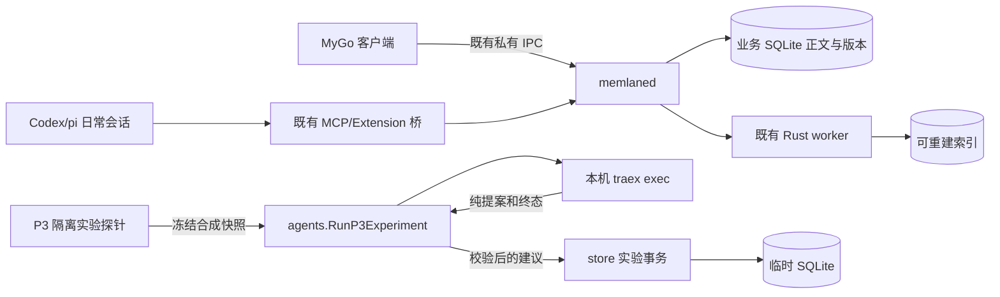

# P3 架构与接口边界

> 当前实施基线：C1 服务、[C2 合并审核](p3-c2-validation.md)、[C3 摘要/标签](p3-c3-validation.md) 和 [C4 修改审核](p3-c4-validation.md) 已通过，C1 细节见 [服务验收](p3-validation.md#8-p3-c1-正式服务端验收)。早期“本轮/未接生产”段落描述隔离实验历史。全部剩余切片与外部条件见 [交付矩阵](p3-delivery-plan.md)，后续通过项仅以对应证据为准。

2026-11-08 历史实验资料重生成。以 [技术方案](technical-plan.md) 和 P2 实际代码为基线，正式产品语义见 [P3 产品方案](p3-product-design.md)。实验结果见 [验证记录](p3-validation.md)，接口与参数是否正式由对应切片决定。

## 1. 保持已有进程结构

图中 P3 实验没有接入生产 IPC，不代表 memlaned 已提供完整整理能力。Agent 没有数据库句柄、生产记忆连接或 improve 写入入口。有效正文的真相仍在业务库，Cognee 只承担可重建索引。

## 2. 当前真实接口

| 所属模块 | 已存在或本轮实现 | 边界 |
| --- | --- | --- |
| internal/agents | P2 Run；实验 RunP3Experiment | 独立 argv/目录/认证链接、JSONL、输出绑定、终态和进程取消；不替换日常验证 |
| internal/records | P3Snapshot/P3Proposal/Seal/Decode/OutputSchema | 实验 schema、来源 quote、任务/输入绑定和限制 |
| internal/store | Apply/applyTx；实验 Start/Stage/Cancel/Apply | 事务门禁、结果/应用幂等、多来源合并与历史/索引任务 |
| internal/memory | IndexCurrent/Search | 索引失败持久化、当前 revision/generation、归档候选排除 |
| cmd/p3-runner-check | 合成验证入口 | 默认 traex；纯建议/显式合成确认/取消，不随主包分发 |

没有为每个概念新增仓储或抽象接口。只有正式整理进入生产服务后，才按实际职责引入编排模块；调度器、排名和初始化不提前建空骨架。

## 3. 实验数据与事务

实际 schema v2 不变。显式实验附加表分别保存 task/当前 attempt/冻结快照/取消标记、提案结果、唯一应用回执、具体版本来源快照。普通 Open 不创建这些表。

冻结快照 → 调用 Agent（不持有写事务）→ Stage 事务登记 → 明确确认 → Apply 事务校验两来源 → 新建合并知识并归档来源 → 一次 commit → 持久索引队列。

来源快照保存捕获时能证实的 P2 元信息与具体正文版本，不能据此补造历史来源。归档前 v1 保留，归档各追加新 revision，不删除活动事实。新合并在首次可用索引时计一次活动。

## 4. 门禁与恢复语义

- 接收结果同时核对宿主任务、attempt、取消、输入摘要、动作与来源。
- 确认应用同时核对全部 revision、dataset 和有效状态，任一变化使整项过期。
- 数据库唯一约束负责重复提案和回执；不同内容或不同提案重用标识冲突。
- 取消先提交则迟到结果不能登记/应用；应用先提交则重放返回已有事实。
- SQL 中途异常整体回滚；索引失败不回滚已提交知识，重排任务后重试。
- 默认列表和 Resolve 过滤归档条目及旧 revision/generation，不能用旧 chunk 补结果。

正式 attempt 租约、重启中断、失败重试和依赖传播仍需设计。本轮 attempt 固定 1，只证明当前门禁，不宣称完整恢复调度已实现。

## 5. 进入生产的切片

P3-C：正式快照/来源/提案决定/回执和权限 → 兼容迁移与备份 → 服务审核闭环 → 栏内 UI 与实际窗口验收。P3-B 的引导/初始化/使用事件和 P3-D 的调度/全局经验分别后续收口。

新增生产接口前明确契约所有者和旧客户端兼容；实验参数、名称、表和方法保持实验标记。完整 UI、质量对比、签名分发及三类体积实测各在受影响阶段完成。

## 6. P3-C1 服务端职责

正式链路：受信宿主类型化私有 IPC → memlaned 开始/冻结事务 → daemon 持久任务编排 → 隔离 traex 纯建议 → CompleteMerge 登记 → 宿主确认或拒绝 → ReviewMerge/applyTx 单事务 → 既有 replay/IndexCurrent/Rust 检索。正式契约见 [技术文档第 6 节](p3-technical-analysis.md#6-p3-c1-正式契约2026-11-08)。

memlaned 是唯一数据库拥有者，持有服务 root 锁和数据库 owner 锁；Store.Open 仅承担备份/迁移，重启中断识别由 daemon 在开始监听前执行。实验 OpenP3Experiment 保留 v2 显式临时入口；正式路径不得使用实验表。Agent 模块只收到独立 DTO 快照，不持有 store、生产根或生产写工具。

后台模型运行使用服务生命周期 context，独立于开始 IPC 的超时/断连；开始持久化后立即返回稳定 task ID。取消先提交数据库门禁再取消进程；服务退出先取消编排并等待全部 runner 收口，再关闭数据库/释放 root。模型/网络运行和进程等待不持有 SQLite 事务。重启不自动重跑中断任务，不重复应用 completed/applied。

已有 agentAccess 只保护 P2 连接代次；C1 授权来自受信宿主明确选择项目和用户确认，复用 scopes、same-uid 和范围校验，不通过伪造 traex 日常 connection 授权。确认工具不会出现在 Codex/pi MCP 清单。新类型化 IPC 操作是 merge_start/get/cancel/confirm/reject，协议仍为 1；完整租约、服务外逃逸进程隔离和 UI 后续切片实现。

## 7. P3-C3 摘要与标签

受信 App 的 organization_start/get/list/cancel/resume/sources 私有 IPC 与 C1 merge 操作并存，日常 Agent 不暴露整理或批准工具。Store 持有版本/来源有效性判断和唯一回执；agents 只接冻结 DTO，daemon 负责进程及任务生命周期。新增摘要通过原 applyTx 与派生/出处写入同一事务，标签不改正文、版本或创建活动。

后台进程运行在 SQLite 事务外。内存拥有权记录 task 与 attempt，旧执行清理不能移除新拥有权；取消的持久事务和进程取消共用序列化边界。异常执行结束但终态写入失败时，服务后续查询核对无执行者状态、递增栅栏并返回 interrupted；有持久结果时新 apply attempt 重用项标识，已提交项直接回放，不重跑模型。存储仍不可写时明确返回失败，解除后可重试协调。计划/租约/自动重试没有借此提前宣称完成。

来源递归依赖只使自动派生摘要失效，不撤销用户确认正文或已应用 C1 合并事实。日常 memory_get 拒绝 stale，memory_status 与 App Current 保留标记供历史核对；C1 所有开始/建议/列表/确认均核对直接派生有效性。见 [契约](p3-organization-contract.md) 和 [验收](p3-c3-validation.md)。

## E 全局经验职责与验收

App负责显式原文复制、提炼请求、条件预览/确认/拒绝与历史恢复。Store决定源revision/目的范围有效性，原子记录正文/条件/冻结出处/回执；组织runner v3只产结构化候选，不能批准或持有数据库。服务沿用attempt/取消与独立索引栅栏。日常Agent只能读取已授权的全局正文和条件，源项目正文仍需要其项目授权。

pi验收适配器按本机0.84.1事件的toolCallId关联start参数和end回执，避免将错误回执归属推断为成功证据。契约与真实结果见 [E 契约](p3-global-contract.md)、[E 验证](p3-global-validation.md)。

## D1 计划职责与边界

App 只提供明确草稿、启停与频率/范围编辑；受信 typed IPC 将计划送交 Store。Store 原子保存 operation 回执/generation，并在短事务内冻结具体版本、登记唯一槽位/任务/next。daemon 的周期循环处理每计划最新一个到期槽位，手动/计划/旧 merge 共用一个执行槽；网络和模型不持有 SQLite 事务。

Claim、Stage 和自动 Apply 核对计划当前 generation、启用状态及冻结项目/目的身份。修改/停用按当前持久计划取消旧运行，历史 operation 重放不能取消新代次。已完成的待审结果仍按 C4/E 规则确认，不因停用频率抹掉历史。触发连续三次存储错误停止循环，通过 health.schedule_error 独立显示诊断。

v7 只引入实际计划/操作/槽位表，租约/自动重试由 D2 增量实现。日历/DST/有限补跑是时钟夹具，真实 App 验收使用两个真实未来槽位及真实 traex/Rust。见 [D 契约](p3-schedule-contract.md)、[D1 验证](p3-schedule-validation.md)。
