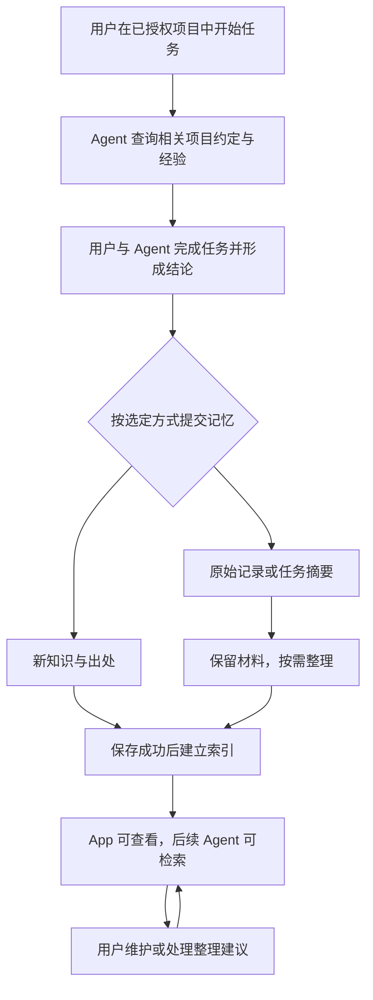

# 日常记忆：产品流程对齐稿

2026-11-08。当前讨论重点是 Agent 接入后怎样积累和使用记忆；安装升级与剩余工程验收仍暂停。本稿将已确认规则和待选择的触发方式分开，待选择项不作为已确认产品要求或已实现能力。

依据：[产品定义](product.md)、[接入流程](agent-integrations.md)、[领域词汇](../CONTEXT.md)。`core-business-flows.md` 是已有业务主线稿，其中全局经验、完整整理、初始化和 traex 等能力的旧状态不作为当前完成情况；当前证据分别见对应 P3 验证记录与交付矩阵。

## 已确认的业务边界

| 环节 | 已确认规则 |
| --- | --- |
| 建立项目 | 一个代码仓库对应一个共享项目，多个获准 Agent 共用知识 |
| 接入 | 发现安装、用户授权、配置与重载、实际验证分别表达；发现不会自动连接 |
| 接收 | 接收 Agent 实际提交的知识或原始记录；客户端不先做重要性筛选，也不额外读取聊天库 |
| 保存 | 新知识保存正文、范围和出处；持久保存与可检索分开表达，重试不重复新增 |
| 使用 | 默认当前项目与获准全局；其他项目需明确指定，读取当前版本并保留来源 |
| 维护 | 用户编辑或恢复形成新版本；AI 合并、覆盖、删除、跨项目移动需确认 |
| 整理 | 根据授权材料生成摘要、标签及建议，保留来源和每项结果 |
| 全局经验 | 用户原文复制，或 AI 通用提炼后预览确认；原项目知识保留 |

连接成功只说明 Agent 有权调用记忆能力。主动查询、主动保存和整段聊天采集是不同的产品行为，不能用一个“已连接”状态代替这些选择。

## 日常使用主线

“开始任务时查询”和“结论形成后主动保存”是建议的默认触发方式，尚未由本轮讨论确认。图中的原始记录不会因保存就自动成为独立知识，后续转换继续遵守来源与审核规则。

| 时刻 | 用户操作 | 建议的 Agent／App 行为 | 决策状态 |
| --- | --- | --- | --- |
| 连接后 | 用户选择项目和允许范围 | 显示接入能力、授权范围和真实验证结果 | 已确认 |
| 开始任务或遇到相关问题 | 用户正常交代任务 | Agent 按任务查询相关约定与经验，缺少结果就继续任务，服务失败明确表达 | 查询时机待确认；范围与错误规则已确认 |
| 形成明确约定、决策或解决经验 | 用户正常推进任务，也可以说“记住这个” | Agent 提交带出处的新知识，不把未经证实的推断写成确定事实 | 默认保存方式待确认 |
| 回 App 查看 | 用户打开首页或项目 | 查看实际新增知识、原文、来源与版本；任务摘要和原始记录分别展示 | 已确认 |
| 发现重复或冲突 | 用户按需整理 | Agent 返回建议，服务判断自动项和需确认项；原知识在确认前保持原样 | 已确认 |
| 下次或另一个 Agent 使用 | 用户在同项目开展任务 | 检索当前有效版本，项目明确约定优先于全局建议 | 已确认；主动触发方式待确认 |

用户手动保存始终保留，不要求先连接 Agent，也不依赖选择自动积累方式。客户端不替 Agent 再筛一次重要性；对日常保存行为的约定属于 Agent 使用规则，来源、范围、版本和确认边界仍由本机受信服务执行。

## 当前要选择的保存方式

1. **建议默认：形成明确结论后自动保存新知识**。例如用户明确“本项目使用 pnpm”，或本次修复已验证并形成可复用经验。保存结论及必要出处，不要求用户每条都额外说一次“记住”。用户仍可明确点名保存。
2. **只在用户点名时保存**。接入后可以查询，但用户说“记住这个”才新增记忆；积累时机由用户直接控制。
3. **任务结束保存摘要，后续整理成知识**。默认先留任务材料，需要继续定义任务结束信号、摘要出处和知识转换规则；摘要本身不能被当成独立新证据。

用户已要求先记录问题，验证真实 Agent 按 Cognee Integrations 的接入与记忆路径后再一起讨论，见 [问题记录](product-questions.md)。这三种方式尚未得到选择，不自动采用第一种，也不将本轮隔离合成材料的集成验证理解为授权采集日常完整聊天。

## 用具体情境核对边界

- 用户明确“本项目使用 pnpm”：第一种方式可建议提交项目新知识；第二种方式等待用户点名；第三种方式先记录到任务摘要。
- Agent 猜测“这里可能因为缓存失效报错”：尚未验证，不能写成已经证实的解决经验；如保存材料，保留其推测性质和出处。
- 已有“本项目使用 npm”，新材料出现 pnpm：不能静默覆盖旧知识，需要保留来源差异并进入冲突处理；确认前旧知识不被替换。
- 项目 A 的经验可能对 B 有用：不因频率或排名自动跨项目提升；复制／提炼为全局经验需走明确操作和确认边界。
- Agent 检索返回某条知识：只能记录返回；成功读取与明确报告采用分别记录，不能推断已修改代码。

## 下一轮对齐点

先完成官方集成的真实路径验证，再恢复用户问题与日常记忆策略的讨论。之后确定保存／检索触发时机、回执怎样反馈，以及首次接入如何展示所选行为。每次只收口会改变日常体验的决定，已有来源、版本和审核约束继续有效。
