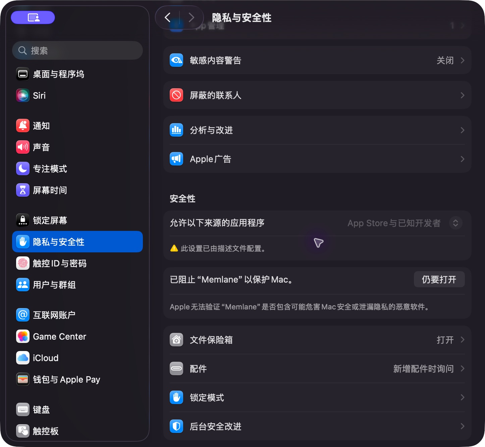

# Memlane v0.1.0-beta.2 内测安装与卸载指南

## 1. 运行环境与要求

- **芯片与系统**为 Apple Silicon（`arm64`，M1/M2/M3/M4/M5 系列 Mac）和 **macOS 26 及以上**。本内测版不提供 Intel（`amd64`）包。
- **磁盘空间**方面，首次准备需要约 **4–6 GiB**，用于隔离安装 Python 3.12、记忆引擎（Cognee）运行库及本地向量模型 `BAAI/bge-small-zh-v1.5`。

## 2. 安装 Memlane

1. 双击从项目发布页下载的 `.dmg`，把 **Memlane** 拖入「应用程序」，再从「应用程序」打开 Memlane。[GitHub 发布页](https://github.com/zwhu/memlane/releases/tag/v0.1.0-beta.2)
2. 如果弹出「未打开‘Memlane’」，点 **「完成」**，确认安装包来自项目发布页。
3. 打开 **系统设置 → 隐私与安全性**，向下滚动到 **「安全性」**。找到「已阻止‘Memlane’以保护 Mac」右侧的 **「仍要打开」**，点击它。
4. 在确认框里再次点 **「仍要打开」**，按 macOS 提示用管理员触控 ID 或密码完成验证。Memlane 打开后就可以继续使用。



## 3. 为什么会出现系统提示

内测版使用 ad-hoc 签名，尚未经过 Apple 公证。macOS 可能在首次打开时拦截。「仍要打开」会为这个 App 单独添加例外。[Apple 操作说明](https://support.apple.com/zh-cn/102445)

确认安装包来自项目发布页后，也可使用以下终端命令。

```sh
xattr -dr com.apple.quarantine /Applications/Memlane.app
```

## 4. 首次启动与下载来源说明

1. 首次运行引导支持在**「国内镜像源」**（默认，优先走清华 PyPI / 阿里云 npmmirror / 中科大 / ModelScope / GitHub 加速节点）与**「国外官方源」**之间切换，并自动读取 macOS 系统代理配置（`scutil --proxy`）与标准代理环境变量；**无论选用哪个下载源，均强制校验固定 SHA256 摘要，不降低任何安全基线**。
2. 如遇公司内网或个别镜像节点临时不可用，可在界面点击**「复制安装命令」**（或在安装确认弹层复制单项命令）后粘贴到个人终端执行，完成后回到 Memlane 点击**「重新检测」**，应用会自动识别并复用通过校验的组件（包括通过官网脚本安装到 `~/.local/bin/uv` 的 `uv`）。
3. 已有日常开发库用户若保持默认独立路径，不会覆盖现有日常记忆库或个人 Python 环境。

## 5. 本次内测支持的 Agent

`v0.1.0-beta.2` 接入页默认开放以下 4 个已完成真机主链路验证的宿主 Coding Agent（其余宿主待后续真机验收完闭环后逐步开放）：

- **Codex**
- **Antigravity（Gemini App）**（提示：目前验证覆盖任务/CodeMode 新会话，普通闲聊尚待后续适配）
- **pi**
- **TraeX**

接入前支持查看具体修改范围预览；记忆引擎（Cognee）、接入网关与 Agent 模型代理状态可在顶部菜单栏图标及**「设置 › 服务」**查看。若在**「设置 › 服务 › 版本与更新」**点击**「检查更新」**，会按需向 GitHub Releases 查询新版本（含内测预发布版本）并提供安全跳转链接。

## 6. 内测已知限制

1. **登录时静默启动限制**：因未做 Developer ID 签名与 Apple 公证，macOS `SMAppService` 的“登录时静默启动”开关可能被系统权限拒绝；拒绝时桌面端会自动回滚开关状态并提示原因，不影响手动启动与关闭窗口时后台保活。
2. **第三方反代波动**：`cognee` 与 `cognee-integrations` 源码在国内源默认经第三方公益反代拉取；如遇波动，可切换为「国外官方源」或在界面复制对应 `curl` 命令手动下载至目标路径后点击「重新检测」。
3. **不提供自动应用内更新**：内测版仅提供手动检查与跳转 GitHub Releases 下载新安装包，更新前请先彻底退出旧版 Memlane。

## 7. 安全卸载

如需卸载测试环境，请**先完全退出 Memlane 桌面端与后台服务**，再使用随附的零第三方依赖卸载脚本 [`scripts/uninstall.py`](../../scripts/uninstall.py)：

```sh
# 1. 先运行 dry-run（默认模式，仅预览不修改任何文件）
python3 scripts/uninstall.py

# 2. 确认无误后执行清理（仅移除 Memlane 独占依赖组件、LaunchAgent 及 4 宿主中的 Memlane 条目并保留备份；保留记忆数据库与 runtime.json）
python3 scripts/uninstall.py --apply

# 如需同时移除 /Applications/Memlane.app
python3 scripts/uninstall.py --apply --remove-app

# 如需连同个人记忆库与运行配置一并清除（不可逆，需双重确认）
python3 scripts/uninstall.py --apply --remove-data --confirm-remove-data
```

卸载脚本内置 `.service-owner` 运行锁检测与防符号链接逃逸检查：服务仍在运行时会自动拒绝执行清理，也不会删除用户在各宿主中配置的其他 MCP/插件条目。
