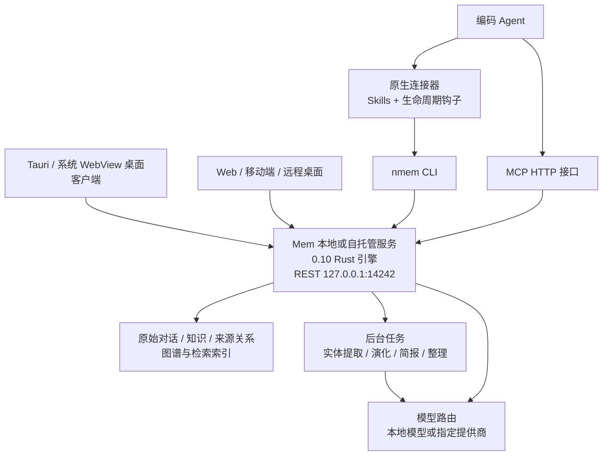

# Nowledge Mem 客户端与实现调研

调研日期：2026-11-07。官方名称为 **Nowledge Mem**。本文基于当日返回的官方网站、文档、GitHub API、公开源码与下载响应；没有安装或运行 App，没有连接真实知识库，也没有修改本机 Agent 配置。

证据分为四类：**官方描述**指产品文档或发布说明；**源码可证**指公开文件能直接证明的结构与行为；**下载可证**指发布资产元数据或实际下载 URL 的 HTTP 响应；**未验证**表示尚未通过安装、运行、数据迁移或断网实测。公开代码存在不等于该能力已在稳定版投入使用。

## 1. 结论

**有正式桌面客户端，而且其范围已超过单纯记忆浏览器。** 官方提供 macOS Apple Silicon、macOS Intel 下载，Windows、Linux 下载仍标 Preview；另有连接同一服务的 Web、移动端和远程桌面模式。桌面入口包括记忆、完整对话、文档库、知识图谱、工作记忆简报、后台整理、Agent 连接器与模型设置。[下载页](https://mem.nowledge.co/download) · [安装说明](https://mem.nowledge.co/docs/installation) · [远程访问](https://mem.nowledge.co/docs/remote-access)

**实现的核心是独立记忆服务、多种客户端与按宿主适配的接入层。** 官方明确：桌面与 MCP 使用同一组 REST 接口，默认 `http://127.0.0.1:14242`；Linux 可无界面运行服务，内置 Web UI 位于 `/app`。原生连接器负责启动时注入上下文、按需检索、捕获宿主对话，再由记忆服务做索引与整理。[API](https://mem.nowledge.co/docs/api) · [服务部署](https://mem.nowledge.co/docs/server-deployment) · [连接器公开注册表](https://github.com/nowledge-co/community/blob/20d9c1e1476ef410a1c92455f2ff60fc69a88c24/integrations.json)

**当前桌面采用 Tauri / 系统 WebView，加上随包提供的 Rust 本地服务。** 0.10 发布流程明确为 `RUST-ONLY`，经 Tauri resources 捆绑原生运行时；打包检查会定位 `nmem-server`。因此它不是只有 UI、首次再下载整个引擎的壳。模型有独立准备流程，官方 ARM DMG 当前约 **371.48 MB**。[发布工作流](https://github.com/wey-gu/mem-releases/blob/bd38e075e603c9706dd7d5415ef939eea6b13443/.github/workflows/release-desktop.yml#L473-L478) · [随包服务检查](https://github.com/wey-gu/mem-releases/blob/bd38e075e603c9706dd7d5415ef939eea6b13443/scripts/verify_packaged_desktop.py#L145-L159)

**不能把“Rust 引擎不依赖 Python”扩大成所有集成零 Python。** 官方仍提供 Python 版 `nmem-cli`，公开 Codex 钩子也调用 Python。早期 Python 引擎、当前 Rust 引擎、宿主连接器的运行时要分别判断。[0.10 本地模型说明](https://mem.nowledge.co/docs/fully-local-models) · [CLI](https://mem.nowledge.co/docs/cli) · [Codex hooks](https://github.com/nowledge-co/community/blob/20d9c1e1476ef410a1c92455f2ff60fc69a88c24/nowledge-mem-codex-plugin/hooks/hooks.json)

**可以研究公开连接器与引擎组件，不能把它视作整套开源桌面项目。** `nowledge-co/nowledge-mem` 当前公开树仅有 README、目录与一个对话示例；公开 `community` 提供连接器，`wey-gu/mem-releases` 提供发布工程。另有 Apache-2.0 的 Rust 数据库 HawDB，但其 README 明确写着 **“currently in nightly integration”**，不能据此断言稳定版已经采用它。[产品公开仓库](https://github.com/nowledge-co/nowledge-mem/tree/e12a04e72c79c92e10bbab170fd9eb398467877d) · [发布工程](https://github.com/wey-gu/mem-releases/tree/bd38e075e603c9706dd7d5415ef939eea6b13443) · [HawDB](https://github.com/nowledge-co/hawdb/blob/db1a58c9e1947d6d048b49d62ba3d2103e1e5a6a/README.md)

## 2. 客户端、版本与下载体积

### 当前可核对的产品形态

| 形态 | 官方可核对的状态 | 边界 |
| --- | --- | --- |
| macOS 桌面 | Apple Silicon 与 Intel 各有安装包 | 本轮未验证最低系统版本、启动与系统集成 |
| Windows / Linux 桌面 | 下载页标 Preview | 不等同于 macOS 的稳定程度 |
| Linux 无界面服务 | `nmem serve`；官方 Docker；浏览器访问 `/app` | 是同一记忆服务的部署形态，不要求桌面窗口常开 |
| Web 客户端 | 同一服务提供 `/app`，访问已有知识库 | 不是浏览器独立存储引擎 |
| 移动客户端 | 官方描述为连接 Mem URL 的原生外壳 | 文档明确没有本地数据库或本地 Python 后台；本轮未验证应用商店上架与各平台当前版本 |
| 桌面远程模式 | 连接另一台常驻 Mem 服务，复用该服务的模型设置 | 属于一套服务、多客户端；不等同于各端独立数据库互相复制 |

来源：[下载页](https://mem.nowledge.co/download)、[Linux 部署](https://mem.nowledge.co/docs/server-deployment)、[Docker](https://mem.nowledge.co/docs/docker)、[Access Anywhere](https://mem.nowledge.co/docs/remote-access)。

### 版本与主包

当日下载页版本列表首项为 `0.10.116-rc1`，稳定版为 `0.10.115`。GitHub `v0.10.115` 发布时间为 `2026-11-06T09:44:53Z`。这些是页面与发布资产证据，不是本机已安装版本。[稳定版发布](https://github.com/wey-gu/mem-releases/releases/tag/v0.10.115)

| v0.10.115 资产 | 发布大小（字节） | 十进制 MB | 证据 |
| --- | ---: | ---: | --- |
| macOS Apple Silicon DMG | 371,479,350 | 371.48 | GitHub 资产元数据；官方短链最终响应 `Content-Length` 一致 |
| macOS Intel DMG | 407,918,263 | 407.92 | GitHub 资产元数据 |
| Windows 安装资产 | 245,739,353 | 245.74 | GitHub 资产元数据 |
| Linux DEB | 394,512,578 | 394.51 | GitHub 资产元数据 |
| Linux AppImage | 432,933,368 | 432.93 | GitHub 资产元数据 |
| Linux RPM | 1,012,057,241 | 1,012.06 | GitHub 资产元数据 |

来源：[发布 API](https://api.github.com/repos/wey-gu/mem-releases/releases/tags/v0.10.115)。Apple Silicon 当日最终下载 URL：<https://download-mem.nowledge.co/app/0.10.115/aarch64-apple-darwin.dmg>，约 **354.27 MiB**。

### 首次准备与磁盘占用

官方安装文档写“启动后安装所需模型，合计约 2.4 GB”，通过 Settings → Models 的 Install 按钮下载并展示进度；服务器 CLI 则提供 `nmem models download/status/reindex`。因此可以确认**模型有独立准备流程**。[安装模型](https://mem.nowledge.co/docs/installation#step-3-download-models) · [模型 CLI](https://mem.nowledge.co/docs/cli#search-index-model)

但安装页同一节仍保留“只有 Apple Chip Mac 支持设备内 LLM，其余需要 Remote LLM”的说法，与页首及 0.10 本地模型说明存在代际冲突。**2.4 GB 只能记录为当前官网保留的估算，不能作为 0.10.115 首次下载实测结果。** 最终磁盘占用尚未测量，也不能用 DMG 大小加 2.4 GB 代替：还要包括解包、组件缓存、索引和真实数据。[安装页](https://mem.nowledge.co/docs/installation) · [0.10 本地模型页](https://mem.nowledge.co/docs/fully-local-models)

### 桌面更新机制：源码与在线协议均有证据

公开发布脚本生成独立更新 manifest，记录 `version`、`source_sha`、`pub_date` 与各平台的对象 key、size、etag、sha256；脚本核对 GitHub Release 资产和 R2 对象。更新检查脚本使用 `Nowledge-Mem/<version> (Tauri)` User-Agent，请求 `backbone-mem.nowledge.co/latest`，检查平台、完整安装包 URL、发布控制状态、校验值及短时效。[清单构建脚本](https://github.com/wey-gu/mem-releases/blob/bd38e075e603c9706dd7d5415ef939eea6b13443/scripts/build-desktop-update-manifest.mjs#L23-L65) · [受控更新检查脚本](https://github.com/wey-gu/mem-releases/blob/bd38e075e603c9706dd7d5415ef939eea6b13443/scripts/verify-controlled-desktop-update.mjs#L33-L78)

2026-11-07 以旧客户端版本 `0.10.114` 只读请求在线接口，得到 HTTP 200、`Cache-Control: no-store`，响应包含：

| 字段 | 当次实际值 |
| --- | --- |
| `version` | `0.10.115` |
| `target` | `aarch64-apple-darwin` |
| `download_url` | `https://download-mem.nowledge.co/app/0.10.115/aarch64-apple-darwin.dmg` |
| `file_size` | `371479350` |
| 控制状态 | `protocol=1`、`status=allowed`、`revision=62` |
| 签发与失效 | `issued_at=2026-11-07T01:44:11.223Z`，60 秒后失效 |
| `sha256` | `b699aa0f92b73b306de8958a49788bcb45fb9597b23c437b59c3512e9841e126` |

可复制的只读查询（响应会随服务状态与时间变化）：

```bash
curl -fsS \
  -H 'User-Agent: Nowledge-Mem/0.10.114 (Tauri)' \
  'https://backbone-mem.nowledge.co/latest?platform=mac&update_control=1&request_id=memlane-research'
```

此次实际请求使用唯一 request ID；示例中的标识仅用于复现，不是认证凭据。核对的是在线元数据协议，**没有下载 DMG、校验文件内容或执行自动更新**。它证明存在独立更新源、平台对应的完整包、校验字段及允许/暂停发布机制；不证明客户端使用标准 Tauri updater 插件，也不证明实现了差分更新或无感替换。

发布仓还保留旧 `build-rust-bundle.yml` 实验流程，其中模型默认不随 bundle 打包、从 R2 首启下载。该文件自己声明实验性质，不能把它的旧默认值当成当前正式桌面发布合同。[历史实验工作流](https://github.com/wey-gu/mem-releases/blob/bd38e075e603c9706dd7d5415ef939eea6b13443/.github/workflows/build-rust-bundle.yml)

## 3. 运行时架构

下图是根据官方接口与连接器源码整理的逻辑边界，不是对闭源桌面内部实现的完整还原。



来源：[API 同一服务声明](https://mem.nowledge.co/docs/api)、[Rust 本地运行时](https://mem.nowledge.co/docs/fully-local-models)、[公开连接器注册表](https://github.com/nowledge-co/community/blob/20d9c1e1476ef410a1c92455f2ff60fc69a88c24/integrations.json)。

### 桌面打包与本地后台

公开发布工程能证明以下结构：

- macOS 流程先执行 `build-rust-bundle.sh`，再执行 `build-macos.sh --skip-python`；Windows 执行 `npm run tauri:build:windows`。这比根据 UI 外观猜框架更可靠。[macOS 构建](https://github.com/wey-gu/mem-releases/blob/bd38e075e603c9706dd7d5415ef939eea6b13443/.github/workflows/release-desktop.yml#L868-L876) · [Windows 构建](https://github.com/wey-gu/mem-releases/blob/bd38e075e603c9706dd7d5415ef939eea6b13443/.github/workflows/release-desktop.yml#L1487-L1490)
- 打包检查在 App 资源中找 `nmem-server` / `nmem-server.exe`；macOS 资源位于 `Contents/Resources`，说明本地服务是分发包的组成部分。[检查源码](https://github.com/wey-gu/mem-releases/blob/bd38e075e603c9706dd7d5415ef939eea6b13443/scripts/verify_packaged_desktop.py#L145-L159)
- 官方检查脚本使用隔离数据和模型目录启动 App，通过 `/health/details` 核对 `version` / `build_sha` 并检查 CLI 版本。**这是源码中的验收方法，不是本轮已执行的实机结果。**[验收脚本](https://github.com/wey-gu/mem-releases/blob/bd38e075e603c9706dd7d5415ef939eea6b13443/scripts/verify_packaged_desktop.py#L248-L301)

本轮没有取得完整前端源码，因此不额外声称 UI 具体使用 React、某状态库或某图渲染库。

### API 与服务状态

| 能力 | 官方接口 | 已知语义 |
| --- | --- | --- |
| 新建知识 | `POST /memories` | 来源关联依赖调用方提供真实 `source_thread_id` / `source_message_id`，不能自动猜造来源 |
| 检索知识 | `POST /memories/search` | 支持筛选、元信息与推理辅助 |
| 修改 / 删除 | `PATCH /memories/{memory_id}`、`DELETE /memories/{memory_id}` | 接口存在不代表修改历史、恢复与审批满足 Memlane 产品规则 |
| 演化 / 退役 | `/memories/{memory_id}/supersede`、`/deprecate` | 将旧知识退出默认召回，历史保留 |
| 原始对话 | `/threads`、`/threads/{thread_id}/append`、`/threads/search` | 线程与消息是独立一等对象 |
| 本机会话导入 | `POST /threads/sessions/save` | 服务所在机器必须能读会话文件；远程场景应由客户端 CLI 解析并上传 |
| 图谱 | `/graph/search`、`/graph/explore`、`/graph/expand/{node_id}`、`/graph/vis` | 可用浏览器展示，也可按节点逐步扩展 |
| 健康与索引 | `/health`、`/health/details`、`/livez`、`/search-index/reindex` | 区分存活、引擎与索引状态 |

来源：[API 索引](https://mem.nowledge.co/docs/api)、[新建知识](https://mem.nowledge.co/docs/api/memories/post)、[检索](https://mem.nowledge.co/docs/api/memories/search/post)、[本机导入接口](https://mem.nowledge.co/docs/api/threads/sessions/save/post)、[Docker 健康检查](https://mem.nowledge.co/docs/docker)。

`/health/details` 的公开部署说明区分 `embedding.mode=remote`、`local-gguf`、`local-hash-fallback`；最后一种表示没有真实嵌入模型，关键词检索仍可用，但语义排序降级。`search_index.reindex_pending=true` 表示索引待重建。**服务端口可通与语义检索准备好不是同一个验收。**[Docker 部署与诊断](https://mem.nowledge.co/docs/docker)

远程请求要求 API key，可用 `Authorization: Bearer ...` 或 `X-NMEM-API-Key`；同机请求默认可免 key，但支持启用 localhost 认证。HTTP MCP 端点在当前 Codex 公开配置中是 `http://127.0.0.1:14242/mcp`；远程文档也有 `/mcp/` 示例，接入时应使用宿主对应的生成配置，不能自行推断路径、认证或重定向兼容性。[远程访问](https://mem.nowledge.co/docs/remote-access) · [Codex MCP 配置](https://github.com/nowledge-co/community/blob/20d9c1e1476ef410a1c92455f2ff60fc69a88c24/nowledge-mem-codex-plugin/.mcp.json)

无界面部署证明服务可以独立于 GUI 运行；**macOS 关闭窗口、退出 App、主动停止服务、故障拉起的完整行为本轮未实测**，不能据此视为 Memlane 的退出语义已经有现成可复制实现。

### 存储引擎的代际问题

当前 Linux 部署文档还列出 `nowledge_graph_v2.db/` 为 KuzuDB、`search_index/` 为 LanceDB 向量与 BM25 索引。这能证明官方曾公开该存储布局，**不能单凭这段旧布局确定 0.10.115 的完整存储组合**。[部署页 Data Location](https://mem.nowledge.co/docs/server-deployment)

另一方面，HawDB 的当前公开 README 描述统一 Rust 引擎，支持图、SQL、全文、向量与图算法，并称正在 Mem nightly 集成。其原始状态与可重建检索投影分离，检索流水线为候选 → 元信息筛选 → 权限内图扩展 → 重排 → top-k → 从固定快照取正文。但这是 **HawDB 自身的公开接口与设计**，不能代替稳定版 Mem 的依赖清单。[HawDB 固定版本 README](https://github.com/nowledge-co/hawdb/blob/db1a58c9e1947d6d048b49d62ba3d2103e1e5a6a/README.md)

## 4. 记忆、图谱与检索是怎样组织的

### 三种知识形态

| 形态 | 官方定义 | 对用户和 Agent 的作用 |
| --- | --- | --- |
| Trace | 完整保存的原始对话 | 保留上下文与可追溯的出处，不要求所有内容先提炼成知识 |
| Unit | 提炼出的原子知识，如事实、决策、计划、过程、偏好 | 可以独立搜索、关联、演化 |
| Crystal | 三个或更多独立来源汇聚后的稳定综合知识 | 提供可独立阅读的总结，通过 `CRYSTALLIZED_FROM` 关联来源 |

来源：[作者工程介绍，2026-03-21](https://nowledge-labs.ai/blog/building-memory-systems-for-ai-agents)、[Crystals 当前文档](https://mem.nowledge.co/docs/concepts/crystals)。官方当前图谱页称 Super Knowledge Graph 有 7 类节点、11 类边；本轮未取得稳定版图谱 schema 源码，不把该数量当作可用于实现的完整数据模型。[Knowledge Graph](https://mem.nowledge.co/docs/knowledge-graph)

Crystal 是特殊 Memory（`is_crystal=true`），不是另造一套不可搜索的报告对象。新 Crystal 初始为未审核；确认后获得检索加权，拒绝后保留但降权；编辑正文或标题会自动确认。来源变化时，已确认 Crystal 应被标为过时并提出重新评估，而不是静默重写。[图谱产物](https://mem.nowledge.co/docs/knowledge-graph) · [Crystal 审核规则](https://mem.nowledge.co/docs/concepts/crystals)

### 知识演化与来源

`EVOLVES` 区分 `replaces`、`enriches`、`confirms`、`challenges`。前两种是版本进展，后两种是证据关系；旧知识被替代后可退出日常检索，但保留历史。矛盾会并列呈现，由用户选择，官方明确不自动裁定谁正确。[Knowledge evolution](https://mem.nowledge.co/docs/concepts/evolves)

这与 Memlane 的确认规则有交集，但不是等价合同：官方也描述新知识保存后自动进行 EVOLVES 检测、建边并影响旧版本召回。**不能仅因“保留历史”就认为 AI 在确认前不会改变已有有效知识。** Memlane 要求合并、覆盖、删除、跨项目移动等待确认，仍需自己的建议与提交边界。[Memlane 产品规则](product.md) · [EVOLVES 检测](https://mem.nowledge.co/docs/concepts/evolves)

生命周期区分 Active、Archived、Removed：默认召回以 Active 为主，Archived 保留用于历史查询；Removed 对应明确删除。新鲜度衰减是排名信号，不等同于自动删除。图谱记录数、活跃知识数、Crystal 数有不同统计口径。[Memory lifecycle](https://mem.nowledge.co/docs/concepts/memory-lifecycle)

### 六路检索与逐步取证

官方当前概念文档列出最多六种检索策略：语义向量、全文关键词、实体、社区聚类、标签、图遍历。Fast 默认侧重语义、全文、实体并行；Deep 增加 LLM 意图识别、HyDE 和可选重排。时间意图与低置信度可能触发 Deep，也可以手动选择。[Search architecture](https://mem.nowledge.co/docs/concepts/search-architecture)

知识有两套时间：事件发生时间与记录时间，且保留时间精度；不能把只知道年份的记录伪装为精确日期。检索同时考虑语义相关性、新鲜度、访问、知识确认与演化关系；有来源时返回 `source_thread_id`，让 Agent 先搜知识，再读取具体对话片段。[Search architecture](https://mem.nowledge.co/docs/concepts/search-architecture)

官方说 Fast 多数查询低于 100 ms、约覆盖 90% 查询；这是产品方描述，**本轮没有数据集、延迟分布或召回率实测**。2026-03-21 工程文章还给出具体权重与旧调度参数，但当前概念文档已经有所变化，不把旧文章数值当作当前稳定版常量。[历史工程文章](https://nowledge-labs.ai/blog/building-memory-systems-for-ai-agents)

Nowledge FS 提供路径式 `ls/stat/cat/find/grep/recall`，当前明确标 Preview；这些路径是 API 中的 Mem 对象地址，**不是本地文件已经挂载到操作系统**。挂载、SQL/Cypher、replay/tail 等阶段仍在设计。[Nowledge FS](https://mem.nowledge.co/docs/nowledge-fs)

## 5. 后台整理如何运转

官方描述两类触发：定时任务负责每日简报、周期性 Crystal 评估、洞察、社区重算等；事件任务在新记忆保存后延迟执行实体抽取、EVOLVES 检测、工作记忆刷新，并可能继续触发聚类与 Crystal 生成。工作记忆按 Space 生成，Default Space 保留 `~/ai-now/memory.md` 兼容文件。[Background intelligence](https://mem.nowledge.co/docs/concepts/background-intelligence)

它采用事件防抖、按小时控制节奏、每任务/小时/日 token 预算以及质量门槛。图算法、衰减等非 LLM 任务不消耗 LLM token 预算；后台任务接收预计算上下文，减少模型自己广泛探索。每项任务可手动运行或独立关闭。[同页任务与限制](https://mem.nowledge.co/docs/concepts/background-intelligence)

当前文档进一步区分：新鲜度与类型整理不改原文；Memory Maintenance 可以只生成审核项；Memory Compaction 与 Label Consolidation 能合并图记录，默认关闭。其产品合同细节需按具体版本实测，不能概括成“所有 AI 写入都先审批”。[同页 Usage boundaries](https://mem.nowledge.co/docs/concepts/background-intelligence)

对 Memlane 有用的是把**接收原始记录、保存用户知识、索引、后台提议、用户确认后提交**当作不同阶段，而不是照搬它的默认自动化权限。当前 Memlane 不因这次调研扩大到全部知识图谱画布、自动 Skill 生成或多设备同步。[产品定义](product.md)

## 6. Agent、MCP 与 CLI 接入

### 接入方式不只有 MCP

公开 `community/integrations.json` 把行为分为 `automatic`（由 hooks / 生命周期实现）、`guided`（规则与技能引导，模型决定是否调用）、`manual`。因此工具“可用”与自动回忆、自动提炼、完整对话自动保存是不同能力。[注册表与说明](https://github.com/nowledge-co/community/blob/20d9c1e1476ef410a1c92455f2ff60fc69a88c24/README.md)

| 目标 | 当前公开包与版本 | 接入与自动化边界 |
| --- | --- | --- |
| Claude Code | `nowledge-mem-claude-code-plugin` `0.7.33` | CLI；启动上下文与会话捕获自动，检索、提炼为 guided |
| Codex | `nowledge-mem-codex-plugin` `0.1.47` | CLI + MCP + hooks；启动注入、prompt 路由、Stop 捕获；宿主需启用并信任 hooks |
| pi | `nowledge-mem-pi-package` `0.8.14` | plugin + CLI；扩展注入启动上下文、自动同步已完成会话分支；提炼为 guided |
| 通用 MCP | `mcp-direct` | 提供工作记忆、搜索、保存能力；注册表明确不提供自动完整会话捕获合同 |
| TRAE / traex | 当日公开注册表未找到条目 | 通用 MCP 或技能机制是适配候选，不能声称已有官方专用集成或已验证 |

版本与能力均来自 [固定提交的 integrations.json](https://github.com/nowledge-co/community/blob/20d9c1e1476ef410a1c92455f2ff60fc69a88c24/integrations.json)，不是本机安装状态。这里的 pi 名称以其宿主为准，不与任意同名 Python 包混用。

### 源码能证明的 Codex 接入链路

1. `.mcp.json` 把工具指向本地 HTTP `/mcp`，并带 `APP: Codex` 标识。[源码](https://github.com/nowledge-co/community/blob/20d9c1e1476ef410a1c92455f2ff60fc69a88c24/nowledge-mem-codex-plugin/.mcp.json)
2. `hooks/hooks.json` 注册 `SessionStart`、`SubagentStart`、`UserPromptSubmit`、`Stop`；实际入口调用 Python 脚本，启动上下文与捕获不只靠自然语言提示。[源码](https://github.com/nowledge-co/community/blob/20d9c1e1476ef410a1c92455f2ff60fc69a88c24/nowledge-mem-codex-plugin/hooks/hooks.json)
3. `nmem-stop-save.py` 构造 `nmem ... t save --from codex`，传递实际 session ID、处理重复 hook 触发，并包含 enqueue、超时与重试分支。[源码](https://github.com/nowledge-co/community/blob/20d9c1e1476ef410a1c92455f2ff60fc69a88c24/nowledge-mem-codex-plugin/hooks/nmem-stop-save.py)
4. 共享行为文档要求先取 Context Bundle，老客户端可回退 Working Memory；检索后只读取需要的原始对话范围，控制上下文大小。[行为合同](https://github.com/nowledge-co/community/blob/20d9c1e1476ef410a1c92455f2ff60fc69a88c24/shared/behavioral-guidance.md)

这些是源码可证的路径；本轮没有执行 hooks，因此不证明给定版本 Codex 中每种事件都实际触发，也不证明写入队列在崩溃、断网下完全无丢失。

### 会话捕获与远程边界

保存一条知识、保存一段交接总结、上传原始完整对话必须区分。官方远程说明明确：远程 Mem 服务不能直接读取客户端机器上的 Agent 会话文件，`nmem t save --from ...` 在 **Agent 所在机器**发现、解析，再上传规范化对话。历史批量导入也是独立操作，不能因连接 MCP 就默认同步全部历史。[远程 capture 说明](https://mem.nowledge.co/docs/remote-access) · [本机导入 API](https://mem.nowledge.co/docs/api/threads/sessions/save/post)

官方 Connect Skill 是一份会安装并修改宿主配置的操作说明；本轮仅把它与注册表当作产品接入证据，未执行其中任何安装、认证、会话同步或配置变更。[官方 Connect Skill](https://mem.nowledge.co/SKILL.md)

## 7. 模型准备与离线边界

### 模型用途独立路由

| 用途 | 官方当前说明 | 完全本地时的要求 |
| --- | --- | --- |
| Default | 多数后台整理任务与继承默认值的用途 | 选择本机 provider |
| Agents | AI Now、Timeline 与交互 Agent | 同样指向本机；不能只改 Default |
| Embedding / Search Index Model | 建索引、语义检索 | 内置本地 GGUF 或已验证的本地 embedding 服务 |
| Vision / OCR | 图片理解与扫描文档识别 | 内置本地视觉模型或本机视觉模型；文本模型不自动具备视觉能力 |
| Fast decisions | Jev 等决策模型用于筛选、去重、时间意图判断 | 完全本地时关闭；设置为本地聊天模型不会自动关闭它 |
| `background_structured` | 知识图谱抽取、压缩可使用内部覆盖配置 | 如有配置需独立核对；未配置时回落 Default |

来源：[Fully local models](https://mem.nowledge.co/docs/fully-local-models)、[Embedding providers](https://mem.nowledge.co/docs/embedding-providers)、[Fast decisions](https://mem.nowledge.co/docs/fast-decisions)。

官方 0.10 文档描述零 Python 本地运行时、GGUF 路径、Apple Silicon Metal 及 Linux/Docker 的可选 CUDA/Vulkan；内置 Gemma 4 的视觉已接入 Library，音频等仍是未来方向。`bundled model` 的产品措辞不能直接解释为模型权重一定全部位于主安装包中，仍须对照发布资产与首次模型准备流程。[本地模型](https://mem.nowledge.co/docs/fully-local-models) · [安装](https://mem.nowledge.co/docs/installation) · [Docker](https://mem.nowledge.co/docs/docker)

聊天 provider 与 embedding provider 分离；更换 embedding 模型、维数或后端后需要重建索引，**维数相同也不代表两模型向量兼容**。远程 embedding 会向对应提供商发送待索引内容和查询；ChatGPT 订阅不等于获得 OpenAI Embeddings API。[Embedding providers](https://mem.nowledge.co/docs/embedding-providers)

### “本地”有三个不同问题

1. **数据放在哪里**：本地默认存储，或用户自托管的远端 Mem；当前也有官方 Cloud 路线，所以早期介绍的“数据永不经过 Nowledge 服务器”不能无条件覆盖所有现有产品模式。[文档首页](https://mem.nowledge.co/docs) · [远程访问模式](https://mem.nowledge.co/docs/remote-access)
2. **模型在哪里推理**：内置或本机 loopback provider 可以本地处理；云端 LLM、远程 embedding、Fast decisions 各有独立外发路径。[Fully local](https://mem.nowledge.co/docs/fully-local-models)
3. **断网后能做什么**：模型与组件需事先准备；同步、浏览器来源抓取、更新、登录可能继续联网。完整离线能力需要逐用途断网验证，不能从“local-first”直接推出。[离线验证说明](https://mem.nowledge.co/docs/fully-local-models#privacy-boundaries-to-review)

官方的验证方法值得复用：停用云 provider、观察本地模型日志、保存并整理测试知识、停止本地模型后再试，确认失败可见且没有云端兜底。本轮未执行这些测试。[官方验证步骤](https://mem.nowledge.co/docs/fully-local-models#4-verify-the-setup)

## 8. 公开源码到底到哪一层

| 仓库 / 资料 | 当日核对结果 | 可以使用的证据 | 不应推出的结论 |
| --- | --- | --- | --- |
| `nowledge-co/nowledge-mem` | 固定提交 `e12a04e...` 的 tree 仅 4 个项目 | 产品介绍、MCP 示例、对话示例 | 完整桌面与服务源码开源 |
| `nowledge-co/community` | 固定提交 `20d9c1e...`，注册表 `1.2.5` | 原生连接器、hooks、Skills、Docker 控制脚本与测试 | 每个插件在任意宿主版本都已通过运行验证 |
| `wey-gu/mem-releases` | 固定提交 `bd38e075...` | 发布、打包、更新清单及检查脚本 | 被构建的产品仓库本身公开 |
| `nowledge-co/claude-dxt` | 官方独立 Claude Desktop 扩展仓库，MIT | 扩展接入实现 | Mem 服务端代码来自此仓库 |
| `nowledge-co/hawdb` | 固定提交 `db1a58c9...`，Apache-2.0 Rust 数据库 | 数据库 API、存储/检索实现与验证工程 | 稳定版 0.10.115 已采用 HawDB；完整产品因此开源 |
| `nowledge-co/OpenKL` | 固定提交 `c9cf8e16...`，Apache-2.0，README 明确 early stage | 独立 Python 知识层原型、LadybugDB 与文件方式 | OpenKL 就是当前 Mem 的真实后端 |

来源：[产品树](https://api.github.com/repos/nowledge-co/nowledge-mem/git/trees/e12a04e72c79c92e10bbab170fd9eb398467877d?recursive=1)、[community](https://github.com/nowledge-co/community/tree/20d9c1e1476ef410a1c92455f2ff60fc69a88c24)、[发布工程](https://github.com/wey-gu/mem-releases/tree/bd38e075e603c9706dd7d5415ef939eea6b13443)、[Claude DXT](https://github.com/nowledge-co/claude-dxt)、[HawDB](https://github.com/nowledge-co/hawdb/tree/db1a58c9e1947d6d048b49d62ba3d2103e1e5a6a)、[OpenKL](https://github.com/nowledge-co/OpenKL/tree/c9cf8e1660bc09fda673013434c2955c825f158b)。不同目录和依赖的许可证需各自核对，不能把某个子项目的 MIT / Apache 授权外推至整个产品。

数据可导出与源代码开放也是两件事。官方提供 Markdown / OKF Wiki 快照导出，以及独立的全数据备份迁移流程；Wiki 导出是快照，外部编辑不会自动同步回 Mem。本轮未验证导出导入是否完整保持所有关系、版本与附件。[OKF](https://mem.nowledge.co/docs/concepts/open-knowledge-format) · [数据迁移](https://mem.nowledge.co/docs/data-portability)

## 9. 对 Memlane 当前方案的启发与限制

本次调研不修改 [产品定义](product.md)、[设计](design.md)、[技术方案](technical-plan.md) 或 [实施清单](implementation-plan.md)，也不改变已经选择的 MyGo 与 Cognee。

Cognee 本身也有官方 [Cognee-RS](https://github.com/topoteretes/cognee-rs) 与 [Rust 文档](https://docs.cognee.ai/rust/getting-started)，应另行评估其实验状态、接口覆盖、绑定与打包；“使用 Cognee”不应被理解成必须永久使用 Python 运行时。这不影响本文对 Nowledge Mem 的独立证据判断。

| 可借鉴的做法 | 为什么适用于 Memlane | 本项目仍需完成的验证 |
| --- | --- | --- |
| GUI、Agent、CLI 走统一服务合同 | 降低多个入口写入不一致的概率，服务可单独管理 | MyGo 与 Cognee 业务服务的生命周期、认证、队列与退出行为 |
| 原始对话与可检索知识分层，保留来源 | 既保存证据，又避免每次向 Agent 注入全部历史 | Cognee 数据、知识版本、项目范围与原始出处的映射 |
| 知识保存、索引、模型准备、服务存活分开呈现 | 不能把“存好了”误报为 Agent 已能检索 | 真正的状态接口、重试与故障恢复 |
| 主包、组件/模型下载、最终占用分别报告 | 用户关心的是轻量主包与透明准备成本 | Memlane 的轻量分发需自己实测；Nowledge 主包约 371 MB 不是可直接达成的指标 |
| 原生连接器按宿主事件适配，MCP 作通用能力面 | 自动接入需要对话定位、增量保存、重复防护与确认能力 | Codex、pi、TRAE、traex 各自合同与实机结果 |
| 工作简报与逐步检索 | 控制上下文量并支持来源追溯 | 当前项目＋全局范围与冲突优先级不能丢失 |
| 每项整理动作区分建议与生效 | 对齐用户确认前不改变有效知识的要求 | 不能照搬 EVOLVES 自动替代默认召回；需自己的版本与审批事务 |

Nowledge Mem 与 Cognee 并不是同一层的可直接替换物：前者是完整产品、服务、模型配置与连接器组合，后者在 Memlane 中承担记忆引擎角色。最值得复用的是可观察的产品合同和公开接入模式，不是未经验证地复制其内部存储栈。

## 10. 仍未解决的证据缺口

- macOS 实际进程树、冷启动耗时、关闭窗口与退出后的服务状态、崩溃恢复行为。
- 0.10.115 首次准备的准确下载清单、模型大小、缓存复用和最终磁盘占用。
- 当前稳定版图数据库、索引数据库与原生依赖的完整版本清单；HawDB nightly 不能代替稳定版证明。
- 本地各模型用途在断网与失败时的实际调用边界，许可证/登录是否影响特定长期离线场景。
- 索引效果、中文召回、真实延迟与内存；官网示例与单用户 benchmark 不作为我们的验收。
- 全套产品代码是否另有公开渠道、稳定版可重现构建与各组件再分发授权。

## 11. 主要一手资料入口

- [官方网站](https://mem.nowledge.co/) · [下载](https://mem.nowledge.co/download) · [官方文档](https://mem.nowledge.co/docs/)
- [文档机器可读索引](https://mem.nowledge.co/llms.txt)：具体页面可用对应 `.md` 读取；当前官网文档包含跨代更新，需结合版本解读。
- [最初产品介绍，页面标注 2025-08-25](https://nowledge-labs.ai/blog/nowledge-mem)：正文已有后来 Public Beta 信息，不把原始日期当成所有正文内容的发生日期。
- [工程架构介绍，2026-03-21](https://nowledge-labs.ai/blog/building-memory-systems-for-ai-agents)：适合解释设计原因，历史参数不作为当前稳定版精确实现。
- [当前连接器源码](https://github.com/nowledge-co/community) · [发布工程](https://github.com/wey-gu/mem-releases) · [HawDB 源码](https://github.com/nowledge-co/hawdb)

本文是竞品与工程资料调研，不是 Nowledge Mem 或 Memlane 的实机验收报告。
