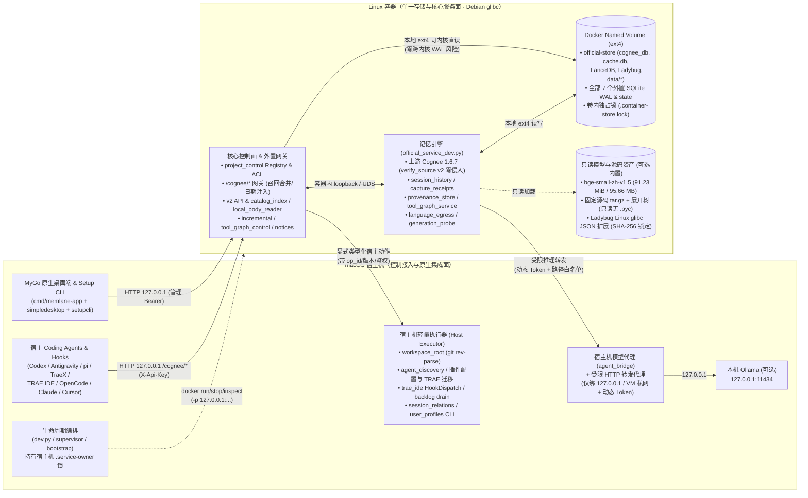

# Memlane Docker 部署架构设计与落地路线图

2026-11-25，源码基线 `6b005c2`（含 Beta.3 Agent-First 首装、`internal/setupcli/`、`internal/controlplane/` 与 TRAE CN 4 事件 Hook 迁移）。本文针对 macOS 本机运行环境，系统评估 Memlane 容器化边界、宿主机与容器网络穿透安全、宿主机依赖瘦身、单一日常库持久化与锁风险、多架构镜像与国内分发，以及面向远期「远程 Docker Cognee」的双轨共存与分阶段落地路线。

全文严格遵守 `AGENTS.md` 中的 **Cognee 零侵入红线**（严禁修改上游 Cognee `1.6.7` `ec6f408` 源码、严禁绕过 `official_service_dev.verify_source` v2 逐文件 SHA-256 与源码目录无 `.pyc`/`.pyo` 门禁、全部扩展落在外置网关/外置存储/LLM 出口/插件层）及 **「单人 Agent 记忆库、单一日常库、不做多租户」** 产品定位，并在各节显式区分 **【代码已核实事实】** 与 **【方案设计建议】**。

关联文档：[部署方向评估](../product/deployment-options-20261117.md) · [安装依赖包瘦身调研](install-dependency-slimming-20261125.md) · [系统架构总览](../architecture/overview.md) · [电脑级接入契约](../architecture/agent-connection-contract.md) · [有效模型契约](../architecture/agent-effective-model-contract-20261118.md) · [公测发版方案](../product/release-v0.1.0-beta.1-20261121.md)

---

## 0. 核心结论速览

**架构决策**：正式交付推荐采用 **「方案 B-Split（Linux 容器承载数据面与核心接入控制面，macOS 宿主机保留原生 App、宿主执行器与 Agent 模型代理）」**。实施上先经 **Phase 1A（方案 A 形态最小隔离 Spike，1 周）** 消除 Linux Ladybug JSON 扩展、`verify_source` 校验与宿主模型桥穿透等核心未知，再以 **B-Split** 形态依次推进 **Phase 1B（CLI/`dev.py` 双轨与双向停机迁移）→ Phase 2（桌面端 / Setup CLI 集成与宿主机依赖瘦身）→ Phase 3（远程 Docker Cognee）**。

决定该切分边界的两条底层代码事实如下：
1. **数据面深度直读耦合**：控制服务（[project_control_server.py](../../engine/python/project_control_server.py#L40)）挂载的 `catalog_index`、`local_body_reader`、`raw_records_read`、`v2_lookups`、`incremental_processing`、`tool_graph_control`、`processing_notices` 与 `user_profiles/documents` 均跨进程直接打开 `official-store` 内的 SQLite（`cognee_db`、`cache.db`）、原始正文文件与外置 `lesson-provenance.sqlite3`。若引擎进 Linux 容器而控制面留在 macOS 宿主机，经 VirtioFS Bind Mount 跨内核共享活动 SQLite WAL 将直接暴露 `-shm` 共享内存与 POSIX 锁失步损坏风险，且 `local_body_reader.py` 会因容器/宿主机 `raw_data_location` 绝对路径前缀不一致触发 Fail-Closed `403`。
2. **宿主面不可容器化耦合**：现役控制面同时承担大量 macOS 原生宿主机操作——用户工作区 `git rev-parse`、读写 `~/.codex`/`~/.gemini`/`~/.trae-cn`/`~/.pi`/`~/.config/opencode` 配置与 TRAE CN 6→4 Hook 迁移、运行 macOS Mach-O Agent CLI 与原生 Keychain/登录态、在宿主工作目录执行 `trae_ide_hook.py`、扫描宿主 Agent SQLite 与 `.cognee-plugin` 待发缓冲；同时引擎侧 `generation_handoff_runtime.py` 在热切换时会反向拉起宿主 `ValidationBridge`，而「代码结构图谱（`code_enabled` / `enola`）」链路依赖 `ACCEPT_LOCAL_FILE_PATH` 在服务端直接读取宿主机代码仓库绝对路径。

### 六大核心工程问题结论矩阵

| 议题 | 核心结论 | 关键实证与边界约束 |
| --- | --- | --- |
| **① 容器边界选型** | **正式交付选「方案 B-Split」**（引擎 + 数据直读投影 + 注册表/ACL/网关 + 外置 WAL 全入同一 Linux 容器；macOS 留原生 App + 6 项类型化宿主执行器 + `agent_bridge`）；「代码结构图谱（`code_enabled`）」默认关闭并在显式启用时按单项目受控只读暂存/挂载接入；Phase 1A 可借 A 形态做短期隔离 Spike | 彻底消除跨内核 SQLite WAL 共享与 `raw_data_location` 403；零破坏保留 `<150ms` v2 首屏性能；与远期远程 Cognee 共享同一接口缝隙，并与 [安装依赖包瘦身调研](install-dependency-slimming-20261125.md) 的 `enola-cli` 按需化联动 |
| **② 网络与 `agent_bridge` 安全** | **严禁 `0.0.0.0` 暴露**；将单一 `completion_url` 拆为「宿主探测 / 容器推理 / 认证排空」三语义；**本机交付首选宿主机受限 HTTP 转发代理**（MVP 可用 `host.docker.internal`），每实例轮换高熵 Token + 补齐桥端 `Origin` 拒绝 + 严格 `-p 127.0.0.1` 发布 | 核实全仓 18+ 处 loopback 限制点；`codex_completion_endpoint.py` 缺 `Origin` 校验且 `/health` 无鉴权；`generation_ollama.py` 硬限 `127.0.0.1/localhost`；Apple `container` CLI 的 `--localhost` DNS 会影响 Private Relay，不宜作默认依赖 |
| **③ 宿主机依赖瘦身** | **引擎 venv、`uv` 与 OpenSSL 3.5.9 可彻底移出宿主机**（`environment.go` 旧预算 `2 GiB` 下载 / `4 GiB` 展开；实测 171 包精确下载 `339.61 MiB`、无 `.pyc` RECORD `979.02 MiB`、含 `.pyc`/块 `1.05–1.14 GiB`）；但**短期不能零成本彻底去 Python**（受制于上游 Python Hook 与宿主桥/编排） | AST 扫描证实全部 Hook/运维脚本为 **0 第三方包**，宿主桥+执行器仅需 **`aiohttp` + `tomlkit` + `jsonschema`（合计 ~8 MB，较引擎 venv 削减 >99%）**；推荐保留受管 Python 3.12（`16.85 MiB` / `17.7 MB` 压缩包）+ `~8 MB` 微型宿主机环境（`1–2 人周`） |
| **④ 持久化与文件锁** | **活动数据库强制使用 Docker Named Volume（Linux VM 原生 `ext4`）**，严禁跨宿主机/容器双端打开任何 SQLite/Ladybug 文件（哪怕 `:ro`）；建立 `store_id` 唯一活动位置与停机 Checkpoint 双向迁移协议 | 核实 `official-store` 含 `cognee_db`/`cache.db`/LanceDB/Ladybug + 7 个外置 SQLite WAL；VirtioFS Bind Mount 不保证跨内核 SQLite WAL `-shm`/`fcntl` 与 Ladybug 锁传播；需专项处理历史 `raw_data_location` 绝对路径 |
| **⑤ 镜像架构与国内分发** | **强制 Debian/glibc `python:3.12-slim`（严禁 Alpine/musl）** 多阶段构建 `linux/arm64` + `linux/amd64`；镜像内保留上游 tar.gz + 无 `.pyc` 只读源码树满足 `verify_source` v2；`libjson.lbug_extension` 与 PyPI `cognee` wheel 解耦为官方三平台固定 SHA-256 资产；`bge-small-zh-v1.5`（`91.23 MiB / 95.66 MB`）推荐独立只读模型卷；GHCR 主发 + 阿里云 ACR 国内同步 + 离线 tar | 上游 `ladybug_extensions/README.md` 证实 Linux 0.18+ 必须动态加载 glibc `libjson.lbug_extension`（musl 无法 `dlopen`），且 Docker 可直接从官方 `ghcr.io/ladybugdb/extension-repo` 拷入并核验 `linux_arm64`（`896,464 B`）/`linux_amd64`（`846,920 B`）固定 SHA-256；可与 [安装依赖包瘦身调研](install-dependency-slimming-20261125.md) 脱钩 PyPI `cognee` wheel 及 44 包裁剪无缝对齐 |
| **⑥ 共存与路线图** | `runtime.json` 增设向后兼容 `engine_runtime: "local" \| "docker" \| "remote"`（缺省 `"local"`）；`dev.py`、`internal/supervisor` 与 `internal/setupcli` 抽象容器生命周期与回执；按 4 阶段（`1A`→`1B`→`2`→`3`）推进，本机完整落地估算 `6–11 人周` | 复用现有 `internal/simpledesktop` HTTP 架构与 Beta.3 `setupcli` / `__install-worker` 体系；远期远程模式复用同一 B-Split 边界，绝不暴露远端 Docker daemon API |

### 推荐目标架构全景（方案 B-Split）



---

## 1. 容器边界选型（关键架构决策）

### 1.1 代码已核实事实：全模块耦合盘点

对照 [project_control_server.py](../../engine/python/project_control_server.py#L40)（`create_app` L40、`configured_app` L505）的实际挂载链与 [official_service_dev.py](../../engine/python/official_service_dev.py#L345) 的运行期行为，现役后端模块可分为 **三类泾渭分明的耦合域**：

#### A. 绝对不能直接进容器（或强依赖宿主机文件系统）的 7 类 macOS 宿主耦合模块

| 模块与代码位置 | 已核实的宿主机强依赖 | 无法直接容器化的根因 |
| --- | --- | --- |
| **工作区与 Git 解析**<br>[project_control.py](../../engine/python/project_control.py#L893)（L893, L1142）<br>[project_policy.py](../../engine/python/project_policy.py#L85)（L85–103） | `workspace_root()` 对用户本地目录做 `realpath` 校验并执行 `git -C <path> rev-parse --show-toplevel` | 宿主机任意路径（如 `~/work/...`）不在容器文件系统内；全盘挂载 `$HOME` 违背最小权限与安全隔离原则 |
| **代码结构图谱索引（`code_enabled` / `enola`）**<br>[graph.go](../../internal/simpledesktop/graph.go#L781)（`indexProject` L781–790）<br>[official_service_dev.py](../../engine/python/official_service_dev.py#L361)<br>[project_control.py](../../engine/python/project_control.py#L395)（L395–470）<br>[cognee_extension_gateway.py](../../engine/python/cognee_extension_gateway.py#L273)（L273–338） | 启用项目代码图谱后，桌面端（`graph.go:790`）与上游插件脚本 `cognee-index-repo.sh` 向 `POST /api/v1/remember` 传宿主机仓库绝对路径 `raw_data=p.Path` + `content_type="code"`，依赖 `official_service_dev.py:361` 允许的 `ACCEPT_LOCAL_FILE_PATH` 在引擎所在文件系统运行 `enola`；上游 Cognee `get_remember_router.py`（`L379, L500-547`）**明确禁止 `content_type="code"` 走文件上传**（仅接受服务端本地路径或远端 git URL） | 禁止挂载 `$HOME`/任意宿主目录后，容器内无法直接读取任意宿主机仓库绝对路径；必须设计专门的默认禁用 + 按需单项目受控暂存/只读策略（见 1.2 节与第 6 节） |
| **Agent 发现、配置、插件安装与 TRAE 迁移**<br>[agent_discovery.py](../../engine/python/agent_discovery.py#L7)（L7–45）<br>[agent_connections.py](../../engine/python/agent_connections.py#L377)（L377, L499, L578, L866, L1007）<br>[project_codex_connection.py](../../engine/python/project_codex_connection.py#L81)<br>[project_installation.py](../../engine/python/project_installation.py#L205)（L65, L128, L205, L272, L289）<br>[opencode_installation.py](../../engine/python/opencode_installation.py#L204)（L204–290）<br>[trae_hooks_migration.py](../../engine/python/trae_hooks_migration.py#L1)<br>[project_control_server.py](../../engine/python/project_control_server.py#L403) | 扫描 `/Applications/*.app`（`Codex.app`、`Gemini.app`、`Trae CN.app` / `TRAE CN.app`、`Cursor.app`）与 PATH（含 `traecli`/`traex`/`trae-cli`）；读写 `~/.codex/config.toml`、`~/.gemini/config/`、`~/.trae-cn/hooks.json`（含 6→4 事件原子迁移与第三方 Hook 组保留）、`~/.pi/agent`、`~/.config/opencode`；执行宿主 `codex`/`agy` CLI 及校验宿主 `node >= v20` SHA-256；`/v1/generation` 亦通过 L403 探测本机 `detected_processing_clis` | 直接操作 macOS 应用包、宿主配置文件与原生二进制；OpenCode loader（`opencode_installation.py:214-248`）更按 `realpathSync` 校验宿主绝对路径与私钥文件 |
| **TRAE IDE Hook 调度器**<br>[trae_ide_connection.py](../../engine/python/trae_ide_connection.py#L48)（`loader` L48、`HookDispatch` L143, L200） | `HookDispatch` 校验宿主 `hooks.json` 和制品，并在用户真实项目工作目录中 `spawn` 宿主 Python 执行 `trae_ide_hook.py` | 必须读取宿主机项目 `cwd`、宿主 `hooks.json` 与本机进程上下文 |
| **宿主积压队列与缓冲消费**<br>[project_backlog.py](../../engine/python/project_backlog.py#L636)（`_execute` L636、`run` L1100）<br>[project_backlog_worker.py](../../engine/python/project_backlog_worker.py#L195) | 检查 `~/.cognee-plugin/*` 本地缓冲、插件 `.env`、插件文件完整性与 `last-hook-error.json`，使用宿主 `HOME` 驱动本地脚本补发 | 缓冲文件由宿主 Coding Agent Hook 写入本机目录，必须在本机读取与清理 |
| **宿主 Agent 会话关联扫描**<br>[session_relations.py](../../engine/python/session_relations.py#L16)（L16, L52） | 通过 `open_official_sqlite_ro()` 只读打开宿主 `~/.codex/state_*.sqlite` 等本地 Agent 会话数据库 | 直接依赖宿主用户目录下的各 Agent 本地状态库 |
| **模型代理桥、画像 CLI 与原生登录态**<br>[agent_completion_endpoint.py](../../engine/python/agent_completion_endpoint.py#L28)（L28–40）<br>[codex_completion_endpoint.py](../../engine/python/codex_completion_endpoint.py#L742)（L742–851）<br>[agent_bridge_runtime.py](../../engine/python/agent_bridge_runtime.py#L15)（L15–31, L143, L154）<br>[antigravity_completion.py](../../engine/python/antigravity_completion.py#L32)（L32, L65）<br>[pi_completion.py](../../engine/python/pi_completion.py#L1)（L1–25）<br>[runner.py](../../engine/python/user_profiles/runner.py#L60) | 启动 macOS 原生 arm64 Mach-O CLI（`codex`、`Gemini.app/Contents/Helpers/agy`、`pi`、`traecli`/`traex`/`trae-cli`）；`agent_bridge_runtime.py:15-31` 直读 `~/.codex/state_*.sqlite` 推断有效模型；`agent_bridge_runtime.py:154` 与 `antigravity_completion.py:65` 明确注明 `agy` 依赖同一 OS 用户的原生 keyring 登录态；`user_profiles/runner.py` 复用上述 CLI 生成画像 | Linux 容器无法运行 macOS Mach-O 二进制，也无法访问 macOS Keychain 与宿主已登录会话 |

#### B. 必须与 `official-store` 同内核的 9 类数据直读与引擎 SDK 模块

| 模块与代码位置 | 已核实的直读/SDK 耦合 | 若跨宿主机↔容器拆分会触发的硬故障 |
| --- | --- | --- |
| **目录投影 `catalog_index` & 同步阶段**<br>[catalog_index.py](../../engine/python/catalog_index.py#L561)（L561–605, L854, L1884–1901）<br>[catalog_sync_stages.py](../../engine/python/catalog_sync_stages.py#L462)（L462–1155） | 跨进程直接打开 `official_data/system/databases/cognee_db` 与 `state_dir/lesson-provenance.sqlite3`（WAL 只读），同步到本地投影库 `catalog-index.sqlite3` | **跨内核 VirtioFS SQLite WAL 锁/SHM 失步损坏风险**；若改成细粒度 HTTP 拉全量表会击穿 `<150ms` 冷启动预算 |
| **安全正文直读快路 `local_body_reader`**<br>[local_body_reader.py](../../engine/python/local_body_reader.py#L166)（L166–216, L349）<br>[documents.py](../../engine/python/user_profiles/documents.py#L71)（L71–88） | 直读 `cognee_db` 获取 `data.raw_data_location`，再通过 `dir_fd + O_NOFOLLOW` 直读 `official_data/data/*`；`_relative_parts_within_data_root()` 严格要求 `raw_data_location` 位于当前 `official_data/data` 绝对路径下 | **绝对路径前缀陷阱（高危）**：容器内 Cognee 写入 `raw_data_location = /var/lib/memlane/official-store/data/...`，宿主机控制面持不同前缀时，校验立即抛出 `LocalPathSecurityError('document_path_denied', 403)`，且安全错误 **Fail-Closed 永不回退 HTTP `/raw`**（`documents.py:87-88` 亦直接转 503） |
| **原始会话/缓存直读**<br>[raw_records_read.py](../../engine/python/raw_records_read.py#L204)（L26, L113, L204–283）<br>[cache_read_v2.py](../../engine/python/cache_read_v2.py#L19)（L19, L94）<br>[v2_api_raw.py](../../engine/python/v2_api_raw.py#L30)（L30, L201） | 批量直读 `cognee_db` 与 `cache.db` 做分页 hydration（仅 503/空数据时回退官方 HTTP） | 跨内核直读 `cache.db` WAL；若禁用直读退回逐会话 HTTP 会退化回 150+ 次查询性能瓶颈 |
| **v2 单点查询与总览 API**<br>[v2_api_context.py](../../engine/python/v2_api_context.py#L296)（L296, L552–563）<br>[v2_lookups.py](../../engine/python/v2_lookups.py#L87)（L87, L123–249, L420）<br>[v2_api_overview.py](../../engine/python/v2_api_overview.py) / [v2_api_knowledge.py](../../engine/python/v2_api_knowledge.py) | 单请求内同时联查 `cognee_db`、`cache.db`、`lesson-provenance.sqlite3`、`catalog-index.sqlite3`、`knowledge-recall.sqlite3`、`ui-reading-state.sqlite3` 与 `Registry` | 属于最核心的读性能聚合层；一旦拆散到宿主机与容器两侧，单次首页加载会裂变为多次跨边界 RPC |
| **增量提炼调度**<br>[incremental_processing.py](../../engine/python/incremental_processing.py#L50)（L50–168, L230–232） | 直读 `cognee_db`（活跃 `pipeline_runs` 容量判定，规避 HTTP 窗口截断）与 `cache.db` | 若留在宿主机要么跨内核读 WAL，要么失去无截断全局容量视图 |
| **工具图谱控制预筛**<br>[tool_graph_control.py](../../engine/python/tool_graph_control.py#L142)（L142–237） | 直读 `cognee_db` 与 `cache.db` 预筛选待构图会话（缺失时可回退 HTTP） | 随引擎与 [tool_graph_service.py](../../engine/python/tool_graph_service.py#L471) 同侧最简洁，避免重复传输会话列表 |
| **处理通知**<br>[processing_notices.py](../../engine/python/processing_notices.py#L74)（L74–147） | 直读 `cognee_db`（`pipeline_runs`）及读取 `runtime-logs/*.log` | 容器内日志与 `cognee_db` 同侧访问无跨界开销 |
| **模型验证探针**<br>[generation_validation.py](../../engine/python/generation_validation.py#L381)（L381–440）<br>[generation_probe.py](../../engine/python/generation_probe.py#L193) | `GenerationValidation.run()` 在宿主机拉起 `ValidationBridge`，同时以 `runtime['python']` 启动 `generation_probe.py`——而 `generation_probe.py` **必须导入完整 `cognee` + `litellm` 并执行 `verify_source`** | 若 `generation_probe.py` 留在宿主机，**宿主机就无法卸载引擎 venv（无 `.pyc` `979.02 MiB` / 含 `.pyc` 约 `1.05–1.14 GiB`）**！必须将 SDK probe 移入容器执行 |
| **首装存储初始化**<br>[store.go](../../internal/bootstrap/store.go#L155)<br>[first_install_store.py](../../engine/python/first_install_store.py#L82) | `PinnedSDK` 执行 `verify_source`、导入 `cognee` 运行 Alembic 迁移并初始化 owner key | 必须随引擎镜像在容器内执行（如 `docker run --rm ... first_install_store.py`） |

#### C. `official_service_dev.py` 内部 6 处容器化隐藏耦合

1. **引擎反向拉起宿主模型桥**：[generation_handoff_runtime.py](../../engine/python/generation_handoff_runtime.py#L189)（L189–220）在运行期热切换到 `agent_bridge` 时，默认直接实例化 `ValidationBridge(...)` 并 `spawn` 宿主 Agent CLI（`codex`/`agy`/`pi`/`traex`），并在 [generation_handoff_runtime.py](../../engine/python/generation_handoff_runtime.py#L275)（L275–281，`client.get` 在 L278）直接请求旧桥 `completion_url + /health` 检查 `active_or_waiting` 排空。在 Linux 容器内无法拉起 macOS CLI，必须利用 `apply()` 现有的 `factory` 接缝改为消费「宿主机预先拉起并传入端点/凭据的候选桥」或通过认证回执确认排空。
2. **Ladybug JSON 扩展硬编码 macOS**：[ladybug_extension.py](../../engine/python/ladybug_extension.py#L15)（L15–52）写死 `PLATFORM = 'osx_arm64'`、`SIZE = 630440` 与 `if sys.platform != 'darwin' or platform.machine() != 'arm64'`，并在 [official_service_dev.py](../../engine/python/official_service_dev.py#L387) 启动时调用。Linux 容器会直接抛 `ladybug_json_extension_unsupported_runtime`。
3. **Uvicorn 硬编码 `127.0.0.1`**：[official_service_dev.py](../../engine/python/official_service_dev.py#L478)（L478–479）写死 `uvicorn.Config(app, host='127.0.0.1', port=port)`。在容器桥接网络下绑定 `127.0.0.1` 会导致 Docker `-p 127.0.0.1:<port>:<port>` 端口转发全部 `Connection reset by peer`，容器内需支持显式配置监听地址（如由环境变量 `MEMLANE_BIND_HOST=0.0.0.0` 控制，同时宿主机端口发布严格锁定 `127.0.0.1`）。
4. **`.generation-applied-<pid>.json` 宿主 PID 校对陷阱**：[official_service_dev.py](../../engine/python/official_service_dev.py#L466)（L466–477）使用容器内 `os.getpid()`（通常为 `1`）写回执，而 [dev.py](../../scripts/dev.py#L904)（L861–904）严格校验 `applied.get('pid') != service.pid`（宿主机进程 PID）；此外 [service_monitor.py](../../engine/python/service_monitor.py#L83)（L83, L462–479, L739–744）也按宿主 `ps` PID 与 `.memlane-dev-owner.json` 采样。容器模式必须改为基于 **实例 Nonce（`run_id`）+ Container ID** 校验。
5. **父进程退出哨兵**：[official_service_dev.py](../../engine/python/official_service_dev.py#L349) 调用 `owner_lifecycle.watch_owner()`（[owner_lifecycle.py](../../engine/python/owner_lifecycle.py#L7) 监控 `os.getppid()` 变化即自杀）。作为容器 PID 1（`ppid == 0`）或由容器 entrypoint 启动时需按容器模式显式关闭，由 Docker 生命周期与 `SIGTERM` 接管。
6. **代码结构图谱本地路径直读（`ACCEPT_LOCAL_FILE_PATH`）**：[official_service_dev.py](../../engine/python/official_service_dev.py#L361) 允许透传 `ACCEPT_LOCAL_FILE_PATH` 供上游 `get_remember_router.py`（L500–547）执行本地仓库 `enola` 索引。容器内默认应关闭 `ACCEPT_LOCAL_FILE_PATH=false`（防止任意路径读取），仅对明确开启 `code_enabled` 的受管项目经受控单仓库只读暂存/挂载目录开启并限制前缀。

### 1.2 方案设计建议：三种切法 + 两种改良方案全面对比

| 维度 | 方案 A（原版：仅引擎入容器） | 方案 A+（引擎 + 容器内数据只读代理/Probe，控制面留宿主） | **方案 B-Split（推荐正式交付：引擎 + 核心控制面/数据面入容器，宿主留轻量执行器 + 桥）** | 方案 B（原版：整包 `project_control_server` 入容器） | 方案 C（全后端含模型桥入容器） |
| --- | --- | --- | --- | --- | --- |
| **可行性** | ❌ **直接破损**（VirtioFS WAL 损坏 + `local_body_reader` 403 + `generation_probe` 依赖宿主 Cognee） | ⚠️ 可运行，但割裂状态与接口碎片化 | ✅ **全局最优，数据/控制/远期架构完全统一** | ❌ **直接破损**（无法运行宿主 `git`/Agent CLI/修改 `~/.codex`） | ❌ **macOS 不可行**（Mach-O CLI + macOS Keychain 无法入 Linux 容器） |
| **跨内核 SQLite 风险** | 极高（宿主控制面直读容器 `cognee_db`/`cache.db`/`provenance`） | 低（但状态分裂在宿主机与容器两处 WAL） | **零**（全部 7+ SQLite WAL、LanceDB、Ladybug 严格单内核独占于同一 Named Volume） | 零 | 零 |
| **`<150ms` 首屏性能** | 破坏或高危 | 退化（需发明 15+ 细粒度跨容器 RPC 拼装 `v2_api`） | **无损保留**（`v2_api`/`catalog_index`/`recall`/`reading_state`/`Registry` 全部同容器同卷内直联） | 无损 | 无损 |
| **宿主机依赖瘦身** | 无法卸载 Cognee（受阻于 `generation_probe`/`first_install_store`） | 可卸载 Cognee | **可彻底卸载 Cognee/LanceDB/Ladybug/ONNX/`uv`/OpenSSL** | 可卸载 | 可卸载（但丧失本机 Agent 登录复用能力） |
| **备份/单一日常库原子性** | 割裂 | 割裂（`official-store` 在卷内，`Registry`/`recall`/`drift`/`reading_state` 在宿主机） | **极佳（单一 `store_id` 卷即全部权威业务状态）** | 极佳 | 极佳 |
| **向 Phase 3 远程 Cognee 演进** | 无复用（远程时仍要重写控制面） | 需二次重构（远程时 `Registry`/`ACL`/`v2_api` 仍须迁服务端） | **一步到位（远程 Cognee 直接复用同一容器镜像与宿主执行器协议）** | 不可用 | 仅限远端无宿主代理的纯 Provider 变体 |
| **工程改造成本** | 看似最低，实则隐性返工最大 | 中高（重写大量数据读取层 RPC） | **中高但一次性投入（3–5 人周）**：不动 90% 数据/v2/网关代码，集中抽出 6 个清晰的宿主执行器动作 | 不可行 | 极高且违背产品定位 |

#### 方案 B-Split 的「宿主执行器（Host Executor）」最小契约设计

为确保安全边界与低改造成本，macOS 宿主机保留一个轻量本地入口（可并入宿主控制守护进程或 Go 编排层），**严格只接收以下 6 类显式类型化业务动作**，**严禁透传任意 shell 命令或任意文件路径**，全部调用必须携带 `operation_id`、`expected_revision`、目标 `agent_kind` 与独立鉴权凭据，且跨边界等待期间容器侧 **不持有 `Registry` 文件锁**：

1. `workspace.resolve`：输入用户选定目录（或来自 Hook 的本机 `cwd`），在宿主机执行 `realpath` + `git rev-parse --show-toplevel` + 安全路径核验，返回标准化逻辑工作区标识与仓库指纹；由容器侧 `Registry` 唯一决定项目绑定与授权。
2. `agent.host_ops`（`discover` / `preview` / `apply` / `verify` / `migrate`）：宿主探测本地 App/CLI/Profile（含 `detected_processing_clis`），生成或核对插件制品代次、宿主配置文件变更及 TRAE CN 6→4 Hook 原子迁移（保留 `preserved_third_party_groups`）；遵循既有电脑级接入契约（[agent-connection-contract.md](../architecture/agent-connection-contract.md#L25)），仅创建/校验独立身份与本地配置，所有身份记录与项目 ACL 仍由容器 `Registry` 单点提交。
3. `agent.trae_dispatch`：保留在宿主机的本地入口，供 TRAE IDE Hook 触发，按本机 `hooks.json` 校验并在宿主 `cwd` 执行 `trae_ide_hook.py`，出站经宿主机转发到容器 `/cognee/*`。
4. `backlog.drain`：宿主侧扫描 `~/.cognee-plugin/*` 待发缓冲，向容器 `/cognee/*` 补发，并以容器侧 `capture-receipts` 回执作为幂等提交依据。
5. `profile.run_cli` & `session.scan_host_relations`：画像生成 CLI（`codex`/`agy`/`pi`/`traex`）与宿主 Agent 会话库只读扫描留宿主机执行，生成结果交回容器侧 `ProfileDocuments` 持久化与读回确认（保留现有保存阶段不可取消与单所有权语义）。
6. `bridge.lifecycle` & `monitor.host_sample`：宿主机负责启动/探活/排空/销毁常驻 `agent_bridge` 与热切换候选 `ValidationBridge`（向容器侧 `generation_handoff_runtime.apply()` 的 `factory` 接缝上报桥代次 ID、容器可达推理地址与独立动态 Token），并与容器侧引擎/卷指标聚合输出至现有 `/v1/runtime/monitor`。

#### 代码结构图谱（`code_enabled` / `enola`）在 Docker 模式下的专门处置策略

由于上游 Cognee `get_remember_router.py`（L509–547）明确禁止 `content_type="code"` 通过 HTTP 上传文件（仅接受服务端本地仓库路径或远端 git URL），且 B-Split 严禁挂载 `$HOME` 或任意宿主机目录，建议按以下三层闭环处理（与 [安装依赖包瘦身调研](install-dependency-slimming-20261125.md) 的 `enola-cli` 按需化联动，标准镜像可同步省下约 `51 MiB` 级二进制）：

1. **Docker 模式默认关闭并显式告知**：容器默认 `ACCEPT_LOCAL_FILE_PATH=false` 且标准基础镜像可不内置 `enola-cli`；未授权项目点击「构建代码结构图谱」或触发 `cognee-index-repo.sh` 时，桌面端与外置网关显式提示「当前 Docker 模式未启用该项目代码仓库只读授权」，绝不静默失败或退化为宽泛宿主机挂载。
2. **本机 Docker 按需单项目受控只读接入（Opt-in）**：当用户在桌面端明确为单个已注册项目启用 `code_enabled` 时，支持两种零侵入方案择一：
   - **方案 I（推荐 · 按需单项目快照导入卷内只读暂存区）**：宿主执行器将该项目受控 git 跟踪文件/工作区快照同步至容器卷内独立隔离路径 `/var/lib/memlane/code-staging/<project_id>`（无需重启主容器变更 `-v` 挂载表，亦避免 VirtioFS 大量小文件遍历慢与跨内核访问）；容器侧网关（`cognee_extension_gateway.py`）仅对已开启 `code_enabled` 的该项目将 `raw_data` 映射为 `/var/lib/memlane/code-staging/<project_id>` 后转发 Cognee `/api/v1/remember`（受限于仅允许该前缀的 `ACCEPT_LOCAL_FILE_PATH` 门禁）；索引完毕后可保留增量同步目录或按策略清理。
   - **方案 II（受控只读挂载）**：仅对该项目显式挂载单个只读仓库路径 `-v <canonical_repo>:/workspaces/<project_id>:ro`（需受控容器重建挂载表，并严格校验无 symlink 逃逸与单项目白名单）。
   - 同时可配合提供「按需安装/挂载 `enola` 扩展层」或独立的 `-with-codegraph` 镜像变体，与 `enola-cli` 按需下载策略完全对齐。
3. **远期远程 Docker（Phase 3）**：优先采用上游原生的 **远端 git URL 浅克隆模式**，或由宿主执行器推送受控代码快照包至远端隔离暂存区再触发索引，绝不在远端服务端开放任意本地路径读取。

> **架构策略小结**：Phase 1A 技术验证 Spike 可临时使用「容器跑引擎 + 隔离测试数据」验证 Linux 镜像、Ladybug JSON 扩展、`verify_source` 与宿主机模型桥连通性（**严禁接入真实日常库**）；从 Phase 1B 正式接管日常库开始，**必须按 B-Split 边界落地**，绝不让方案 A 带病进入生产。

---

## 2. 宿主机 ↔ 容器网络与 `agent_bridge` 穿透安全

### 2.1 代码已核实事实：全仓 Loopback 约束与桥鉴权全景

#### A. 全仓 Loopback 限制清单

| 分层 | 精确位置（文件:行号） | 当前强约束行为 | Docker 模式下影响 |
| --- | --- | --- | --- |
| **开发启动器** | [dev.py](../../scripts/dev.py#L147)（L147–186, L797–804） | `load_config()` 强制 `service_url` / `completion_url` / `project_control.url` 必须为显式 `http://127.0.0.1:<port>` 根 origin；`port_free()` 试绑 IPv4 `127.0.0.1` | 宿主机对外兼容地址可保留 `127.0.0.1`，但容器内部地址映射必须解耦 |
| **官方引擎 Uvicorn** | [official_service_dev.py](../../engine/python/official_service_dev.py#L478)（L478–479） | 硬编码 `host='127.0.0.1'` | **阻塞**：容器内必须支持监听容器私网/全接口（`0.0.0.0`），靠 Docker `-p 127.0.0.1:<port>:<port>` 守住宿主机回环边界 |
| **控制服务 aiohttp** | [project_control_server.py](../../engine/python/project_control_server.py#L589) | 硬编码 `host='127.0.0.1'` | 同上（B-Split 进容器时需支持受控绑定地址） |
| **Python 官方客户端 & 增量** | [project_control.py](../../engine/python/project_control.py#L96)（L96–101）<br>[incremental_processing.py](../../engine/python/incremental_processing.py#L217) | `loopback_origin()` 仅接受 `http://127.0.0.1:<port>` | B-Split 同容器内可用 `127.0.0.1` 或 UDS；跨容器/远程时需按运行模式放开受控白名单 |
| **Agent Hook 策略校验** | [project_plugin_policy.py](../../engine/python/project_plugin_policy.py#L102)<br>[opencode_installation.py](../../engine/python/opencode_installation.py#L275)（L275–290）<br>[trae_ide_hook.py](../../engine/python/trae_ide_hook.py#L355) | 均强制校验 `http://127.0.0.1:<port>` | **无需大改**：宿主机本地入口继续暴露在 `127.0.0.1`，现有全部 Agent 插件无缝兼容 |
| **通用模型代理 & Codex 桥** | [agent_completion_endpoint.py](../../engine/python/agent_completion_endpoint.py#L28)（L28–40）<br>[codex_completion_endpoint.py](../../engine/python/codex_completion_endpoint.py#L849)（L849–851）<br>[generation_bridge.py](../../engine/python/generation_bridge.py#L37)（L37–60）<br>[first_install_runtime.py](../../engine/python/first_install_runtime.py#L63)（L63–65） | 通用桥与 `ValidationBridge` 写死 `127.0.0.1`；Codex 桥参数 `choices=('127.0.0.1', '::1')` | 容器通过 `host.docker.internal` 访问时（Colima/Apple `container` 场景）或需经宿主机转发代理接入 |
| **模型配置校验与 Ollama** | [generation_config.py](../../engine/python/generation_config.py#L71)（L71–110）<br>[generation_ollama.py](../../engine/python/generation_ollama.py#L25)<br>[generation_http.py](../../engine/python/generation_http.py#L12) | `validate_profile()` 仅允许 Provider 用 HTTPS 或 loopback HTTP；**`generation_ollama.py:25` `local_destination()` 严格只放行 `127.0.0.1`/`::1`/`localhost`**；`compile_environment()` 将 `completion_url + /v1` 编成 `LLM_ENDPOINT`，并将 Ollama 地址写为 `OLLAMA_API_BASE` | **阻塞**：容器内若把 `LLM_ENDPOINT` 或 `OLLAMA_API_BASE` 写成 `http://host.docker.internal:...`，会直接被 `validate_profile()` / `local_destination()` 拒绝；需在 `MEMLANE_IN_CONTAINER=1` 下由运行时适配器注入受控映射白名单 |
| **三处健康检查路径** | [dev.py](../../scripts/dev.py#L894)<br>[service_monitor.go](../../internal/simpledesktop/service_monitor.go#L119)（L119, L132, L143）<br>[generation_handoff_runtime.py](../../engine/python/generation_handoff_runtime.py#L275)（L275–281） | 宿主机 `dev.py:894` 与桌面 App 探 `completion_url + /health`；**引擎热切换 `generation_handoff_runtime.py:275-281`（`client.get` 在 L278）也在引擎进程内探 `completion_url + /health` 确认旧桥 `active_or_waiting == 0`** | **极易漏改陷阱**：只重写 `LLM_ENDPOINT` 而不解耦热切换健康检查，会导致容器内热切换无法核验旧桥排空而超时失败 |
| **Go 侧客户端与守护** | [process.go](../../internal/supervisor/process.go#L93)（L93–145, L724）<br>[client.go](../../internal/controlplane/client.go#L28)（L28, L74–83）<br>[project_access.go](../../internal/simpledesktop/project_access.go#L345)<br>[client.go](../../internal/simpledesktop/client.go#L56)（L56–75）<br>[http_transport.go](../../internal/simpledesktop/http_transport.go#L16)（L16–34） | Supervisor、`controlplane` 与桌面控制客户端均通过 `controlplane.ValidateLoopbackOrigin` 强校验 `http://127.0.0.1:<port>` 且禁代理、禁重定向；但 **`internal/simpledesktop/client.go:68` 的官方客户端已支持 `http` 或 `https` 任意 host** | 本机 Docker 继续通过 `-p 127.0.0.1` 发布即可零改动兼容 Go 客户端；Phase 3 远程模式再扩展 `controlplane` 与 `project_access` 的 HTTPS 支持 |

#### B. `agent_bridge` 现有安全态势核查

经核查 [codex_completion_endpoint.py](../../engine/python/codex_completion_endpoint.py#L742)（L742–810）与 [performance_trace.py](../../engine/python/performance_trace.py#L13)（L13, L99–105）：
- **已有强守卫**：
  - 从 `0600` token 文件读取密钥并要求长度 `>= 24` 字符，对 `POST /v1/chat/completions` 的 `Authorization: Bearer ...` 使用 `hmac.compare_digest` 常量时间校验。
  - `X-Memlane-Request-Id` 仅作追踪（严格匹配 `[0-9a-f]{32}`，否则重新生成）。
  - 并发闸门默认最大并行执行 `2`、执行中+排队总上限 `32`，饱和直接回 `429`，并监听客户端断开立即取消底层 Agent 子进程。
  - 临时 `ValidationBridge`（[generation_bridge.py](../../engine/python/generation_bridge.py#L37)）每次启动生成独立随机 Token 并绑定临时端口、收紧并发上限。
- **现役 2 处安全缺口（进入容器通信前必须补齐）**：
  1. `codex_completion_endpoint.py` **未像 [project_control_server.py](../../engine/python/project_control_server.py#L58)（L58–59）那样拒绝带 `Origin` 头的浏览器跨站请求**（一旦监听范围超出纯回环或遭遇 DNS Rebinding 风险增大）。
  2. `GET /health` **无 Bearer 鉴权**，直接返回模型名、Agent 默认配置摘要与当前并发容量状态；容器化穿透暴露后应最小化返回字段或对跨边界状态查询加 Bearer 鉴权。

### 2.2 macOS 26+ 主流容器运行时网络兼容性矩阵

> 下表结合各运行时官方文档整理，实际支持范围须在目标 macOS 26+（Apple Silicon / Intel）真机矩阵逐项验收。

| 容器运行时 | 容器访问宿主机 `127.0.0.1` 能力 | 宿主机访问容器（`-p 127.0.0.1`） | 关键差异与限制 | 推荐支持定位 |
| --- | --- | --- | --- | --- |
| **Docker Desktop**（macOS 26+） | 原生支持 `host.docker.internal` 经内置用户态代理直连宿主机 IPv4 `127.0.0.1`（**无需宿主机绑 `0.0.0.0`**）；4.34+ 另支持可选 L4 Host Networking（启用后 `-p` 失效，不宜默认依赖） | 原生支持 `-p 127.0.0.1:<host>:<ctr>`，不会暴露至 LAN | 需实测开启公司 VPN / 系统代理、IPv6 `::1` 与休眠唤醒后 `host.docker.internal` 稳定性 | **Phase 1 MVP 首选基准运行时** |
| **OrbStack** | 原生支持 `host.docker.internal` 直连宿主机 `127.0.0.1`（且提供 `--net=host` 双向 localhost） | 完全兼容标准 Docker CLI `-p 127.0.0.1:...` | 轻量、内存与 VirtioFS 表现通常优于 Docker Desktop；需单独验证休眠唤醒重连与同机无关容器隔离 | **Phase 2 一等兼容运行时** |
| **Colima（Lima）** | 将 `host.docker.internal` 映射至 `host.lima.internal`（VM 网关），默认 `shared` / `vz` 网络下宿主机纯 `127.0.0.1` 服务**未必直接可达**，往往需 `--network-address` 或 Lima 显式端口转发 | 支持 `-p 127.0.0.1:...` | 行为强依赖 VM 类型（QEMU vs Apple VZ）和网络配置，必须固定测试矩阵（优先测 `vz` + `shared`） | **Phase 2 次级兼容运行时（须明确版本矩阵）** |
| **Apple 原生 `container` CLI**（macOS 26 Tahoe `Containerization` 框架） | 每容器独立 micro-VM，分配 `vmnet` 私网（`192.168.64.0/24`，网关 `192.168.64.1`）；官方文档访问 Mac `localhost` 需执行 `sudo container system dns create ... --localhost`，且**官方明确注明会影响 iCloud Private Relay 且包过滤规则在系统重启后失效** | 支持容器 IP 直连与端口发布，但 CLI 与 Docker Engine API 不兼容 | 启动轻量且基于系统框架，但需要 `sudo` 改系统网络且无完整 Docker Compose/Volume 生态 | **远期适配目标（复用 OCI 镜像，单做驱动层；严禁把 `--localhost` 系统变更做成默认安装步骤）** |

### 2.3 方案设计建议：三语义地址拆分与零公网暴露穿透方案

#### 1. 将单一 `completion_url` 拆分为三类独立语义

- **宿主机探测地址（`completion_url`）**：固定为 `http://127.0.0.1:<host_port>`，继续供桌面 App、`dev.py` 健康探测与本机诊断使用。
- **容器内推理地址（`engine_inference_origin`）**：由运行时适配器按容器网络形态动态渲染注入容器环境（例如 `http://host.docker.internal:<proxy_port>`），并仅在 `MEMLANE_IN_CONTAINER=1` 时被 `generation_config` / `generation_ollama` 的受控白名单接纳；Agent 桥自动派生 `/v1` 给 `LLM_ENDPOINT`，Ollama 同步注入 `OLLAMA_API_BASE` 且须在容器内通过 `generation_probe` 重新出具绑定新 endpoint 的 Ollama evidence（参考 [generation_config.py](../../engine/python/generation_config.py#L344)）。
- **引擎排空确认通道**：不再在容器内裸连宿主机 `completion_url + /health`，而是走带 Bearer 鉴权的受控状态端点（仅返回 `bridge_instance_id`、`active_or_waiting`、`draining`），与 [generation_handoff_runtime.py](../../engine/python/generation_handoff_runtime.py#L275)（L278）形成闭环。

#### 2. 四种宿主机推理穿透方案对比

| 穿透方案 | 安全性与防 `0.0.0.0` 暴露 | 跨运行时兼容性 | 实现复杂度 | 结论 |
| --- | --- | --- | --- | --- |
| **① 直连 `host.docker.internal` + 宿主机绑 `127.0.0.1`** | 中高（Docker Desktop/OrbStack 下不需绑 `0.0.0.0`，但 Ollama 原生无鉴权，同机任意无关容器也能连到宿主 `11434`） | 依赖 Docker Desktop / OrbStack；Colima 与 Apple `container` 易不通 | 极低 | **仅作 Phase 1A MVP 临时方案**（须对桥强制每实例轮换 48B Token + 禁 `Origin`，并限制 Ollama 仅在明确启用时开放） |
| **② 宿主机受限 HTTP 转发代理（推荐本机正式方案）** | **高**：统一收口 Agent 桥 + Ollama；按路径白名单（仅 `/v1/chat/completions`、`/health`、Ollama `/api/chat`/`/api/generate`/`/api/show`）、请求/响应体上限、并发限流与 **独立高熵动态 Token** 鉴权（彻底补齐 Ollama 无原生鉴权的短板）；绝不绑 `0.0.0.0`（Desktop/OrbStack 绑 `127.0.0.1`，Colima/Apple 仅绑经验证的单一 VM 桥接 IP） | **高**（屏蔽各运行时对 `agent_bridge` 与 Ollama 的监听差异） | 低至中（Go 或 Python ~200 行极简代理，可内置于宿主执行器） | **推荐 Phase 1B / Phase 2 本机交付首选** |
| **③ Unix Domain Socket（UDS）跨 VM 转发** | **极高**（`0600` 文件权限精准限制本机调用者，零 TCP 监听端口） | 中低（macOS VirtioFS 本身**不支持**宿主机与 Linux guest 之间直接共享 Unix socket，需依赖各运行时专用 vsock/socket 转发特性，跨运行时差异大） | 中高 | 作为特定已支持运行时的进阶安全加固选项，不作全平台前置依赖 |
| **④ 宿主机主动建立反向通道（WebSocket / HTTP2 长连接）** | **极高**（宿主机完全零监听端口，天然穿透 NAT/防火墙） | 极高（本机/远程通用） | 高（需租约、心跳、背压、取消传播、断线重连与幂等对账） | **Phase 3 远程 Cognee 专用能力**（本机模式无需过度设计） |

#### 3. 防公网暴露与安全验收红线（必须全部自动化负向测试）

1. **宿主机端口发布一律显式写死回环**：所有 `docker run` 必须使用 `-p 127.0.0.1:<host_port>:<container_port>`，严禁 `-p <port>:<port>`（Docker 默认绑定 `0.0.0.0` 且会绕过部分防火墙规则暴露到局域网）。
2. **禁止 `0.0.0.0` 监听宿主机模型桥**：`agent_completion_endpoint.py` 与转发代理严禁监听 `0.0.0.0`；仅在需要适配 Colima/Apple `container` 时绑定到探测确认的单一 VM 网关私网接口，并做来源核查。
3. **补齐桥端安全头与凭据轮换**：为 `codex_completion_endpoint.py` 补上与 [project_control_server.py](../../engine/python/project_control_server.py#L58) 等价的 `Origin` 拒绝中间件；每次容器实例启动签发独立 48 字节高熵 Bridge Token（与管理 Token、Cognee API Key 完全独立），容器停止即作废。
4. **必做四视角负向探测验收**：分别从 ① 目标 Memlane 容器、② 本机 macOS、③ 同 LAN 第二台设备、④ 同宿主机运行的另一个无关容器 发起探测，验证 LAN 完全不可达、无关容器无 Token / 错 Token / 旧 Token / 带 `Origin` 头全部 `401/403`、以及桥连接断开能立即取消宿主机 Agent 子进程。

---

## 3. 宿主机依赖能否彻底瘦身

### 3.1 代码已核实事实：实测体量与全仓 AST 第三方依赖清单

#### A. 本机实测现役宿主机重型依赖体量（与依赖瘦身调研口径统一）

结合 [安装依赖包瘦身调研](install-dependency-slimming-20261125.md) 对 `requirements.lock` 全部 171 个 `darwin/arm64` 包的精确统计及本机受管环境只读测量（对照 [公测发版方案](../product/release-v0.1.0-beta.1-20261121.md#L27) 首装预算）：
- **引擎 venv 体积口径澄清**：[environment.go](../../internal/bootstrap/environment.go#L165)（L165–170）的 **`2 GiB` 下载 / `4 GiB` 展开空间是硬编码安装预算**；实测 `requirements.lock` 全部 171 个 wheel 精确下载量仅 **`339.61 MiB`**，受管引擎 venv 无 `.pyc` 的 `RECORD` 逻辑解压体积为 **`979.02 MiB`**，含 `.pyc` 后为 **`1,076.31 MiB`（`1.05 GiB`，APFS 块占用 `1,165.52 MiB` / `1.14 GiB`，`du -sh` 约 `1.1 GiB`）**。
- 其中 `site-packages`（含 `.pyc` 的 `du` 口径，不含 `bin/enola` `51.11 MiB`）Top 16 重包几乎全部属于**纯引擎侧依赖**：
  - `lance`（`174 MB`）、`lancedb`（`145 MB`）、`litellm`（`131 MB`）、`pyarrow`（`127 MB`）、`onnxruntime`（`77 MB`）、`pandas`（`49 MB`）、`cognee`（`48 MB`）、`cognee_db_workers`（`34 MB`）、`botocore`（`27 MB`）、`numpy`（`25 MB`）、`openai`（`21 MB`）、`sqlalchemy`（`18 MB`）、`networkx`（`14 MB`）、`ladybug`（`14 MB`）、`PIL`（`13 MB`）、`cryptography`（`12 MB`）。
- 另有引擎专属宿主机重资产：
  - **OpenSSL 3.5.9** Homebrew bottle（`10.33 MiB` / `~10.8 MB` 压缩包，[native.go](../../internal/bootstrap/native.go#L31) 专用于给 macOS arm64 Python 原生扩展注 `DYLD_LIBRARY_PATH`）；
  - **`uv 0.12.3`**（下载归档 `16.87 MiB` 官方 / `17.57 MiB` 国内 wheel，解压后 `uv` 二进制本体 `39.12 MiB`，仅用于安装/同步 `171` 个 pip 包）；
  - **`bge-small-zh-v1.5`**（`91.23 MiB` / `95.66 MB`，[embedding-components.json](../../engine/embedding-components.json) 7 个文件精确合计 `95,660,924 B`）；
  - **`cognee-source`**（上游 `ec6f408` 归档 `68.95 MiB` 与展开源码树）。

#### B. 全仓宿主机功能与 Hook 脚本 AST 第三方依赖实测

对仓库全部非测试宿主机脚本、控制面、模型桥及 Hook 文件执行 Python AST `import` 静态扫描并核对对应包体积：

| 宿主机模块 / 场景 | 精确代码位置 | 第三方 pip 依赖（AST 实测） | Python 版本要求 |
| --- | --- | --- | --- |
| **运维启动/卸载/准备脚本** | [dev.py](../../scripts/dev.py)、[uninstall.py](../../scripts/uninstall.py)、[local_prepare.py](../../scripts/local_prepare.py) | **0 个第三方包（100% 标准库）** | `dev.py` 预检调用的 [agent_bridge_runtime.py](../../engine/python/agent_bridge_runtime.py#L60)（L60, L72）及 [uninstall.py](../../scripts/uninstall.py#L532)（L532–537）依赖 Python 3.11+ `tomllib`（macOS 系统 `/usr/bin/python3` 为 `3.9.6`，缺失 `tomllib`） |
| **全部 Python Agent Hook 脚本**（Codex / Antigravity / pi / TraeX / TRAE IDE / 积压补发） | [project_access.py](../../engine/patches/project_access.py)、[plugin_capture.py](../../engine/python/plugin_capture.py)、[project_plugin_policy.py](../../engine/python/project_plugin_policy.py)、[antigravity_hook_policy.py](../../engine/python/antigravity_hook_policy.py)、[traex_hook.py](../../engine/python/traex_hook.py)、[trae_ide_hook.py](../../engine/python/trae_ide_hook.py)、[codex_hook_access.py](../../engine/python/codex_hook_access.py)、[agent_memory_adapter.py](../../engine/python/agent_memory_adapter.py)、[project_backlog_worker.py](../../engine/python/project_backlog_worker.py) + 上游 `cognee-integrations` `hooks.json`/`hook_runner.py` | **0 个第三方包（100% 标准库）**；且全部在 Python 3.9 语法下可解析 | Codex 上游 `hooks.json` 默认调用 PATH 上 `python3`；pi（[index.ts](../../engine/agents/pi/index.ts#L12)）、TraeX（[project_installation.py](../../engine/python/project_installation.py#L128)）、TRAE IDE（[trae_ide_connection.py](../../engine/python/trae_ide_connection.py#L48)）、Antigravity（[project_installation.py](../../engine/python/project_installation.py#L272)）均调用写入绝对路径的受管 Python |
| **OpenCode 插件与积压** | `engine/agents/opencode/*.ts`、[opencode_installation.py](../../engine/python/opencode_installation.py#L204)（L204–272） | **0 Python 运行时依赖**（纯 TypeScript / Node `>= v20`）；仅安装/配置阶段由 [opencode_connection.py](../../engine/python/opencode_connection.py)（纯标准库 Python）执行 | Node `>= v20` |
| **宿主机模型代理桥 & 宿主执行器** | [agent_completion_endpoint.py](../../engine/python/agent_completion_endpoint.py)、[codex_completion_endpoint.py](../../engine/python/codex_completion_endpoint.py#L22)、[antigravity_completion.py](../../engine/python/antigravity_completion.py#L11)、[pi_completion.py](../../engine/python/pi_completion.py#L8)、[agent_connections.py](../../engine/python/agent_connections.py)、[project_codex_connection.py](../../engine/python/project_codex_connection.py#L81)、[project_control_server.py](../../engine/python/project_control_server.py#L11)、[runner.py](../../engine/python/user_profiles/runner.py) | **仅 3 个轻量第三方包**：<br>1. **`aiohttp`**（含 `multidict`/`yarl`/`frozenlist`/`aiosignal`/`propcache`/`aiohappyeyeballs`，实测共 **`~5.0 MB`**）<br>2. **`tomlkit`**（实测 **`~0.7 MB`**，用于保真保留注释修改 `~/.codex/config.toml`）<br>3. **`jsonschema`**（含 `referencing`/`rpds`/`attrs`/`jsonschema_specifications`，实测共 **`~2.2 MB`**，用于桥的结构化输出校验）<br>**合计仅 `~8.0 MB`（较引擎 venv 缩减 >99.2%）** | Python 3.12（`tomllib` + `asyncio`） |
| **需迁入容器的 2 个现役宿主机调用** | [generation_validation.py](../../engine/python/generation_validation.py#L404)（拉起 `generation_probe.py`）、[store.go](../../internal/bootstrap/store.go#L155)（拉起 [first_install_store.py](../../engine/python/first_install_store.py#L82)） | 依赖完整 `cognee` + `litellm` + `verify_source` | 必须迁入容器执行，否则宿主机仍被迫保留完整引擎 venv（实测无 `.pyc` `979.02 MiB` / 含 `.pyc` 约 `1.05–1.14 GiB`） |

> **关键暗坑（依赖锁隐性耦合）**：经检查 [requirements.lock](../../engine/python/requirements.lock)，`tomlkit==0.15.2` 目前并非直接声明，而是 **`# via dlt`**（Cognee 的传递依赖）顺带带入的。一旦 Docker 模式将 Cognee 迁出宿主机（或按 [安装依赖包瘦身调研](install-dependency-slimming-20261125.md) 脱钩 `cognee` wheel 重建精简锁），宿主机侧必须单独维护显式 `requirements-host.in` / `requirements-host.lock`（显式锁定 `aiohttp`、`tomlkit`、`jsonschema`），避免运行期突发 `ModuleNotFoundError: No module named 'tomlkit'`。

### 3.2 方案设计建议：能否彻底摆脱重依赖 & 三条宿主机瘦身路线对比

**明确回答**：
1. **切到本机 Docker 后，宿主机可以立刻彻底摆脱**：`uv`（下载 `16.87/17.57 MiB` / 解压本体 `39.12 MiB`，运行期零需要）、`OpenSSL 3.5.9`（macOS 无需 `DYLD_LIBRARY_PATH` 原生库垫片）、引擎 venv（旧预算 `2 GiB` 下载 / `4 GiB` 展开；实测下载 `339.61 MiB`、无 `.pyc` RECORD `979.02 MiB`、含 `.pyc`/块约 `1.05–1.14 GiB`，覆盖 `lance`/`lancedb`/`pyarrow`/`onnxruntime`/`litellm`/`ladybug`/`pandas`/`botocore`/`cryptography`/`enola-cli` 等）、`cognee-source` 源码树与 `bge-small-zh-v1.5`（`91.23 MiB / 95.66 MB`，放模型卷/镜像）。
2. **短期不能低成本彻底去掉宿主机 Python 解释器**：核心原因有三——（a）上游公开 `cognee-integrations` 插件（Codex / Antigravity / Claude Code / Cursor）本身是 Python 脚本，重写并维护非 Python 分叉违背「复用上游官方插件」原则；（b）macOS 系统内置 `/usr/bin/python3` 为 `3.9.6`，缺失 `tomllib` 且 GUI 启动时 PATH 不可控；（c）现有 `agent_completion_endpoint`、`agent_connections`、`user_profiles` 含上万行已通过严密安全与取消回归测试的 Python 代码。
3. **总磁盘空间透明账本**：Docker 模式让 macOS 原生应用目录瘦身 `>95%`，但用户机器的**总磁盘占用**会新增「Docker 运行时 VM + Memlane 引擎镜像层 + Named Volume + 迁移快照」，因此在桌面端安装页必须对用户透明展示「本机轻量安装 vs Docker 镜像与卷总磁盘增量」。

| 宿主机瘦身路线 | 宿主机保留清单与估算体积 | 优缺点分析 | 估算改造成本 | 推荐度 |
| --- | --- | --- | --- | --- |
| **路线 1：受管微型 Python 3.12 + 预打包 8 MB 微型 venv（推荐）** | 独立 `python-build-standalone` 3.12（压缩下载 `16.85 MiB` / `17.7 MB`，展开约 `50–65 MiB`）+ 仅含 `aiohttp`/`tomlkit`/`jsonschema` 的 `~8 MB` wheel/venv；**彻底移除 `uv`、OpenSSL 3.5.9 与完整引擎 venv（实测无 `.pyc` `979 MiB` / 含 `.pyc` `~1.1 GiB`）** | 宿主机运行环境从实测 `~1.1 GiB`（旧安装预算 `4 GiB`）骤降至 **`<80 MiB`**；零破坏复用全部上游 Python Hook、TOML 保真编辑与桥并发/取消语义；构建期打好宿主机微型包，安装期无需跑 `uv` | **1–2 人周**（拆分 `engine_python` / `host_python` / `plugin_python` 字段、独立宿主机锁、插件解释器代次平滑迁移与净室回归） | **⭐⭐⭐⭐⭐ Phase 2 首选** |
| **路线 2：复用 macOS 系统 Python 3.9 + 纯标准库重写 3 个依赖** | 0 独立 Python（依赖 `/usr/bin/python3`），手写/内嵌 HTTP Server、TOML 编辑与 JSON Schema 校验 | 省下 ~60 MiB，但失去 `tomllib`、受制于 Apple 未来移除或变更 `/usr/bin/python3` 风险，且自维护异步 HTTP/TOML 注释保真/Draft-2020 Schema 验证维护债极高 | **2–4 人周**（且长期维护成本高于收益） | ⭐⭐ 不推荐 |
| **路线 3：全 Go 原生重写宿主机守护、模型桥与代理** | 宿主机仅留 `Memlane.app` 单二进制 + 极薄 Python（仍需兜底上游 Python Hook，除非分叉上游插件） | Beta.3 已落地 `internal/setupcli/` 与 `internal/controlplane/`，Go 接管编排、转发代理、卸载与进程守护极具价值；但将全部 Agent CLI 桥（`codex`/`agy`/`pi`/`traex` 流式解析、空闲超时、进程组清理、JSON Schema、TOML 保真编辑）和上游插件全量重写成本高昂 | **6–12+ 人周**（建议拆成独立演进项，Phase 2 先用 Go 接管容器编排与 HTTP 转发代理） | ⭐⭐⭐ 远期渐进演进 |

> **解释器代次平滑迁移要点**：从本机模式切向 Docker 微型宿主机环境时，已安装的 Codex/pi/TraeX/TRAE IDE/Antigravity 插件仍绑定旧受管引擎 Python 绝对路径。必须先生成新插件制品代次、逐一重绑定并在净室验证新会话采集+召回+积压无漏采后，再退役旧引擎 venv。

---

## 4. 数据持久化、单一日常库兼容与 macOS 文件系统锁风险

### 4.1 代码已核实事实：全部持久化资产与锁拓扑

基于源码（[official_service_dev.py](../../engine/python/official_service_dev.py#L367)、[project_control_server.py](../../engine/python/project_control_server.py#L444)、[v2_api_context.py](../../engine/python/v2_api_context.py#L552)、[project_control.py](../../engine/python/project_control.py#L210)、[service_monitor.py](../../engine/python/service_monitor.py#L278)）核实全部持久化文件、写入者、跨进程直读者与锁拓扑如下：

| 存储位置与文件名 | 类型与参考体量 | 唯一写入者 | 跨进程直读者（已核实） | 锁 / 日志模式 |
| --- | --- | --- | --- | --- |
| `official-store/system/databases/cognee_db` | SQLite（日常库参考量级数十 MB + WAL） | `official_service_dev`（Cognee） | `provenance_store`、`catalog_index`、`v2_api_context`、`v2_lookups`、`raw_records_read`、`local_body_reader`、`incremental_processing`、`tool_graph_control`、`processing_notices` | SQLite WAL；读侧用 [sqlite_ro.py](../../engine/python/sqlite_ro.py#L127)（`mode=ro` + `query_only` + authorizer） |
| `official-store/system/databases/cache.db` | SQLite（日常库参考量级数十 MB + WAL） | `official_service_dev`（Cognee） | `session_history`、`tool_graph_service`、`cache_read_v2`、`raw_records_read`、`v2_api_raw`、`v2_api_knowledge`、`incremental_processing`、`tool_graph_control` | SQLite WAL |
| `official-store/system/databases/cognee.lancedb/` | LanceDB 向量目录 | `official_service_dev`（Cognee） | 无其他进程直接打开 | 目录版本文件 + manifest |
| `official-store/system/databases/cognee_graph_ladybug*` & `<dataset_uuid>/*.lbug` | Ladybug 图数据库（含 `.wal`） | `official_service_dev`（Cognee） | 无其他进程直接打开 | Ladybug 内部文件锁（**单写者**） |
| `official-store/data/*` | 原始文档与记忆正文文件 | `official_service_dev`（Cognee） | [local_body_reader.py](../../engine/python/local_body_reader.py#L166)（L166–216）、[documents.py](../../engine/python/user_profiles/documents.py#L71) | `dir_fd + O_NOFOLLOW` 严格路径守卫 |
| `official-store/home/.lbdb/extension/...` | Ladybug 平台专用 JSON 扩展（可重建） | [ladybug_extension.py](../../engine/python/ladybug_extension.py#L34) | Ladybug 引擎 `dlopen` | 平台绑定（不可跨 macOS/Linux 共享） |
| `state_dir/capture-receipts.sqlite3` | 外置 SQLite WAL | [official_service_dev.py](../../engine/python/official_service_dev.py#L436) | 仅引擎内（宿主 `project_backlog_worker` 走 HTTP 核对） | WAL + `4 MiB` `journal_size_limit`（[external_capture_store.py](../../engine/python/external_capture_store.py#L60)） |
| `state_dir/lesson-provenance.sqlite3` | 外置 SQLite WAL | [official_service_dev.py](../../engine/python/official_service_dev.py#L444) | **[catalog_index.py](../../engine/python/catalog_index.py#L854)、[v2_lookups.py](../../engine/python/v2_lookups.py#L87)（L87, L421，跨进程直读）** | WAL（[provenance_store.py](../../engine/python/provenance_store.py#L332)） |
| `state_dir/session-drift.sqlite3` | 外置 SQLite WAL | [project_control_server.py](../../engine/python/project_control_server.py#L486) | 仅控制服务 | WAL + `4 MiB` `journal_size_limit`（[session_drift.py](../../engine/python/session_drift.py#L193)） |
| `state_dir/knowledge-recall.sqlite3` | 外置 SQLite WAL | [project_control_server.py](../../engine/python/project_control_server.py#L444) | 控制服务 + `catalog_index` | WAL + `4 MiB` `journal_size_limit`（[knowledge_recall.py](../../engine/python/knowledge_recall.py#L58)） |
| `state_dir/registry-sessions.sqlite3` | 外置 SQLite WAL | [project_control.py](../../engine/python/project_control.py#L218) | 仅控制服务 | WAL |
| `state_dir/ui-reading-state.sqlite3` | 外置 SQLite WAL（持久化用户已读状态） | [v2_api_context.py](../../engine/python/v2_api_context.py#L552) | 仅控制服务 | WAL（[reading_state_store.py](../../engine/python/reading_state_store.py#L1)，物理独立于可重建索引） |
| `state_dir/catalog-index.sqlite3` | 外置 SQLite WAL（可重建元数据投影） | [v2_api_context.py](../../engine/python/v2_api_context.py#L561) | 仅控制服务 | WAL + 单写者线程池 |
| `state_dir/*.json` & 锁文件 | `project-registry.json`（或首装 `projects.json`）、`generation.json`、`user-profiles.json`、`tool-graph-*.json`、`generation-handoff-runtime.json` | 各自对应服务 | `runtime_generation()` 只读（[generation_config.py](../../engine/python/generation_config.py#L373)） | `<file>.lock` `flock` + `private_write`（[_runtime_common.py](../../engine/python/_runtime_common.py#L29)） |
| `official-store/.service-owner` & `.memlane-dev-owner.json` & `.memlane-upgrade.lock` | 单实例独占锁 + 所有权回执 + 升级锁 | [dev.py](../../scripts/dev.py#L363) / [owner.go](../../internal/supervisor/owner.go#L147)（L147–283） | [service_monitor.py](../../engine/python/service_monitor.py#L466)、[uninstall.py](../../scripts/uninstall.py#L331) | 非阻塞独占 `flock(LOCK_EX\|LOCK_NB)` + PID/启动时间指纹校验 |

### 4.2 macOS 容器存储锁语义与数据损坏风险深度剖析

在 macOS 宿主机运行 Linux 容器本质是 **macOS（XNU 内核）↔ 轻量化 Linux VM（Linux 内核）** 的双内核架构，Bind Mount 通常经由 **VirtioFS** 跨越两套内核文件缓存：

1. **SQLite WAL 跨 VirtioFS Bind Mount 的高危损坏机理**：
   - SQLite WAL 模式依赖两项底层内核机制：**POSIX `fcntl` 字节范围咨询锁**（协调读写/checkpoint）与 **`-shm` 索引文件的 `mmap` 共享内存**（所有并发读写者通过同一块页缓存实时感知最新 WAL 帧号）。
   - SQLite 官方文档明确警告：跨网络/虚拟化共享文件系统边界时，`-shm` 内存映射在不同操作系统内核之间**无法保证页缓存一致性**，`fcntl` 锁在 VirtioFS 上也可能出现延迟或丢失。
   - **双重禁区**：
     - **禁区一（致命）**：宿主机进程与容器内进程同时打开 Bind Mount 里的同一 SQLite WAL 文件（即便一端是 `mode=ro` 或容器挂载 `:ro`——只读打开在线 WAL 仍需读写/映射 `-shm` 索引并协调 checkpoint 锁），必然触发 `SQLITE_BUSY`、`SQLITE_IOERR_SHMMAP`、`SQLITE_PROTOCOL`，甚至导致读到撕裂页或静默破坏 WAL。
     - **禁区二（高风险）**：即使所有 SQLite 访问者都在同一个 Linux 容器内，若数据库直接落在 macOS VirtioFS Bind Mount 上，一方面 macOS 宿主机可能被 Spotlight / Time Machine / 杀毒扫描或误启动的本地 Memlane 触碰，另一方面 VirtioFS 对 `fsync`/随机小页写与 `mmap` 仍有显著延迟放大与潜在边界问题。
2. **Ladybug 图数据库锁不传播问题**：Ladybug 官方并发文档明确记录了 Docker 与宿主机之间文件锁标记不传播的已知问题；同时 `.lbug` 在 macOS arm64 与 Linux arm64/amd64 之间的物理格式兼容性尚未经真实库实测，必须列为 Phase 1 强制验证门禁。
3. **`.service-owner` `flock` 跨 VM 失效**：macOS 宿主机上 `dev.py` / `supervisor` 持有的 `flock` **与 Linux VM 容器内的 `flock` 处于两个完全独立的内核锁表中**。仅靠 Bind Mount 同一 `.service-owner` 文件 **无法阻止** 宿主机本地模式与 Docker 容器模式同时启动写坏同一日常库。
4. **`raw_data_location` 绝对路径前缀陷阱**：[local_body_reader.py](../../engine/python/local_body_reader.py#L166)（L166–211）严格按 `official_data/data` 逻辑前缀校验 `cognee_db` 中持久化的 `data.raw_data_location`。直接把宿主机原路径下的 `official-store` 复制到容器 `/var/lib/memlane/official-store` 会导致所有历史文档的本地快路读取立即报 `403 document_path_denied`（连带影响 [documents.py](../../engine/python/user_profiles/documents.py#L87)）。

### 4.3 方案设计建议：安全卷划分与单一日常库无损双向迁移协议

#### A. 生产级存储分层划分（严格单内核归属）

| 存储载体 | 承载内容 | 访问者边界 |
| --- | --- | --- |
| **Docker Named Volume（`memlane-store-<store_id>`，Linux VM 原生 `ext4`）** | `official-store/`（`cognee_db`、`cache.db`、`cognee.lancedb`、Ladybug 图库、`data/*`）+ `state/`（`capture-receipts`、`lesson-provenance`、`session-drift`、`knowledge-recall`、`registry-sessions`、`ui-reading-state`、`catalog-index`、`project-registry.json`、`generation.json`、`user-profiles.json`、图谱/切换状态）+ `code-staging/`（可选单项目代码图谱暂存区）+ 卷内独占锁 `.container-store.lock` | **仅限单一 Memlane 容器进程组访问**；完全隔离于 VirtioFS，享原生 Linux `ext4` `mmap`/`fcntl`/`fsync` 性能与崩溃一致性 |
| **只读模型与只读源码资产（独立 Named Volume 或镜像层）** | `bge-small-zh-v1.5` 7 个哈希校验文件（`91.23 MiB / 95.66 MB`）；镜像内固定只读 `/opt/memlane/cognee-source/`（含原 `service.tar.gz` 与无 `.pyc` 展开树）及 `/opt/memlane/ladybug-extensions/` | 容器以 `:ro` 只读挂载；容器内可重建的 `home/.lbdb` 扩展与 `source-verify-cache.json` 放容器私有目录或卷内 `ephemeral/` 子目录 |
| **macOS 宿主机私有目录（`0700`）** | `runtime.json`、**宿主机全局 `store-location.json`（记录 `store_id`、唯一活动后端 `local\|docker`、容器名/卷名与迁移状态）**、宿主机 `.service-owner` 锁、宿主插件制品与 Agent 凭据、`~/.cognee-plugin/*` 待发缓冲、宿主机执行器日志 | 仅宿主机进程访问，不挂载给容器（容器所需独立凭据通过运行期 secret 文件单向只读注入） |

#### B. 单一日常库 `local ↔ docker` 无损双向切换与迁移协议（5 步闭环）

为贯彻「单一日常库、绝不双活脑裂、支持可逆回切」原则，设计以下原子迁移流程（**Phase 1 须先在脱敏/授权停机副本上完整演练，严禁直接在未备份日常库上试跑**）：

1. **单一活动位置登记 + 双重互斥锁**：
   - 在宿主机稳定位置维护 `store-location.json`（含不可变 `store_id`、当前唯一 `active_backend: "local" | "docker"`、目标 `volume_name` / `docker_context`、迁移操作 ID）。
   - 无论 `local` 还是 `docker` 启动，**都必须先在宿主机取得同一把 `.service-owner` 排他锁**，并核验 `active_backend` 与当前请求模式一致；Docker 启动时额外核对 daemon 中无残留同 `store_id` 容器，并在容器内获取卷内 `.container-store.lock`（四重防双开）。
2. **停服冻结与一致性停机快照**：
   - 暂停新提炼提交，保留宿主机 Hook 待发缓冲（不丢用户新会话）；彻底停止当前活动引擎、控制服务、图谱/积压 worker，确认进程/容器完全退出。
   - 对全部 9 个 SQLite 库（`cognee_db`、`cache.db` + 7 个外置 WAL）执行 `PRAGMA wal_checkpoint(TRUNCATE)` 与 `PRAGMA quick_check`（若遇到异常未提交 WAL，则连同 `-wal`/`-shm` 完整打包快照，绝不强行丢弃）；剔除平台专属的 `home/.lbdb` 扩展目录与可重建的 `source-verify-cache.json`；整体打包含 `cognee.lancedb`、Ladybug `.lbug`、`data/*` 与全部 `state/` 的带清单 SHA-256 停机快照。
3. **目标卷导入与 `raw_data_location` 绝对路径治理**：
   - **策略 A（Phase 1 零改动数据库最稳策略：同逻辑路径挂载）**：由于 [local_body_reader.py](../../engine/python/local_body_reader.py#L166) 仅比较逻辑路径前缀，可在容器内将 Named Volume 挂载（或通过容器内固定目录映射）到与原宿主机 `official_data` **完全一致的逻辑路径**，使历史 `cognee_db` 中的 `raw_data_location` 零改写即可通过 `dir_fd + O_NOFOLLOW` 安全校验。
   - **策略 B（Phase 2/3 标准化路径策略）**：将容器内标准路径统一为 `/var/lib/memlane/official-store`，在 `local_body_reader.py`（外置代码，**零修改 Cognee 源码**）中引入受限的只读历史前缀重写表（仅允许将记录在 `store-location.json` 中的历史已验证 `official_data_aliases` 映射为当前 `official_data/data` 下的相对路径，并保持完整的 symlink 逃逸检查与 `O_NOFOLLOW`），同时在 Phase 1 实测确认 Cognee 官方 `/raw`、Ladybug 与 LanceDB 是否存在其他持久化绝对路径依赖。
4. **全链路业务核验后原子提交切换**：
   - 以目标后端拉起服务，自动比对：项目列表与 dataset UUID、受管 Agent 身份与 ACL、正文读取与 `lesson-provenance` 日期抽样、向量召回、Ladybug `LOAD EXTENSION JSON` 与图谱查询、采集回执、`ui-reading-state` 水位及 `active` 模型修订号。
   - 核验全部通过后，原子更新 `store-location.json` 的 `active_backend` 并记录迁移回执；**原本地目录保留为只读静止恢复点**（严禁自动删除，交由用户确认留存期后再手工清理）。
5. **安全回切原则（防旧快照覆盖新数据）**：
   - 一旦 Docker 模式已产生新采集或新提炼写入，**切回 `local` 必须执行对称的「Docker Named Volume 停机 Checkpoint → 导出回宿主机 → 校验 → 切换」流程**；直接切回迁移前静态旧目录仅允许作为带显式告警的「放弃后续新写入回滚」应急选项。

---

## 5. 镜像架构、体积优化与国内分发

### 5.1 代码已核实事实：镜像构建的三项核心硬约束

1. **`verify_source` v2 零侵入红线不可妥协**：
   - 固定 manifest（[coding-memory-components.json](../../engine/coding-memory-components.json#L3)）锁定 Cognee `1.6.7`（commit `ec6f40859e5f2df9e7862dde27d580ac3268ed43`）、归档 SHA-256 及 `cognee`、`cognee_db_workers`、`kuzu` 三个包。
   - [official_service_dev.py](../../engine/python/official_service_dev.py#L32)（L32–340）启动流程：冷校验核算归档 SHA-256 并逐文件比对源码树、禁止新增未在归档中的模块；v2 缓存命中时仍以 `O_NOFOLLOW` 打开每个文件校验元数据与 SHA-256；**缓存快路一旦在源码目录发现任何 `.pyc` / `.pyo` 即立即拒绝**，且导入 hook 只加载 `.py` 源码（`PYTHONDONTWRITEBYTECODE=1`）。
   - `source-verify-cache.json`（[official_service_dev.py](../../engine/python/official_service_dev.py#L57)）绑定绝对路径与文件 inode/mtime 元数据，存储在运行时私有目录。
2. **Linux Ladybug JSON 扩展强制要求 Debian/glibc + 与 PyPI `cognee` wheel 解耦的统一三平台 SHA-256 资产**：
   - 上游 Cognee 源码 `cognee_db_workers/ladybug_extensions/README.md`（L3–81）明确记录：
     - **Linux 版 Ladybug 自 0.18 起取消静态链接，必须动态加载 `libjson.lbug_extension`**；离线环境若缺少该文件，召回与时序搜索会直接报错。
     - **Linux 二进制均为 glibc 构建，Alpine / musllinux 无法 `dlopen`（直接回退联网下载，离线即失败）**。这构成了**基础镜像必须选用 Debian/glibc（严禁 Alpine）**的硬技术依据。
     - 官方构建来源为 `ghcr.io/ladybugdb/extension-repo`（即 `extension.ladybugdb.com` 的官方源镜像），Docker 构建阶段可直接从中拷入已发布的 Linux glibc 二进制。
   - 同时交叉核实：GitHub 源码归档（`ec6f408`）中仅含 `README.md` 不含二进制，现役 [ladybug_extension.py](../../engine/python/ladybug_extension.py#L49)（L49–51）通过 `distribution('cognee').locate_file(...)` 从 PyPI `cognee==1.6.7` wheel 中提取 `osx_arm64` 扩展（经复核三平台二进制的精确字节与 SHA-256 如下）：
     - `osx_arm64/libjson.lbug_extension`：`630,440 B`（`0.60 MiB`），SHA-256 `e6482a025de31d662ee4b32a39c991706b8cc3c2ec49673ef5d8ce45cc23ce7a`（当前 [ladybug_extension.py](../../engine/python/ladybug_extension.py#L16) 唯一写死项）
     - `linux_arm64/libjson.lbug_extension`：`896,464 B`（`0.85 MiB`），SHA-256 `e5bedcd4e51f4acbe9505efb9f4ab7ba970bb5359f64b131ef8bc9c3e026712f`
     - `linux_amd64/libjson.lbug_extension`：`846,920 B`（`0.81 MiB`），SHA-256 `39c51fa9b1915590a500eef732c76913aeb10cd942e46e1c259497e609b97426`
   - **与依赖瘦身方案统一解耦**：[安装依赖包瘦身调研](install-dependency-slimming-20261125.md) 已证实 PyPI `cognee==1.6.7` wheel 完全被 `verify_source` 的 `sys.path[0]` 源码树遮蔽且夹带 `26.53 MiB` Windows DLL 与 `18.73 MiB` tests/evals，应当彻底脱钩移除。因此**正式方案必须将 `libjson.lbug_extension` 从 PyPI `cognee` wheel 解耦为独立的「三平台固定 SHA-256 资产」**：
     - Docker 构建阶段直接从按 digest 固定的 `ghcr.io/ladybugdb/extension-repo` 拷入目标架构的 `v0.19.0/<platform>/libjson.lbug_extension` 至 `/opt/memlane/ladybug-extensions/v0.19.0/<platform>/libjson.lbug_extension` 并强校验上述 SHA-256；
     - 扩展 Memlane 外置文件 [ladybug_extension.py](../../engine/python/ladybug_extension.py) 支持按 `(sys.platform, platform.machine())` 索引三平台精确大小/SHA-256，并优先从外部资产路径（如 `MEMLANE_LADYBUG_EXTENSION_DIR`）读取，仅将 `distribution('cognee').locate_file(...)` 保留作脱钩 PyPI `cognee` wheel 前的 Phase 1A 过渡兜底路径；
     - 镜像构建测试期实跑 `probe_json_extension()`（[ladybug_extension.py](../../engine/python/ladybug_extension.py#L54)）验证 `LOAD EXTENSION JSON; RETURN json('{}');`，全程**零改动 Cognee 上游源码**。
3. **`requirements.in` / `requirements.lock` 跨平台审计结果**：
   - [requirements.lock](../../engine/python/requirements.lock)（171 个包，4,193 行）中已包含 `ladybug==0.19.0`（41 哈希，含 `manylinux` arm64/amd64）、`lancedb==0.39.0`（4 哈希，含 `manylinux_2_28` `abi3` arm64/amd64）与 `onnxruntime==1.31.1`（24 哈希，含 `manylinux_2_28` arm64/amd64）。
   - **但存在 3 个必须修正的隐患**：
     1. 锁头（[requirements.lock](../../engine/python/requirements.lock#L2)）由 `uv pip compile ... --python-version 3.12 --generate-hashes` 在 macOS 上生成，**未传 `--universal`**，因此缺少平台条件标记，任何 `sys_platform == 'linux'` 专属传递依赖都不会被解析进去；
     2. [requirements.in](../../engine/python/requirements.in) 含有 `# P0 comparison only` 的 **`pyinstaller==6.16.0`**，连带拉入 macOS 专属 `macholib==1.16.4` 与 `altgraph==0.17.5`，对 Linux 容器完全多余；
     3. `lancedb==0.39.0` 在 `linux/amd64` 下的默认 wheel 要求 CPU 支持 **AVX2**（老旧 x86_64 机器需在发布说明注明最低 CPU 指令集要求或验证 `lancedb-compat`）。

### 5.2 方案设计建议：多阶段 Dockerfile、模型策略、依赖瘦身协同与国内分发

#### A. 多阶段 Dockerfile 蓝图（`linux/arm64` + `linux/amd64`）

```dockerfile
# syntax=docker/dockerfile:1.7
# 强制使用按 SHA256 digest 固定的 Debian glibc Python 3.12 基础镜像（严禁 Alpine/musl）
ARG BASE_IMAGE=python:3.12-slim-bookworm@sha256:<pinned-multiarch-digest>

# -----------------------------------------------------------------------------
# Stage 1: 上游 Cognee 1.6.7 源码归档下载、解包与 verify_source 门禁验证
# -----------------------------------------------------------------------------
FROM ${BASE_IMAGE} AS source-verify
WORKDIR /stage
COPY engine/coding-memory-components.json engine/python/official_service_dev.py /stage/
# 1) 按 manifest 下载/拷入固定 ec6f408.tar.gz 并核对 SHA-256
# 2) 解包至 /opt/memlane/cognee-source/source（保留 service.tar.gz 供运行期 verify_source 使用）
# 3) 构建期直接调用 official_service_dev.verify_source(...) 并强制断言源码树内 0 个 .pyc/.pyo 文件
# 4) 将 /opt/memlane/cognee-source 设为只读权限 (0555/0444)

# -----------------------------------------------------------------------------
# Stage 2: 分架构 hash-locked Python 依赖构建 + 官方 Ladybug JSON 扩展资产校验
# -----------------------------------------------------------------------------
FROM ghcr.io/ladybugdb/extension-repo@sha256:<pinned-ext-repo-digest> AS lbug-ext

FROM ${BASE_IMAGE} AS venv-builder
ARG TARGETARCH
ENV PYTHONDONTWRITEBYTECODE=1 \
    UV_COMPILE_BYTECODE=0
# 1) 使用固定版本 uv（仅留构建层，绝不进最终镜像）按目标架构 --only-binary=:all: --require-hashes
#    安装 /opt/memlane/venv（基于脱钩 PyPI cognee wheel 及 A1+A2+B1 裁剪后的 requirements-engine-linux.lock）
# 2) 从 lbug-ext 拷入对应架构的 v0.19.0/linux_${TARGETARCH}/libjson.lbug_extension 到
#    /opt/memlane/ladybug-extensions/v0.19.0/linux_${TARGETARCH}/ 并用 ladybug_extension.py 强校验 SHA-256
# 3) 构建期校验 ladybug / lancedb / fastembed / onnxruntime / uvicorn 均可正常 import
#    且实跑 probe_json_extension() 验证 LOAD EXTENSION JSON

# -----------------------------------------------------------------------------
# Stage 3: 最小非 root 运行时镜像
# -----------------------------------------------------------------------------
FROM ${BASE_IMAGE} AS runtime
ENV PYTHONDONTWRITEBYTECODE=1 \
    PYTHONUNBUFFERED=1 \
    MEMLANE_IN_CONTAINER=1 \
    MEMLANE_BIND_HOST=0.0.0.0 \
    MEMLANE_LADYBUG_EXTENSION_DIR=/opt/memlane/ladybug-extensions \
    HOME=/var/lib/memlane/home \
    HF_HOME=/models/hf-cache
# 仅保留最小 glibc 运行时系统库（如 ca-certificates、libstdc++6/libgomp1 按实测精简），不留 gcc/uv/pip 缓存
RUN groupadd -g 10001 memlane && useradd -u 10001 -g 10001 -m -s /usr/sbin/nologin memlane
COPY --from=venv-builder --chown=root:root /opt/memlane/venv /opt/memlane/venv
COPY --from=venv-builder --chown=root:root /opt/memlane/ladybug-extensions /opt/memlane/ladybug-extensions
COPY --from=source-verify --chown=root:root /opt/memlane/cognee-source /opt/memlane/cognee-source
COPY --chown=root:root engine/python/ /opt/memlane/app/
# 源码树只读不可写，确保运行期永远不会意外生成 .pyc/.pyo 破坏 verify_source v2 缓存
USER 10001:10001
VOLUME ["/var/lib/memlane", "/models"]
EXPOSE 8000 8100
HEALTHCHECK --interval=15s --timeout=3s --start-period=30s CMD ["/opt/memlane/venv/bin/python", "-c", "..."]
ENTRYPOINT ["/opt/memlane/venv/bin/python", "/opt/memlane/app/container_entrypoint.py"]
```

> **`verify_source` v2 缓存策略**：由于 `source-verify-cache.json` 绑定文件元数据且位于运行期私有目录，建议**在最终容器首次启动时自动生成并写入 Named Volume 内的私有缓存路径**（`verify_source` 冷校验仅耗时数百毫秒至数秒），后续重启直走 v2 缓存快路，既完全遵守零侵入红线又避免镜像层跨主机 OverlayFS inode 变化导致缓存失效。

#### B. `bge-small-zh-v1.5`（`91.23 MiB / 95.66 MB`）外挂卷 vs 镜像内置权衡

| 策略 | 优势 | 劣势 | 建议定位 |
| --- | --- | --- | --- |
| **独立只读模型卷（推荐默认）** | 镜像体积直降 `91.23 MiB（95.66 MB）`；跨 `arm64`/`amd64` 架构复用；Memlane 镜像频繁发版升级时无需重复拉取模型；国内可直接复用现有 [mirrors.go](../../internal/bootstrap/mirrors.go#L174)（L174–180）的 **ModelScope + 7 文件 SHA-256 校验** 极速下载 | 首次启动需额外准备一步模型卷挂载 | **在线默认方案**（Go/CLI 首装复用 ModelScope 校验后导入模型卷，并在离线状态下实测 7 文件哈希与真实 embedding） |
| **镜像内置独立底层 Layer（`memlane-engine:...-with-model` 变体）** | `docker load` 单文件即开即用，零二次下载 | 每次全量离线包增大 `91.23 MiB（95.66 MB）`（但增量拉取时若放独立底层 Layer 可被 Docker 缓存复用） | **离线/内网一键分发变体** |

#### C. 与安装依赖包瘦身的直接协同收益

Docker 镜像并非「把完整未裁剪 venv 原样打包」——[安装依赖包瘦身调研](install-dependency-slimming-20261125.md) 的实测可省清单可直接 1:1 放大到 Docker 镜像拉取体积、展开层大小与国内分发体验上：
1. **对齐依赖瘦身实测裁剪清单（零功能降级 Tier 3 + `enola-cli` 按需化）**：
   - **A1（4 包）**：剔除 `requirements.in` 遗留的 `pyinstaller==6.16.0` 及其闭包（Linux 原生锁本就不含 macOS `macholib`）；
   - **A2（脱钩 PyPI `cognee` wheel + 12 个零引用核心包）**：`libjson.lbug_extension` 改为上述官方三平台固定 SHA-256 资产后，彻底移出被 `sys.path[0]` 源码树遮蔽且夹带 Windows DLL/重复 tests 的 PyPI `cognee==1.6.7` wheel，并移除 `fakeredis`/`lupa`/`nbformat`/`gunicorn`/`websockets`/`pympler`/`cbor2`/`langdetect` 等零引用包（注意删 `fakeredis` 时须显式保留 `redis`）；
   - **B1（27 个未用传递依赖，经 `uv pip compile --excludes` 裁剪）**：`boto3`/`botocore`、`pandas`、`hf-xet`、`black` 等代码生成工具链、`dlt` 未用的 `gitpython`/`setuptools`/`rich`/`pygments` 等；
   - **B2（`enola-cli` 按需化）**：默认镜像与 Docker 模式默认关闭「代码结构图谱」策略联动，按需提供含 `enola` 的扩展层或 `-with-codegraph` 变体；
   - **严格避开 C 类顶层强导入不可删陷阱**：按离线断包实测，`pylance`（`cognify` 末尾 `lancedb_compaction.py:77` 无保护 `import lance`）、`pillow`/`py-rust-stemmers`/`mmh3`/`loguru`（`fastembed` 顶层强导入）、`pypdf`、`networkx`、`dlt`/`sqlglot`/`tomlkit`、`redis`、`rdflib`、`dateparser`、`datamodel-code-generator`、`opentelemetry-api`（`fastapi==0.162.0` 顶层强导入）、`httpx2` 均**不可删除**；
   - **减重量级预期**：按 `darwin/arm64` 实测推算（A+B1 净省下载 `61.02 MiB` / 解压 `159.65 MiB`，叠 `enola-cli` 按需为 `72.30 MiB` / `210.76 MiB`），叠加镜像构建期强制 `PYTHONDONTWRITEBYTECODE=1`（消除约 `97 MiB` 级 `.pyc` 膨胀），预计可为容器 Python 层带来 **`~160–210 MiB` 级解压减重与 `~60–72 MiB` 级拉取减重**（精确值须在原生 `linux/arm64` & `linux/amd64` 锁与真实镜像层上实测）。
2. **建立清晰的双锁文件体系**：`engine/python/requirements-engine-linux.lock`（脱钩 PyPI `cognee` wheel、显式顶层锁定 Memlane 直接导入包、在原生 `linux/arm64` & `linux/amd64` 校验的容器引擎锁）与 `engine/python/requirements-host.lock`（显式锁定 `aiohttp`/`tomlkit`/`jsonschema` 及其传递依赖，供 macOS 宿主机微型环境），两条链路互不污染。

#### D. 国内镜像分发与多架构发布策略

- **主发布源（海外/CI）**：GitHub Container Registry（`ghcr.io/<org>/memlane-engine:<tag>`），由原生 `linux/arm64` 与 `linux/amd64` CI runner 分别构建并跑完 `verify_source` + `probe_json_extension` + 离线 embedding 冒烟后，合成为多架构 OCI Image Index 并记录 index 及各平台 manifest digest。
- **国内主拉取源（复用现有 `china` / `official` 下载源切换设计，见 [mirrors.go](../../internal/bootstrap/mirrors.go#L8)）**：同步至 **阿里云 ACR（国内地域）** 公开镜像仓库，发布后自动比对源/目标 digest 完全一致；Docker Hub 仅作备选（受匿名拉取速率限制与国内网络波动影响）。
- **无网/弱网离线兜底**：随 GitHub Release / 国内下载站按架构提供 `docker image save | zstd` 压缩归档（附独立 `.sha256` 校验文件），用户通过 `memlane docker load <archive>`（封装 `docker image load` + digest 核验）一键导入，彻底不依赖外网 Docker Registry。

---

## 6. 与本地方案低成本共存及分阶段路线图

### 6.1 代码已核实事实：现有共存缝隙评估

- [dev.py](../../scripts/dev.py#L147)（L147–186, L861–910）集中承载配置加载、服务启动与回执核对；[first_runtime.go](../../internal/bootstrap/first_runtime.go#L734)（`StartFirstRuntimeHandle` L734、`launcher.log` L891）复用 `dev.py` 作为 `launcher`；Beta.3 新增的 [install_worker.go](../../internal/bootstrap/install_worker.go#L34)（脱离式 `__install-worker --start-runtime`，`180s` 预算）与 `internal/setupcli/`（[install.go](../../internal/setupcli/install.go#L31)）已提供统一的 Pre-AppKit 单二进制安装与诊断编排骨架；[supervisor.go](../../internal/supervisor/supervisor.go#L317)（L317, L746）与 [process.go](../../internal/supervisor/process.go#L164) 管理本机 `Setsid` 进程组，并在 [owner.go](../../internal/supervisor/owner.go#L52)（L52–70）维护 `.memlane-dev-owner.json` 回执。
- 桌面前端 `internal/simpledesktop/`（`client.go`、`v2_client.go`、`project_access.go`、`service_monitor.go`）**完全通过 HTTP 消费后端数据，不直接接触任何 SQLite 或引擎进程**。只要维持宿主机 `127.0.0.1` 接入地址与 API 契约稳定，UI 业务层几乎零改造即可无缝支持 Docker 后端。

### 6.2 方案设计建议：最小侵入双轨共存与远程预留接口

#### A. `runtime.json` 最小向后兼容 Schema 扩展

现有 `runtime.json` 缺省视为 `"local"`，**老配置零改动原样运行**：

```json
{
  "engine_runtime": {
    "mode": "local",
    "docker": {
      "context": "desktop-linux",
      "image": "registry.cn-hangzhou.aliyuncs.com/.../memlane-engine:0.2.0@sha256:...",
      "volume": "memlane-store-<store_id>",
      "model_volume": "memlane-model-bge-small-zh-v1.5",
      "store_id": "<uuid>",
      "container_name": "memlane-engine-<short_id>",
      "inference_proxy_mode": "host_proxy",
      "code_graph_mode": "disabled"
    },
    "remote": {
      "endpoint": "https://memlane.example.com",
      "device_token_file": "/path/to/0600/device.token",
      "inference_mode": "remote_provider",
      "code_graph_mode": "git_url"
    }
  }
}
```

- **`mode == "local"`（缺省）**：完全沿用现役 `official_data` / `cognee_source` / `python` 路径校验与本机进程启动。
- **`mode == "docker"`**：校验 `docker` CLI 可达、指定 `context` 匹配、目标镜像 digest 存在（或引导拉取）、`store_id` 与宿主机 `store-location.json` 一致；由启动器动态渲染一份仅含容器内路径、容器私网地址与本次轮换动态 Token 的最小容器配置视图挂载进容器，**绝不把宿主机原始 `runtime.json` 直接暴露进容器**。

#### B. 统一生命周期抽象（`dev.py` & `internal/supervisor`）

在 [dev.py](../../scripts/dev.py)（Phase 1）与 `internal/supervisor`（Phase 2）抽象极简 4 动词引擎运行时接口：

1. `Start(ctx, spec) -> RuntimeHandle`：本地模式拉起 `Setsid` 进程组；Docker 模式以 `--rm=false`（先优雅 `SIGTERM` 落盘再受控清理）、`--init`、`-p 127.0.0.1:<port>:<port>`、只读源码/模型卷、Named Volume、非 root UID 启动容器，并传入本次 `MEMLANE_INSTANCE_NONCE`。
2. `Probe(ctx, handle) -> HealthSnapshot`：本地模式查 PID/启动时间 + HTTP `/health` + `.generation-applied-<pid>.json`；Docker 模式改查 `docker inspect`（容器状态、`ContainerID`、`ImageDigest`、退出码/OOMKilled）+ HTTP `/health` + 按 `instance_nonce` 校验 applied 回执（彻底替代 [dev.py](../../scripts/dev.py#L904) 宿主 PID 比对），并明确区分 `docker` CLI 进程退出与容器本身退出的语义。
3. `Stop(ctx, handle)`：Docker 模式执行 `docker stop -t 20 <container_id>`（触发容器内 Uvicorn/Cognee 优雅收尾与 SQLite checkpoint），确认退出后记录清洁停机状态并清理容器对象；遵循既有 M1 保活/退出策略（[quit_policy.go](../../cmd/memlane-app/quit_policy.go)），支持桌面 App 退出保活、重新打开附着（Attach）以及崩溃后不静默自启的显式恢复（Recover）。
4. `ReconcileOwner(storeRoot) -> OwnerStatus`：扩展 [owner.go](../../internal/supervisor/owner.go#L52) 的 `OwnerRecord`，新增可选字段 `RuntimeMode`、`ContainerID`、`ImageDigest`、`StoreID`、`InstanceNonce`，让 `.memlane-dev-owner.json` 同时支撑本地进程身份核验与容器实例身份核验。

#### C. `internal/bootstrap` & `internal/setupcli` 双模式环境检测与安装

在 [environment.go](../../internal/bootstrap/environment.go#L318)（`Environment.Detect`）及 Beta.3 的 `internal/setupcli` / [install_worker.go](../../internal/bootstrap/install_worker.go) 中按选定安装模式分流组件清单：
- **Local 模式**：保留现有 `python` + `uv` + `runtime`（引擎 venv + OpenSSL）+ `cognee-source` + `embedding` + `agent-plugin`。
- **Docker 模式**：跳过 `uv`、`OpenSSL 3.5.9`、`cognee-source` 与重型引擎 venv；改为检测 `docker-runtime`（daemon 连通性、最低版本、磁盘空间）+ `engine-image`（按国内 ACR / 官方 GHCR / 离线 tar 拉取并核对 digest）+ `embedding-volume`（复用 ModelScope + SHA-256）+ `host-micro-python`（`<80 MiB` 轻量宿主机环境）+ `agent-plugin`。

#### D. 为远期「远程 Docker Cognee」预留的最小接口边界

遵循 [部署方向评估](../product/deployment-options-20261117.md#L57) 单人跨设备共享单一权威库方向，B-Split 架构天然只需预留 **2 条最小边界**：
1. **记忆与控制 API 边界**：
   - 将 [controlplane/client.go](../../internal/controlplane/client.go#L74) 与 [project_access.go](../../internal/simpledesktop/project_access.go#L345) 的 origin 校验从硬编码 `127.0.0.1` 抽象为 `LocalLoopback | VerifiedHTTPSRemote`；引入按设备签发、服务端可即时撤销的独立 Device Token；服务端继续掌握 dataset ACL；宿主机独立保存「本机工作区路径 → 远端 `project_id`/`dataset_id`」映射表（同一单人在多台 Mac 上可有不同绝对路径）。
   - 现有全部 loopback-only Agent Hook **保持零修改**，继续连接本机 `127.0.0.1` 宿主执行器入口，由本机入口统一完成远端 HTTPS 认证、转发、断网本地缓冲与回执对账。
   - **安全铁律**：远程模式**绝不**要求暴露或接入远端服务器的 Docker daemon API，宿主机仅与业务 HTTPS API 通信。
2. **推理通道边界**：
   - **默认优先（Phase 3A）**：远端服务器直连云端 LLM Provider 或同机房独立推理服务（延迟最低、无跨公网长连接复杂度）。
   - **按需扩展（Phase 3B）**：若用户希望远程 Cognee 复用本机 Mac 上的 Agent 登录态，则在宿主执行器与远程服务间建立「宿主主动外连的受控反向通道（带租约、心跳、取消传播与背压）」，复用同一套推理请求契约。

### 6.3 分阶段实施路线图与发布级未知清单

#### 必先消除的 3 个发布级技术未知（Phase 1A 优先验证）

1. **Linux 实机 `LOAD EXTENSION JSON` 与跨架构依赖锁完整性**：在真实 Linux `arm64`（随后原生 `amd64`）容器内验证 `ladybug_extension.py` 加载从官方 `ghcr.io/ladybugdb/extension-repo` 独立校验导入的 `libjson.lbug_extension`（`896,464 B` / `846,920 B`，与 PyPI `cognee` wheel 解耦）、`verify_source` v2 及离线 `bge-small-zh-v1.5` embedding。
2. **macOS 现有真实库 → Linux 容器物理格式兼容性与绝对路径闭环**：在授权的停机快照副本上实测 `cognee_db`、`cache.db`、`cognee.lancedb` 与 Ladybug `.lbug` 从 macOS arm64 迁入 Linux arm64/amd64 Named Volume 后的读取、向量召回、图谱查询与写回再迁回 macOS 的双向无损闭环，并验证 `raw_data_location` 路径策略。
3. **跨容器模型热切换的宿主桥真实排空**：实测容器内 `generation_handoff_runtime.apply()` 在有在途推理任务时切换 `agent_bridge` 候选项，确认旧桥 `active_or_waiting` 归零、无双 `active`、桥突然失联时进入可核对状态而非静默破坏。

#### 分阶段里程碑规划（单名熟悉代码工程师估算，待 Phase 1A 验证后校准）

| 阶段 | 核心交付范围 | 强制验收完成标准（Gate） | 估算周期 |
| --- | --- | --- | --- |
| **Phase 1A · 引擎容器技术 Spike** | 多阶段 Debian glibc `linux/arm64` Dockerfile；扩展 `ladybug_extension.py` 支持独立三平台 SHA-256 资产（过渡期可兼检 wheel）；修复 `official_service_dev.py` 容器绑定地址、`owner_lifecycle` 与 `instance_nonce` 回执；生成脱钩 PyPI `cognee` wheel 及 `pyinstaller` 的首版 `requirements-engine-linux.lock`；在隔离测试数据上验证 `verify_source`、离线 embedding、Ollama 及 `host.docker.internal` 桥穿透 | 容器内 `verify_source` v2 通过、0 `.pyc` 断言通过、`probe_json_extension()` 通过、隔离库完成「写入→提炼→召回」且 LAN 端口负向探测全部拒绝 | **1 人周** |
| **Phase 1B · B-Split 拆分与 CLI/`dev.py` 双轨交付** | 按 **B-Split** 抽出 6 项宿主执行器动作与宿主机受限 HTTP 转发代理（补齐桥端 `Origin` 拒绝与动态 Token）；落实 `code_enabled` 默认关闭 + 单项目受控暂存/只读策略；容器内接管核心控制面/网关/`v2_api`/`generation_probe`/`first_install_store`；实现 `runtime.json` `engine_runtime`、`dev.py` 容器生命周期、宿主机 `store-location.json` 单一活动位置与停机快照双向迁移脚本 | 用授权停机副本跑通完整连续场景：**宿主机新会话采集 → 容器内提炼 → 桌面阅读正文与 `lesson-provenance` 日期 → 新会话实际召回 → 容器重启后同库读取 → 写后无损回切 `local`**；验证桥失联、容器被杀、陈旧 owner 回执与中断迁移恢复 | **3–4 人周** |
| **Phase 2 · 桌面端 / Setup CLI 集成、宿主机依赖瘦身与多运行时矩阵** | `internal/bootstrap` 与 `internal/setupcli` / `__install-worker` 双模式环境检测与国内 ACR / ModelScope / 离线 tar 拉取引导；`internal/supervisor` 原生支持容器启停/附着/M1 保活退出/恢复与监控聚合；交付 macOS 宿主机微型 Python 3.12（`<80 MiB`，零 `uv`/零 OpenSSL/零引擎 venv）及已装插件解释器代次平滑迁移；补齐原生 `linux/amd64` CI 与 OrbStack / Colima 支持矩阵；按需对接 `code_enabled` 代码图谱单项目授权与 `enola` 扩展层；更新 `scripts/uninstall.py` 保留数据卷 | 净室 macOS 仅安装 `Memlane.app` + 微型宿主机环境 + Docker 镜像即可完成首次向导、Agent 连接、模型热切换、正常保活/彻底停服与卸载保留数据；四视角安全负向测试全绿 | **3–6 人周** |
| **Phase 3 · 远程 Docker Cognee（独立立项）** | 扩展 Go 控制客户端与宿主执行器支持 HTTPS 远端 origin、按设备可撤销 Token 与本地工作区→远端 dataset 绑定；代码图谱走远端 git URL 浅克隆或受控快照同步；先交付服务端直连 LLM Provider（Phase 3A），按需追加宿主主动反向推理通道（Phase 3B） | 验证多设备单库一致读写、设备凭据即时撤销、弱网/断网本地缓冲补发、重复任务幂等、推理取消与服务端备份恢复 | **4–8 人周**（含反向通道取高端） |

### 6.4 主要工程风险清单

| 风险项 | 概率 | 影响 | 缓解策略与放行门禁 |
| --- | --- | --- | --- |
| **跨 macOS/Linux 边界共享活动 SQLite WAL 或 Ladybug 文件** | 高（若强推方案 A Bind Mount） | 致命（WAL 损坏、脏读、回执无法对账） | **架构级根除**：采用 B-Split + Docker Named Volume（Linux `ext4`），宿主机绝不直接打开活动库文件；回归并发读写与异常断电恢复 |
| **历史库 `raw_data_location` 绝对路径或 Ladybug/LanceDB 跨 OS 物理格式不兼容** | 中至高 | 高（迁移后正文报 403、图谱或向量不可用） | Phase 1A/1B 用真实库停机快照做 macOS↔Linux 双向演练；首版用同逻辑挂载路径保兼容，随后补受控只读路径映射并保留 `O_NOFOLLOW`；未通过双向核验禁止提交活动切换 |
| **代码结构图谱（`code_enabled` / `enola`）路径越权或功能意外失效** | 中 | 中高（开启 `ACCEPT_LOCAL_FILE_PATH` 扩大容器读取面，或静默报错） | Docker 模式默认关闭并显式提示；仅对显式开启 `code_enabled` 的单个项目经隔离暂存区或单仓库 `:ro` 挂载重写前缀，绝不挂载 `$HOME`；与 `enola-cli` 按需化同步验证 |
| **容器运行时网络差异或桥/Ollama 意外暴露局域网** | 中 | 高（凭据/本机模型能力暴露或提炼链路中断） | 强制 `-p 127.0.0.1`、宿主机受限 HTTP 转发代理（独立动态 Token + 路径白名单 + `Origin` 拒绝）、严禁绑 `0.0.0.0`；四视角负向探测作硬门禁 |
| **跨容器热切换后旧宿主机 Agent 仍在执行** | 中 | 中高（重复计费/调用、双 `active` 观测不一致） | 按 `bridge_instance_id` + `operation_id` 跟踪排空与终态回执；通道失联时显式进入待核对态而非盲目切活 |
| **`requirements.lock` 缺少 Linux 专属传递依赖或 `amd64` 缺 AVX2 崩溃** | 中 | 中（镜像构建失败或首次向量检索 SIGILL） | 在原生 `linux/arm64` 与 `linux/amd64` runner 上独立生成并验证 `requirements-engine-linux.lock`（脱钩 PyPI `cognee` wheel 与 `pyinstaller`），CI 跑全套真实 import + Ladybug + LanceDB + FastEmbed 探针并声明 CPU 要求 |
| **宿主机依赖瘦身导致存量已装 Agent Hook 失效** | 中至高 | 高（服务看似正常，但真实新会话静默漏采或漏召回） | 拆分 `engine_python`/`host_python`/`plugin_python` 职责；先写新插件代次并验证新会话全链路与历史积压，确认零消费者后再退役旧 venv；显式锁定 `tomlkit`/`aiohttp`/`jsonschema` |
| **Docker daemon 重启、PID 变化或 `local`/`docker` 并发双开脑裂** | 中 | 高（同时写入两份副本或破坏单一日常库） | 宿主机稳定 `.service-owner` 锁 + `store-location.json` 唯一活动后端 + 卷内 `.container-store.lock` + daemon `ContainerID`/`InstanceNonce` 四重核验，回归 daemon 崩溃与强制恢复场景 |

---

> **交付判据**：Docker 模式的验收完成标准不是「容器 `/health` 返回 200」，而是 **同一 `store_id` 在 Docker 模式下走完「宿主 Agent 真实新会话采集 → 容器内提炼 → 桌面阅读正文与出处日期 → 新会话真实召回 → 重启后同库读取 → 写后安全回切 `local`」完整连续场景**，并保留全部四视角安全负向测试与迁移回执证据；同一具体缺陷累计第 4 次验收仍未通过时按 [工程规范](../engineering/workflow.md) 停止尝试并汇报。
