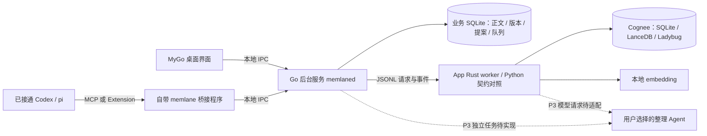
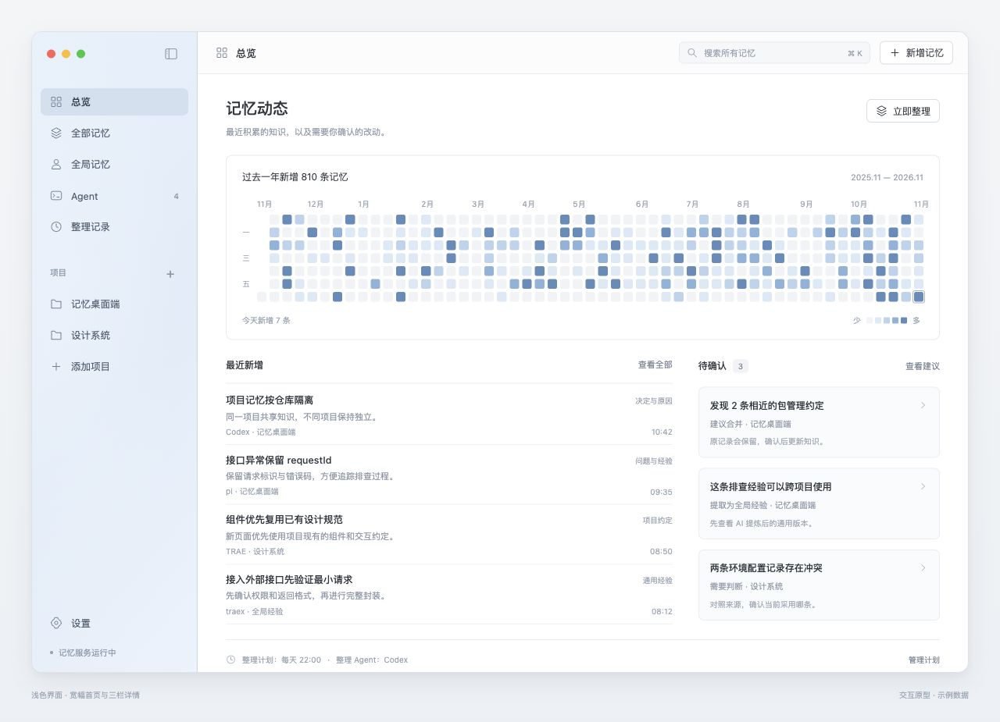
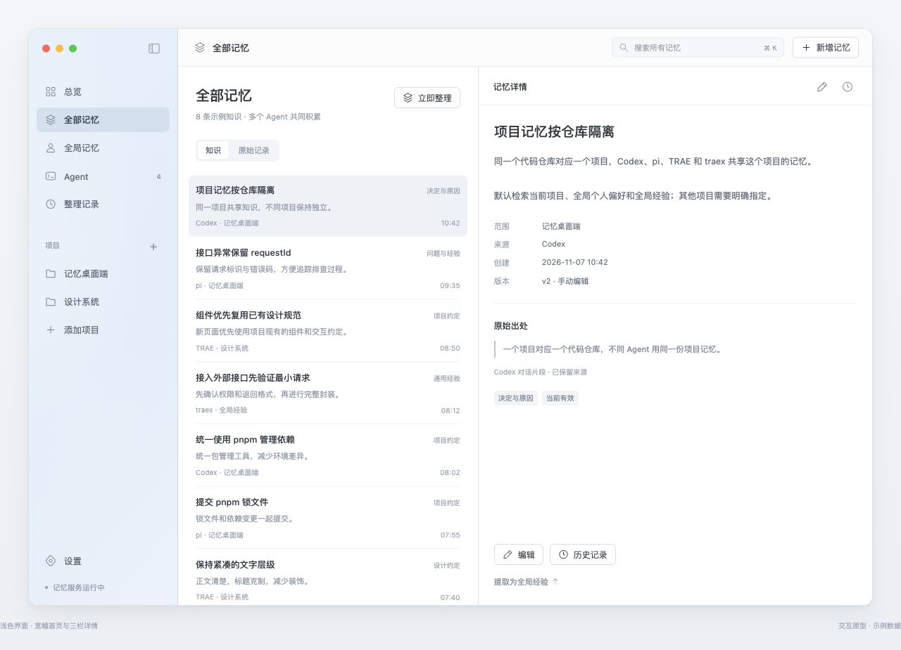

# Memlane 第一版技术方案

2026-11-07。桌面框架按用户选择采用 **MyGo**；建议使用 **MyGo 轻量客户端 + Go 后台服务 + 独立下载的 Cognee 引擎**。用户已明确优先控制主下载包大小：主客户端提供 UI、自动更新、组件准备与状态管理及必要的轻量 Go helper，重型引擎依赖和模型由 App 自动下载，在本地运行。用户无需安装数据库服务器、Python 或 Docker。首版交付 macOS，保留以后扩展 Windows/Linux 的边界。

这是按阶段实施的技术方案。MyGo 的平台与接口、Cognee 源码及本机 Agent 命令已经核对；真实原文服务、固定模型、Rust/Python 独立 worker、App 准备、后台及受控更新的 P0 核心流程已通过合成实测，结果见 [P0 验证记录](p0-validation.md)。按 2026-11-07 用户最新要求，旁白等旁支不再阻塞本轮；未通过结果保留后续增强。P1 手动记忆与系统窗口已通过；P2 已接通真实 Codex/pi 和 App Agent 管理，证据见 [P2 记录](p2-validation.md)。后台整理、其余 Agent、代码图谱和正式签名分发仍按后续阶段验收。

实现路线补充：官方 **Cognee-RS** 是本地引擎的 Rust 移植，仍标 Experimental。P0 优先验证它的最小可用构建，并与 Python 1.6.7 对照；本轮 App 使用已通过原文契约的 Rust worker，Python 保留同契约对照；完整代码图谱仍待 P4 适配。下文标明 Python 的内部接口、FastEmbed、Enola 和 wheel 条件仅适用于该候选，Rust 对应能力须独立验收。[Rust 研究](research-cognee-rust.md)

## 1. 关键选择

| 部分 | 方案 | 原因与边界 |
| --- | --- | --- |
| 桌面 UI | MyGo `ui`，Go 编写、自绘界面 | 按选定设计实现，不依赖 WebView；不是把 HTML 原型直接搬进应用 |
| 业务服务 | 独立 Go 进程 `memlaned`，作为轻量 helper 随主客户端提供 | UI 完全退出后仍可接收 Agent 记忆、执行计划；独立于 Cognee 崩溃 |
| 业务数据库 | SQLite，Go `database/sql` + `modernc.org/sqlite` | 保存正文、版本、提案、任务与活动；单服务拥有数据库 |
| 记忆引擎 | Cognee worker 独立下载；对照 Cognee-RS 与 Python Cognee 1.6.7 | 复用索引、语义检索和图谱；实现以功能与分发验证决定，不让每个 Agent 独立打开引擎数据库 |
| Cognee 存储 | SQLite + LanceDB + Ladybug，随引擎组件提供 | 沿用引擎提供的本地实现，用户无须部署独立服务 |
| 向量模型 | 显式本地推理；Python 验证 FastEmbed，Rust 验证 ONNX provider | 模型由 App 管理；模型兼容性、中文效果与资源占用分别实测 |
| Agent 接入 | 自带 Go MCP stdio/CLI 桥；本机 pi 0.84.1 使用薄 Extension | 统一作用域、来源、幂等；Agent 只允许新建，覆盖等操作保留确认规则 |
| AI 执行 | 调用用户选择的后台 Agent，输出结构化结果 | 登录由 Agent 处理；不复制凭据，不承诺无限或免费额度 |
| 分发 | 轻量 `.app` / DMG + 独立引擎组件 + 模型资源，首轮验证 arm64、macOS 15+ | 主包不附带 Cognee 引擎、重型原生依赖和模型；完整能力的系统要求仍由引擎依赖决定 |
| 自动更新 | 主客户端更新器与组件管理器 | 主客户端、引擎、模型分别版本化；未变化的组件复用，兼容性和失败恢复须实测 |

MyGo 支持 Native UI 与 WebView 两条路线，前者由框架绘制，不是 SwiftUI/AppKit 控件集合；本文选择 Native UI。Go SQLite 驱动不要求 cgo。[MyGo UI](https://github.com/egoist/mygo/blob/v0.7.4/docs/ui/README.md)、[SQLite 驱动](https://pkg.go.dev/modernc.org/sqlite)

## 2. 跨平台到底覆盖什么

MyGo 官方支持 macOS、Windows、Linux，提供相应窗口与分发能力；原生 UI 的平台依赖不同。macOS 签名和 DMG 仍在 Mac 上完成。[平台要求](https://github.com/egoist/mygo/blob/v0.7.4/docs/README.md)、[分发说明](https://github.com/egoist/mygo/blob/v0.7.4/docs/distribution.md)

Memlane 的 UI、业务规则、SQLite schema、任务协议和 MCP 适配可以复用。后台服务注册、进程取消、目录与 Agent 发现、引擎原生依赖、签名和安装器分别适配。首版不增加 Windows/Linux 的交付承诺；也不把“Go 能交叉编译”写成“包含 Cognee 的整包已经跨平台可用”。

MyGo v0.7.4 自身的 macOS 下限为 12。首轮测试暂采用 macOS 15+，依据是 Python Cognee 当前 Ladybug wheel 条件及旧版本问题；不能据此推断 Rust 的系统下限。最终支持范围按选定引擎的构建结果确定，Intel 的完整运行时矩阵在发布前另验。[MyGo 配置](https://github.com/egoist/mygo/blob/v0.7.4/docs/configuration.md)、[Python Cognee 平台依据](research-cognee.md#2-内置存储和打包)

## 3. 进程与模块



职责保持简单：

- **UI**：导航、表单、列表、选择与草稿状态；展示更新与组件准备状态，不直接打开任何数据库，不在绘制回调做索引、下载或模型调用。
- **客户端更新与组件管理**：检查版本、下载、校验、安装和恢复；即使 Cognee 未安装或不可用仍能执行。下载器与组件安装只由一个拥有者执行，UI 和服务共用状态。
- **Go 服务**：业务事务、查询授权范围、版本判断、计划与任务队列、Agent 适配、worker 管理。所有入口共用一套规则。
- **MCP/CLI 桥**：协议转换、连接身份与工作区绑定。每个 Agent 可以启动轻量桥，全部连接同一个服务；桥本身不启动一份 Cognee。
- **引擎 worker**：固定版本的 Cognee 适配、embedding、代码索引。Rust 与 Python 都遵守同一进程协议，一个受管拥有者访问 Cognee 数据；如实现中存在数据库子进程，纳入同一生命周期管理。

macOS 首版 IPC 使用用户私有目录中的 Unix socket，目录 0700、socket 0600，并核对连接身份。使用带版本和请求 ID 的 JSON 消息，限制消息大小，取消与事件使用独立消息。socket 取短路径，避免系统路径长度限制。Windows 的 IPC 留在平台接口后面，后续用命名管道适配；不为首版开公网 HTTP 服务。

Memlane 自己封装的 worker 使用 stdin/stdout JSONL，stdout 仅协议、stderr 为日志；不是假定上游 CLI 已提供该协议。Rust 路线优先评估独立进程，C FFI 暂不作为基线，以保留引擎单独更新与故障恢复边界。服务异步处理 worker 的模型请求，避免等待同一队列造成死锁。第一版引擎写任务和后台模型任务分别单并发，取消后忽略迟到结果。

## 4. UI 如何落实设计

**视觉实现基准是下面两张图。** 开发 Agent 需用看图能力实际打开图片，不能仅按文字自行补布局。原型里的数据属于示例；生产界面必须显示真实内容或明确的空态。分步实施与验收见 [P1 清单](implementation-plan.md#p1桌面界面与真实记忆管理)。





采用 MyGo 隐藏标题栏但保留系统窗口按钮的方式，使用框架提供的标题栏占位信息。侧栏从顶部延伸到底部，收起按钮始终在侧栏内部；拖动区避开按钮和输入框。MyGo 的材质可在局部露出，其他区域绘制不透明背景。[标题栏与材质接口](https://github.com/egoist/mygo/blob/v0.7.4/docs/ui/windows.md)

首轮先用稳定的浅蓝背景还原整体，再验收侧栏局部材质；工具栏和正文始终不透明。使用平台系统字体，中文回退到苹方，图标与按钮保持单色。Windows/Linux 后续使用各自字体和材质回退，不分发 macOS 系统字体。

界面状态分为 `route + scope + selectedID + detailMode`：

- 首页：侧栏＋宽幅总览；热力图在上，最近新增与待确认在下。
- 详情页：导航—列表—详情三栏；`detailMode` 为查看、新增、编辑、历史、恢复确认或提案处理。
- 草稿以条目 ID 保存，导航不丢失未保存输入；返回列表保留选择和滚动位置。
- 保存后立即展示最新正文，另显示索引状态；不能让“已保存”暗示“所有图谱处理完成”。

中文输入法、长文选择、复制粘贴、键盘导航、缩放和窗口拖动列为P0 Native UI验收项。VoiceOver实际输出列为后续辅助功能增强，本轮按用户明确指示停止该旁支，不伪称通过。MyGo固定v0.7.4，不跟随浮动main；只有验证出具体缺陷时才升级。局部编辑体验若不达标，先在MyGo内评估修复或局部WebView，不默默更换整个桌面框架。

## 5. 内置数据库与数据模型

数据库库文件随运行时提供，数据文件在用户数据目录生成；界面只暴露“数据位置、服务状态、备份与诊断”等用户能理解的内容，不要求选择数据库品牌。建议目录：

```text
Application Support/Memlane/
  memlane.sqlite             # 业务数据，唯一正文与版本真相
  sources/                   # Agent 实际提交的出处，按需保存
  cognee/                    # 引擎关系库、向量库、图库
  runtimes/<version>/        # 下载并校验后的引擎运行时，版本独立
  models/                    # 固定 revision 的本地模型
  backups/                   # 一致性备份与迁移前快照
```

开发数据使用独立的 Memlane Dev 目录。客户端更新保留业务数据与设置，复用兼容的运行时和模型缓存；组件切换、清理仅处理对应的组件版本目录。日志放系统日志目录，默认不记录完整 prompt、记忆正文或凭据。

| 业务对象 | 必要字段与规则 |
| --- | --- |
| `projects` / `scopes` | 项目 UUID、规范仓库路径、worktree 映射、范围类型、Cognee dataset UUID |
| `records` | Agent 实际提交的内容、来源、输入类型和幂等键；原始片段与成品知识分开标识 |
| `memories` | 当前 revision、范围、类别、有效/归档/删除状态；不使用标题当 ID |
| `memory_versions` | 不可变正文、来源关联、操作人、原因、时间；编辑和恢复均追加版本 |
| `jobs` / `job_attempts` | 任务类型、输入快照、运行状态、租约、重试次数、错误分类 |
| `proposals` | 操作类型、目标 ID 与预期 revision、前后内容、确认/拒绝/过期状态 |
| `index_bindings` | memory/revision 与 Cognee data ID、dataset、索引 generation 的映射 |
| `activity_events` | 首次可用事件、时间与时区、来源类别；用于热力图，不数图节点 |
| `connections` / `settings` | Agent 能力、批准范围、配置安装状态、整理计划与服务设置 |

采用普通 SQL migration；事务提交正文、版本、事件与待索引任务。业务库与 Cognee 库没有跨库事务，靠持久任务和幂等实现最终一致。服务只在持久化成功后返回接收回执；磁盘满、服务失联不能返回成功。

## 6. 保存、编辑与搜索的一致性

**保存路径**：业务库事务提交 → 返回 `accepted` → worker 建索引 → 服务核对目标 revision → 标记 `searchable`。知识图谱完成另记 `graph_ready`。原文可以先可检索，不等待 AI 整理。

Python Cognee 有不调用 LLM 的内部索引任务及 CHUNKS 检索路径，但内部入口需固定版本封装，不能当作稳定公共 API。Rust 的对应原文索引、片段返回与来源字段独立核对。两条路线均不得直接用默认 `remember()` 承担所有产品操作，它还可能执行图谱提取与 improve。[Python 索引与版本依据](research-cognee.md#4-新增编辑与版本一致性)、[Rust 边界](research-cognee-rust.md)

**编辑/恢复路径**：校验 `expected_revision` → 追加新版本 → 当前索引立即标为过期 → 提交重索引任务。界面可查看新正文；索引未完成时语义搜索排除该条并报告索引进度。恢复旧版本会生成新 revision。

**搜索路径**：服务计算允许 dataset 集合 → worker 返回可追溯的片段候选（Python 对应 CHUNKS）→ 校验范围、有效状态、`current_revision == indexed_revision` 和 generation → 从业务库读取对应正文与来源。旧 chunk 不参与回答，候选不足可以扩大检索；不能用旧文本补足数量。更新过程中失败仍保留正文、历史和重试任务。

每个候选必须能通过 data ID、来源或固定索引上下文映射到对应 revision/generation；无法证明映射的命中直接丢弃，不能仅比较业务库中两个相等字段就放行。对同一事项，向 Agent 明确提供当前项目约定优先于全局建议的上下文，并保留两者来源；不擅自删除或覆盖全局条目。

worker 提交任务结果时再次检查 revision，旧任务不能把新版本标记为索引完成。重试用稳定操作 ID；同一幂等键但不同内容返回冲突。落库后响应丢失可安全重试。引擎索引损坏可从业务正文重建，但不能把进程重启说成数据修复。

通用图谱生成答案涉及旧实体和来源追踪；未通过隔离、删除与来源验证前不直接开放。第一条共享记忆链路使用可追溯的片段检索，项目代码图谱单独接入，不因此取消该功能。

## 7. 项目与 Agent 接入

项目用内部 UUID 标识；路径仅是绑定。规范化路径并识别 Git common directory，同仓 worktree 可映射到同一项目；相同 remote 的独立 clone 不自动合并，仓库移动或歧义由用户确认。代码图谱额外记录正在索引的 worktree、commit 与工作区快照，避免把一个分支的关系冒充另一个分支。

项目知识、全局偏好、全局经验、项目代码分别绑定 dataset UUID，当前项目与全局范围由服务计算，NodeSet 标签不充当权限。Python 路线显式开启 `ENABLE_BACKEND_ACCESS_CONTROL=true` 并断言 provider 支持，搜索不得传 `datasets=None`；Rust 也有该隔离开关但默认关闭，直接使用 Rust `SearchBuilder` 还需接通 per-dataset 模式。两条路线都验证范围与权限，不能只传 dataset 参数就认定隔离成立。[Python 隔离依据](research-cognee.md#3-项目隔离与检索范围)、[Rust 研究](research-cognee-rust.md)

| Agent | 日常读写 | 后台整理候选 |
| --- | --- | --- |
| Codex | 0.147.0 MCP stdio，真实保存/读取通过 | P3 候选 CLI `exec`，结构化结果与事件流 |
| pi | 0.84.1 Extension，真实保存/检索通过；本机不假设原生 MCP | P3 候选 RPC、独立会话、受限结果工具 |
| TRAE | 按实际版本/渠道接 MCP | 不把 IDE 默认当成后台执行器 |
| traex | 独立 TRAE CLI MCP 适配 | `exec`，先验证本机 internal 发行版的隔离与取消 |

Codex/pi 的真实接入见 [P2 验证](p2-validation.md)，其余两款尚未接通；版本与接口依据见 [Agent 研究](research-agents.md)。MCP 使用 [官方 Go SDK](https://github.com/modelcontextprotocol/go-sdk) v1.8.0；P2 固定 `memory_scopes/save/search/get/status`，详见 [接入契约](agent-contract.md)。覆盖、删除、恢复与移动不作为 Agent 直接工具暴露；提案和后台任务属于 P3。

连接流程是发现 → 能力探测 → 用户连接 → 安装自己的配置 → 待重载 → 真实工具往返 → 可用。只搜索已知安装位置、PATH 和用户选定路径，不扫描全盘或导入聊天历史。Skill 只描述使用时机与工具语义，不代替连接和后台执行协议。配置增量修改并保留备份，断开时只移除 Memlane 条目。

MCP 进程 cwd 不一定是当前会话项目。优先使用项目配置的明确绑定、受信工作区上下文或 Extension 提供的 cwd；无法确认就要求选范围，不默认查询全部。额外项目由用户明确授权，服务验证 connection 的允许范围。这约束 Agent 误操作，不宣称能隔离同账户下拥有任意执行权限的恶意程序。

P2当时只保留初始化入口；当前I已实现可选指引、明确文件冻结快照、复制prompt与初始化三工具，见 [I契约](p3-onboarding-contract.md)。来源保存已批准具体版本/引用，不读取聊天库。

## 8. 本地模型与用户 Agent

embedding 显式指定本地 provider、模型、revision、维度、切片参数与缓存目录。Python 的 FastEmbed 路线优先评估 `jinaai/jina-embeddings-v2-base-zh`，并以较小的 BGE 中文模型作基线；Rust 验证 ONNX provider 与模型文件/分词/池化契约，不能把 FastEmbed registry 当作 Rust 支持列表。Rust 配置默认是 OpenAI，部分无密钥条件会回退本地 ONNX；仍需显式固定本地配置，避免新增 LLM 配置后模型改变。最终默认值由中英混合、代码标识符与长记录的检索集和资源测量决定。[Python 模型依据](research-cognee.md#5-本地向量模型)、[Rust 研究](research-cognee-rust.md)

引擎运行时和模型均独立于主安装包，由 App 首次自动下载并准备，显示各组件进度、大小和重试入口。主客户端与轻量业务服务可以先运行，准备失败仍允许持久化原文，但索引显示未就绪。使用固定下载来源与校验值，准备完成后可离线向量化和搜索，不隐式切换云 embedding。以后换模型新建索引 generation，不能混用向量。

摘要、整理和需要模型的图谱抽取统一使用用户选定的后台 Agent。Go 适配器抽象 `probe/start/events/cancel/result`；Cognee 模型请求经本机桥转换为该适配器的结构化任务。优先验证 Codex，pi 作为另一条候选。桥接采用请求 ID、schema、超时和取消协议；未经验证的 provider/参数不写成已支持。[桥接参考及限制](research-cognee.md#6-用用户的-agent-提供-llm)

任务使用独立会话和只读快照，关闭不需要的工具、自动 hooks 与插件；不能再次调用正常记忆写工具形成递归。schema 由服务二次校验。认证和额度问题由对应 Agent 报告，不读取登录 token 给 Cognee 直连。云端 Agent 会接收任务输入，本地存储不等于全部离线推理。

## 9. 立即整理、定期整理与历史

整理使用 `queued → running → completed / partial_failed / failed / cancelled`；“有待确认建议”单独统计，不能让任务长期卡在 running。每次 attempt、输出和应用结果均有记录。

执行步骤：固定输入 ID/revision 快照 → Agent 返回新增摘要、标签和提案 → 校验 schema、来源与范围 → 允许的新增摘要/标签自动提交 → 合并、覆盖、删除、跨项目移动和提炼全局经验进入待确认 → 用户在右栏查看差异并确认 → 业务事务提交版本、事件与索引任务。

批准时再核对预期 revision；过期提案不覆盖用户新编辑的内容。合并保留原条目的归档状态与来源；项目经验转全局创建关联的新条目，原项目记录保留。AI 提炼先预览；用户选择原文复制时按明确操作直接创建。删除先使当前检索失效，再清理派生索引，历史按产品规则保留。

Cognee `improve()` 会直接写数据，不能先执行再弹确认。首版整理 Agent 只输出提案，不直接调用生产 dataset 的默认 improve；复用 Cognee 能力的前提是满足上述应用顺序。[副作用依据](research-cognee.md#7-立即整理的审核边界)

计划任务在 Go 服务运行，按用户时区计算。默认单并发，相同任务去重；休眠错过的计划唤醒后合并补跑一次，不补出大量任务。手动与定期共用策略。热力图从首次可用事件计算，编辑、恢复、重放不新增计数；初始化导入单列，详情按产品定义解释。

## 10. 代码图谱

每个项目手动开启后才建立代码图谱，代码 dataset 与记忆 dataset 分离，未开启时不扫描代码。Python 路线调用 Cognee 的 Enola 结构索引，固定 Enola 0.4.30 与 worker 一起构建到独立下载的引擎组件，显式传执行路径，主安装包不附带 Enola。Rust 尚未确认等价代码索引入口，必须补齐验证或适配后才能满足首版范围，不能用普通实体图谱代替代码图谱。[Python 实现依据](research-cognee.md#8-代码图谱)、[Rust 待验证项](research-cognee-rust.md)

首版展示文件/符号查询、调用和依赖结果，不做全仓库大画布。文件变化合并后触发索引，记录最后成功的工作区快照；失败继续显示旧快照的时间与过期状态。先用 TypeScript/Python 样本核对实际语言支持和忽略规则；不承诺静态图覆盖动态调用。

当前上游 runner 默认在仓库 `.enola` 下生成并读取 `facts.jsonl`。优先验证能否把输出外置到 Memlane 工作目录；尚未验证时不承诺零仓库写入，启用前展示实际写入位置，不擅自修改 `.gitignore`。[当前 runner](https://github.com/topoteretes/cognee/blob/eaa33be5c58cd14584e64e3e0ed2e1479472ee09/cognee/tasks/code_graph/enola.py)

## 11. 后台服务、退出与恢复

MyGo 处理窗口和菜单栏；其登录启动能力不等于独立记忆服务的生命周期。[应用生命周期](https://github.com/egoist/mygo/blob/v0.7.4/docs/app.md)

macOS 使用用户级 LaunchAgent 管理 `memlaned`，通过平台适配层封装 `SMAppService` 注册/注销；不需要 root。系统可能要求用户批准后台运行，界面显示真实授权状态，不把默认开启设置当成系统已经允许。[Apple SMAppService](https://developer.apple.com/documentation/servicemanagement/smappservice)、[注册语义](https://developer.apple.com/documentation/servicemanagement/smappservice/register%28%29)

| 动作 | 预期行为 |
| --- | --- |
| 关闭主窗口 | UI 留在菜单栏，服务继续运行 |
| 退出 App，保留服务开启 | UI 进程退出，LaunchAgent 与 worker 继续工作 |
| 停止服务并退出 | 先持久化主动停止状态，取消任务、停止 worker 子进程树、解除重启，再退出 |
| 系统禁止后台运行 | 显示需要授权，不循环重装或绕过系统设置 |
| Cognee worker 崩溃 | 服务仍可接收并保存写入；读请求返回明确不可用或部分可用状态 |
| 服务整体不可达 | 桥返回可重试错误；未取得持久回执的写入不声称已接收 |

worker 按有上限的退避策略恢复，例如 10 分钟最多 3 次，超限熔断后由用户重试。服务进程重启计数保存在引擎外；主动停止不触发自动恢复。任务租约回收、操作 ID 去重、迟到结果失效用于中断恢复，不能只依赖拉起进程。

窗口关闭、进程退出、后台登录启动分别验收。通过 `SMAppService` 注册的服务可能在登录时启动，须在设置中说明，并且主动停止标记在重启后仍有效。MyGo 包内服务 plist 布局和 Go 到系统 API 的桥接是 P0 打包验证项，不能靠 `nohup` 代替。

## 12. 轻量分发、组件准备与自动更新

桌面候选基线：MyGo v0.7.4 / Go 1.27.3。引擎对照候选：Python 3.12 / Cognee 1.6.7，以及 Cognee-RS 固定提交 `151905c302fc9b5b9aad88d6b13931c09f0eac30` / Rust 1.91.1。该 Rust 提交的功能不能用旧 v0.2.0 发布包直接验收；应固定源码构建。两条路线均锁定完整依赖和模型文件。MyGo 的 `go.mod` 明确要求 Go 1.27.3。[MyGo 版本约束](https://github.com/egoist/mygo/blob/v0.7.4/go.mod)、[Rust 版本证据](research-cognee-rust.md)

分发产物分为三部分：

| 产物 | 内容 | 获取与更新 |
| --- | --- | --- |
| 主安装包 | MyGo UI、自动更新、组件管理、轻量 Go 服务与 MCP 桥 | 用户安装 `.app`，后续由客户端更新器管理；不附带 Cognee 引擎、引擎数据库原生库、Enola 或向量模型 |
| 引擎组件 | 选定的 Rust 或 Python worker、固定原生依赖及代码索引工具 | App 自动获取匹配系统和架构的预构建归档，校验后安装到版本目录；仅版本变化时重新下载 |
| 模型资源 | 固定 revision 的向量模型与必要配置 | App 自动下载，校验并复用缓存；模型变更与索引 generation 联动 |

Python worker 优先验证 PyInstaller onedir，运行时在构建阶段准备，保留原生库与资源结构；不把开发机 venv 原样复制，也不在用户启动 App 时运行 pip。Python 动态导入、数据库子进程与 Enola 都要纳入收集和签名验证。若冻结方案失败，再评估可重定位 CPython，仍作为独立组件分发。[PyInstaller 原生依赖说明](https://pyinstaller.org/en/stable/feature-notes.html)

Rust worker 按实际功能选择 Cargo features，验证本地 SQLite、Ladybug、持久向量库与 ONNX，再裁剪首版不使用的 provider 和 loader。完全关闭默认功能的 slim CLI 只是编译检查，不能用其体积代表可用产品。官方约 210.18 MB 的 macOS C API 归档也不是 Memlane worker 的体积。两条路线分别测量可用产物后再选择；独立分发方式不随实现语言改变。[构建与体积边界](research-cognee-rust.md)

MyGo 已有 helper 分发和嵌套代码签名机制，可用于主客户端的轻量 helper；下载后从用户组件目录启动 worker 的签名、公证和 Gatekeeper 行为需要单独验收，不能用 bundle 内 helper 的成功代替。[MyGo helper 分发](https://github.com/egoist/mygo/blob/v0.7.4/docs/distribution.md#helper-executables)

组件清单记录版本、平台、架构、下载大小、哈希和协议兼容范围，并验证发布来源。下载支持中断重试，先进入暂存目录，校验与安装完成后才标为可用。切换引擎前停止旧 worker 子进程树，通过握手与健康检查后再接收引擎任务；首次准备失败可重试，已有可用版本不因下载失败被覆盖。下载不阻塞界面，也不把未完成准备显示为服务可用。

自动更新是主客户端的首版能力，P0 先用测试更新源验证检查、下载和替换。更新客户端时协调后台服务的停止与重启，保留用户主动停止状态；兼容的引擎和模型不重复下载。UI/服务/worker 做协议版本握手，版本不兼容时阻止写入，先准备兼容组件。正式发布前落实用户可访问的更新源、清单和分发权限；当前私有仓库不能直接当公开更新源，不嵌入个人 GitHub token。

分发前完成依赖/模型许可证记录、校验值、Developer ID 签名和公证。数据库升级前由唯一拥有者停止写入并做一致性备份，禁止直接复制正在写入且漏掉 WAL 的 SQLite 文件。回退必须核对数据格式兼容性，涉及迁移时按备份恢复方案处理，不能只切回旧二进制。

体积验收分别记录压缩主安装包、首次准备的额外下载量、准备完成后的磁盘占用及更新下载量。用户当前优先约束主安装包大小，尚未指定数值上限；先测最小客户端基线，再确定预算。组件分发减少主包及仅 UI 更新的下载量，完整首次准备的总下载量仍需单独展示。首次离线且无组件缓存时只能使用已就绪的客户端与保存能力；已有组件和模型后，离线索引与检索照常工作。

## 13. 工程组织与本轮验证边界

当前实现使用下列目录；提案、计划与其余 Agent 按后续阶段增加，不提前放空模块：

```text
cmd/memlane-app/        MyGo 界面入口
cmd/memlaned/           独立后台服务
cmd/memlane/            MCP / CLI 桥
internal/desktop/      页面、组件、状态、设计 token
internal/records/      正文、版本、来源与连接契约
internal/daemon/       服务端版本、范围、活动与 Agent 规则
internal/agentbridge/  官方 SDK MCP / CLI 统一工具与错误
internal/store/         SQLite 与 migration
internal/jobs/          队列、计划、恢复
internal/agents/        Codex / pi 发现、配置与实际验证
internal/engine/        Cognee worker 协议
internal/platform/     系统服务、目录、进程控制
engine/                选定的 Rust/Python worker、Cognee 适配与依赖锁文件
packaging/             plist、资源、签名与构建脚本
docs/                  产品、设计、方案和证据
```

早期只读检查为 macOS 26.6.2 arm64、PATH 中无 Go、默认 Python 3.9.23、uv 可用。随后已在仓库隔离准备固定 Go/Rust/Python 工具链并完成构建，不替换用户默认环境。工具链命令见 [开发说明](development.md)。

MyGo 完整主包、组件准备、固定本地模型、服务注册、手动记忆和真实 Codex/pi 互通已有实测记录；正式发布、后台整理和完整代码图谱尚未验收。具体通过条件与开发顺序见 [实施清单](implementation-plan.md)；详细来源见 [Python Cognee 研究](research-cognee.md)、[Cognee-RS 研究](research-cognee-rust.md)、[Nowledge Mem 研究](research-nowledge-mem.md)、[Agent 研究](research-agents.md)。

## 14. P3-C1 当前正式落点

2026-11-08 最小合并已接正式 memlaned：同一个用户明确授权项目两条有效知识 → 冻结具体版本 → 本机 traex 纯建议 → 宿主确认/拒绝 → applyTx 原子合并/归档 → 既有 Rust 索引与检索。正式 schema v3 增量增加 merge_tasks/attempts/proposals/decisions/receipts/sources，既有 jobs 仍是索引任务；不将前文概念表或实验附加表当现成 API。

详细约束、错误、决定与取消/重启栅栏见 [P3 技术第 6 节](p3-technical-analysis.md#6-p3-c1-正式契约2026-11-08)，职责见 [架构](p3-architecture.md#6-p3-c1-服务端职责)，实际证据见 [验证记录](p3-validation.md#8-p3-c1-正式服务端验收)。数据库 owner 锁与 v2 WAL 一致性备份先于迁移，旧数据完整保留；老 v2 服务无法打开 v3，回退需停服后恢复独立 v2 备份，不切二进制冒充回退。P2 私有 IPC 1 与日常工具兼容。

上段是 C1 交付时的范围记录；随后 C2 App 审核和 C3 摘要/标签已分别实现验收，当前能力见下节；计划、排名、初始化、图谱与其他后台 Agent 继续按实施清单推进。

## 15. P3-C3 当前正式落点

schema v4 增量保存摘要/标签任务、attempt、结构化结果、逐项回执、冻结来源、派生状态、标签集合与事件。既有 v3 数据库先 VACUUM INTO 包含已提交 WAL 的一致性备份再迁移；临时库逐表保留验证和旧恢复契约通过。旧客户端普通 IPC 编码不含新增零值字段；旧服务不支持新的整理操作时明确报错。

App 在三栏内选定同项目 knowledge/raw 的具体版本，后台 traex 仅返回 summary/add_tags。结构化输出整体校验后逐项短事务自动提交新增内容；正文/范围变化、C1 合并和后续 C4 修改动作均保持确认边界。摘要派生依赖失效会排除默认列表和检索；用户编辑/恢复追加版本并保留来源关联。

运行中取消、迟到结果、无执行者中断与已有结果多 attempt 收尾保留已提交回执；计划租约与有限自动重试仍属于后续 D。正式契约、质量小样本和 App/服务/Rust/故障夹具分别见 [整理动作](p3-organization-contract.md)、[C3 验证](p3-c3-validation.md)。


## P3-E 已验收的全局经验实现

schema v6 增加按知识 revision 保存的全局经验类型/适用条件，以及独立 global 审核/决定表，保留 v5 表及旧动作CHECK约束。原文复制复用稳定操作账本；AI提炼用v3冻结项目来源与全局目标，用户确认后原子新增正文/条件/出处/回执/索引任务。编辑和恢复追加版本，恢复采用旧条件；来源变化仅提示已确认事实，不自动改写。

App、服务、traex 与真实 pi/Rust 证据见 [E 验证](p3-global-validation.md)，正式边界见 [E 契约](p3-global-contract.md)。网络/模型不持有SQLite事务；App信任出处读取与日常Agent全局回执分开，日常回执不携带未提升项目片段。定期任务和代码图谱仍按总交付矩阵继续。

## P3-D1 已验收的持久计划

schema v7 增量保存计划/generation/明确策略、幂等 operation 回执和唯一到期槽位。新草稿停用；用户明确启用才计算未来运行。日历时区由用户设置，DST 缺失时刻顺延、重复时刻单次；唤醒只补最新一槽，超过窗口记跳过。输入与动作/目的/executor/model 策略相同且已有持久结果时记 no_changes，时间或窗口编辑不重复模型调用。

原子计划触发复用 C3/C4/E 正式任务与来源冻结，daemon 共用单本机执行槽，计划身份/代次在 Claim/Stage/自动 Apply 校验。v6 迁移前一致性备份、旧 helper 拒绝 v7 和独立 v6 恢复读取已证明；正式升级/索引重建另验。App 正常、活动取消、停用/停服与 Rust 证据见 [D1 验证](p3-schedule-validation.md)。D2 租约与有限自动重试仍未完成。

## P3-D2a 已验收的租约与进程保护

v8 增量 organization_leases 绑定 task/attempt 随机 owner、到期、进程组与回收事实；短事务门禁保护领取/结果/自动应用/失败/收尾，后台续租失败取消执行，旧 owner 不能复活。内部 guard 收到持久登记许可后启动 Agent，FD3 不继承，服务崩溃 EOF 杀组。新服务只观察旧组消失后撤销旧租约与中断任务，不盲目 kill 复用 PID；旧 C1 guard 的历史组同样核对保存。

v7 非空 WAL 一致性备份/全部旧表/部分回执保留、真实 App/traex/Rust 正常与取消、实际 guard 故障和旧 C1 真服务回归见 [D2 验证](p3-recovery-validation.md)。租约不是收费重试授权；D2b 有限重试/恢复预算和完整自动恢复仍待实现。

## D2b 有限恢复边界（2026-11-08）

schema9仅新增实际organization_recovery，旧v8一致性备份/全表保留；授权extra1–2/window1–1440分钟、15/60秒退避，默认0。同task新attempt，已有结果仅apply，回执保持；来源/计划/lease/window在领取及guard许可复核。stop_generation优先于时间水位，Resume保留旧停服边界；KnownOutcome即使SQL末写失败也不覆写为可重跑unknown。真实App/traex/Rust及故障/包边界见 [D2验证](p3-recovery-validation.md)，正式契约见 [恢复契约](p3-recovery-contract.md)。

## U 使用观察与排序（2026-11-08）

schema10在一致性v9备份后仅增加实际usage_operations/events/coverage与用户importance。受信服务记录当前范围/版本，采用关联同连接代次/工作区摘要的90天内曝光；事务内来源门禁与原get状态兼容保持。明细90天、常用近30天，最小幂等回执长期保留避免重计；App/验证独立，后台未采集不补造。Current/List按观察scope补统计，历史Apply回执不受其当前栅栏影响。正式契约和真实证据见 [U契约](p3-usage-contract.md)、[U验证](p3-usage-validation.md)。

## I 可选指引与原子初始化（2026-11-08）

schema11在v10一致性备份后增量保存initialization_batches，包含冻结文件/路径/SHA/text、operation/digest、连接代次/工作区/状态及稳定导入回执。文件读取不持SQLite事务，descriptor-relative openat/NOFOLLOW/CLOEXEC限制批准根。新增版本/引用/操作/索引/导入活动一次短事务；整批稳定ID冲突回滚，收到回执优先重放，慢源读取错误不覆盖并发已提交事实。具体资源上限/错误/取消/恢复见 [I契约](p3-onboarding-contract.md)。

App指引只持隐藏偏好，实际组件/项目/Agent状态持续刷新。准备并复制只生成pending，三个批次工具由daemon校验scope/generation/workspace；初始化模式无普通保存/批准/文件/命令工具。pi Extension显式筛选；Codex MCP用argv传tool-mode，避免env_clear丢失模式。真实pi/Rust/App及索引故障恢复见 [I验证](p3-onboarding-validation.md)。通道toolset_version2需要旧接入重新连接/重载/实际验证，旧日常协议1保持兼容；Codex新增模型验收与TRAE/traex/piRPC继续A/R。

## A1a traex 日常适配（2026-11-08）

traex/traecli0.214.1 internal日常MCP复用schema11/protocol1业务契约，connections Agent字符串不扩表；所选项目`.trae/traecli.toml`增量区块/备份/外部改动门禁/撤销复用既有Codex配置模块。版本与渠道由实际Probe记录到Installation，连接详情从该安装读取；未知旧channel不沿用其他路径的发现值。共享与项目标量模型选择按优先级读取，自定义provider默认路径明确拒绝，认证只由CLI读取自身auth链接。CLI临时运行仅Memlane MCP/受限工具，实际GET/保存/返回/采用和初始化三工具按原受信栅栏处理；验证进程独立组与有界管道退出，结果区别SelectedModel和未报告的Model。

真实App按钮/traex六工具/初始化/Rust、实际活动取消/重验/断开与OS/协议夹具见 [A验证](p3-agent-validation.md)。第一次同identity换包路径启动超时仍留F1；Codex新工具、TRAE IDE和piRPC继续独立验收，不能从CLI推断IDE支持。
