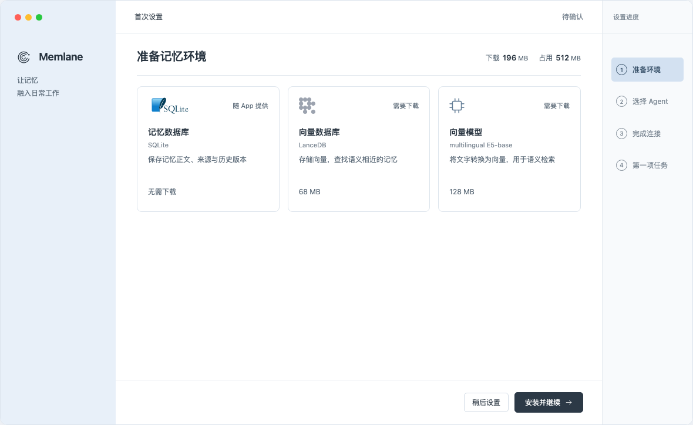
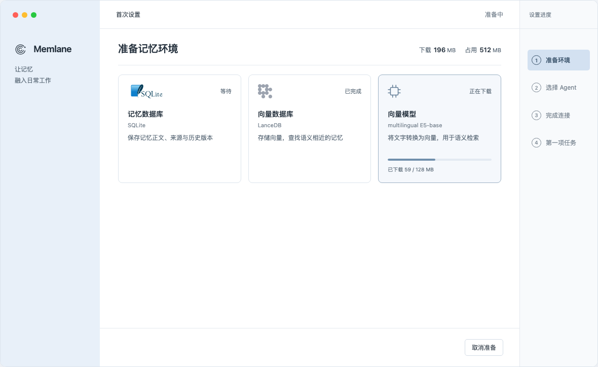
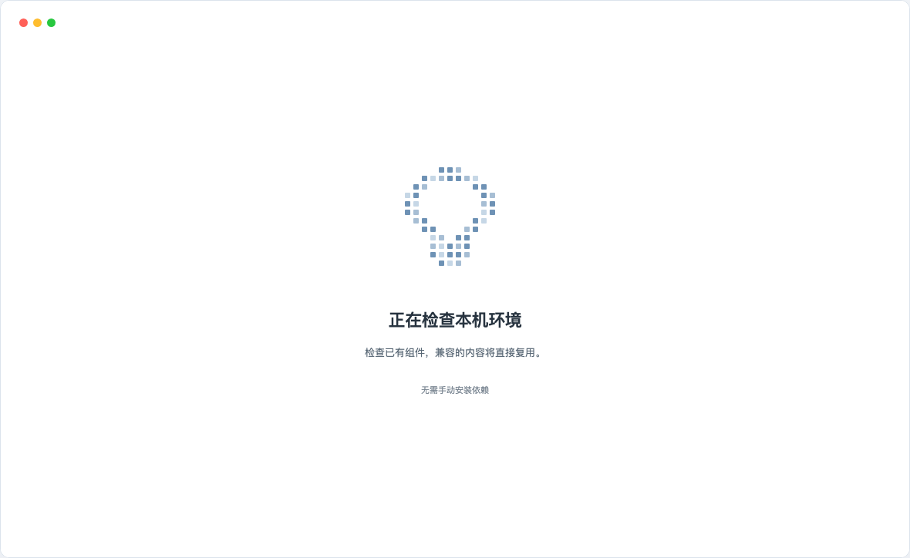

# A01–A04：本机环境检测与安装开发契约

> 2026-11-09：环境正文保持本文件的已认可规则，最新初始化导航和后续设置复用按 [A 已认可实施交接](a-setup-handoff.md)。当前只有环境、Agent 批量连接、记忆处理三步；下文原四步/首任务入口及默认 Agent 提炼的安排在对应范围内已被替代。统一 Cognee/BGE 环境准备及 E5/BGE 边界继续有效，示例图不代表这些依赖的真实下载或新实现已完成。

**2026-11-09 用户认可，最终本地预览 revision 11。** 原型冻结提交：`5f4c504bfbc6ee07a571b015f7ccc809d0943848`，分支 `prototype/selected-ui`，入口 `prototypes/ui-redesign-20261109/a-environment.html`。本文件约束后续生产 UI 改造；认可设计不等于真实安装、接入或新版窗口验收完成。

## 实际设计图

截图来自浏览器渲染。正式 MyGo 实现完成后必须截图对照，不能仅以编译或 HTML 核验代替视觉验收。其余失败、取消、未知、复用、就绪和窄窗口图见 `docs/images/ui-redesign/a-environment/`。

## 范围及信息层级

- 本次认可 A01–A04：自动检测、组件结果、安装确认、安装进度与结果。
- A02/A03/A04 共用一个准备页面。点击开始、取消、重试时，原位更新组件状态和操作，不切到另一张确认页或进度页，也不丢失滚动位置。
- A05–A10 已另补讨论稿，尚待用户认可。就绪后「选择 Agent」只是下一步入口；不得据此宣称 Agent 已授权、已连接或已可用。项目可跳过及首任务规则按现有产品定义执行。
- 完成首次设置后直接进入日常首页。初次使用引导在设置阶段完成；日常首页不重复「初次使用／开始使用／先连接 Agent」。

## 布局与视觉

- 自动检测采用全白中央画面，蓝色小方块散落、归整为灯泡，阶段文字在下方。失败或取消停止播放；系统减少动态效果时显示静态图。真实检测结束即进入结果，不人为加成功等待时间。
- 准备页：连续浅蓝品牌侧栏、白色主区、右侧步骤栏。顶部状态和底部操作固定；中部必要时滚动。
- 右侧四步保持「准备环境／选择 Agent／完成连接／第一项任务」，当前步高亮。
- 准备页标题为「准备记忆环境」。标题与下载总量、磁盘占用放在同一行，标题下只有细分隔线。
- 桌面三张卡片横排。窄窗口改为纵排紧凑卡片，显示产品名、用途和状态；完整 SQLite 标志不裁切。内容可滚动，底部按钮不得被裁切或覆盖为不可操作。
- 桌面参考数值：侧栏 196px、步骤栏 154px、主内容左右内边距 36px；卡片间距 14px、内边距 18px、最小高度 214px、圆角 8px。标题 20px，组件名称 14px，产品名 11px，用途 12px。尺寸用于视觉对照，适配以实际 MyGo 窗口为准。
- 删除品牌角落备注、下一步角落说明、内容底部免责声明、重复下载汇总、大段标题描述、冗余指标条和「本次准备」重复标题。评审工具栏及窗口外示例说明不进入产品。
- 不恢复「查看检查详情」。只有用户能据此采取行动的具体错误才展示在对应组件或页面错误区。

## 三个组件的文案与标志

| 卡片标题 | 标题下小号灰字 | 用途说明 | 资源 |
| --- | --- | --- | --- |
| 记忆数据库 | SQLite | 保存记忆正文、来源与历史版本 | SQLite 官方完整标志 |
| 向量数据库 | LanceDB | 存储向量，查找语义相近的记忆 | LanceDB 官方灰色标志 |
| 向量模型 | multilingual E5-base | 将文字转换为向量，用于语义检索 | 通用单色模型图标 |

保留「标题 → 产品小字 → 用途」顺序。SQLite 标志使用 `https://www.sqlite.org/images/sqlite370_banner.svg`；LanceDB 使用官方仓库 `docs/web/static/assets/logo/lancedb-icon-gray.svg`。原文件及来源在原型目录 `icons/`、`icon-sources/sources.json` 中。已查阅 E5 的官方模型卡及微软项目 README，未发现其独立产品 logo；通用芯片图标不是 E5 官方标志。

## 安装状态与操作

| 状态 | 组件与页面反馈 | 底部操作与规则 |
| --- | --- | --- |
| 检测中 | 真实检测阶段＋方块动效 | 不用固定计时假造完成 |
| 检测失败／网络不可用 | 清楚说明未完成及原因，停止动效 | 「稍后继续」「重新检查」 |
| 等待确认／部分可复用 | 随 App 提供、兼容可复用、需要下载分别显示；总量仅算实际缺失部分 | 次按钮「稍后设置」，主按钮 **「安装并继续」** |
| 下载中 | 进度条和已下载字节直接在对应卡片内；其他已完成项保留 | 「取消准备」，同页更新 |
| 校验／安装／验证中 | 对应卡片显示实际阶段；不继续显示已经结束的下载进度 | 可取消的阶段按真实任务能力响应，不假造即时取消 |
| 下载或安装失败 | 显示具体原因；保留已完成组件及可继续部分 | 「稍后设置」「重试下载」；非下载失败使用准确的重试文案 |
| 已取消／中断后继续 | 显示已停止与保留的进度；不宣称完成 | 「稍后设置」「继续准备」；恢复需核对持久任务与组件完整性 |
| 部分结果未知 | 说明哪项未完成核对，不把未知当缺失或兼容 | 「稍后设置」「重新检查」 |
| 全部就绪 | 「记忆环境已就绪」；所有必要组件真实验证通过 | 「选择 Agent」，明确进入后续设置 |

安装确认与进度必须同页；总进度不得在组件外重复展示。准备成功不会因动效结束而成立。就绪图中的 0MB 为原型剩余准备量示例；生产中「占用」必须显示真实最终磁盘占用，不能跟着下载剩余量清零。

## 工程对应及不能写死的部分

- SQLite 由轻量 helper 提供并初始化业务数据库，不是需要用户另装的数据库服务器。其卡片显示「随 App 提供」「无需下载」。安装中也不能假造 SQLite 的单独下载任务。
- LanceDB 随所需引擎组件提供。原型的向量数据库卡片对应引擎准备单元，**68MB 不是 LanceDB 独立安装包大小**；可在业务卡片下汇总实际依赖任务，但不能为了凑三张卡片虚构三个下载单元。
- 当前 App 使用 Rust worker 和 multilingual E5-base int8 本地模型，模型配方、固定 revision、768 维及向量集合必须兼容；切换模型使用独立索引代次，不复用维度或配方不匹配的索引。
- 2026-11-09 用户追加确认：官方采集所需的 Cognee 服务、运行依赖与 BGE 512 维本地模型，和 App 基础服务、Rust/E5 一起纳入首次环境初始化；连接 Codex 时复用已有环境并检查可用性。此规则替代此前将官方服务准备留到接入流程的安排，当前生产实现和已归档截图尚未调整。实际新增下载、组件进度与占用须纳入准备页面，继续按真实依赖任务汇总；BGE 与 E5 保持各自配方和索引边界。提炼模型通过本地 Agent 桥接，默认流程无需用户另填云模型 API Key；服务初始化与提炼能力验证解耦，后者在首次任务准备或设置中完成，不进入电脑级连接页面。不能将组件已安装或 E5 就绪描述为官方提炼模型、插件或 Agent 已可用，见 [模型桥接需求](../agent-model-bridge-requirements.md)。
- 196MB 下载、512MB 占用、68MB 引擎和128MB 模型、59/128MB 下载进度全部是设计示例。生产从实际组件 manifest、已有兼容资源、任务字节和测量结果取值。
- 区分下载压缩量、解包后占用与最终磁盘占用；最终交付仍分别报告主包大小、首次额外下载量、最终占用。不能将示例合计当测量结果。
- 引擎、模型和主客户端独立版本管理；复用前检查版本、能力、配方和完整性。取消、重试、关闭重开与故障恢复复用真实任务状态；不覆盖已有知识和设置，不启动重复下载拥有者。
- 本页不自动授权 Agent、不扫描历史聊天、不隐式采集项目。真实发现、配置、重载、验证和可用须分别反馈。

## 开发与验收清单

1. 阅读本契约、原型及截图；按 [技术方案](../technical-plan.md) 和当前实现接入真实安装任务，不按 HTML 技术反推生产架构。
2. 检查新环境、部分复用、全部复用、版本不匹配和未知结果。版本不匹配需明确说明替换内容和实际下载量，不能静默当兼容。
3. 检查下载、校验、安装、验证阶段；真实离线、错误、取消、重试和中断恢复各有正确状态，已完成项保留。
4. 核对「安装并继续」仅开始当前准备，确认/进度同页，进度位于卡片内，只有真实验证完成才进入就绪。
5. 实际打开普通和窄窗口、长错误文案、系统减少动态效果，截图对照。核对滚动上下文、按钮可操作性、完整标志与无关备注清理。
6. 按变更运行必要检查；涉及生产逻辑使用仓库开发命令和相关真实包验收。报告设计符合、真实安装验证和未完成事项，保持三者分开。

浏览器归档核验：13 个场景截图、安装/取消/重试3个同页操作、运行时错误0；见 [核验记录](../images/ui-redesign/a-environment/verification.json)。此记录只证明原型页面与操作，不证明生产安装或 Agent 接入。
