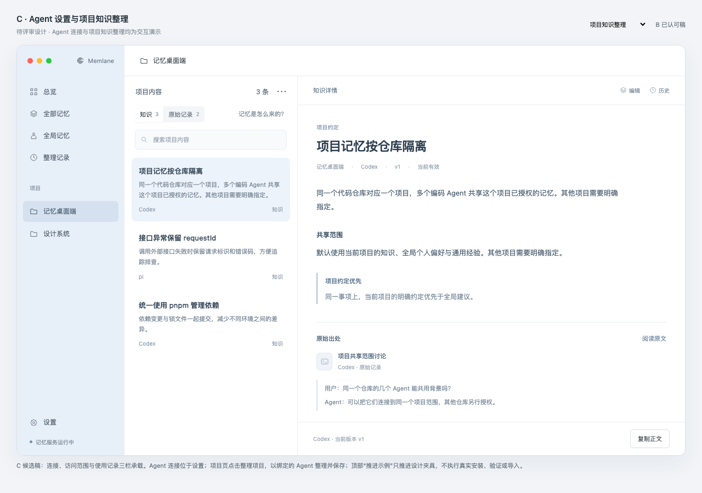
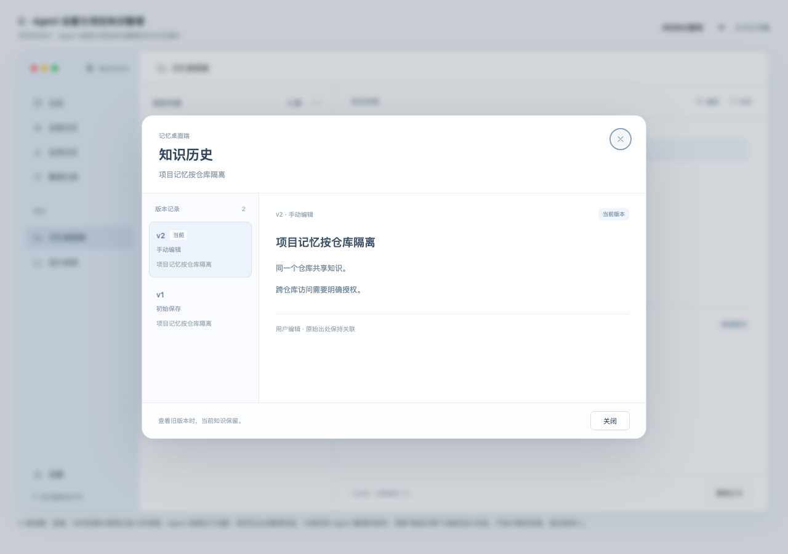

# C 项目阅读：①均衡阅读与历史弹框交接

2026-11-10，用户反馈「1不错，那个历史可以是弹框的形式呈现」。①均衡阅读作为选定项目阅读排布；历史按要求采用弹框。认可的是布局与承载方向，浏览器原型已完成该调整，Native页面、真实历史读取与最终包仍须分别验收。

同日用户进一步确认历史弹框「可以，继续推进后续的设计」。因此①项目阅读与当前历史弹框一并作为已认可设计交接；后续转入 D 日常记忆进入与复用，不代表相应Native工程已完成。

## 固定来源

- 原型分支：`prototype/selected-ui`。
- 本轮固定提交：`16bc644c799b0ec5ad8845654c2196a7ecf585aa`。
- 目录：`prototypes/ui-redesign-20261109/`。
- 项目阅读：`c-agent.html?state=project&context=project&project=memlane&layout=1&revision=11`。
- 历史弹框：相同路由加 `historyView=1`。
- 固定窗口截图与来源散列见 [截图目录](../images/ui-redesign/c-project-reading/archive.json)。

本交接在项目阅读与历史承载范围内补充 [C revision 7 交接](c-agent-handoff.md)。Agent设置、电脑级接入、绑定、历史会话授权、整理任务和Token边界继续按对应契约。不得将本次阅读认可写成全部 C、历史回补或Native生产能力已经完成。

## 选定阅读结构

普通窗口采用导航—列表—详情三栏。列表基准316px；知识与原始记录分别显示数量，列表有标题、摘要、来源及类型。右栏首先显示知识正文、范围与版本，出处位于正文下面，来源应指向独立原始材料，不能重复知识正文冒充出处。

筛选零结果不当作项目空库，不新增整理主按钮。知识为空但已有原文时明确显示已有材料；整理仍可跳过。直接保存且没有完整会话的知识如实说明，不补造原文。查看原文保持项目与知识选中项，提供返回。

编辑与保存在右栏完成。②正文优先、③出处对照保留为探索，不作为生产实现依据；默认不展示布局切换条。原型加 `compare=1` 才启用排布对照。

## 历史弹框

「历史」位于知识详情右上角，打开独立弹框。左侧倒序列出版本、初始保存／手动编辑与当前标记；右侧显示所选版本标题、正文与来源说明；默认选中最新版本。实际作者、时间与版本来自真实记录，没有证据时不编造。

查看历史不替换底层详情、不改变当前有效版本。保留选中项、正文滚动和后台任务；长正文只在预览区滚动。关闭使用叉号、底部关闭、Escape或遮罩；Tab焦点留在弹框内，关闭后返回「历史」入口。

历史查看本轮不增加恢复按钮。恢复旧版本生成新版本、版本冲突和来源状态仍按独立契约实现与验收。该弹框是用户明确要求的局部例外，不改变普通编辑与整理操作在栏内完成的规则。

## 证据与实施边界

本轮原型 `review-c-history-modal.cjs`：25项检查、6张截图、运行时错误0；覆盖版本切换、当前内容保持、关闭与滚动恢复、键盘、遮罩、后台任务、窄窗口及长正文。示例v2通过页面内存编辑生成，不是真实记忆库历史。首轮核验脚本的换行拼接错误保留在原型 `20261110-001/`，修正后的结果另存 `20261110-002/`。

选定阅读与三版对照的前一轮来源为 `1bcca47`；其旧的历史右栏断言不作为最新历史验证。新的Native实现必须核对：真实不可变版本与来源、打开和关闭时当前版本及任务保持、长正文与窄窗口、键盘焦点、实际包截图。浏览器截图、内存版本和用户设计选择不代表上述工程验收已经完成。
