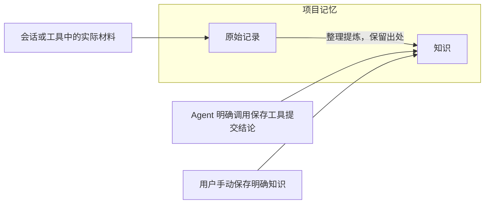

# 项目记忆、知识与原始记录

2026-11-09。用户指出“知识”和“记忆”混用，追问内容何时属于哪一种。本文明确既有产品规则与记录结构；项目页默认知识，并可切换原始记录。领域词汇统一见 [CONTEXT.md](../../CONTEXT.md)。

## 名称与关系

**记忆是整体名称，知识本身也是记忆。** 项目记忆包括实际保存的原始记录，以及明确供后续复用的知识；界面不把“记忆”再作为与知识并列的第三种内容类型。

| 概念 | 内容性质 | 具体例子 |
| --- | --- | --- |
| 会话 | 用户与 Agent 围绕任务的连续交互，可能产生多条材料和结论 | 一次接口异常排查，包含问题、尝试、日志和最终结论 |
| 原始记录 | 被实际保留的过程或原文，供核对与提炼 | 排查对话片段、工具返回的500日志、文档片段 |
| 知识 | 可维护、可复用的明确结论，保留范围与出处 | “接口异常需保留requestId”“本项目统一使用pnpm并提交锁文件” |
| 项目记忆 | 这个项目中原始记录和知识的整体积累 | 上面的原文、结论及其来源关系 |

会话不是记忆条目的计数单位。一段会话可以没有提交，也可以提交多条原始记录或多条知识。未提交到 Memlane 的聊天不视为已保存的原始记录，不因为 Agent 已连接就宣称全部会话已经采集。

## 知识产生的时机

1. Agent 以原始材料提交会话／工具片段：保存为原始记录，尚不能当作一条新增知识。
2. Agent 明确调用保存工具，将结论作为知识提交，并取得持久化回执：直接保存为知识，不必先进入原始记录再执行一次项目整理。具备工具不代表会自动调用；在对话中说出结论或声称“记住了”也不代表保存成功。
3. 用户手动新增明确内容：按既有规则视为用户确认的知识。
4. 整理任务从选定材料提炼结论：新建知识并关联来源，原始记录保留；不是把旧原文改名或删除。

来源可能是已保存原始记录，也可能是 Agent 实际提交的原文片段或文件引用。不能承诺每条知识都拥有一份完整历史会话。实际能够核对的出处与版本必须保留。

### 谁在什么条件下产生知识

普通编码 Agent 的日常接入提供检索和保存工具。例如，用户明确要求“记住本项目统一使用 pnpm”，Agent 实际调用 `memory_save(origin="knowledge", ...)`，服务返回 `persisted=true` 后，这条结论才成为已保存知识。这是工具能力和具体调用行为，不能描述为已连接 Agent 默认在每次会话结束时总结并提交。

官方采集与提炼是另一条流程：插件保留授权范围内的实际会话材料，官方提炼产生学习文档，Memlane 在同步时读取已持久化且已处理的文档，保存为知识并关联原始记录。当前已验证的 App 受控 Codex 任务使用显式任务与官方结束同步；该证据不覆盖用户日常全部会话，也不表示官方历史图谱自动覆盖 App 当前有效知识。

设计中的「记忆处理」通过用户当前启用的 Provider、已连接 Agent 或 Magpie 为提炼提供模型；「整理项目」与「补充项目知识」是用户主动启动的有界任务，各条真实执行路径仍分别验收。即使使用同一个 Agent，其编码会话与提炼执行也必须区分并隔离采集，避免处理结果被再次采集形成循环。

日常采集／同步在什么时机触发、哪些材料交给自动提炼，仍按 [D01 与待确认项](scenarios.md) 确定；本文不新增默认自动策略。原文实际保存后属于原始记录，提炼得到并实际保存的可复用结论属于知识。

保存成功、等待索引、索引完成、索引失败是另一组状态，均不改变内容类型。知识待索引仍是知识；原始记录完成索引也不会自动变为知识。知识并非根据字数、重要程度、保存时间或界面位置猜出来。

## 项目页的展示

- 侧栏项目是这一项目的整体记忆空间。
- 中间栏提供「知识／原始记录」两个页签，默认知识，分别展示各自数量与空态。
- 右栏对应「知识详情」或「原始记录」，原文阅读不套用“当前有效知识”的标签。
- 仅知识为空但已有原始记录时，不能表示整个项目没有记忆；日常会话材料仍可以积累，后续整理产生知识。
- 完全没有材料也可继续在已连接 Agent 中开始新会话。项目整理始终可选，不阻塞日常实际提交和记忆积累。
- 首次知识空态提供「整理项目」快捷入口；已有知识后可在项目「⋯」菜单选择「补充项目知识」，继续复用同一整理面板、历史会话选择和Token提示。

全文、日志、对话应保留为来源。知识详情可以阅读原始依据，但不能用知识正文的再次摘要冒充独立来源，也不能将“同一段话整理过”作为新的事实证据。

## 当前工程依据与实施边界

现有 `records.Mutation.Origin` 区分 knowledge、raw 及旧 imported 标记，`records.ListQuery.Kind` 支持知识／原始记录筛选。Agent 保存契约支持 `origin=knowledge/raw`；当前未传 origin 默认 knowledge，因此提交原始材料时必须明确标记 raw，不能依赖客户端事后猜分类。本文不修改接口或数据库。

C3 的新增摘要创建独立 knowledge 记录，保存派生来源；原材料仍保留。客户端 `recordKind` 按实际类型筛选。依据见 [Agent 保存契约](../agent-contract.md)、[记录定义](../../internal/records/types.go)、[保存实现](../../internal/store/store.go)、[整理契约](../p3-organization-contract.md)。

当前新项目页的切换、原文和补充入口是浏览器夹具；真实列表／来源读取、历史会话回补和新的Native页面按各自工程证据验收。词汇澄清不代表自动历史采集已实现。
