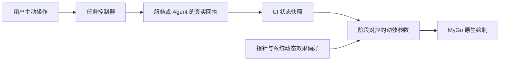

# MyGo 动效实施与复用契约

2026-11-09。用户要求明确记录项目知识整理动画如何在 MyGo 实现，并让后续动画可以达到类似效果。本文是生产实施交接；本轮只核对固定 MyGo v0.7.4 接口和现有代码，没有实现或验收新的 Native 动效组件。

项目知识整理的方块动效、空态、命名、历史会话选择和 Token 提示已随 C revision 7 认可。具体任务规则见 [项目知识整理](agent-settings-placement.md)，固定原型与实施入口见 [C 交接](c-agent-handoff.md)。

## 1. 所有后续动画共用的实现方式

生产继续使用 MyGo Native UI。复用设计的形状、颜色、目标坐标、层级、时序、缓动和状态含义，使用 Go 编写组件。HTML/CSS/JS 留在原型分支；导出 GIF 用于对照，不作为正式任务进度的播放源。

后续按钮归整、卡片进入、面板切换、加载、知识成形和完成标记统一遵循下图：

任务控制器拥有启动、取消、范围、尝试和结果。动画只读取状态：动画结束不宣布任务成功，绘制回调不安装组件、不运行 Agent、不读写知识，也不提交取消。窗口关闭或右栏离开停止绘制，真实任务是否继续由服务生命周期决定。

后续每份动画设计必须记录以下内容，不能只交付一张 GIF：

| 交接内容 | 必须明确的事实 |
| --- | --- |
| 触发与状态含义 | 哪个用户操作或真实事件触发；待开始、运行、完成、失败和取消分别表达什么 |
| 几何与层级 | 逻辑画布、锚点、形状、各阶段起点／终点、颜色、透明度、遮挡与阴影 |
| 时序 | 单次时长、错开间隔、缓动、循环条件、何时停止；时间用于插值而非判断业务完成 |
| 中断与重入 | 连续点击、阶段快速变化、收起／重开、旧回执和新尝试如何处理 |
| 系统偏好 | 减少动态效果的静态目标；纯视觉动作是否需要完全关闭 |
| Native 对照 | 固定原型、关键时刻帧、实际窗口截图、打包版本和未通过项 |

共用绘制、缓动、动态效果偏好与尺寸换算；各业务保留自己的阶段映射，不能为了复用强行使用同一个完成条件。

## 2. 已核对的 MyGo v0.7.4 能力

依据仓库 `go.mod` 固定版本、已下载的对应源码与文档核对以下接口。接口存在不等于新场景已经实测。

| 设计需要 | MyGo 原生接口与用途 |
| --- | --- |
| 方块、卡片、知识书、完成勾 | `Draw`／`DrawOver`、`Painter.Fill`／`FillPath`／`StrokePath`、`Path.Trim` |
| 颜色层次、光晕和阴影 | `FillGradient`、`FillRadialGradient`、`FillPathGradient`、`Shadow` |
| 位移、缩放、倾斜和书页翻开 | `Translate`、`Scale`、`Rotate`、`Skew`、`RotateX`／`RotateY`、`Perspective`、`TransformOrigin`、`BackfaceHidden` |
| 单值朝目标过渡 | `AnimateTo`、`ui.Animation`、`ui.CubicBezier`；目标改变时保留连续运动 |
| 一段动作或逐块错开 | `Keyframes`／`KeyframeOptions.Delay`；多对象配合使用 `Timeline`、`Tween`、`AtTime`／`AtLabel` |
| 按钮和卡片的轻微抬升／缩放 | `AnimatePose`，可只重绘而不重新构建整页 |
| 漂浮、起伏、扫光等循环 | `c.Now()`／`p.Now()` 与 `AnimationFrame()`；只在确实运动时请求下一帧 |
| 指针视差 | `PointerPosition`／局部坐标转换，限制旋转范围并缓动回位 |
| 系统减少动态效果 | `c.Preferences().ReduceMotion`；内置动画遵循系统偏好，自绘循环也必须显式停止 |

现有 [首次启动方块](../../internal/desktop/first_launch.go) 已使用 `preparationBlocksSized`、`Draw` 和 `c.AnimationFrame()`，将真实阶段与时间插值分开。现有 [窗口入口](../../cmd/memlane-app/main.go) 通过 `ui.View(app.View)` 绘制，并以 `win.Update` 接入后台状态。可以沿用这些边界；新项目知识舞台仍须重新实现和验收。

MyGo 的 3D 变换会把每个元素投影到父元素的平面，接近 CSS 的 `transform-style: flat`。原型舞台使用 `preserve-3d`，不能机械照搬 DOM 层级。当前方块的立体感主要由三个面组成，推荐在一个绘制面中画方块和卡片，再对整个舞台施加透视；两片书页可分别设置旋转原点和透视。需要保留单个方块的 Z 深度差时，在绘制前计算投影坐标，或使用独立平面并核对视觉，不能把侧面丢掉后仍称等价。

官方固定版本依据：[绘制](https://github.com/egoist/mygo/blob/v0.7.4/docs/ui/drawing.md)、[动效](https://github.com/egoist/mygo/blob/v0.7.4/docs/ui/motion.md)、[变换](https://github.com/egoist/mygo/blob/v0.7.4/docs/ui/transforms.md)、[系统偏好](https://github.com/egoist/mygo/blob/v0.7.4/docs/ui/styling.md)。

## 3. 生产组件与复用边界

建议在 `internal/desktop/` 下建立共用动效辅助模块，包含几何绘制、颜色与时序参数、尺寸换算和减少动态效果处理；组件名称与目录在实施时确定，本文不声称这些文件已存在。

项目场景作为独立 `ProjectKnowledgeScene` 组件，按钮动效和环境准备组件复用辅助能力。避免把新舞台继续堆进 `App.View`，也不另造一套全窗口持续运行的动画引擎。

建议的 UI 输入如下；这是拟采用的组件输入，尚不是服务 IPC 字段：

| 输入 | 作用 |
| --- | --- |
| 项目身份、任务身份、尝试号 | 区分场景与当前尝试，拒绝旧状态覆盖 |
| 当前阶段与阶段变化序号 | 决定目标形状；仅阶段变化重启对应过渡 |
| 首次／后续补充意图及仓库／历史会话选择 | 显示本次固定范围，不因动画或阅读其他知识而改变 |
| 是否可见、是否减少动态效果 | 决定是否绘制循环和使用静态目标 |
| 指针局部位置 | 只影响轻微视差，不改变业务状态 |
| 当前绘制区域 | 换算逻辑坐标、裁切与字号；不决定任务进度 |

每个场景和方块使用稳定 `Key`。不要用帧时间、随机值、Token 数或每次收到的进度值当元素 Key。同一阶段收到更新只更新文字／数据，不重播整段入场。`TimelineOptions.Run` 与 `KeyframeOptions.Run` 只在阶段或尝试确实变化时更新。

阶段快速变化时，从当前显示位置朝新目标继续；不额外等待一段动画结束。重开面板读取当前任务快照，不重新启动 Agent；动画恢复当前阶段即可。任务取消、失败或新尝试出现时，停止旧循环并隔离旧回执。

在 `Draw` 中只读取事先取得的快照和动画数值。MyGo 可能在同一帧多次调用绘制，不能在其中推进阶段、追加条目或计费。关键帧／时间线的对象只在本帧构建期间有效；绘制回调捕获计算出的标量或几何快照，不持有上一帧的时间线对象。

## 4. 当前项目知识舞台的精确参数

以原型 `project-initialization.js`、`project-initialization.css` 为主，使用逻辑坐标按右栏等比换算。基准场景宽度最多560，常规高度280；项目空态预览高度300。窄／矮窗口正文舞台高度150，空态预览高度210。真实 MyGo 的窗口最小尺寸仍以当前窗口契约为准，浏览器800×720截图不自动更改 Native 限制。

主要绘制层从后到前是光晕与地面网格、仓库卡片、方块、知识卡片、完成时的记忆书和标记。保持浅色背景、单色按钮以及三个面的明暗关系。

### 形状与目标位置

- 24个方块，归整为6列×4行。间距22；方块正面14×14，顶面和侧面厚度约5。顶面浅、侧面深，原型分别使用 `#dce7f1`、`#7995ae`，正面渐变 `#c2d4e4` 到 `#8caac4`。
- 方块中心锚点约为场景横向47%、纵向53%。归整目标：`gx=(i%6-2.5)*22`，`gy=(floor(i/6)-1.5)*22`。
- 散落布局是固定分布，不逐帧重新随机：`angle=i*2.39996`，`radius=34+sqrt(i)*15`，`sx=cos(angle)*radius`，`sy=sin(angle)*radius*0.66`。保留每个方块的稳定序号、初始旋转与深度参数。
- 仓库卡片约90×106，知识卡片组宽136；记忆书约146×132，由左右两页和完成标记组成。原型使用两个伪元素拼方块面，生产用路径／面绘制。
- 地面网格和阴影是淡色装饰，不显示百分比、文件数、Token 数或实际完成量。

### 动作与阶段

| 阶段／交互 | 原型参数与 Native 映射 |
| --- | --- |
| 空态按钮悬停／键盘聚焦 | 仅预览归整：700ms，方块按序错开20ms，缓动 `(0.2,0.7,0.2,1)`；不创建任务、不修改阶段 |
| 待开始 | 固定散落点上下漂浮，6s循环，各块错开负220ms；纵向幅度7，缩放约0.75到0.8 |
| 启动 Agent | 朝归整点移动850ms，逐块错开25ms，缓动 `(0.2,0.7,0.2,1)`；完成移动后等待真实启动回执 |
| 整理项目／历史会话 | 在归整点起伏，1.7s循环，各块错开负90ms；纵向幅度4，缩放最低0.86；阶段由实际任务结果推进 |
| 保存知识 | 800ms汇入知识卡片，逐块错开30ms；目标向右约145、向上约10，缩放至0.2并淡出 |
| 建立索引 | 卡片扫光1.6s循环，三张卡片错开0／250／500ms；知识已保存但尚未可检索 |
| 完成 | 卡片向中心收束并淡出；书体850ms从缩放0.6、下移20和透明过渡到就位；两页900ms由约±78°展开；完成标记延迟550ms，再用350ms出现 |
| 失败／取消中／已停止 | 方块停在归整形状，透明度约0.35；停止漂浮、扫光和连接提示，不出现完成书或完成勾 |

舞台指针归一化到 `x,y∈[-0.5,0.5]`：X轴旋转为 `-y*7°`，Y轴旋转为 `x*10°`，因此最大实际角度分别约3.5°和5°；原型透视距离750、回位缓动约300ms。书页单独透视600、以内侧边为旋转原点。Native 以对应的 `RotationX/Y`、`Perspective` 和 `TransformOrigin` 实现并实机核对。

负的错开值表示循环相位，Native 可按各方块的相位采样周期，不把它当成负的启动等待。循环通常使用 `EaseInOut`；保存汇入使用 CSS `ease-in` 对应的缓动，完成书体与书页使用 `(0.2,0.8,0.2,1)`。

这些参数是表现时长。不能用“850ms后已连接”“6秒后完成”推进真实任务，也不能据此生成知识数或模型用量。原型的「播放完整动效」是评审夹具，生产删除其自动推进逻辑。

## 5. 减少动态效果、离开与能耗

系统 `c.Preferences().ReduceMotion` 或 App 减少动态效果任一启用时，使用该阶段的静态目标，关闭漂浮、视差、扫光与按压位移；保留阶段文字、固定范围、错误与主操作。

`c.DisableAnimations()` 可使朝目标变化的值／姿态立即就位，但不会停止独立关键帧和时间线。自绘循环必须明确不请求下一帧；需要立即就位的独立时间线使用静态目标或 `Seek`，不能只调用 `DisableAnimations`。

几何循环优先在舞台绘制中使用 `p.Now()` 和 `p.AnimationFrame()`；常规控件的轻微位移优先 `AnimatePose`。只在可见、未减少动态效果且当前阶段需要运动时继续请求帧。完成、失败、取消后过渡收敛即停止请求；移出右栏、窗口不可见或退出后不保留60Hz全局定时器。

动画渲染与任务生命周期分开：停止渲染不取消服务任务；真实任务不得依赖只有窗口可见时才运行的动画回调。静态几何／SVG只需准备一次，避免逐帧解析资源、生成随机位置、查询数据库或创建无界对象。

## 6. 实施顺序与验收

1. 在 MyGo 当前右栏中实现静态舞台，核对方块三个面、卡片、光晕、书页、颜色、裁切和逻辑坐标缩放。
2. 实现单阶段运动、错开、透视和指针回位，再实现阶段间过渡。先用明确的隔离视觉夹具验证，不启动真实 Agent。
3. 接入真实服务快照、任务启动和取消；核对项目与历史会话范围、尝试隔离、保存与索引分开，以及读取旧知识后回到同一任务。
4. 构建包含 helper 的验证包，在实际窗口中截取相同阶段／时间点，对照原型图和动效。验证默认窗口、最小窗口、Retina缩放、中文文字、减少动态效果、快速切换和失败／取消。
5. 测量实际运动帧时间、CPU及静止时刷新；60Hz显示下以约16.7ms帧预算评估流畅度，实测结果写入验收记录，不由24个方块或编译通过推断性能通过。

验收至少证明：稳定阶段不反复重播；重复点击不重复启动；收起／重开不丢任务；旧尝试状态不覆盖新尝试；结束或隐藏后不持续请求动画帧；减少动态效果没有残留循环；动画完成不写数据、不触发任务完成；完整包真实阶段能得到对应画面。

当前已通过的是浏览器原型状态和渲染、固定 MyGo 接口核对及既有 Native 方块机制。新舞台、空态交互、完整视觉一致性、真实任务与性能尚待实施，不将其中任一证据替代整体验收。
